# Safari Ride: a tour of a real Roc program

A long walk through one program of about eighty Roc modules: the big picture, the details, and the big picture again.

## Introduction

Safari Ride is a program written in Roc, and it runs in the page below. It takes a moment to load. When it's ready, a ride starts by itself.

```widget ride
The ride, running as you read. Click it to give it the keyboard: Space pauses, and the arrows step.
```

This is Safari Ride. A rider cycles down a long road through open country, past trees, cows and pigs, with a truck somewhere ahead. Radio towers blink in the distance. A bird takes off as the rider comes near. A cat walks into the lane, freezes, and leaps for the far verge. The sun goes down behind the mountains, and the truck turns on its headlights.

Safari Ride has the important parts of a game's world: terrain, physics, a camera, things that react to the player, and a day that ends. It doesn't have game mechanics yet. Nothing keeps score.

A safari is a guided tour, so this is a tour of a tour. We'll start with the big picture, hold one frame still to see what's in it, let it move, and zoom back out at the end. You'll get to see how Roc holds up in a program with a lot going on.

We assume you can already read Roc. If you can't yet, the official tutorial is the place to start. We'll point out a few Roc ideas in each chapter as they come up.


## The problem

Here's the problem Safari Ride has to solve. We design a world once. Then, each time the clock steps, we move what moves, find everything near enough to see, and draw it against the backdrop.

The problem, as a loop
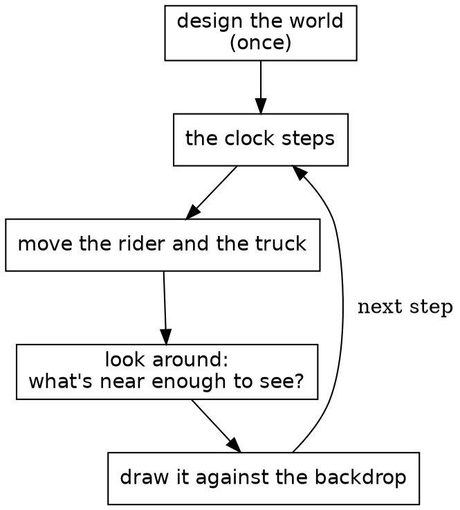

It works like a flipbook, the little stack of drawings that seems to move when you riffle the pages with your thumb. Each page is drawn whole. Safari Ride draws a page about thirty times a second. The code calls a page a frame, and a turn of the loop a step.

The most interesting box is the middle one: looking around. On a real safari, a guide scans the land and calls out what's there: a cat by the third tree, a bird on the far side. We'll call each of those a sighting. A sighting is only true for the moment it's made, so Safari Ride throws them all away and makes new ones for every page.

Next, let's look at what one of those boxes looks like in Roc.

## One whole module

A module of Safari Ride is one file of Roc. This chapter shows one from top to bottom, and it starts with a line that doesn't compile. Here we try to add 7 to the ride's clock:

{{fails clock_plus_seven}}

New in this chapter:

- Roc: opaque types, `is_eq : _`, `expect`, static dispatch
- Modules: `Clock`

This is the module that stops that line, all of it.

{{module Clock}}

Most of Safari Ride's small modules look like this: a comment saying what the thing is, some imports, and one type named after the module.

`Clock :: U32.{ ... }` defines an opaque type. Underneath, a `Clock` is a `U32`, and the block after it holds its methods.

`Clock.(n)` wraps a number into a `Clock`. In a parameter list, it does the opposite and unwraps one. Only this module can do either, which means no other module can add 7 to a clock, or pass a count of trees where a clock is expected.

`is_eq : _` asks Roc to derive equality for us. Below the type, each `expect` is a test, and `roc test` runs them all.

Safari Ride calls it once a step, like this:

{{code RideInstant.next from "clock = instant.clock.next()" to "clock = instant.clock.next()"}}

`instant.clock.next()` is static dispatch: `next` comes from the type of `instant.clock`, so the call needs no import.

Because a clock is an ordinary value, a test about one fits on a single line. The `expect` above that starts at step 5,699 uses `Clock.at_step` to get there directly, so the test doesn't have to run the ride for 5,699 steps first.

That's one module out of about eighty. In the next chapter, we'll see how the rest fit together.

## The modules

This chapter shows how the modules fit together, starting with the whole system, simplified.

Each arrow points from a module to a module it imports. A dashed box stands for a family of modules. Roc doesn't allow import cycles, so no arrow can point back up the diagram.

The whole system, simplified
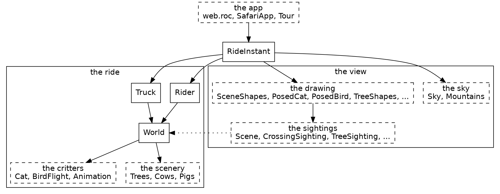

New in this chapter:

- Roc: imports that can't form a cycle
- Modules: `SafariApp`, `Scene`, `SceneShapes`, `CrossingSighting`

There are two halves. The ride is `Rider`, `Truck` and `World`. `World` puts the route together from its scenery and critters. Nothing in the ride knows anything about drawing.

The view is everything that turns the ride into a picture. The sightings work out what's visible, and the drawing code makes its shapes. The dotted arrow shows the view reading the ride. No arrow goes the other way.

`RideInstant` sits above both halves. It holds one instant of the ride and steps to the next. The browser only ever sees `SafariApp`, which gives it a list of shapes each frame.

### The part that isn't Roc

One tick across the line between JavaScript and Roc
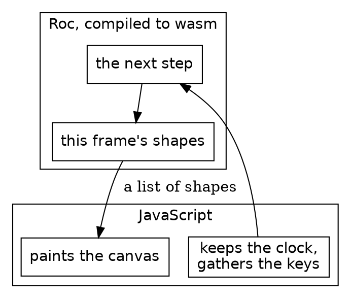

Safari Ride runs in a browser, and that takes a thin layer of JavaScript. The Roc compiles to wasm. Each step, the JS keeps the clock, gathers the keys, and calls into Roc. Roc answers with a list of shapes, and the JS paints them on a canvas. The JS knows nothing of cats, and the Roc knows nothing of canvases. The whole game is on the Roc side of that line, and the same app also runs natively. `canvas_apps/ARCHITECTURE.md` has the details, and the platform chapter comes back to it.

### What's a sighting?

At step 1,570 of the ride, a cat is frozen in the lane. This is what `CrossingSighting` answers about it on that frame:

| Field | Value |
|---|---|
| `right` | 0.32 metres |
| `forward` | 30.42 metres |
| `pose` | `Frozen` |
| `lift` | 0 |

That's a sighting: where the rider sees something, and how it should look.

Most things in the view come in pairs, and the names say which half is which: `CrossingSighting` and `PosedCat`, `TreeSighting` and `TreeShapes`, `TowerSighting` and `Tower`, `TruckSighting` and `TruckAhead`.

A sighting answers one question each frame: which of these can the rider see right now, and how should each one look? `CrossingSighting` goes through the stretches of road ahead, which Safari Ride calls segments, asks `Cat` where it is, works out where that lands in the rider's view, and drops any cat behind the camera or too small to matter. What it hands back is a plain record with no drawing in it:

{{code Pipeline.Sighted}}

`Scene` gathers every sighting's answer. `SceneShapes` renders each one through `Pipeline.rendering_of`, which asks the kind's own module for a picture and attaches the depth, making a `Rendered`, and a depth sort puts those in order, far to near. Because a sighting's answer is plain data, it can be checked with numbers, without drawing anything. So a sighting decides what's visible, and the drawing code only paints what it's told.

Cows, pigs and the other animals by the road are all sighted the same way, by `BillboardSighting`, which decides which of them get drawn. `Detail` holds the thresholds behind that kind of decision: how near a tree shows its full detail, and how few pixels tall something may be and still be drawn.

Everything in this chapter happens within a single frame, and none of it survives to the next one. Very little carries over from step to step, and we'll come to that. First, let's hold one frame still and see what's in it.

## The world

Some of Safari Ride never changes. Trees, cows, the pond and the road are built once and only read after that, which makes them the easiest part of the program to read, so the tour starts there.

```widget route
The whole route in one picture. The white stretch is segment 7, and the lines under the map read out its record.
```

Each stretch of this map is one record of a list called `World.plans`, and the lines under the map read out the one in white. The marks on the map are the six segments with a cat or a bird. We drew the map for this page: the ride itself never has one.

New in this chapter:

- Roc: void modules, tag unions written in a field's type, `match` that has to cover every tag, `crash`
- Modules: `World`, `Pond`, `Trees`

The modules around `World`


A piece of the world can be just a value. Here's the second whole module. `Pond` is a void module: a type with no values, whose block holds definitions. This one has two record aliases and six ducks.

{{module Pond}}

Above its `expect`s, there are no functions here at all. The ducks are read where the critters are sighted:

{{code BillboardSighting.bend_life_billboards}}

`World` turns a route, a plain list of records, into segments of road. A plan for a segment shows how much tag unions can do with no declaration. `[WithBull, NoBull]` is written right in the field's type, and it says more than a boolean would at every place a segment is written down.

{{code World.SegmentPlan}}

A `match` on a closed union has to cover it: leaving out a tag is a compile-time error.

{{code Trees.accent_conifer}}

Here's where it's called, picking the color for a pair of small trees:

{{code Trees.roadside_trees from "match $conifer {" to "Green => accent_conifer(scheme)"}}

`SegmentIndex` is another small opaque type, a `U32` for a segment's place in the route. A place in the route can't be confused with a count of trees, because nothing outside can do arithmetic on it. `crash` appears here too. It isn't for error handling: an index that isn't in the world is a bug in Safari Ride, not a case to handle.

{{code Route.segment_at}}

A value that never changes can be checked once, whole. `Pond`'s one function is below its block, and it's there for a test:

{{code Pond.is_on_water}}

The `expect` under it, in the module above, runs that over all six ducks. One line covers the whole pond.

Nothing in this chapter moves, and that's true of the next few chapters too, as we go through what's on one page of the flipbook. First, a word about what a page is made of.

## Shapes

Before we draw a tree, we need to know what drawing means here, because our Roc app doesn't draw anything. For each frame, Roc answers with a list of shapes, and a painter puts them on a canvas. The painter on this page is JavaScript. It could as well be a wasm host, written in Odin or Zig, say, and the Roc wouldn't change. A painter is a bit like a printer: it does what the list says, and nothing more.

New in this chapter:

- Roc: a record taken apart in a parameter list, `Try`
- Modules: `TwoShapes`, `Shapes`, `Polygon`, `Screen`, `Pixels`, `Picture`, `Ground`

### Get the types right

Three types carry everything a frame paints:

| Type | What it is |
|---|---|
| `Screen.Point` | A place on the canvas, as an `x` and a `y` in `Pixels` from its top left |
| `Shapes.Shape` | One item in a frame's list, such as a polygon |
| `Picture` | The shapes that paint one object, in the order they're painted |

Safari Ride's frames are for a canvas 960 pixels wide and 600 pixels tall, and `y` grows downward. `Pixels` is a length on the screen. It's opaque like `Clock`, and it's an `F64` underneath, because a corner can fall between two pixels. A `Screen.Point` is a record of two of them:

{{code Screen.Point}}

`Screen.point(x, y)` makes one from two plain numbers.

A frame is a list of `Shapes.Shape`:

{{code Shapes.Shape}}

Each tag here carries a value in parentheses, called its payload. A `Poly` carries a record of its coordinates and its fill, and a `Disc` carries its center, radius, fill and clip. A conifer comes back to payloads. A fill is a `Brush.Fill`, another tag union: `Flat` with one color, or one of several kinds of shading and gradient.

That type serves every app under `canvas_apps`, so some of its tags are for apps other than Safari Ride. `Image`, for example, is for a pixel paint program. Two of its tags, `Blend` and `View`, aren't shapes at all. They're marks that change how the shapes after them are painted. A frame of Safari Ride often holds more than 2,000 shapes, and nearly all of them are `Poly`.

Here's a frame with a triangle and a rectangle in it:

```widget shapes
The list `TwoShapes.shapes`, painted over a plain background, on a smaller canvas than the ride's.
```

It's made like this:

The two shapes, from the top
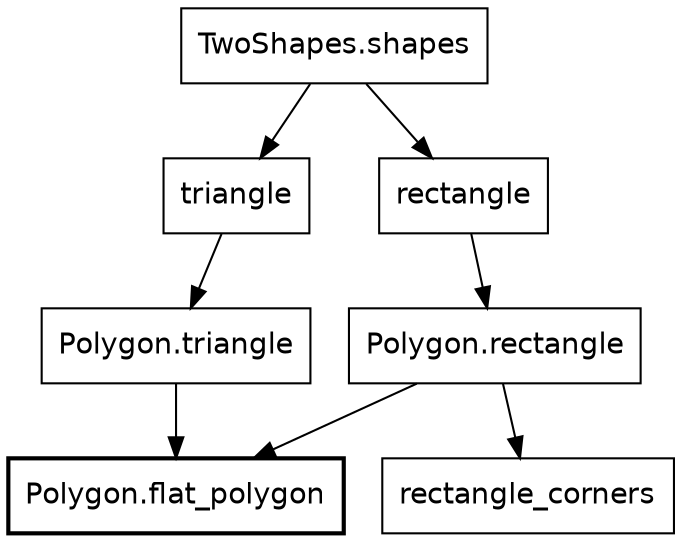

A box is a definition, and an arrow points to a definition it uses. The top three are values, made once. The rest are functions in `Polygon`. The widget adds one more shape of its own, the plain background, at the front of the list.

### The functions

Here's the whole of `TwoShapes`:

{{module TwoShapes}}

A color is a whole number in hex, with the six digits a web page writes after its `#`. `0x2e8b57` is a green, and `0xe8a33d` is an amber.

`Polygon.triangle` doesn't put a triangle on the canvas. It makes a value that describes one. Every maker in `Polygon` works this way, and each gives back one shape. The triangle hands its three corners to `flat_polygon`:

{{code Polygon.triangle}}

The triangle takes two arguments: a color, and a record of three corners. Between the bars, `{ first_corner, second_corner, third_corner }` takes that record apart into three names. A caller gives all three by name, in any order, and can't leave one out.

`Polygon.rectangle` takes two opposite corners, and `rectangle_corners` works out all four, clockwise from the top left. Either way, `flat_polygon` makes a `Poly` of one color from a list of corners:

{{code Polygon.flat_polygon}}

`Brush.opaque` turns a hex color into the color a painter wants, with no transparency, and `Flat` wraps it as a fill of one color.

So our rectangle is a `Poly`, not a `Rect`. A rectangle is just a polygon with four corners, so it goes through the same `flat_polygon` as a triangle or a tier, and every polygon reaches the painter the same way.

A polygon needs at least three corners, and `polygon_coordinates` checks:

{{code Polygon.polygon_coordinates}}

Fewer than three would be a bug in Safari Ride, and a bug shouldn't quietly paint nothing, so it crashes. `maker` names the function that asked, so the crash says where the bug is.

Some things can rightly have nothing to show. A `Ground.Patch` is a patch of ground, a list of corners on the ground and a color, and one wholly behind the camera has nothing to show. So `Ground.patch_shape` answers a `Try`:

{{signatures GroundPatch.patch_shape}}

Its second argument is the lens's focal length, in pixels, which turns corners on the ground into places on the screen. A simple tree says more about the lens. A `Try` is either `Ok` holding a shape, or `Err` holding a reason, here `BehindCamera`. Both answers are in the type, so whoever calls `patch_shape` can't forget the ground behind the camera.

### Pictures

Something made of several shapes is a list of them. A tree is nine: a trunk and eight tiers of foliage. The shapes that paint one object, in order, make a `Picture`:

{{signatures Picture.from_shapes Picture.to_shapes}}

`Picture` is opaque, and a `List(Shapes.Shape)` underneath. Outside its module, a picture is one thing, handed along whole until something paints it.

The order of a list is the order of painting, so in our frame the rectangle covers part of the triangle. A frame paints the backdrop, the mountains and the ground first, then a series of pictures, far to near.

For the next few chapters, the work is choosing corners and choosing their order. Before the first tree, though, we need the few types that every object along the road goes through.

## Nature types

The ride has six kinds of object: trees, towers, billboards such as the cows, the cat, the bird and the truck. Each kind is drawn its own way, and each kind's sighting module finds its own objects on the road. After that, every object takes the same steps: it's seen from the camera, drawn, and paired with a depth, so that it can be painted in order with all the others, far to near. Written once for each kind, those steps would be the same code six times over. Safari Ride writes them once, in `Pipeline`, and each kind says only how tall it is and how it looks.

New in this chapter:

- Roc: defining a type with a type variable, `where`
- Modules: `Geom`, `Along`, `Across`, `Billboard`

`Pipeline` and `Rendered` came up in The modules, and here we look at them properly.

### Three forms and a kind

An object takes three forms on its way to the screen:

1. Placed: it stands at a spot on the road, measured along and across a segment.
2. Sighted: the camera sees it some distance to the right and forward.
3. Rendered: it's a picture, with a depth that says how far ahead of the camera it stands.

A sighting and a rendering last one frame. How long a placing lasts depends on the object. A tree or a cow is placed on the road once, when the world is built, and stays there for the whole ride. A cat moves, so it's placed anew for each frame.

The first two forms hold the object's kind. A kind, such as `Conifer` or `Billboard`, holds how the object looks right now, and never where it is. The forms around it hold where. A kind is asked for its height, to see whether the object stands tall enough on the screen to draw, and for its picture, which goes into the rendering. A rendering keeps the picture and not the kind.

`Conifer` is one of four tags, `BigGreen`, `SmallGreen`, `Red` or `Gold`, and the tag alone settles a tree's height and color. `Billboard` is a record of an emoji's codepoint, a height and which way it faces, and a cow, a pig or one of the ducks on the pond is one. Neither has a field for a place.

### Get the types right

| Type | What it is |
|---|---|
| `Geom.Placed(kind)` | An object on the road: `along` and `across` its segment, and its `kind` |
| `Pipeline.Sighted(kind)` | All of that, where its segment lies from the rider as `place`, and where the rider sees it, `right` and `forward` of the camera |
| `Picture.Setting(context)` | What a kind draws from: `right` and `forward`, the lens's focal length as `cam_focal`, and a `context` for whatever else the kind needs |
| `Picture` | The object's shapes, in order, from the Shapes chapter |
| `Rendered` | The object's `picture`, and its `depth`: how far ahead of the camera it stands |

One object through one frame
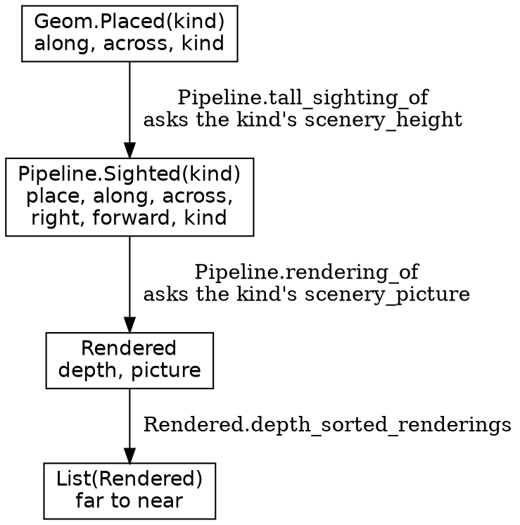

A box is a type, and an arrow is a function that makes the next one. The kind goes in at the top and comes out of `Pipeline.rendering_of` as a picture. `Rendered` has no kind, so a tree's rendering and a cow's are the same type, and every rendering in the frame goes in one list for the depth sort.

### A type with a type variable

We've used types that take an argument since Shapes. A `Picture` is a `List(Shapes.Shape)` underneath, and a `List` can hold any one type, named in its parentheses. `Geom.Placed` is a type of our own that works the same way:

{{code Geom.Placed}}

The `kind` in its head, `Placed(kind)`, is lowercase, and that makes it a type variable: a name for whatever type goes in the parentheses. The fields use it like any other type. So `Geom.Placed(Conifer)` is a record of an `along`, an `across`, and a `kind` that holds a `Conifer`, just as `List(Shapes.Shape)` is a list that holds shapes. A cow is a `Geom.Placed(Billboard)`.

`Along` is a place along a segment, and `Across` is a place across the road, measured from its middle. Both are opaque, like `Clock`, so passing one as the other is a compile-time error.

A type's head declares its variables. A function's annotation needs no head: a lowercase name in it is a type variable, and it means one type wherever it appears in that annotation. `Pipeline.sighting_of` takes a `Geom.Placed(kind)` and answers with a `Try` that holds a `Pipeline.Sighted(kind)` when the object isn't behind the camera. Both name the same `kind`, so a placed conifer can only come back as a sighted conifer, never as a sighted cow.

`Picture.Setting(context)` has a variable named `context`. A conifer's context is `{ nearer_tree_count : U16 }`, how many trees are nearer than it. A billboard needs nothing more, so its context is `{}`, the empty record.

### Asking a kind by name

`Pipeline` imports neither `Conifer` nor `Billboard`, and neither of them imports `Pipeline`. Yet `Pipeline.rendering_of`, the one function this chapter shows in full, gets a picture out of either one:

{{code Pipeline.rendering_of}}

It hands the sighting's `right` and `forward`, the lens and the context to the kind's own `scenery_picture`. It answers with a `Rendered`: the picture it gets back, and the sighting's `forward` as the depth.

The second line of the annotation, indented under the first, is a `where` clause. Its square brackets hold a list of requirements on the annotation's type variables, here one. `kind.scenery_picture : kind, Picture.Setting(context) -> Picture` says that the type `kind` has a method named `scenery_picture`, of the type after the colon. A kind meets it by having a method of that name and that type. `Conifer` has one, and so does `Billboard`. Neither says it meets a requirement, and no interface names the two. The name and the type are the whole contract, and the compiler checks them wherever `rendering_of` is called.

`context` appears twice in the annotation, in the record and in the `where`, so the context a caller passes has to be the one its kind's `scenery_picture` wants. Pass `{}` as a conifer's context, and Safari Ride doesn't compile:

{{fails conifer_without_context}}

`Pipeline.tall_sighting_of` asks for a kind's height the same way, with `where [kind.scenery_height : kind -> Distance]`, where a `Distance` is a length in metres. It finds the sighting, then asks the kind for its `scenery_height`, to see whether the object stands tall enough on the screen to draw. A tower and the truck skip that test, through `Pipeline.sighting_of`, which has no `where` at all.

Because a name and a type are the whole contract, the name has to say what it's for. A kind could well have a method called `height`, of type `kind -> Distance`, that measures something else, and a `where` clause that asked for `height` would take it without a word. The first word of `scenery_height` and `scenery_picture` says that the method is there for the objects along the road, so a kind meets the contract only on purpose.

Trees, towers, critters and the truck all go through these forms. The grass, the sky, the sun, the mountains and the road don't, and the rails make their `Rendered` by hand. The next three chapters are about trees.

## A simple tree

Let's draw a tree. Forget the road for now, and the rider, and the ride. All we know is what kind of tree it is, and where it stands from the camera.

Drawing a tree and placing trees along a road are two nearly separate problems. This chapter and the next draw one tree. The chapter after that, Roadside trees, puts trees in the world, relative to the road and the rider.

A tree is a trunk under eight tiers of foliage, and a far tree's tiers are flat triangles. Every tree a long way off is drawn exactly this way. The tree's kind decides how tall it is and what color.

New in this chapter:

- Roc: nominal types, record update, one branch for two tags
- Modules: `Conifer`, `TreeShapes`, `Distance`, `Fraction`, `Camera`

### Get the types right

A tree passes through these types on its way to the screen:

| Type | What it is |
|---|---|
| `Conifer` | A tree's kind: `BigGreen`, `SmallGreen`, `Red` or `Gold` |
| `Distance` | A length in metres, opaque like `Clock` and an `F64` underneath |
| `TreeShapes.TreeAhead` | A tree as `TreeShapes` sees it: `right`, `forward`, `height` and `foliage_color` |
| `Geom.RaisedPoint` | A point in the rider's view: `right` and `forward` of the camera, and `height` above the rider's level, negative where the ground curves away |
| `TreeShapes.TreeOutline` | Where a tree lands on the screen, and how big it looks there, in `Pixels` |
| `TreeShapes.Tier` | One layer of the crown, as fractions of the crown |

A conifer draws from a `Picture.Setting({ nearer_tree_count : U16 })`, the setting from Nature types with the count of nearer trees as its context.

Each step of the job is a signature:

| Job | Function | Its type |
|---|---|---|
{{types row Conifer.scenery_picture Draw a conifer}}
{{types row TreeShapes.tree_picture Draw a tree of any height and color}}
{{types row TreeShapes.tree_outline Find it on the screen}}
{{types row TreeShapes.tier_triangle Make one tier}}

One tree, from the top
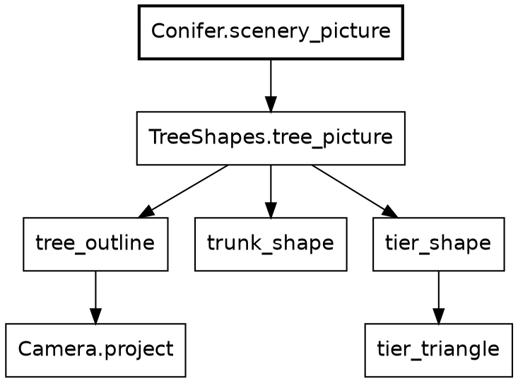

A box is a function, and an arrow is a call. `Conifer.scenery_picture` is the only box that knows the kind. It works out a height and a color from the kind, and everything below it works from those and never learns the kind. `Conifer` imports `TreeShapes`, and `TreeShapes` doesn't import `Conifer`, so a fifth kind of tree wouldn't touch a line of `TreeShapes`.

### The functions

Here's all of `Conifer`:

{{module Conifer}}

`Conifer := [BigGreen, SmallGreen, Red, Gold].{ ... }` is a nominal type. Like `Clock`, it carries a block of definitions. Unlike `Clock`, it isn't opaque. The one symbol that differs, `:=` here against `::` for `Clock`, is what decides that. Because it isn't opaque, other modules can use its tags. `Trees.accent_conifer`, back in The world, picks `Gold` for a scheme of gold and green.

No tree stores its height. `scenery_height` works it out from the kind, so there's no stored copy to disagree with it. In `foliage_color`, `BigGreen | SmallGreen =>` is one branch for two tags, because both greens share one color. The first `expect` checks a list of pairs. Each pair in parentheses is a tuple, a fixed group of values whose types needn't match, and `all` checks every one.

`scenery_picture` takes the kind and a setting, and the bars take the setting apart, as `Polygon.triangle` did with its corners. The tree's `right` and `forward` go on to `TreeShapes.tree_picture` with its height and color, in the record that function wants.

`tree_picture` finds the tree on the screen, then makes a trunk and eight tiers.

{{code TreeShapes.tree_picture}}

`tip` is the top of the tree, as a point in the rider's view. `trunk_shape` makes the trunk, a rectangle, and `tier_shape` makes each tier. `tiers.map(...)` calls it for every tier and gives back the list of answers, and `[trunk].concat(...)` puts the trunk first, so the tiers paint over it. What `trunk_finish` and `crown` do for near trees can wait, but notice the tags in `trunk_finish`. `Shaded` and `Flat` are written on the spot, as in The world, and this `Flat` has nothing to do with the fill `Flat` from Shapes. Two tags with one name in two unrelated unions are two different tags. For a far tree, `tier_shape` answers with `tier_triangle`, and the next chapter shows the rest of it.

`Camera.project` turns a point in front of the camera into a place on the screen, and `cam_focal` is the lens's focal length, in pixels. `tree_outline` calls it twice, once for the tree's foot and once for its tip. The difference between them is how tall the tree looks.

{{code TreeShapes.tree_outline}}

`{ ..tip, height: Distance.zero }` is a copy of `tip` with a new `height`, and `tip` itself doesn't change. That copy is the tree's foot.

The trunk and the crown split the tree's height between them:

{{code TreeShapes.trunk_height_share}}

{{code TreeShapes.crown_height_share}}

A `Fraction` is a number from 0 to 1. `Fraction.of` makes one, and it crashes on a number outside that range, because a ratio out of range is a bug in the sum behind it. `complement` is one minus a fraction, so the two shares add up to 1 by construction.

### Triangles

A tier is three fractions:

{{code TreeShapes.Tier}}

`tiers` is a list of eight of these, and each overlaps the next. A tier is one triangle, worked out in pixels, with its apex on the tree's middle line and its base across the tier's bottom:

{{code TreeShapes.tier_triangle}}

That's a tree, and from a distance nobody can tell it's flat. Ride close to one, though, and it looks like cardboard.

## A conifer

A near tree needs to look round, and it has to fatten as you ride past it. So Safari Ride draws two styles of crown: flat triangles far off, and 3-D cones up close. The tree is still alone in front of the camera, and the road can wait one more chapter.

New in this chapter:

- Roc: a payload that exists only where it means something, a guard, a list pattern that takes from the end
- Modules: nothing new

### Get the types right

The whole decision is one type:

{{code TreeShapes.Crown}}

The square brackets list everything a `Crown` can be. This is a tag union, as in The world, and `Cones` and `Triangles` are its tags. A tag is a capitalized name, and it needs no other declaration. So far a `Crown` is one of two names.

The parentheses are where it goes further. As in Shapes, a tag can carry a value, its payload. The payload of `Cones` is a record with one field, `shade`, and `Triangles` has no payload at all. So a `Crown` is written one of two ways:

| Value | What it says |
|---|---|
| `Cones({ shade: Fraction.of(0.5) })` | Cones, half shaded |
| `Triangles` | Triangles, and nothing more to say |

A triangle has nowhere to put a shade, and a cone can't be missing one. The only way to reach a `shade` is a `match` branch for `Cones`, and we'll see one shortly.

Three functions carry the decision:

| Job | Function | Its type |
|---|---|---|
{{types row TreeShapes.crown_of Decide, once for the tree}}
{{types row TreeShapes.tier_shape Act on it, for each tier}}
{{types row TreeShapes.convex_hull_points Outline a cone}}

A near tree's tiers
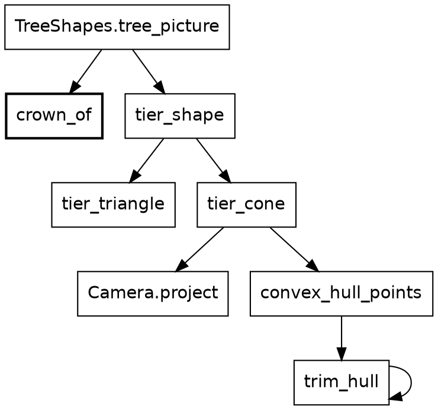

`tree_picture` asks `crown_of` once, and hands the answer to `tier_shape` for every tier. The arrow from `trim_hull` to itself is a function calling itself, and we'll see why.

### The functions

`crown_of` answers with a `Crown`:

{{code TreeShapes.crown_of}}

`Detail` holds the thresholds that decide how much of a thing gets drawn, and `cone_reach` is 200 metres. Shade fades from full at the camera to none at 80 metres.

```widget tree
Three gold trees, each drawn by `Conifer.scenery_picture`. Under each are its distance and what `crown_of` said.
```

`tier_shape` acts on that decision. Its `TierInputs` is the record `tree_picture` built as `inputs`: what every tier of one tree needs, from the tree's tip and the lens to its color and its crown.

{{code TreeShapes.tier_shape}}

`Camera.project` needs points in front of the camera, and `Geom` draws that line at its near plane, `Geom.near_plane`, 0.4 metres ahead. So a tier whose ring reaches back past the near plane falls back to the flat triangle. The `if` after the pattern is a guard, and it adds a condition to a branch. A `match` tries its branches from the top down and takes the first that fits, so the guarded branch has to come before the plain `Cones` one. `_` fits any payload and names none, because that branch doesn't need the shade.

A frame has no cones, only polygons, so we work out the polygon a cone would make. We leave pixels behind for a moment and work in metres. `base_height` and `apex_height` are how high the tier's bottom and top stand. `top` and `bottom` count down from the crown's tip, so `1.0 - bottom` is the share up from the crown's foot. We take a ring of 16 points around the base and one point at the top, and we project them all onto the screen:

{{code TreeShapes.tier_cone}}

`shaded_polygon` makes a polygon whose fill is darker at its edges and lighter in its middle, and `strength` says how much, so a near cone looks rounder than a far one. The shade from `crown_of` goes in as that strength.

That leaves 17 points on the screen, and a cone's outline is whatever wraps around them. That's a convex hull:

{{code TreeShapes.convex_hull_points}}

This is Andrew's monotone chain, which A. M. Andrew published in 1979. Sort the points from left to right, walk along the top, and walk back along the bottom. `sort_with` sorts by a function that compares two points and answers `Before`, `Same` or `After`, and `left_to_right` is that function: left first, and the higher of two at one x. The top walk ends on the rightmost point, where the bottom walk starts, and the bottom walk ends on the leftmost, where the top walk started. So each walk drops its last point before the `concat`, and no corner appears twice. `fold` walks a list from the front, carrying an answer from item to item, and `fold_rev` is the same from the far end, with its arguments the other way around. `trim_hull` serves both walks: before a point goes on, it drops the last point of the hull while that point would make a dent, and it calls itself until none does. `[.., a, b]` is a list pattern that takes the last two items.

{{code TreeShapes.trim_hull}}

A whole cone comes out as one polygon. The ring gets wider on the screen as it gets nearer, so the tree fattens as you pass.

So much for one tree. The road has hundreds.

## Roadside trees

Here's the other tree problem. Safari Ride places 392 trees along its road, and only some of them are in view at any moment. For each frame, it has to find those, and say where each one stands from the camera. Once a tree is found, `Conifer.scenery_picture` from A simple tree draws it. The kind still matters here in two places: a gold tree is placed farther from the road, and a tree's height decides whether it's tall enough on the screen to draw.

```widget frame trees
Step 1,570 of the ride, with only the trees on.
```

This is step 1,570 again, the frame with the frozen cat, showing only its trees. There are 184 of them, out of 392. At nine shapes each, they make up 1,656 of the 2,713 shapes in that frame, more than everything else put together.

A tree goes through the three forms from Nature types, with a `Conifer` as its kind. It's placed once, for the whole ride, and sighted and rendered for each frame that can see it.

New in this chapter:

- Roc: `var` and `while` in a pure function
- Modules: `TreeSighting`, `RoadAhead`

### Get the types right

A placed tree has a name of its own: `Trees.RoadsideTree` is another name for `Geom.Placed(Conifer)`. A tree's sighting is a `Pipeline.Sighted(Conifer)`, and its rendering is a `Rendered` like any other. A tree never looks at its sighting's `place`, `along` or `across` again, but a radio tower will.

| Job | Function | Its type |
|---|---|---|
{{types row Trees.roadside_trees Place a segment's trees, once}}
{{types row TreeSighting.trees_in_view Find the trees in view, for each frame}}
{{types row Scene.tree_renderings Render them, for each frame}}

A tree, once and for each frame
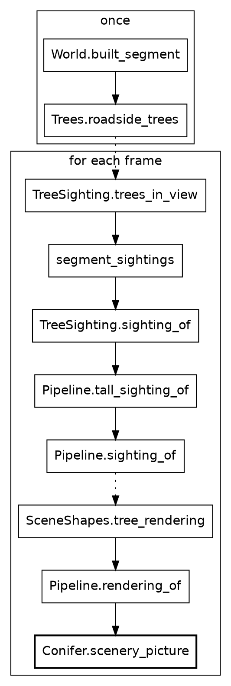

A box is a function, and a solid arrow is a call. A dotted arrow is a step's answer going on to the next step: the trees that `World` placed, read again for each frame, and then the sightings, which go on to be rendered. `Conifer.scenery_picture`, in bold, is where A simple tree began.

### Placing

Placing a segment's trees walks along the segment and keeps a list, and a loop says that best.

{{code Trees.roadside_trees}}

`var` makes a name that can change, and a `$` marks every use of one, so the names that change stand out. The function is still pure, because nothing outside it can see them change.

Trees stand in pairs, one on each side of the road, every 30 metres. `{ ..left_tree, across: ... }` makes the right tree from the left one, with the record update from A simple tree. The pairs take turns: a big green pair, then a pair of the segment's accent, which is small green, red or gold, then big green again. A gold pair stands farther from the road, because it's so much taller:

{{code Trees.tree_line_distance}}

### Seeing the trees

For each frame, `trees_in_view` goes through the segments of the road ahead, the ones the rider can see. `join_map` is a `map` followed by a flatten:

{{code TreeSighting.trees_in_view}}

{{code TreeSighting.segment_trees}}

From here on, things are measured from the camera, which travels with the rider. We don't need to know much about the rider yet.

{{code Pipeline.scenery_sighting_of}}

`Ahead(position)` says which segment of the road ahead the tree stands on. The size test asks for 2 pixels, through the camera's own lens.

`Pipeline.tall_sighting_of`, from Nature types, starts with `Pipeline.sighting_of`, which asks `RoadAhead.rider_point_at` where the tree's spot on the road lies from the rider. The math layer chapter shows how. If that spot is no farther ahead than the near plane from A conifer, the answer is `BehindCamera`. Otherwise it's a sighting.

Then `tall_sighting_of` calls a tree under 2 pixels tall on the screen `TooSmall`. So the answer is a `Try`: a sighting, or one of those two reasons. `keep_oks`, in `segment_sightings`, keeps the sightings and drops the reasons.

### Spending the detail

Far trees are cheap. They get eight triangles and a plain trunk. A cone costs a ring of 16 points and a hull, so only trees within 200 metres get cones. A shaded trunk looks round, and the effect only shows on a trunk wide enough on the screen, so it goes to the nearest four trees and no others.

"The nearest few" is the one thing a tree alone can't tell us, because it depends on the other trees. So `SceneShapes` counts them, and the count goes in as the conifer's context, the `nearer_tree_count` from Nature types:

{{code Scene.tree_renderings}}

{{code Scene.nearer_tree_count}}

`count_if` answers a `U64`, and `to_u16_wrap` turns it into the `U16` the context wants, wrapping around past 65,535. A frame never sees more than the 392 trees there are, so it never wraps.

`Pipeline.rendering_of` hands that context to `Conifer.scenery_picture`, and the tree's `Rendered` joins the towers' and the critters' in the frame's one list.

So `World` holds every tree's place for the whole ride, and no frame remembers anything. Every sighting is thrown away, and the next frame makes them all again.

Most things in a frame work this way: placed once, then sighted and rendered for each frame. Grass needs none of that.

## Grass

The grass is one rectangle.

New in this chapter:

- Roc: nothing new
- Modules: `Backdrop`

`Backdrop` paints what's behind the ride. It has one color for grass:

{{code Grass.grass_color}}

Its list of shapes starts with the sky, the sun and the grass, and this is the grass:

{{code Grass.grass_shape}}

It starts a pixel above the horizon, so no seam shows between the grass and the sky:

{{code Grass.grass_top_y}}

It's much wider than the screen because the whole picture tilts when the rider leans, and the corners have to stay filled.

Nothing else in the program draws grass. A segment doesn't have any, and there's no sighting for it. The grass is whatever hasn't been painted over.

The other big thing in `Backdrop` is more interesting.

## The sun

The sun is a circle. That's the easy part, so it's the part we'll do here.

New in this chapter:

- Roc: tags in place of `null`
- Modules: `Sun`, `Angle`

### A circle

A frame is a list of shapes, and a circle is one of them. `Disc` is a tag from `lib.Shapes`. This is the sun's, from the same list as the grass:

{{code Sun.sun_shapes from "Disc({" to "fill: look.disc,"}}

A `Disc` has a center, a radius and a fill. The grass comes after it in the list and paints over whatever falls below the horizon, so the sun can sink behind the land with no more code.

The fill makes it look like a sun. `sun_fills` builds two, a disc and a glow behind it:

{{code Sun.look}}

`Radial` runs from pale yellow in the middle to orange at the edge. `Glow` is a wide haze that fades to nothing. Both are tags with records inside, so a fill is plain data, and the browser does the painting. `scale` is how large the sun is drawn, because a wider view makes it look smaller.

### Angles that can't be mixed up

The sun stands in one direction, and the rider may not be facing it. That needs angles. `Angle.Bearing` is a direction in the world and `Angle.Turn` is a change of direction. Here we pass a `Turn` where a `Bearing` is wanted:

{{fails turn_as_bearing}}

Two tags say whether the sun is in view, so there's no `null` and no off-screen sentinel value. A caller has to handle `OutOfView`, because `match` must cover every tag.

{{code Sun.Sighting}}

Opaque types do the most work from here on. A `Bearing` and a `Turn` are both floats underneath, but only the `Angle` module can build or open one. `Sun.sighting` also takes one record argument, destructured in its parameter list.

{{code Sun.sighting}}

`turn_from_view.abs() >= visible_turn_limit` compares two `Turn`s. The code never touches radians until `Sun.place` has to do trigonometry, because `.tan()` works on a float.

{{code Sun.place}}

Its caller, `RideInstant.sun`, is short enough to read whole:

{{code FrameView.frame_view_at}}

Those functions all take a `clock`, and that's the hard part. The sun sinks a little with every step, and the sky's colors, the mountains and the truck's headlights all follow it. That's a lot of heavy lifting for a circle. It gets a chapter of its own, The setting sun, once things start to move.

## The sky

The sky changes all through the ride, but a frame only has to ask one question: what color is it right now? The answer depends only on the clock.

New in this chapter:

- Roc: `->` as a promise
- Modules: `Sky`

`Sky` is a set of functions that each take a clock and answer with a color.

The modules around `Sky`
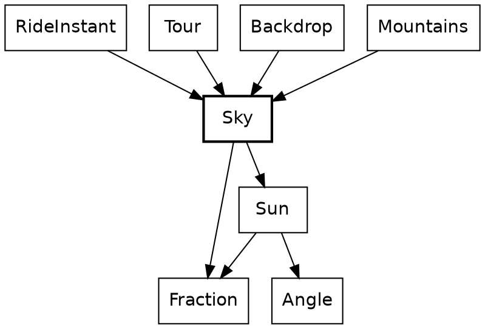

`Sky` sits near the bottom of the system. It imports `Sun` and a few small types, and it knows nothing of the rider, the road or the drawing. Those above it each ask for a color at a given clock.

Every function in this chapter has a `->` arrow, not `=>`. That tells you the function has no effects, and the compiler holds it to that. So the same clock always gives the same sky. If you don't see a `=>`, you only have to think about what the function is given.

Here's one of the questions being asked. `Tour` holds the ride, and we'll come back to it. `Tour.sky_top_color` takes the clock from the current instant and hands it to `Sky`.

{{code FrameView.frame_view_at from "sky_colors: Sky.colors_at" to "sky_colors: Sky.colors_at"}}

### Two colors

The sky is two colors, the top of the sky and the horizon. Here they are at five steps of the ride:

| Step | Top of the sky | Horizon |
|---|---|---|
| 0 | `0x8ecae6` | `0x8ecae6` |
| 3,000 | `0x75a8c6` | `0x9d898e` |
| 3,980 | `0x618ead` | `0xcb6046` |
| 4,730 | `0x4f7595` | `0x966765` |
| 6,000 | `0x243a5e` | `0x243a5e` |

Every color in the sky is a blend of two others, and a blend needs a ratio. `Fraction` is another small opaque type, a ratio from 0 to 1, and only its own block can build one, so a `Fraction` is always in range. It has two ways in. `Fraction.of` takes a ratio that can only be in range and crashes on anything else, because that would be a bug in the sum. `Fraction.clamp` takes a ratio that can rightly fall outside, and holds it at the nearest end.

`color_between` takes one record argument, destructured in its parameter list, so callers name every field. Each channel moves the same share of the way. `HexColor.Rgb` is a plain record alias: three floats with nothing to guard.

{{code HexColor.color_between}}

`sky_top_color`, the one `Tour.sky_top_color` asked at the start of this chapter, calls it to blend day into dusk. `dusk_at` says how far the day has gone. That's a `Fraction` too, and The setting sun works it out.

{{code Sky.sky_top_color}}

`sky_horizon_color` is the same sky, warmed toward red near sunset.

{{code Sky.sky_horizon_color}}

`Backdrop` paints the two as a gradient, down to the horizon. It stays on the top color for the first fifth of the way, then fades:

{{code Sky.sky_shape from "Linear({" to "end_point: { x: 0.0, y: Screen.horizon_y.to_f64() },"}}

That's where a color finally becomes one integer, because a `Brush` wants `0xRRGGBB`. `pack` gets there with method calls on plain numbers. Static dispatch finds `to_i64_wrap`, `shl_wrap` and `bitwise_or` on Roc's own types. That makes `pack` a leaf: it calls nothing of Safari Ride's own.

{{code HexColor.pack_rgb}}

One more thing in the frame goes dark with the sky: the mountains.

## Mountains

However far the rider goes, the mountains never get any closer. They only turn as the rider turns. That makes them much simpler than they look.

New in this chapter:

- Roc: a function in a record field
- Modules: `Mountains`, `HexColor`

There are two ranges, one to the north with snow on its peaks, and a lower one to the west. A range is a record:

{{code Mountains.MountainRange}}

It's measured in bearings and pixels, not metres. There's no terrain behind it. All a mountain has is a height at a bearing:

{{code Mountains.range_height}}

A range is highest in its middle and falls to nothing at its ends. Two waves on top of that make the ridges. The rolling land in front of the ranges is a single wave of its own, in the same green as the grass.

To draw a range, we go across the screen two pixels at a time and ask how high the skyline is at each bearing. The caller passes in `height_at`, a function in a record field, so one `silhouette` draws all three:

{{code Mountains.silhouette}}

`Mountains.mountain_shapes` paints them back to front:

{{code Mountains.mountain_shapes}}

The rock darkens with `dusk`, the same `Fraction` that darkens the sky, and the snow goes blue. `snow_color` uses the sky's own `color_between`:

{{code Mountains.snow_color}}

That's nature. Next come the things people built.

## The road

A road of straight segments still has to get round its bends. Where two segments meet, something has to pave the corner and put up a rail.

```widget bends
Three bends from above. The rail changes sides with the bend, and a sharper bend pushes the apex further out.
```

Each road here is two segments, seen from above, and the white dot is where the view is from. The rail runs along the outer edge of the bend, and the yellow dot is the apex, where the outer edges of the two segments meet. The left bend and the right bend have their outer edges on opposite sides. A road with no turn has no apex, so none is shown.

New in this chapter:

- Roc: a closure that gives a repeated call a short name
- Modules: `BendView`, `GroundSighting`

`BendView` knows where two segments meet. `GroundSighting` and `RailSighting` each ask it about a bend, and each answers with plain data for another module to draw.

The modules around `BendView`
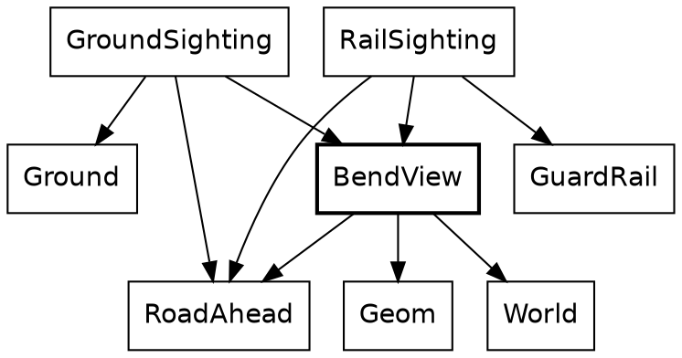

Everything in this chapter is measured from the rider, as the trees were.

### Where two segments meet

A bend is a small record.

{{code BendInView.BendInView from "A bend as the rider sees it" to "}.{"}}

`before` and `after` say where the two segments lie from the rider. The turn is positive to the right.

{{code BendInView.outer_edge}}

A bend to the right has its outer edge on the left. That's why the rail changes sides between the first two bends.

{{code BendInView.outer_corner}}

`point_before` and `point_after` are closures. Each gives a call with four arguments a short name, so the two lines below them read alike. Each line runs along the outer edge of one segment, and `Geom.line_crossing` finds where the two cross. That's the yellow dot.

The road is 4 metres wide, so at a turn of 45 degrees the apex lies 4 × tan(22.5°) past the end of the first segment, which is the 1.7 metres the widget shows. Two parallel lines never cross, so a road with no turn has no apex, and nothing asks for one.

### Paving a corner

A piece of ground is a list of corners and a color.

{{code GroundSighting.road_patch}}

That's what `Ground` paints. It's plain data, so it can be checked with numbers.

{{code GroundSighting.bend_paving}}

Four points cut the corner: the two ends of the first segment, the apex, and the place where the second segment's outer edge starts.

{{code GroundSighting.lead_in_length}}

The last 40 metres before a bend get a patch of their own, laid after the road's chunks and before the corner.

{{code GroundSighting.road_along}}

The road along a segment is laid in chunks of up to 25 metres. The widget's two segments are 60 metres each, which makes three chunks each, and `bend_patches` adds two patches. That's the widget's count of 8.

{{code GroundSighting.pond_patches}}

A pond is ground too. A segment that ends at a pond gets two more patches, the water and its bank, and their outlines come from `Pond`. `on_map` is another closure, and it moves an outline from the pond's own record onto the road.

The corner has its paving. Next, it needs a rail.

## Rails

The rail is a path along the outer edge, out to the apex, and back.

New in this chapter:

- Roc: nothing new
- Modules: `RailSighting`, `GuardRail`

The path of a guard rail
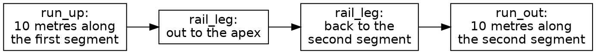

{{code RailSighting.rail_points}}

The four parts of the list are the four boxes.

{{code RailSighting.leg_points}}

A leg gets a point about every metre. It leaves out its first point, which is the last point of the leg before it.

{{code RailSighting.rail_quads_in_view}}

`GuardRail.quads_along` turns the path into rails and posts for the depth sort. At a turn of 45 degrees, that's the 49 pieces in the last chapter's widget.

All of this is worked out again on every frame, from the route and the rider. A bend is kept nowhere.

## Radio towers

The rail stays close to the road. The radio towers stand well back from it. One stands past the end of every segment, off to the right, and a long segment has one more halfway along, off to the left. Each is a lattice of thin rods, 80 metres tall.

New in this chapter:

- Roc: `match` on a pair
- Modules: `TowerSighting`, `Tower`

A tower isn't placed when the world is built. Its sighting works out where it stands from the segment. This one is for the tower halfway along:

{{code TowerSighting.mid_tower}}

`MidTower` is a tag on the segment, and that's all the world knows about towers.

### Rods

A tower's footprint is a square, and four tags name its corners. Going round the square is a `match`:

{{code Tower.next_corner}}

Everything above the footprint is rods. Four legs run from the corners up to a point:

{{code Tower.leg_shapes}}

A ring of rods goes round the tower every 20 metres, and crossed braces fill the lowest two storeys. Each rod is a line between two points in the rider's view, and it needs some care, because a near tower can stand partly behind the camera:

{{code Geom.ahead_line}}

The `match` is on a pair, so it has to cover all four combinations. A rod with one end behind the camera is cut where it crosses the camera's plane, and a rod with both ends behind isn't drawn.

### Over the horizon

As a tower gets further away, it sinks below the horizon from the bottom up:

{{code EarthCurve.exaggerated_drop}}

A real tower wouldn't go so soon. `sink_radius` is 20 km, a much smaller earth than ours, so a tower is gone at 1.8 km. That way, you can see it sink.

Each tower has a beacon on top, and `beacon_brightness` is a field of its sighting. Beacons blink, so we'll leave them until things start to move.

The truck is man-made too, and it waits for the same reason. That leaves the animals.

## Stills: how we draw a critter

Before we can stand an elephant by the road, we have to be able to draw one. Every critter in Safari Ride is a *still*: a small picture made of filled polygons, stored as data. An elephant has one still. A cat has seven, one for each pose, and a bird has six. Those two have to wait until things start moving, but we can look at them now. Animating a critter comes down to choosing which still to show, and where.

```widget stills
Every pose of the cat and the bird. Click one to see it large, and click it again for its polygons.
```

New in this chapter:

- Roc: a large table of plain data
- Modules: `Stills`, `StillShapes`, `CatStills`, `BirdStills`, `EmojiStills`

The stills are the least readable code in Safari Ride, and nobody is meant to read them. They're generated data, encoded as Roc, and this chapter ends with how they got made. Here's how much data each set holds:

| Stills | Kind | Pictures | Polygons | Points |
|---|---|---|---|---|
| `BirdStills` | Hand-drawn | 6 poses | 32 | 119 |
| `CatStills` | Hand-drawn | 7 poses | 275 | 13,453 |
| `EmojiStills` | Emoji-based | one for each animal by the road | 129 | 5,267 |

The distinction matters. The cat and the bird were drawn for this game, and they have poses. The animals by the road started as emoji, and each has one picture.

A polygon is one record. It has a color, an optional gradient and a list of points:

{{code Still.Polygon}}

The bird is the smallest set, because the perched bird is Roc's logo, and the logo is made of a few straight-edged shapes. The cat has far more points, because its curves are made of many short straight lines. Its seven stills fit in a 73-line file, and those lines are very long.

Every point is measured in units of the still's height. Its feet are at `y` 0, and a standing critter is about 1 tall. That's why no pixels or metres appear here. The same numbers draw a cat in the distance and a cat in the lane.

`StillShapes` does the rest. An `Anchor` says where a still stands on screen, which way it faces and how tall it is:

{{code StillShapes.Anchor}}

Drawing a still is then one sum for each point. The height in pixels scales the point, and the feet place it:

{{code StillShapes.screen_point}}

That's all there is to drawing a critter. Each set of stills has a `pose_polygons` function that turns a pose into its polygons, and `StillShapes.still_shapes` puts them on screen.

### How the stills got made

That's all the Roc in this chapter. If you came for the Roc, you can skip ahead to [The elephant](the-elephant.html). The rest of this chapter is the story of where the pictures came from.

At a larger company, a picture like these would pass through three people. An artist would draw it. A software developer would build the tools that get it into the game. A project manager would look at the result and decide whether it's good enough. On Safari Ride, Claude played the first two roles, and Steve played the third.

The artist's cat was a program. An early version of Safari Ride drew the cat in TypeScript, with splines for its body, tapered capsules for its limbs, chains of joints for its legs, and strokes for its whiskers. That's a lot of code to carry from language to language, and a game only ever shows seven poses.

So the developer wrote a baker, a small program that ran the real drawing code once for each pose. A recorder stood in for the canvas. It kept every filled shape as a polygon and turned every stroke into a thin filled quad, and the result was a flat table of polygons. The drawing code stayed behind, and the table moved on.

The emoji-based animals took a different route. They come from Microsoft's Fluent Emoji, in its Flat style. That set draws every animal whole and from the side, where another set draws a rhino as a face, which looks like a bug beside a road. A second baker read each SVG file, walked its shapes in painting order, and cut each curve into short straight lines.

The bull is a hybrid. It comes from the same emoji set, but in its Color style, which is shaded. It's the only still with gradients, on 40 of its 43 polygons, which is why a `StillPolygon` has a place for one. Its 2,309 points are nearly half of `EmojiStills`.

The Roc bird came last. Its perched pose is the logo, and Claude drew the five flight poses to match, directly as polygons, in the logo's two purples.

The project manager's tool was a contact sheet: every still, side by side, in one image. Each bake wrote one, and Steve looked at it. No test can say whether a cat looks like a cat. The comment in the emoji baker puts the standard well: "an elephant is an elephant".

The bakers belong to the older versions of Safari Ride, in TypeScript and Zig. The polygons they made have been carried along ever since, which is why these files look like generated data. They are.

Now that we can draw a critter, we can stand one by the road.

## The elephant

The critters in this stretch of the book are billboards: flat pictures that stand in one place and never change. The code calls them billboards too. We'll start with the elephant. It stands at 14 of the route's 19 bends, so it's the animal you'll see most. A grown elephant waits beyond the guard rail on the outside of the bend, and its baby stands in the middle of the road a little further on.

New in this chapter:

- Roc: a `match` that answers with a list
- Modules: `Wildlife`

A segment's `bend_life` field says what's at its bend. `Wildlife.bend_critters` turns that into critters:

{{code Wildlife.bend_billboards}}

`Quiet` and `DuckPond` have no animals, so they answer with an empty list. An `Animal` answers with a list of two. `inward` is 1 or -1, so one line of arithmetic places the grown animal on either side of the road.

An elephant has no state. It's a plain record, with a place, an emoji, a height and a way to face. `Billboard` looks up the emoji's still and draws it at that height. The baby is the same still at half the height.

Nothing in that function says "elephant". That's what makes the next chapter short.

## Rhinos, giraffes and the other corner critters

A giraffe, a rhino and a zebra have one bend each. They all use the same code as the elephant, and they differ by one row:

{{code Wildlife.species_of}}

Each animal is a tag, and each answers with its emoji and how tall it stands. The `match` has to cover all four.

To add a lion, we'd add a tag, a row here and a still in `EmojiStills`. The compiler would point at every `match` that needs the new tag.

These animals stand at the bends. Most of the others come in crowds, and a crowd starts with a single pig.

## A pig

A pig is the simplest critter in Safari Ride. It isn't tied to a bend. Here's how we build one:

{{code Pig.pig}}

New in this chapter:

- Roc: a `match` on numbers, with a default branch
- Modules: `Pigs`

That's the record that the elephant and its baby came out as: two places, an emoji, a height and a way to face. A critter's `codepoint` is what finds its still, and that's one `match`, from a number to some polygons:

{{code EmojiStills.EmojiStill}}

That's a pig. One pig doesn't look like much of a farm, though.

## Herds: cows and pigs

Safari Ride's farms are crowds of animals, and a crowd is just a list of critters. Both herds are worked out once, when the world is built.

New in this chapter:

- Roc: `List.from_iter` with `I64.until`
- Modules: `Cows`, `Scatter`

### Cows

A herd of 14 cows grazes on the left of the road, in columns of three. Every fourth cow is a calf, at half the height.

{{code CowHerd.herd_cows}}

A herd in a perfect grid would look like a parking lot, so each cow strays a little from its place:

{{code CowHerd.herd_cow}}

The stray comes from the sine and cosine of the cow's number. It looks random, but it's the same on every run, so the frames stay exact.

A bull may stand in front of the herd, by the trees. It's the same record again, a bit taller than a cow:

{{code CowHerd.herd_bull}}

### Pigs

Pigs graze on the right of the road, near the end of a segment. The first two segments with pigs get a big herd, 7 rows of 7. After that, it's two short rows.

{{code PigHerd.herd_pigs}}

The `match` has three branches, because a segment's pigs can be three things to the rider. `Distracting` is the one a cow doesn't have. One pig in a big herd catches the rider's eye, and the rider slows down to look. That's about the rider more than the pig, so it waits for the rider's chapters.

That's every critter that stands still, and the end of what we can say about one frame.

## The ride instant

We've held one frame still for a long time. Now it's time to turn the page. Each time the clock ticks, Safari Ride moves the rider and the truck and draws everything again. `RideInstant` is the one record it keeps from one tick to the next, and it holds the rider, the truck and the clock. One tick is a step.

```widget step
Press play to run the ride, and the outer buttons to go to either end.
```

The first three lines under the picture are that record's three fields, read from a real ride. Press the last button, and the ride plays up to step 2,000, eight steps a frame. Press the first, and it's back at the start almost at once, because the steps it has been through are kept in a list.

New in this chapter:

- Roc: nominal types
- Modules: `RideInstant`, `Tour`, `FrameView`

A record is the plainest shape in Roc, and it's nearly all this needs. `RideInstant := { ... }.{ ... }` makes the module's own type out of one. That's a nominal type, which can carry a block of definitions, and unlike an opaque type it leaves its fields readable.

{{code RideInstant.RideInstant from "One instant of the ride" to "}.{"}}

Those three fields are the whole of what Safari Ride keeps from one step to the next. The cat has no state, and neither does the bird, the sun or the beacons. Each frame works them all out again from the rider, the truck and the clock. Call this *worked out, not stored*: keep the few things that have to last, and work out the rest. We'll see it everywhere from here on.

That gives three kinds of moving thing, and the rest of the tour is organized around them:

| Kind | Things | How it works |
|---|---|---|
| Clock-driven | The sun, the sky, the beacons, the headlights | Worked out from the clock, with nothing stored |
| Stepped | The rider, the truck | Stored in `RideInstant`, and moved once a step from where it was |
| Rider-driven | The cat, the bird | Worked out from how the rider is approaching, with nothing stored |

Trees and cows are a fourth kind, the easiest of all: they never change.

The game itself has no effectful functions at all. It has no `!` names, no `=>` arrows and no `?`. Effects live in the platform.

### Pausing and stepping

Mostly, Safari Ride is a screensaver: you sit back and watch it. You can also take the controls. Click the ride to give it the keyboard, and Space pauses it. While it's paused, Right moves one step forward and Left moves one step back. While it's running, each moves four steps at a time. J jumps to the next segment of the road, and R starts over.

`SafariApp.model_at_next_step` handles all of that. It takes the model, which is the `Tour` and a pause flag, and a snapshot of the input. It returns the next model:

{{code SafariApp.model_at_next_step from "paused = if input.key_pressed(KeySpace)" to "Tour.step_forward(m.tour)"}}

There's no event handler here. Each frame, the platform hands `model_at_next_step` a snapshot, and `model_at_next_step` reads it. `key_pressed` says a key went down since the last frame, so one tap of Space pauses the ride once. `key_down` says a key is being held, so holding Right keeps the ride moving.

Stepping forward is the ordinary step. Stepping back is more interesting, because it's where keeping so little pays off. `Tour` holds the current instant and a list of the instants before it, so going back just means taking the last one off the list:

{{code Tour.step_back}}

Nothing has to be undone. An old `RideInstant` is still a perfectly good value. The cat ends up in the right place because its position was only ever worked out from the rider's, and the sun ends up in the right place because it was only ever worked out from the clock. Neither one needs any code for going backward.

We've seen the things that never change. The beacons are next, because they follow the clock alone.

## The beacons

Some things in Safari Ride are worked out from the clock alone, with nothing stored. The beacons on the radio towers are the simplest of them, and they blink over and over.

```widget beacon
Press play and watch the towers blink out of step.
```

Play it, and the clock runs through two whole blinks, from step 5,400 to step 5,640. The left tower starts dark and the right one at full brightness. At step 5,430 both read 49%, and by step 5,460 they've changed places. By the end the towers are back where they began.

New in this chapter:

- Roc: a pair of opaque types with only the sums that make sense
- Modules: `Steps`

### A blink

The modules behind a beacon
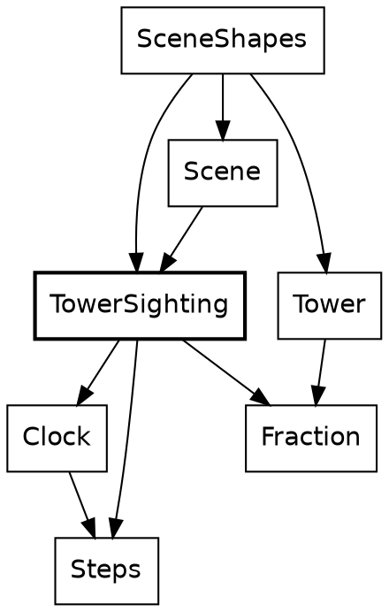

A beacon is the only thing in Safari Ride that repeats on the clock, so it's the first thing that needs to ask how far into a cycle it is. That question isn't about an instant of the ride. It's about a length of time, and Safari Ride keeps those two apart.

`Clock` says which step it is. `Steps` says how long something lasts. Both are opaque `U32`s, and `Clock.minus` turns two clocks into `Steps`, the same way two `Angle.Bearing`s make an `Angle.Turn`. Adding two clocks means nothing, so `Clock` has no `plus`, and no other code can add one. Call this *places and distances*: one opaque type for where something is, a second for how far apart two of them are, and only the sums that make sense.

Here, `wrapped_to` is `Steps`'s one way to reach `%`. The result is a `Fraction` built with `of`, because `(1 - cos) / 2` can only be in range:

{{code Beacon.beacon_brightness}}

Each tower starts somewhere else in the cycle, so the towers along a road don't blink together. This function is one line of method calls, and every call in it is on a `Steps`:

{{code Beacon.beacon_offset_for}}

The sighting calls both, adding the two `Steps`. `clock.minus(Clock.start)` is how a place becomes a distance, and it says which distance: the one from the start of the ride.

{{code Beacon.brightness_at}}

Its caller gives each tower its key, the segment's index. Records with named fields stand in for what would otherwise be six arguments in a row, and `Ahead(position)` is a tag carrying a payload, saying where the segment lies from the rider:

{{code TowerSighting.end_tower}}

A tower halfway along a segment takes the key plus 60. That's a small piece of number theory hiding in a constant: 60 staggers of 37 steps come to 2,220, which is 18 periods of 120 and 60 left over, so the mid-tower blinks exactly opposite the end tower.

Notice where the clock stops. `beacon_brightness` on a `TowerSighting` is a `Fraction`, and neither `Tower` nor `SceneShapes` imports `Clock`. A beacon's blink is decided in the same place as whether the tower is in view at all.

There's no blink abstraction, because nothing else in the game blinks.

The clock counts steps, not seconds, so pausing the ride freezes the beacons, and stepping back runs them backward.

A beacon repeats. The sun only goes one way, and a lot more hangs on it.

## The setting sun

Safari Ride needs a sunset. We'll build it the way we build everything here: concepts, then types, then functions.

The concept is three jobs:

1. Move the sun down the sky.
2. Darken the sky.
3. Warm the horizon.

All three come from the clock, and the game stores none of them.

### Get the types right

The types do the work, and a sunset needs four:

| Type | What it is | Under it |
|---|---|---|
| `Clock` | A step of the ride | A `U32` |
| `Pixels` | A length on screen, like the sun's height | An `F64`, because a shape can sit between two pixels |
| `Fraction` | A ratio from 0 to 1, like how far toward dusk we are | An `F64` |
| `HexColor.Rgb` | A color | A record of three floats |

The first three are opaque. Each is still a number, and the type gives it a name, so a height can't be passed where a dusk is wanted. With those in hand, each job is a signature:

| Job | Function | Its type |
|---|---|---|
{{types row Sun.height_at Move the sun}}
{{types row Sky.darkness_at Darken the sky}}
{{types row Sky.sky_top_color}}
{{types row Sky.horizon_warmth_at Warm the horizon}}
{{types row Sky.sky_horizon_color}}

Every one is a `->`, and every one starts from a `Clock`. That's most of the design, before we've read a line of code.

### The functions

The sunset, from the top
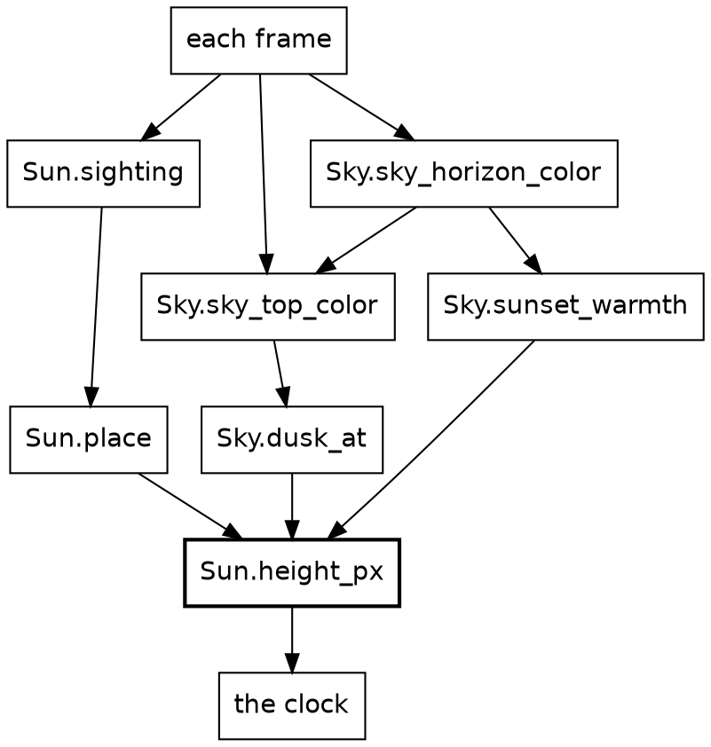

A box is a function, and an arrow is a call. The three boxes under the frame are the three jobs: the sun, the top of the sky and the horizon. They all end at `Sun.height_px`, because everything in a sunset comes down to how high the sun is.

Here's the top of that diagram in code. Each frame, the game asks for three things and hands them to `Backdrop`:

{{code FrameView.framed_shapes}}

`Tour` holds the clock and hands it straight to `Sun` and `Sky`, so everything from here on is in those two. Let's take the three jobs in order.

### Job one: the sun goes down

```widget sky sun
Press play. The two middle buttons step one frame at a time, for the patient.
```

This widget does only the first job, so the sky stays blue. For each frame it calls `Sun.height_px`, reads out the answer, and marks it on the chart's gold line.

The sun chapter showed how `Sun.sighting` places a sun. All it needs from the clock is a height:

{{code Sun.height_at}}

### Job two: the sky darkens

```widget sky sky
Press play. Now the sky darkens too.
```

This widget adds one call, `Sky.dusk_at`, and the sky finally does something. Its answer is the blue line. The top of the sky blends day into dusk, by that `Fraction`:

{{code Sky.sky_top_color}}

`dusk_at` works out that `Fraction`:

{{code Sky.darkness_at}}

It asks for the sun's height, then picks one of two shapes. They meet when the sun has fully set, one radius below the horizon, and you can see the join in the blue line at step 4,735. Before that, dusk grows with the square of how far the sun has fallen. After that, it runs on in a straight line to full dark.

{{signatures Sky.darkness_while_up Sky.darkness_after_set}}

As always, anything outside a module's block is private, so these two are helpers without any keyword.

Neither has heard of the clock. The outer functions take a clock, because that's what the frame has to give. The helpers take a height, because that's what dusk depends on, and now that's all it can depend on.

### Job three: the horizon warms

```widget sky warmth
Press play. This is the whole sunset.
```

This widget adds `Sky.sunset_warmth`, the red line. This job is polish. A sunset without it is still a sunset, just a sad one.

The horizon is the same sky, warmed toward red:

{{code Sky.sky_horizon_color}}

`sunset_warmth` asks for the sun's height, just as dusk did:

{{code Sky.horizon_warmth_at}}

The horizon is warmest when the sun's height is zero. `ratio_to` says how far away the sun is, as a share of 110 pixels, and `abs` makes the two sides match, which gives the red line its tent. `Fraction.clamp` holds everything past 110 pixels at no warmth at all.

### Going backward

Play any of those widgets backward, and the sun rises. No code does that. Every function here takes a clock and answers, so it doesn't matter which way the clock runs.

The sun and the beacons can be asked about any step, cold. Hand `Sky.dusk_at` a clock and it answers. The rider and the truck can't do that.

## Stepping through the ride: RideInstant

Where the rider and the truck are depends on where they were, so their state has to be kept, and it's the only state there is. This chapter and the next few are about the two fields of `RideInstant` that aren't a clock.

```widget step
Press the last button, then the first.
```

Going forward, the ride has to be played, because each step starts from the one before. Going back, it only reads a list. The rider and the truck are the reason for that difference.

New in this chapter:

- Roc: a block that ends in a record
- Modules: none yet. This chapter shows what calls the modules below, and the next few open them.

The modules that do the stepping
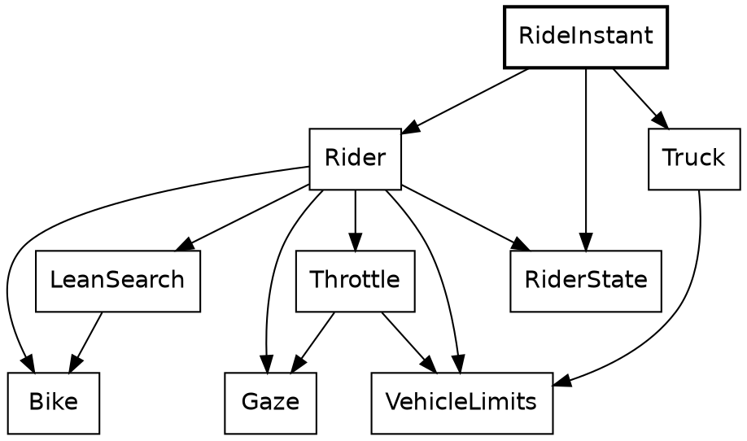

Here's the step again, this time whole. Its body is a block: names, then a record, which is the value of the block. The rider moves first, and the truck reads where the rider has just got to, so the order of those lines is a rule of the game, and `dist` is what carries it.

{{code RideInstant.next}}

`Clock.next`, `Rider.rider_state_at_next_step` and `Truck.truck_state_at_next_step` all have the same shape: a value goes in, and the next value comes out. Call that *the step function*. There's no mutable rider being nudged. There's a rider, and another rider one step on.

Stepping has a cost, which shows up when we compare it with the sun:

- We can ask about the sun at any step. To find a truck at step 4,000, we have to play the ride that far, or write the answer down by hand.
- A wrong sky only affects the frames it touches. A wrong step moves the rider for the rest of the ride.
- The lines of `RideInstant.next` have to run in order. Frames can be worked out in any order.

The rider's step is the bigger of the two, and it takes up the next four chapters. The truck gets the chapter after those.

## The rider

This is the rider at step 1,570, with the cat ahead:

| Field | Type | Value |
|---|---|---|
| `segment_index` | `World.SegmentIndex` | 3 |
| `along` | `Along` | 97.58 metres |
| `across` | `Across` | -0.12 metres |
| `yaw` | `Angle.Turn` | 0.0081 radians |
| `speed` | `Speed` | 1.22 metres a step |
| `lean` | `Angle.Lean` | -0.0048 radians |
| `heading` | `Angle.Bearing` | 0.0081 radians |
| `gaze_yaw` | `Angle.Turn` | 0 radians |
| `look_depth` | `Fraction` | 0.67 |

New in this chapter:

- Roc: a nominal record with no bare floats, a value for a bike that doesn't exist
- Modules: `RiderState`, `RiderEyes`, `Rider`, `CanvasRoll`, `Speed`

A nominal record holds the rider, and `RideInstant` stores one. Count the opaque types: `SegmentIndex`, `Along`, `Across`, `Turn`, `Speed`, `Lean`, `Bearing` and `Fraction`. Nothing in it is a bare float. Four fields of this one record are angles, of three different types, and passing one type where another is wanted is a compile-time error. The last two fields say where the rider is looking, and they get a chapter of their own.

{{code RiderState.RiderState}}

The step does four things in order, and the code reads that way. Static dispatch finds `segment_in` on the `SegmentIndex`. The `match` on `seg.ending` has two tags, and `Continues(_)` ignores its payload:

{{code RiderState.next}}

The rider steers by leaning, so a decision is a record of two opaque values: a change of lean and an acceleration. There's something to notice in the last line of this next function. `Throttle`, which picks the acceleration, is asked about a bike that doesn't exist yet: the rider as it would be with the new lean, which `Bike.with_lean` makes by building a new record. The real rider isn't touched, because nothing can touch it.

{{code Rider.controls}}

The Rehearsal chapter takes that idea much further. A small version of it decides what happens at the end of a segment. `cross_if_on_road` works out the rider on the next segment and keeps that only if it lands inside the lane. The rejected rider simply stops being referred to, and nothing has to be undone:

{{code RiderState.cross_if_on_road}}

Record update does most of the writing in this module. Its plainest use is stopping dead, where `..s` keeps everything but the two fields named:

{{code Motorcycle.stopped_at}}

### The picture leans too

When the rider leans, the whole picture leans with it. This is all of that:

{{module CanvasRoll}}

A lean inside the deadband leaves the canvas level, and any other lean passes straight through. The last `expect` is a table of pairs, on both sides of the deadband and at its edge. It's called once a frame:

{{code RiderCamera.of from "roll: CanvasRoll" to "roll: CanvasRoll"}}

The camera turns as well. `ViewYaw` follows the rider's gaze, and turns a little with the lean, as a rider's head turns into a bend.

So a decision is a lean and an acceleration. `Bike` is what turns them into movement.

## The bike

A lean of 1 degree turns the bike by a tenth of a degree each step, so at a metre a step it goes round a circle 573 metres in radius. That's nearly all the physics.

New in this chapter:

- Roc: a named open record
- Modules: `Bike`

The modules around `Bike`
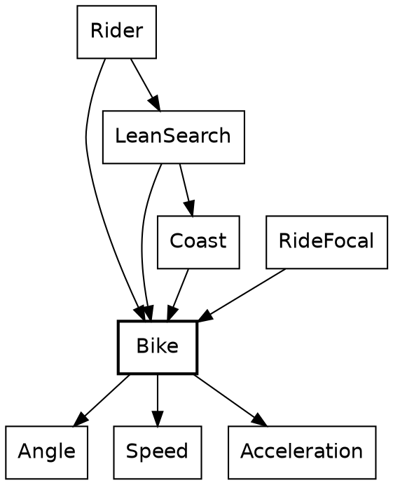

`Bike` holds the physics. It's under 60 lines, not counting its `expect`s. Its type is the first one in the tour that names the rest of a record. `..others` makes `Motion` open: it's any record with these six fields and whatever else, with `others` standing for the whatever else.

{{code Motorcycle.Motorcycle}}

A structural type like this has to be named when it appears twice. Here it appears in the argument and in the result, and that's the promise: what goes in comes out with the same other fields. A `RiderState` goes in, with its `segment`, `gaze_yaw` and `attention`, and a `RiderState` comes out, though `Bike` has never heard of a gaze.

Call this *a narrow view of a wide record*. A module says exactly which fields it cares about, and the compiler takes care of the rest, with no base class and no copying fields across by hand. The smallest example in the program is a function with one job:

{{code Motorcycle.with_lean}}

`{ ..s, lean }` is record update with a shorthand: the field and the local have the same name. `Rider.decide` called it in the last chapter. Here's the step, which `Rider.rider_state_at_next_step` called:

{{code Motorcycle.motorcycle_at_next_step}}

Reading down, the types do their share of explaining. A `Lean` can't be added to anything but a `Lean`, and it only reaches direction through `lean.steer(turn_per_lean)`, which is the single door from roll to yaw. The bike then moves along the middle of the step's turn, which is what `s.yaw.plus(turn.times(0.5))` means. `speed.step_length()` is a `Distance`, and `Along.plus` takes one, so the move itself is places and distances. `to_radians()` waits until the last line, where `.cos()` needs a float.

A bike does what it's told. Choosing the lean has to wait for the Rehearsal chapter. Choosing the acceleration is the throttle's job.

## The throttle

The rider is always deciding whether to accelerate, brake or hold steady. `Throttle` makes that decision, once a step.

New in this chapter:

- Modules: `Throttle`, `Acceleration`

The modules around `Throttle`


The chain of limits
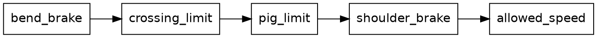

The rider has several reasons to slow down, and they don't know about each other. A turn is coming. A cat is in the lane. There's a pig to look at. The road is about to run out. `Throttle` writes them as a line of limits. An `Acceleration` goes in, a limit lets it through or lowers it, and the next limit gets what's left:

{{code Throttle.next_speed from "limits = [" to "limited = limits.fold(offered, held_to)"}}

Call this *the chain of limits*. Each limit has the same shape and can be read alone, and adding a reason is one more line. It reads like a list of rules because that's what it is.

Each limit takes the lower of two opaque `Acceleration`s with `min`. `NoAcceleration` comes from the cat: it stops the rider opening the throttle, and a rider already braking stays braking. We'll see how once we've met the cat.

{{code Throttle.held_to}}

`Speed` and `Acceleration` are places and distances again: two speeds make an acceleration, and an acceleration moves a speed. The formula behind braking for a turn is the first line of a physics textbook, `v² = u² + 2as`, solved for `a`. This function is a good example of how far opaque types reach into a parameter list. `target: Speed.(t)` opens the field's `Speed` where it's destructured:

{{code Speed.acceleration_to}}

The first limit, `bend_brake`, makes the `a1` that the chain above starts from. It calls this for the distance left to the point where the rider commits to the turn. Three modules use that one line of physics: this one, `Gaze` to slow for a pig, and `Truck`.

{{code Throttle.bend_limit from "v_end = exit_speed(seg)" to "AtMost(VehicleLimits.braking_to(motorcycle.speed, { target: v_end, within: d }))"}}

After the limits, `Throttle.acceleration` hands its result to `allowed_speed`, not quoted here, which holds the speed between rest and the top speed. The chain works in accelerations and that step works in speeds, so the answer is taken back with `.change_from(state.speed)`, the other half of the same pair of types.

The last limit, `shoulder_brake`, comes back in the Rehearsal chapter, because it simulates the bike ahead of itself.

The two limits in the middle come from what the rider sees. `crossing_limit` is the cat's, and `pig_limit` is the pig's. The cat's has to wait until we've met the cat, so we'll take the pig first.

## The rider's gaze

The herds chapter left one pig waiting. On the first two segments with pigs, one pig in the big herd catches the rider's eye. The rider turns to look and slows down, and the camera turns too.

Those are two different things, and they don't last the same time. The eyes follow the pig, and they give up once it's too far round. The speed drops for the pig, and it stays down until the segment ends. So `Gaze` has two words. A *look* is what the eyes do, and *gawking* is what the speed does. This chapter takes them in that order.

```widget gaze
Press play to ride the stretch around the first distracting pig, seen from above. Each step is one call to `Rider.rider_state_at_next_step`, and the lines under the picture read the rider's `speed`, `gaze_yaw` and `look_depth`.
```

### Get the types right

The rider's record has two fields we skipped:

| Field | Type | What it is |
|---|---|---|
| `gaze_yaw` | `Angle.Turn` | How far the rider looks from the way the bike points |
| `look_depth` | `Fraction` | How far a look went, from 0 to 1, fading once the gaze is back on the road |

Mind what `gaze_yaw` is measured from. The road has a direction, `yaw` is how far the bike points from the road, and `gaze_yaw` is how far the eyes point from the bike. Each is measured from the one before it, which is what a `Turn` is.

Three small types say what a pig can do to the rider. Each one carries its payload only where it means something. A segment's `pig_interest` says what its pigs are to the rider, and only `Distracting` has a pig in it:

{{code Segment.PigInterest}}

The rider looks at a pig or at the road, and only a pig has an angle:

{{code Gaze.GazeTarget}}

A pig asks something of the throttle, or it doesn't:

{{code VehicleLimits.Limit}}

So the job is a short list:

| Job | Function | Its type |
|---|---|---|
{{types row Gaze.desired_gaze Choose where to look}}
{{types row Gaze.next_gaze_yaw Turn the head}}
{{types row Gaze.next_look_depth Keep the depth of the look}}
{{types row Gawking.is_gawking Know whether the rider is gawking}}
{{types row Gawking.gawk_brake Work out the brake}}

One step of the gaze
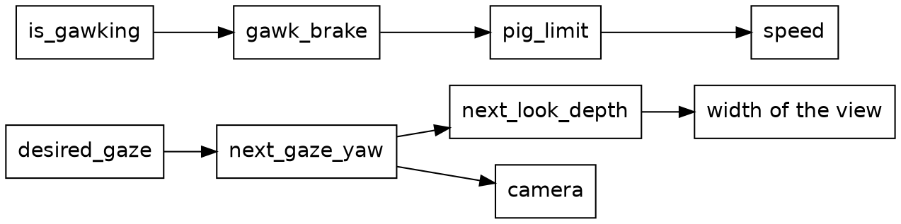

The chain from `desired_gaze` is the look, and the chain from `is_gawking` is the gawking. Nothing joins them. Both ask about the same pig, and neither asks about the other.

### The look

`Rider.rider_state_at_next_step` moves the eyes last, after the bike has moved:

{{code Gaze.eyes_at_next_step}}

Choosing where to look comes first:

{{code Gaze.desired_gaze}}

The pig has to be near, and it has to be in sight. Near means within 150 metres, measured along the road. In sight is an angle:

{{code Gaze.turn_to}}

That's the direction to the pig, less the way the bike points. The pig stands beside the road, so the angle grows as the rider comes closer. At 35 degrees the rider lets it go. There's no timer and no flag saying the look is over. The first pig stands about 11 metres from the middle of the road, so it reaches 35 degrees about 16 metres ahead.

### Turning the head

{{code Gaze.next_gaze_yaw}}

Toward a pig, the gaze turns by at most 4 degrees a step, and `clamped_within` holds the change to that limit on either side. On the way back it gives up a twentieth of its angle each step, and never more than 0.2 degrees.

A twentieth of what's left never gets to zero, so the `OnRoad` branch first checks whether the gaze is nearly home. Within 0.02 degrees, it snaps to straight ahead, and the return ends.

Nothing here turns the bike. The gaze goes to the camera, and to nothing else that moves:

{{code RiderCamera.view_yaw_for}}

The second term is the rider's head going with the lean. So when the rider looks right, the road slides left on the page, and the bike keeps going where it was going.

### The depth of a look

{{code Gaze.next_look_depth}}

While the gaze is off straight ahead, the depth rises with how far it has turned, and it doesn't drop. Once the gaze is home, the depth fades by 0.0012 a step. That's why the table in the rider chapter has a `look_depth` of 0.67 at step 1,570, with no pig in sight. The gaze came home 262 steps before.

The depth has one job. It widens the view:

{{code Gaze.gaze_attention}}

`RideFocal.ride_focal`, which sets how wide the view is, takes the stronger of this and what a crossing on the road asks for, which we'll meet with the cat. So a pig widens the view, and the view stays wide for a while after.

### Gawking

Whether the rider is gawking is a plainer question than whether it's looking:

{{code Gawking.is_gawking}}

It starts at the same 150 metres, but it only asks where the rider is. There's no angle in it, so it outlasts the look.

`pig_limit` is the third link in the throttle's chain. It asks `Gaze` for a brake, and takes it if that's harder than what it was offered:

{{code Throttle.next_speed from "Gawking.gawk_brake(motorcycle, seg)," to "Gawking.gawk_brake(motorcycle, seg),"}}

{{code Gawking.gawk_brake}}

The formula is the one the throttle uses for a bend, with a pig for a bend. The rider aims to be down to 0.2 metres a step by 25 metres before the pig. Past that point `room` would go below zero, so `gawk_least_distance` holds it at a metre and the brake stays on.

### The first pig

Here's all of that on the third segment of the route:

| Step | What happens | Speed | `gaze_yaw` | `look_depth` |
|---|---|---|---|---|
| 889 | The rider looks, with the pig just inside 150 metres | 1.94 metres a step | 4.0 degrees | 0.114 |
| 1,050 | The gaze is at its widest | 0.2 metres a step | 34.7 degrees | 0.991 |
| 1,051 | The rider lets the pig go | 0.2 metres a step | 34.5 degrees | 0.991 |
| 1,308 | The gaze is back on the road | 0.2 metres a step | 0 degrees | 0.989 |

The look takes 162 steps, and getting the eyes back takes 257. The rider crawls for 90 steps more with nothing to look at, and the segment ends at step 1,398. The gaze is home at every one of the ride's 18 crossings, and an expect holds that. A crossing needs no reset anyway: the bike doesn't turn at a seam, and `gaze_yaw` is measured from the bike.

That's the pig's part of the rider's step. The truck is the other stepped thing.

## The truck

The truck stays ahead of the rider all the way:

| Step | Rider, along the route | Truck, along the route | Lead |
|---|---|---|---|
| 0 | 0 metres | 500 metres | 500 metres |
| 2,000 | 1,819 metres | 2,186 metres | 366 metres |
| 4,000 | 4,607 metres | 4,968 metres | 362 metres |
| 6,000 | 6,481 metres | 6,632 metres | 151 metres |

New in this chapter:

- Roc: list patterns
- Modules: `Truck`, `TruckAhead`

The modules around `Truck`
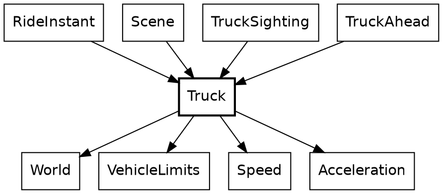

The truck is what the rider chases. It starts 500 metres ahead and keeps to a schedule that brings it to within 100 at the route's end. Its state is three fields:

{{code Truck.Truck from "How far along" to "pace : [Slowing, NotSlowing],"}}

The schedule is a straight line, and a pure function of the rider's progress, destructured from a record so the call site has to name both `Distance`s:

{{code Truck.tease_position}}

Its one caller is the truck's step function, the same shape as the rider's. `NextBend` is a tag union with a payload on one side, so the only way to read a `distance` is to be inside the branch where there is one:

{{code Truck.at_next_step from "tease = tease_position(" to "NoBendAhead => chasing_state_at_next_step(truck, tease)"}}

And that's called from `RideInstant.next`, in the chapter on stepping, with the rider's distance as the only thing the truck knows of the rider. Nothing in `Rider` imports `Truck`, and nothing in `Truck` imports `Rider`. The chase is one record literal in `RideInstant`.

Finding the next turn shows a list pattern. `[]` is the end of the route, and `[segment, .. as later_segments]` takes the first segment and names the rest. Recursion walks the list, carrying where the current segment starts. Elsewhere, the same walk is usually a `fold`.

{{code Route.segments_with_ends}}

It's called through a smaller function, which supplies the 0 so nobody else has to:

{{code Truck.next_bend}}

Then the two ways to take a step. Both sit below the block, private, and both are arithmetic on `Speed` by name. `target_speed.max(...)` keeps braking from undershooting, and `speed < truck.speed` is the whole of what turns on the brake lights. They're on while the truck is slowing down, and they go off when it's settled at the speed for the turn, even with the turn still ahead.

{{code Truck.braking_state_at_next_step}}

{{code Truck.chasing_state_at_next_step}}

`brake_lights` is state because it's a fact about the last step. Headlights aren't, and they stay out of `TruckState`. That's three of the four kinds in one vehicle: the place and speed are stepped, the headlights are clock-driven, and the tires don't change.

`TruckSighting` calls the distance to the truck `lead`, because the truck is being chased.

### One switch

Here are the truck's lights at three frames of the ride:

| Step | Headlights | Brake lights |
|---|---|---|
| 3,742 | `Off` | `On` |
| 5,700 | `On` | `Off` |
| 6,553 | `On` | `On` |

The modules behind the headlights
```dot
digraph headlights {
  node [shape=box, fontname="Helvetica"];
  RideInstant [style=bold];
  RideInstant -> Mountains;
  RideInstant -> Sky;
  RideInstant -> Truck;
  RideInstant -> SceneShapes;
  Mountains -> Sky;
  Mountains -> Clock;
  Sky -> Clock;
  SceneShapes -> TruckAhead;
  TruckAhead -> Truck;
}
```

The truck's headlights come on once the sun has gone behind the mountains, at step 4,039 of a ride that lasts 7,071. `Mountains` knows the skyline and already imports `Sky`, so the question is asked there. The argument is an opaque `Clock`, and the answer is a plain `Bool`, which is about to be turned into something better:

{{code Mountains.is_sun_behind_mountains}}

`Truck.Lights` is a record of two tag unions. Two independent lamps aren't one state with four values, so they're two fields:

{{code LitTruck.LitTruck from "Which of" to "LitTruck := {"}}

`RideInstant` puts it together. It's the only place that can. `Truck` is in the ride half of the system and `Mountains` is in the view, and no arrow goes from the first to the second. `RideInstant` imports both.

{{code LitTruck.at}}

Lamps are plain data. The sighting carries them, and the drawing does what they say, with each `match` covering both tags:

{{code LitTruck.truck_shapes from "beams =" to "].join()"}}

`TruckAhead` leaves the painting to two modules. `TruckBody` paints the trailer, the cab and the tires, far to near, and `TruckLights` paints the beams and the brake lights, each with its glow.

The sun and the beacons follow the clock alone. The cat has a more nuanced rule: the timing of its crossing depends on the rider's position.

## The cat

A cat walks out into the lane, freezes as the rider bears down on it, and leaps clear at the last possible instant. It's one of the most elaborate effects in Safari Ride, so this chapter takes some concentration. Unlike the sun, which follows the clock alone, the cat reacts to the rider.

```widget cat
Press play and watch the crossing.
```

Play it, and the gap falls from 50 metres to 0, with the rider held at a metre a step. The cat rests on the right verge until 41 metres, where the last line changes to "The rider may not accelerate". It walks out, and at 31 metres it freezes in the lane. It stays frozen down to 7 metres, coils, and is in the air from 6 metres to 4. At 3 metres it has collapsed on the far verge and the rider may accelerate again. Below that, nothing changes.

New in this chapter:

- Roc: type parameters, operators on opaque types, `var`, `for` and `return` in a pure function
- Modules: `Cat`, `CatCrossing`, `Animation`, `Beat`, `Beats`, `CatHeights`

The cat is one function, `Cat.instant_at`, with two jobs: work out how far along the crossing is, and look up what the cat does at that point. The module `Animation` sits under both.

The modules around `Cat`
```dot
digraph cat {
  node [shape=box, fontname="Helvetica"];
  Cat [style=bold];
  World -> Cat;
  CrossingReaction -> Cat;
  CrossingReaction -> World;
  CrossingSighting -> Cat;
  PosedCat -> Cat;
  PosedCat -> CatStills;
  CatStills -> Cat;
  Cat -> Animation;
  Cat -> Easing;
  Animation -> Easing;
  Animation -> Speed;
}
```

`Cat` says what a cat does, and `Animation` holds what a cat shares with a bird. Everything that uses a cat imports it, and `Cat` imports none of them: it doesn't know it's drawn, sighted or reacted to.

The widget isn't playing a video. Every gap it shows is a call to `Cat.instant_at`. The arrow is `->` again, so the type already says there's no hidden cat being updated somewhere. A timeline is a record of what the cat does at each point. Method syntax chains the two jobs: `.instant(...)` is defined on the `Timeline` that `crossing_timeline` returns.

{{code Cat.instant_at}}

A crossing and an approach go in, and the cat at that instant comes out. The same crossing at the same approach gives the same cat, a thousand frames apart.

`CrossingSighting.cat_in_view` calls it, adding the distance to the segment to get the gap:

{{code EncounterPoses.segment_cat}}

What `Cat` gets from `Animation` comes down to one type, `Stage`:

{{code Animation.Stage}}

`Stage` is the type where the function's two jobs meet. It's a tag union, and two of its tags carry a payload. You might expect `Waiting` and `Past` to be the same as progress of 0 and 1, but a critter can rest somewhere its animation never goes. If `Waiting` were just 0, a perched bird would show the first frame of its flight.

An `Approach` says how the rider is coming, and an `Instant` is the cat at one point in the crossing.

A rule turns an `Approach` into a `Stage`, and a timeline turns a `Stage` into an `Instant`. `crossing_stage` decides how far along things are, and `crossing_timeline` decides what that looks like. They know nothing of each other.

Here are the calls. In this diagram a box is a function, not a module, and an arrow is a call.

The calls from `Cat` into `Animation`
```dot
digraph cat_calls {
  node [shape=box, fontname="Helvetica"];
  fontname="Helvetica";
  subgraph cluster_cat {
    label="Cat";
    instant_at [style=bold];
    crossing_stage;
    crossing_timeline;
  }
  subgraph cluster_animation {
    label="Animation";
    stage_over_step_span;
    instant [label="Timeline.instant"];
    at_beat [label="Timeline.at_beat"];
    playing_at;
    pose_of;
    path_spot;
  }
  instant_at -> crossing_stage;
  instant_at -> crossing_timeline;
  instant_at -> instant;
  crossing_stage -> stage_over_step_span;
  instant -> at_beat;
  at_beat -> playing_at;
  at_beat -> pose_of;
  at_beat -> path_spot;
}
```

`Cat` reaches into `Animation` twice, once for each job. `crossing_timeline` calls nothing there, because all it does is build a record of what the cat does at each point in the crossing.

The rest of this chapter has three parts. First, we'll see when a crossing plays. Then we'll read the timeline, which says what the cat does at each point. Last, we'll see how it gets on screen.

### When it plays

How far off the crossing starts depends on the rider's speed:

| Rider's speed | The crossing starts at a gap of |
|---|---|
| 1 metre a step | 41 metres |
| 1.5 metres a step | 60 metres |
| 2 metres a step | 79 metres |

A faster rider sets the cat off sooner, so it's clear of the lane in time.

`Cat.crossing_stage` calls the rule with the cat's own numbers. A crossing takes 38 beats: 10 to walk out, 24 frozen, and 4 for the escape. A beat is the animation's own unit of progress, and it's tied to no clock.

{{code Cat.crossing_stage}}

The rule lives in `Animation`. It takes the cat's numbers and an `Approach`, which says how the rider is coming:

{{code EncounterPlan.StepSpan}}

`stage_over_step_span` destructures its first argument in place, and the `Approach` after it, so the body reads in plain names:

{{code EncounterPlan.planned_start}}

Neither field of an `Approach` is a plain number. `Distance`, `Speed` and `Beats` are opaque types, like `Clock` and `Angle`. A distance can't be passed as a speed, and a place in an animation can't be passed as a step of the ride. `distance_in`, on the second line, multiplies a speed by some beats and gives a `Distance`. `Speed` also derives `is_eq`, which is what lets `speed == Speed.at_rest` work with an ordinary operator.


The cat plays over beats rather than over a stretch of road because it has to finish before the rider reaches it, however fast the rider comes. A faster rider makes it start earlier. The bird uses `stage_over_gap`, because a bird simply reacts to how close the rider is. Each critter picks the rule that suits it.

### What it looks like

The two tracks of a crossing, in beats
```dot
digraph tracks {
  node [shape=record, fontname="Helvetica"];
  looks [label="looks|Stride and Rest\nto 10|Frozen\nto 34|Coil\nto 34.8|Flight\nto 36.8|Land\nto 37.8|Collapse"];
  path [label="path|Line across\nto 10|StaysAt\nto 35|Arc\nto 37|StaysAt"];
  looks -> path [style=invis];
}
```

A timeline is data, so the cat's whole performance reads in one place. This is the part of `crossing_timeline` that says how the cat looks:

The words are tags. `Through` and `Before` say where a stretch ends, and `Holds` and `Alternates` say how the cat looks. The poses are a closed tag union, so a `match` that misses one is a compile-time error.

{{code PosedCat.CatPose}}

A timeline is divided into stretches, and a cut is where one stretch ends and the next begins. A cut has to say which stretch its own beat belongs to, and two tags say that better than a boolean would. `crossing_timeline`'s comment says why it matters: the beats of the leap add up to a float just under the beat they stand for.

There are two tracks because a cat's looks and its movement change at different instants. Its body moves just ahead of its path, so the `looks` track above cuts at 0.8, 2.8 and 3.8 beats into the escape, while the `path` track cuts at 1 and 3. One list of phases tying them together wouldn't fit the cat or the bird.

The `path` track needs three places on the road. `spot_across` makes one, as a single record. It sits below `Cat`'s block, so it's private. `Along.start`, the first place on a segment, is a value and not a call, so this function calls nothing of Safari Ride's.

`crossing_timeline` calls it three times before the timeline starts:

Here's the `path` track:

`Timeline` is nominal, the middle ground: unlike an alias it can carry methods, and unlike an opaque type anyone can build one, which is right for data that needs no guarding. `Timeline(pose, lift)` takes two type parameters, which is how a cat and a bird share it. A cat fills the first with its own poses and the second with `CatHeights`, because a cat's lift off the ground is measured in its own height.

{{code Animation.Timeline from "## A whole animation" to "}.{"}}

### How a timeline plays

A timeline is data, so something has to play it. This section shows how, and it's where Roc's `var` and `for` appear inside a pure function. If you'd rather get back to the cat, you can skip to "Getting it on screen".

The code that plays a timeline is in `Animation`, and we'll start at an operator. `Beat.is_lte` opens two `Beat`s and compares the floats inside.


`is_short_of` is one `match`, and it looks like a leaf. It isn't, because `<=` on two `Beat`s is a call to `is_lte`, and `<` is a call to `is_lt`. An operator on an opaque type runs code of Safari Ride's own.

Finding the stretch that's playing shows one more Roc idea. In `playing_at`, `var $from` is a local variable that a `for` loop reassigns, inside a pure function. Roc allows that because nothing outside can see it: `playing_at` still has a `->` arrow, and the `$` marks what changes. An early `return` ends the loop.

`Timeline.at_beat` calls it once for each track, which is what lets the two tracks cut wherever they like. `Animation.Timeline.(timeline)` in a parameter list opens the nominal type, the way `Clock.(n)` opens an opaque one. `pose_of` and `path_spot` turn what's playing into a pose and a spot, and the bird chapter reads `path_spot`.

`Timeline.instant` is the one place that knows about stages. Its `match` covers all three tags, and `portion` turns a `Fraction` of the way through into a beat. It answers with an `Instant`, the cat at that point:

{{code Animation.Instant}}

{{code Animation.Timeline from "## The animal at `stage`." to "Past(_) => timeline.after"}}

Back at the top, nothing in `instant_at` is unknown any more.

{{code Cat.instant_at}}

`crossing_stage(approach)` is the rule with the cat's numbers, `crossing_timeline(cat)` is the timeline, and `.instant` plays the one at the other. A `Stage` is all that passes between them.

### Getting it on screen

The last step is finding the cat in the rider's view.

The modules that put a cat on screen
```dot
digraph screen {
  node [shape=box, fontname="Helvetica"];
  CrossingSighting [style=bold];
  PosedCat [style=bold];
  SceneShapes -> Scene;
  SceneShapes -> PosedCat;
  SceneShapes -> CrossingSighting;
  Scene -> CrossingSighting;
  CrossingSighting -> Cat;
  CrossingSighting -> RoadAhead;
  CrossingSighting -> DepthSort;
  PosedCat -> Cat;
  PosedCat -> CatStills;
  CatStills -> Cat;
}
```

`CrossingSighting` and `PosedCat` never import each other. `SceneShapes` is what carries a sighting's answer to the drawing.

`cat_in_view` places the cat and decides whether it's big enough to draw. An empty list or a list of one is how it says "maybe".

{{code EncounterPoses.segment_cat}}

`segment_cat` calls it for a segment with a cat, and `cats_in_view` flattens the answers with `join_map`, so a "no" simply disappears:

{{code EncounterPoses.cat_poses}}

Looking back over the chapter, notice what isn't in it: a cat in `RideInstant`, an update loop, or a flag saying the cat has already crossed.

Roc doesn't force that, but pure functions make the stateless version the easy one to write, and every `->` shows it stayed that way.

The cat also has an effect on the rider. A cat in the lane stops the rider speeding up, and that holds the rider back while the crossing plays. We'll come to that after the bird.

## The bird

The cat is built on a shared module, `Animation`, and one critter can't show whether that module was written for critters in general or just for cats. The bird is the second critter to use it. It's Roc's logo, sitting on a treetop. As the rider comes near it takes off, flies across the road and ahead, and drops onto a tree on the far side. It's a rider-driven thing like the cat, and it cost much less.

```widget bird
Press play and watch the bird fly.
```

Play it, and the gap falls from 75 metres to 0. The bird sits on the tip of the left tree, 6.4 metres up, until 60 metres. It takes off side on, turns away at about 55 metres, and reaches 10.7 metres near the middle of its flight, shrinking as it goes. It dives from 20 metres, and at 15 it's perched on the tip of the far tree, 4.9 metres up. Below that, the picture stays as it is.

New in this chapter:

- Roc: record update, tags inside tags, opening a `Try` by hand, `match` as an expression
- Modules: `BirdFlight`, `CrossingSighting`, `PosedBird`

The modules around `BirdFlight`
```dot
digraph bird {
  node [shape=box, fontname="Helvetica"];
  BirdFlight [style=bold];
  World -> BirdFlight;
  CrossingSighting -> BirdFlight;
  CrossingSighting -> PosedBird;
  CrossingSighting -> Animation;
  PosedBird -> BirdFlight;
  PosedBird -> BirdStills;
  PosedBird -> StillShapes;
  BirdStills -> BirdFlight;
  BirdStills -> Stills;
  StillShapes -> Stills;
  BirdFlight -> Animation;
}
```

The family has the cat's shape. `BirdFlight` says what a bird does and imports nothing that draws it. `CrossingSighting` finds it, `PosedBird` draws it, and `BirdStills` holds its pictures. `Animation` is underneath, and most of what the bird does is ask `Animation` for something.

`BirdFlight` does one addition, a tree's place plus `shortest_hop`, the shortest flight a bird will make. The rest is constants, tags and one timeline.

### Two rules

A rule turns where the rider is into a `Stage`. The cat's rule was `stage_over_step_span`, and the bird's is `stage_over_gap`. They say different things about the same road:

| | `stage_over_gap` | `stage_over_step_span` |
|---|---|---|
| It reads | The gap | The gap and the speed |
| It starts | 60 metres off, always | Earlier for a faster rider |
| It ends | 15 metres off, always | `ends_at` metres short, always |
| It's for | Something that reacts to how close the rider is | Something that has to finish in time |
| A stopped rider | Leaves the bird hanging where the gap puts it | Holds the cat at the start of its crossing |

The first argument of each is destructured in place, and both answer the same tag union. `stage_over_gap` has a shorter job, so here it is first. `Fraction.clamp` fits here because a rider far off gives a ratio well outside 0 to 1, and `<=` works on a `Fraction` because `Fraction` defines `is_lte`:

{{code EncounterPlan.stage_at}}

The bird calls it with two constants, and passes no speed, since this rule doesn't take one:

{{code BirdFlight.flight_stage}}

Beside it, again, is the cat's rule. Its second argument is the whole `Approach`:

{{code EncounterPlan.planned_start}}

The extra case in `stage_over_step_span` is there because its ratio divides by a stretch that a stopped rider makes zero. `stage_over_gap` divides only by constants, so it has no such case. That hanging bird is real: nothing in `stage_over_gap` knows a bird can't hover. The rider never drops below 1.1 metres a step inside a bird's 45 metres on this route, so it doesn't come up.

Now the one-liners, side by side. A bird's and a cat's `instant_at` have the same shape:

{{code BirdFlight.instant_at}}

{{code Cat.instant_at}}

Each is a rule's `Stage` handed to a timeline's `instant`. Neither half knows which other half it's been paired with. Call this *rule and timeline*: one function says how far along things are, and one piece of data says what that looks like. A third critter can take either rule with a timeline of its own, and a new rule would work with both timelines already written.

### A timeline one beat long

The two tracks of a flight, in shares of one beat
```dot
digraph flight_score {
  node [shape=record, fontname="Helvetica"];
  looks [label="looks|Side, wings beating\nto 0.12|Away, wings beating\nto 0.88|Diving"];
  path [label="path|Arc, from tree to tree"];
  looks -> path [style=invis];
}
```

`BirdFlight` sets the length of a flight to one beat, so that a cut on the timeline is simply a share of the flight:

The bird needs one small helper. It sits below the block, so it's private, and it builds an `Alternates` from two poses. `Animation.Looks(BirdFlight.BirdPose)` is `Looks(pose)` with the type parameter filled in, which is how the cat's timeline type came to fit a bird:

Then the timeline. `Animation.Timeline.( ... )` wraps a record in the nominal type, and `Side(WingsUp)` is a tag whose payload is another tag. `flight_beats.portion(takeoff_share)` is a method on the opaque `Beats`, and `Beat.at` makes a place of the length it gives. It reads almost like configuration, and most of it is:

Wings beat all the way through the first two stretches. `count` runs from the start of the timeline, so the wing beat carries on across the cut from side-on to from-behind without restarting.

The path track shows why a `Track` has `finally`. A flight is one unbroken curve, so it has no cuts at all:

That `Arc` is a tag. `path_spot` is where it's played. `{ ..on_line, lift: ... }` is record update: the spot on the straight line, with one field replaced. The curve is `4t(1 - t)`, a parabola that's 0 at both ends and 1 at the middle, so `rise` means what its comment says.

The stills are data too. Nested tags get checked all the way down, so a `match` that forgets `Away(WingsDown)` is a compile-time error. The function reads as a table, and there's nothing else in it:

{{code PosedBird.pose_still}}

`PosedBird.scenery_picture` hands that to `StillShapes.still_shapes`, the function that also draws a cow. A bird's feet reach the screen through `Camera.project`, as a tree's top does, and the math layer chapter shows how. That's the drawing.

### Finding a tree

Where a bird flies is decided once, when the world is built. `habit_from` shows the plain end of Roc's list functions. `keep_if` takes a closure, and `is_far_enough` is one, closing over `from`. `first()` answers a `Try`, which is one of the few that Safari Ride opens by hand. A route is a tag union with two tags: a bird with no tree to fly to `Sits`, which beats a flight of length zero.

{{code BirdFlight.flight_from}}

The caller's return type is written in place, a tag union that exists for this one function and fits straight into the `crossing` field of a segment:

{{code Segment.fifth_left_tree}}

And that's called from a `match` in the middle of a record, which is a reminder that `match` is an expression. The plan's plain `BirdHere` tag comes in, and `BirdHere(route_segments)` goes out:

{{code Segment.from_choices from "encounter: match choices.encounter {" to "QuietRoad => QuietRoad"}}

Each frame, a sighting reads the route back. The crossing is matched in full, so a third kind of crossing would stop here until someone says what a bird sighting should do about it:

{{code EncounterPoses.segment_bird}}

We didn't need any new machinery for the bird. Above their `expect`s, the four bird modules come to about 450 lines, a quarter of them coordinates for the stills. `Animation` has nothing in it about birds.

The bird asks nothing of the rider. The cat does.

## What a cat does to the rider

The loop between the cat and the rider
```dot
digraph reaction_loop {
  rankdir=LR;
  node [shape=box, fontname="Helvetica"];
  speed [label="the rider's speed"];
  cat [label="where the cat\nhas got to"];
  speed -> cat [label="  Cat.crossing_stage  "];
  cat -> speed [label="  CrossingReaction  "];
}
```

The cat chapter promised this. A cat in the lane has a say in what the throttle does, and `CrossingReaction` is where it speaks.

New in this chapter:

- Roc: an open record that's only read
- Modules: `CrossingReaction`, `RideFocal`

The modules around `CrossingReaction`
```dot
digraph reaction {
  node [shape=box, fontname="Helvetica"];
  CrossingReaction [style=bold];
  Throttle -> CrossingReaction;
  RideFocal -> CrossingReaction;
  CrossingReaction -> Cat;
  CrossingReaction -> World;
  World -> Cat;
}
```

`Throttle` sets the rider's acceleration, and `RideFocal` sets how wide the rider's view is. Neither knows anything of cats. They ask `CrossingReaction`, which is the only part of the rider's code that does.

Let's follow this back to `Cat`, to two small questions about the same `Stage`.

`is_crossing` asks whether the crossing is playing. `_` ignores a payload.

{{code Cat.is_crossing}}

`attention` is where `Past`'s payload is used. A cat in the lane also draws the rider's attention, which widens the view. `beyond` is how far past the end of the crossing the rider has come, and that attention fades over that distance, counted in beats. `beats_to_cover` divides by the speed, so a rider at a standstill gets an answer first. `Attention` is another opaque type.

{{code Cat.attention}}

`CrossingReaction.reaction_to` calls both. `..` in the argument's type makes it an open record, like `Bike.Motion`, though this one is only read and nothing comes back. This function needs `along` and `speed`, and accepts any record that has them, so it doesn't depend on `RiderState`, the rider's record. `speed` here is the opaque `Speed` again, and `match` on `segment.crossing` has to name every tag.

{{code EncounterReaction.encounter_throttle}}

A cat in the lane stops the rider opening the throttle, without braking, and widens the view as it pulls the rider's eye. Two tags, `MayAccelerate` and `NoAcceleration`, stand where a boolean might have gone. The next call up, `crossing_attention`, is one line, and its caller, `ride_focal`, works out the view's focal length:

{{code EncounterReaction.encounter_attention}}

{{code RiderCamera.ride_focal}}

This is the only feedback loop in the design. The rider's speed decides where the cat has got to, and the cat holds the rider's speed down. The loop settles, and it's why `stage_over_step_span` has to stay the cat's rule. A bird asks nothing of the rider, so it falls through to the same answer as an empty road.

Each stretch of road has exactly one `crossing`: `CatCrosses`, `BirdHere` or `QuietRoad`. A cat and a bird in the same place can't be written down.

One question about the rider is still open: how `Rider.decide` picks a lean.

## Rehearsal

Safari Ride's rider steers by rehearsing. Each step it tries twelve leans, and keeps one.

```widget rehearsal
Click a mark to see that try at a lean.
```

Each try lets a rider who doesn't exist coast down the road with one lean, and the white arc is where that rider goes. The yellow line is where the real rider wants to end up. A try that ends on the wrong side of it sends the next try the other way, and by the twelfth they've closed in. This is step 370 of the ride, just after the first bend.

New in this chapter:

- Roc: a `while` that stops early, with `return`
- Modules: `Coast`, `LeanSearch`

The rider has no steering wheel. Nothing tells it where to go. Each step, it has to choose a lean, and it does that by working out what would happen.

The calls of one rehearsal
```dot
digraph rehearsal {
  rankdir=LR;
  node [shape=box, fontname="Helvetica"];
  decide [label="Rider.decide"];
  best [label="LeanSearch.best_lean"];
  project [label="Coast.project"];
  advance [label="Bike.bike_motion_at_next_step"];
  decide -> best;
  best -> project [label="  12 tries  "];
  project -> advance [label="  a step at a time  "];
}
```

`Coast` answers one question. If the rider stopped changing anything now, and coasted, what would happen? It takes the rider, and it runs the physics. The call is the same `Bike.bike_motion_at_next_step` that moves the real rider, with no lean change and steady speed. That's why `Bike` has to be a function. A method that changed a bike in place couldn't be tried out like this.

{{code Coast.project}}

`Coast.project` takes a `Bike.Motion(others)`: a narrow view of a wide record again, so `Coast` can take the whole rider without knowing what's in it. The road's edges are its bounds. The `while` moves the bike a step at a time until the coast reaches the shoulder, makes 25 metres of progress, or runs for 2,000 steps, and `return` leaves the function from inside the loop. The answer says where the coast went:

{{code Coast.Outcome}}

`LeanSearch` asks `Coast` that question at a dozen different leans. The rider wants the coast to end somewhere near the middle of the lane, and more lean to the right moves the end of a coast to the right, so this is a bisection. It's a `for` loop, with `$low` and `$high` closing in on each other. `Bike.with_lean(state, mid)` is a rider who doesn't exist, handed to `Coast`, who gets a future that didn't happen:

{{code LeanSearch.search_tries from "mid = $bounds.low.halfway_to($bounds.high)" to "$bounds = bounds_after(lean_try)"}}

The decision about which way to go is a `match` on what the rehearsal found. Running off the left means more right, running off the right means less, and staying on the road compares the end of the coast with the target:

{{code LeanSearch.lean_correction}}

Its caller gives the search its bounds, at most a degree either side of the current lean. That's what stops the bike flicking from one lean to another:

{{code LeanSearch.best_lean}}

And `Rider.decide` calls that, on its first line. The walk up the stack ends there.

Call this *rehearsal*: run the real rules on a pretend copy, read the result, and throw it away. The numbers are worth stating. Twelve coasts for the lean and one more in `Throttle`, which uses `Coast` to ask whether the road is about to run out. Over the whole ride, a coast averages about 44 simulated steps. So each real step of the ride runs about 570 steps of bike physics that never happen, and the 7,071 steps of the ride come to about four million. With no drawing, on the dev backend, the whole ride takes about 1.6 seconds: about a quarter of a millisecond a step, against a budget of 33. [check: the 44 is `forward / speed` from one coast per step, measured at 9aa3814, not a counter inside `Coast.project`; the 1.6 seconds is one native run, and the page runs wasm.]

In a language with mutable objects, a rehearsal has a problem to solve before it starts. It needs to copy the rider, or save it and restore it, and it needs to be sure the copy really is one, all the way down. It needs to know that the physics doesn't quietly update something global, like a scoreboard or a random number generator. In Roc, none of that comes up. `Bike.bike_motion_at_next_step` has a `->`, so it can't reach anything but its arguments. The old rider stays intact because every rider does. A rehearsal that goes wrong costs nothing, and all of `LeanSearch` is 105 lines.

The last limit of the throttle is the same idea with one rehearsal in it. It runs the coast, and brakes only if the coast leaves the road:

{{code Throttle.shoulder_limit}}

That's the last of the rider.

## The math layer

All this time, a layer of math has been doing the measuring. This chapter works up from the floor.

New in this chapter:

- Roc: records as coordinate systems, `fold`, `fold_rev` and `map2`
- Modules: `Lens`, and `Geom`, `RoadAhead` and `Camera` in full

A lot of Safari Ride is math and physics, and most of it is geometry a reader could do on paper. It's here because this kind of code suits a compiled functional language unusually well, for a short list of reasons:

- A formula is an expression, and a function with no effects is the same thing with a name.
- Units can be types, for no runtime cost. [check: confirm a `::` wrapper around `F64` costs nothing at runtime, in the dev and wasm builds.]
- A coordinate system can be a record, so the fields say which one a point is in.
- It's compiled, so even the last chapter's rehearsals are affordable.

### The most imported modules

Safari Ride has 79 modules, not counting `web.roc`, `main.roc` and `game.roc`. The import graph is lopsided in a good way. Counting who imports what, leaving out the test programs, a handful stand out, and the lines here are the ones above each module's `expect`s:

| Module | Imported by | Lines | What it is |
|---|---|---|---|
| `Distance` | 44 | 62 | A length in metres |
| `Along` | 29 | 57 | A place along a segment |
| `Across` | 27 | 73 | A place across the road |
| `Angle` | 21 | 172 | Three opaque types for rotation |
| `Pixels` | 21 | 86 | A length on screen |
| `Geom` | 20 | 213 | Road points, rider points, and how to turn one into the other |
| `Fraction` | 19 | 92 | A ratio from 0 to 1 |
| `World` | 17 | 415 | The route |
| `RoadAhead` | 16 | 172 | Where the road ahead lies from where the rider is |
| `Scenery` | 15 | 48 | The words the world is built from, and the road's width |

After those ten the count drops to 12, for `Screen`, 11 for `Speed` and 10 for `DepthSort`. Most modules are imported by one, two or three others. `Shapes` is imported about as widely. It's in `lib/`, a folder of modules shared with the repository's other canvas apps.

These are the core utility modules. There are only ten, and nearly everything else is a small module that takes one of these and adds a single idea. Six of the ten are nothing but numbers with rules, and the top three are under 80 lines each. A cat, a tower and a truck are all found on the road through `RoadAhead`, and all reach the screen through `Camera`.

The modules of the math layer
```dot
digraph math {
  node [shape=box, fontname="Helvetica"];
  LeanSearch -> Coast;
  LeanSearch -> Bike;
  Coast -> Bike;
  Coast -> Angle;
  Bike -> Angle;
  RoadAhead -> Geom;
  Camera -> Geom;
  Camera -> Screen;
  Lens -> Angle;
  Lens -> Screen;
  Geom -> Angle;
}
```

Two families share `Angle` and don't otherwise meet: `Geom`, `RoadAhead`, `Camera` and `Lens` say how the world looks from the bike, and `Bike`, `Coast` and `LeanSearch` say where it's going.

### Numbers with units

Here we add a speed to a length:

{{fails speed_as_distance}}

Eighteen small opaque types run through Safari Ride, and the tour has met most of them one at a time. Set side by side, they're a system:

| Type | Under it | What it measures |
|---|---|---|
| `Clock` | `U32` | A place in the ride |
| `Steps` | `U32` | A length of time |
| `Angle.Bearing` | `F64` | A place on the compass |
| `Angle.Turn` | `F64` | The angle between two bearings |
| `Angle.Lean` | `F64` | Roll, which only reaches direction through a rate |
| `Distance` | `F64` | A length in metres |
| `Along` | `F64` | A place along a segment |
| `Across` | `F64` | A place across the road |
| `Pixels` | `F64` | A length on screen |
| `Speed` | `F64` | Metres a step |
| `Acceleration` | `F64` | Metres a step, each step |
| `Fraction` | `F64` | A ratio from 0 to 1 |
| `Attention` | `F64` | How strongly something holds the eye, from 0 up |
| `World.SegmentIndex` | `U32` | A place in the route |
| `SegmentPlace.Position` | `U32` | A place on the road ahead |

This is the opaque type doing the job of a unit. The block after each type is a small statement of dimensional analysis. `Speed.distance_in` takes `Steps` and gives a `Distance`. `Along.plus` takes a `Distance`, and two `Along`s give one back. `Lean.steer` takes a rate and gives a `Turn`. There's no `Bearing.plus(Bearing)`, because that sum has no meaning. If you try to write one, the compiler stops you.

The bug these prevent is the most common one in this kind of code: a correct formula with the wrong number in it. Most physics bugs type-check in a language where everything's a float.

The price is a long list of short methods, and a certain amount of `.to_radians()`. The headers of the float ones all say the same thing: "Each operation does the plain float arithmetic its name says." We'll see why that sentence matters in the proving chapter.

The units run from the road to the screen. Once a point is measured from the rider, its `right` and `forward` are `Distance`s, and a length on screen is `Pixels`. `Pixels` is signed, because a place on screen is measured from the corner, so a point off the left of the screen is negative, and so is the height of a sun below the horizon. It stops at the edge of `lib.Shapes`, which takes plain numbers. A formula wants floats, so `.to_metres()` unwraps one at the top of a function that's about to do trigonometry, and the answer is wrapped again at the end. `Along` can't be passed as `Across`, which rules out the classic swap in a function with both.

### One record per space

A point in Safari Ride is in one of four spaces, and the record's fields say which. Here we hand a point measured from the rider to a function that wants a point on the road:

{{fails rider_point_as_road_point}}

The points are plain records. They don't need to be opaque, since a record's type is its fields, and a `RoadPoint`'s fields are opaque already.

{{code Geom.RoadPoint}}

{{code Geom.RiderPoint}}

{{code Geom.RaisedPoint}}

{{code Screen.Point}}

Structural records give us *one record per space* at no cost: `along` and `across` are on the road, `right` and `forward` are from the rider, and `x` and `y` are pixels. Reading any function, the field names say where it is.

Going from the road to the rider is a translation and a rotation, and this is the function where the opaque places give way to floats. `distance_from` makes the translation, and the rotation is written the way it would be on paper:

{{code Geom.to_rider_point}}

From there to the screen is a pinhole camera, which is similar triangles. Dividing by `forward` is all of perspective. Nearly everything on screen passes through this function, and it's short:

{{code Camera.project}}

`PosedBird.scenery_picture` calls it with a record built on the spot for the bird's feet:

{{code StillShapes.standing_anchor from "projected = |above_ground|" to "feet = projected(spot.lift())"}}

The focal length comes from a lens. `resting_focal` is a value computed from other values, with no function in sight, and `field_of_view` is a `Turn`, so taking half of it needs no comment about radians. [check: whether a value like this inside a `.{ }` block is evaluated at compile time, as top-level values are.]

{{code Lens.resting_focal}}

The view widens as the rider leans. One `Fraction` goes in, and a focal length comes out. `RideFocal.ride_focal`, from the chapter on what a cat does to the rider, calls this through `cam_focal`, taking the wider of what the lean and the rider's attention ask for:

{{code Lens.focal_for_lean}}

{{code Lens.focal_for}}

### Round the bends

```widget route
The route again. This map comes from adding up the turns, which the ride itself never does. The white stretch is the record quoted below.
```

The road has no global coordinates. A point on it is measured within one segment, `along` and `across`, and nothing in the game holds a world coordinate for it. Each segment knows only its length and the turn at its end. `World.plans` is nineteen records like this one, and it reads like configuration: a list of plain values, with the tags declared by `SegmentPlan` and an opaque `Distance` and `Turn` built from their units. It's checked like any other Roc, so a misspelled tag is a compile-time error.

{{code World.bending_plans from "length: Distance.metres(1200.0)," to "bend_life: Animal(Rhino),"}}

So to see something three segments ahead, a point has to be carried back round each bend between it and the rider, one at a time. That's one rotation per bend, and `fold_rev` is the shape of it. The accumulator is a `RoadPoint`, it starts on the far segment, and each step moves it onto the segment before. `segments_before` gives the segments between, and the closure is the only thing the loop does. The last line does the one translation and rotation from above:

{{code RoadAhead.rider_point_ahead from "on_rider_segment =" to "Geom.to_rider_point(on_rider_segment, vantage)"}}

The rotation itself is plain, with two cases, because a right-hand bend pivots on the far side of the lane:

{{code Geom.point_in_segment_before}}

This is what lets `CrossingSighting`, `TowerSighting`, `TreeSighting` and the rest not care where a segment is. They name a position on the road ahead and a point on that segment, and they get back a `RiderPoint`. That's why `RoadAhead` has sixteen importers.

The ground also curves away. That's one formula, the small-angle drop of a sphere, with a record destructured in the parameter list and `right` and `forward` taken out to metres before they're squared. There are two radii in the program, and neither is the earth's. `Geom.ground_curve_radius`, 100 km, is the surface the road and the truck stand on, and it puts the horizon 490 metres out. `Tower.sink_radius`, 20 km, only sets how soon a far tower goes: a tower is gone at 1.8 km, where the ground's curve would leave it in view to 4 km.

{{code EarthCurve.ground_drop}}

### Cutting a polygon

Here's a triangle with one corner behind the rider, before and after cutting:

| | Corners, as metres right and metres ahead |
|---|---|
| Before | (0, -1), (2, 5), (-2, 5) |
| After | (0.47, 0.4), (2, 5), (-2, 5), (-0.47, 0.4) |

The corner behind the camera has gone, and two new ones stand on the camera's plane, 0.4 metres ahead.

Anything that crosses the camera's plane has to be cut, or dividing by `forward` flips it across the screen. The textbook algorithm walks a polygon's edges, keeping corners in view and adding a new corner wherever an edge crosses the plane. In Roc, that's a pairing and a `fold`. `map2` zips each corner with the next one, which is the list rotated by one, and `fold` builds the new polygon. `List.with_capacity` is the one line about performance, and `edge_points_onto` is passed by name:

{{code Geom.clipped_points}}

A fold's step is a plain function of the list so far and one edge:

{{code Geom.edge_points_onto}}

`Ground`, `GuardRail` and `TruckShape` call it the same way. `patch.corners.map(...)` makes the `RaisedPoint`s, and what comes back is a shorter or longer list of the same type:

{{code Camera.clipped_polygon from "in_front = Geom.clipped_points(" to "Ok(Polygon.flat_polygon(projected_points(in_front, cam_focal), color))"}}

### Arithmetic all the way down

At the very bottom are Roc's own builtins: `.sin()`, `.cos()`, `.sqrt()` and the rest. `Throttle.shoulder_brake_at` uses `F64.e.pow(x)` to turn a rehearsed coast's length into a braking force.

So from top to bottom, a rider chooses a lean by simulating physics, and the physics is plain arithmetic on opaque numbers. None of it has any effects. In the next chapter, we'll see what that's worth when the program has to change.

## Proving it

There are no animals in this chapter. It's about what happens to a program of this size when something has to change, which is the question a reader who cares whether Roc scales should ask.

The answer rests on one fact from the ride instant chapter. Three fields decide a frame, and a frame is a value. So a frame can be compared, exactly, with the same frame from an hour ago.

| Step | What the frame shows | Hash of its pixels | Shapes |
|---|---|---|---|
{{proof row 0 The start of the ride}}
{{proof row 100 A bird in flight}}
{{proof row 1529 A cat frozen in the lane}}
{{proof row 1542 The same cat in mid-leap}}
{{proof row 3000 The ride under way}}
{{proof row 3698 A distant truck, its glow barely a pixel}}
{{proof row 5700 The truck at dusk, lights on}}
{{proof row 6250 The truck braking in plain view}}
{{proof row 9000 Past the end, on the second lap}}

Each row is one frame of the ride. Run the ride to that step today and you get that hash and that many shapes, and a change to the program has to leave every row as it is. This page's numbers come from the same file the check reads, `gates/proof.expected`.

New in this chapter:

- Roc: `expect` with its data beside it, `crash` as an assertion, a fold whose direction matters
- Modules: `RasterFrame`, `ShapesFrame`, `StepBack`, `SafariFrame`, `ShapesPixels`

The proof tools and what they read
```dot
digraph proving {
  node [shape=box, fontname="Helvetica"];
  gates [label="the proof tools\nRasterFrame, ShapesFrame, StepBack", style=dashed];
  Tour [style=bold];
  gates -> Tour;
  gates -> SafariFrame;
  gates -> ShapesPixels;
  SafariFrame -> ShapesPixels;
  SafariFrame -> backdrop;
  ShapesPixels -> ScanlineFill;
  backdrop [label="the backdrop\nBackdropPixels, SunPixels", style=dashed];
}
```

Everything here lives in `gates/`, and the game never runs any of it. The merge gate is the check a change has to pass before it lands. It runs the lints, every `expect`, the tutorial's build and the proof tools. Its programs reach the game through `game.roc`, a package whose only job is to list the modules they read.

### A fixture is a value

Getting a test to step 1,570 of a game normally takes some doing. Here it takes a loop. `Tour.initial` is a value, and `Tour.step_forward` is the outermost step function. It wraps `RideInstant.next_or_restart`, quoted below, and it also trims the list of past instants. An `if` chain does the trimming, and its comment says why half of the list goes at once:

{{code Tour.step_forward}}

Testing here is just calling a function. There are no mocks, no fakes, no browser and no waiting. The tests are completely deterministic.

`RideInstant.next_or_restart` is one `if`, and it's worth seeing because it puts the end of the ride in one place. A ride that's finished starts again, so `Tour` needs no notion of game over:

{{code RideInstant.next_or_restart}}

### The frame hash

`RasterFrame` rides to a step, paints the frame into 576,000 exact pixels, and prints an FNV-1a hash of them. The painter is `SafariFrame`, in pure Roc. Its `ShapesPixels` does what `shapes_canvas.js`, the JavaScript that paints the page, does on a canvas. The gate holds each hash to a line of `gates/proof.expected`, exactly. There's no tolerance: one different pixel in one frame fails it.

A frame is only evidence for what's in it, so the steps in the table at the top of this chapter aren't arbitrary. The ride lasts 7,071 steps, so the clock at step 9,000 reads 1,928. [check: what 3,000 and 9,000 are there for; the gate's header doesn't say.]

We add a frame whenever something could go wrong without any listed frame changing. A brake light wired to `Off`, for example, would have passed every hash until we added step 6,553.

Exact hashes have a consequence that reaches into the code. Float addition isn't associative, so a sum's order is part of its meaning here. `World.route_length` says so in its doc comment, and it's one of the few places in Safari Ride where the direction of a fold is a decision:

{{code Route.length_of}}

That's also why each operation on `Speed`, `Fraction`, `Angle` and the rest does the plain float arithmetic its name says. An opaque type adds names and takes nothing away. A retyping that adds `Speed` to a module changes the types throughout, and if it leaves the arithmetic alone, every hash stays where it is. If a hash moves, the retyping changed the program, and the gate says so.

This is how the code in this tour got its shape. About fifty modules were renamed, retyped and reorganized, many of them in parallel, and each merge had to leave the frames alone. Roc's types caught what they catch, the hashes caught the rest, and the picture didn't change. [check: the number, and whether "many" should say how many at once.] A language with no hidden state doesn't make a refactor safe by itself. It makes it possible to write a test strict enough to be trusted.

There's one limit to all this. The hash proves `ShapesPixels`'s pixels, and the page's pixels come from the browser's canvas, with anti-aliasing. What the two share is the list of shapes. `web/page_check.mjs` runs each built page against a stand-in canvas, and past that the JS has only its own checks.

### Two more proofs

The second of these two proofs is here because of a real bug:

| | One step back from step 3,000 lands on |
|---|---|
| When the history kept its first 2,048 instants | 2,047 |
| Now | 2,999 |

`ShapesFrame` paints each frame twice: once with its polygons whole, as the browser gets them, and once cut into triangles, as the native program gets them. It counts the pixels that differ, and the gate requires zero of 576,000, at every step in the table.

`StepBack` checks that one step back goes back exactly one step, at depths either side of the history's cap. It's in the gate because the answer was once no, and its header says how: the list stopped recording when full, so a step back from frame 3,000 landed on 2,047. Holding the first 2,048 instants was a perfectly consistent thing for a list to do. The test works by asking `Tour.step_back` and comparing clocks, and since `Tour.step_back` is this small, there isn't much else to ask:

{{code Tour.step_back}}

### `expect`

The rest of the testing is ordinary `expect`s. An `expect` sits at the top level of a module, under the code it checks, and `roc test` runs it. There are over a thousand, and they're Safari Ride's only other tests. The tour has already shown twenty-six of them, in the whole of `Clock` and `Pond`. A pure function needs nothing else: literal arguments, literal answer. Each `expect` asserts one thing, and they cover both sides. `Clock`'s check that a clock equals itself one step on is false, so it's written with `!`.

A test's data can sit beside it as a plain definition. `Bike` doesn't import `RiderState`, and `Motion` is open, so its fixture is a record that has the six fields and makes up the rest. `segment` and `attention` are bare numbers here, because `Bike` carries them through and never looks. A narrow view of a wide record pays off twice: the test needs nothing the module doesn't.

{{code Motorcycle.riding}}

It's called like any other value, and the steps that follow are named, so three `expect`s can read them:

{{code Motorcycle.first_step}}

The gate makes `expect` honest in one further way. The gate takes its count from the source: every line that starts `expect`, in a module that one of its `roc test` runs compiles, has to print `PASS` exactly once. An `expect` that nothing compiles fails, and so does one that's indented out of reach. One more consequence: an `expect` can only name what its module imports, so a check sits where its test data can be seen, and a module doesn't take on an import for a test's sake. `Coast`'s projections are checked in `Throttle`, which can see a `Speed`, and `LeanSearch`'s search in `Rider`, which can see a `RiderState`.

Even a truck can be checked this way, though it can't be asked about step 4,000 cold. A `TruckState` is a record, so a test writes one down and calls `Truck.truck_state_at_next_step` once.

### Crashes that help

{{code Fraction.of}}

Every `Fraction.of` in the game is an assertion, and the gate runs a lot of them. A ratio outside 0 to 1 stops the program, with a sentence saying the sum behind it is wrong. `Try` is the right answer when a value can honestly be absent. This isn't that case. A wrong ratio is a bug, and the sooner it's a crash the better.

Here's one of the many places it's used, with `smoothstep` trusting its own algebra. A proof run rides through it thousands of times, so if the algebra were wrong, the gate would be first to know.

{{code Easing.smoothstep}}

The same holds for the code's other `crash`es, including two dozen `?? crash`es on lookups that can't miss. Each one states a belief about the program, and every gate run tests it.

### The page itself

This tutorial is built from the code. Every fenced snippet here came through Roc's own parser, by name, and each failing program is run through the compiler, which is quoted. The gate builds the page. So renaming a function quoted here fails the gate until the prose catches up, and the compiler message under `turn_as_bearing` is the compiler's.

Lints round it out: a set of lints for Roc source runs first, with each count held exactly, and every count is at zero. A name that's vague or a boolean parameter that should be a tag fails before a single hash is computed.

All of that runs without a screen. The tour still hasn't said how a list of shapes reaches one, or where the effects went.

## The platform

The platform is what puts the list of shapes on a screen: the host, the JavaScript, and the modules every canvas app shares. Safari Ride has very little to say about it, on purpose. "The part that isn't Roc", in the modules chapter, gave the outline, and this chapter adds the code.

The modules around `SafariApp`
```dot
digraph platform {
  node [shape=box, fontname="Helvetica"];
  web [label="web.roc"];
  SafariApp [style=bold];
  web -> WasmApp;
  web -> SafariApp;
  WasmApp -> CanvasApp;
  SafariApp -> CanvasApp;
  SafariApp -> Input;
  SafariApp -> Tour;
  SafariApp -> Backdrop;
  SafariApp -> Screen;
  SafariApp -> Shapes;
  CanvasApp -> Input;
  CanvasApp -> Shapes;
  Tour -> Shapes;
  Backdrop -> Shapes;
}
```

New in this chapter:

- Roc: an app as a record, `roc glue`
- Modules: `WasmApp`, `CanvasApp`, `Input`, `Shapes`

`WasmApp`, `CanvasApp`, `Input` and `Shapes` are in `lib/`, and they're the same for every canvas app.

| The same modules, built as | By | For |
|---|---|---|
| Wasm | `web.roc` | The page |
| A native program | The merge gate | The proof tools |
| A native program on roc-ray | `main.roc` | A desktop window |

### An app is a value

{{code SafariApp.canvas_app}}

An app here is a record, handed to a runner. `CanvasApp(model)` has a type parameter for whatever the app keeps. Safari Ride's model is its `Tour` and a pause flag, and the app reads like configuration, because almost all of it is.

`CanvasApp.untimed_model_at_next_step` takes a function and answers a function, the same one with a seconds argument to ignore. Safari Ride counts steps, and this is the place that says so: a runner offers the seconds, and they go nowhere.

`web.roc` is thirteen lines, most of them its header. Its body is `program = WasmApp.program(SafariApp.canvas_app)`, and that's the whole connection between the game and the web.

### Keys

The ride instant chapter showed `SafariApp.model_at_next_step` reading a snapshot of the keys. A snapshot is a value, so a test could write one down. Everything the keys do is a function from `Tour` to `Tour`, so moving four steps or one, forward or back, is one helper with a function in a record field. `var` is back, in a function that's still pure. `$tour` can't be seen from outside.

{{code SafariApp.repeat}}

`Tour.step_forward` and `Tour.step_back` are plain values to pass here:

{{code SafariApp.model_at_next_step from "if input.key_down(KeyRight) {" to "step_once: Tour.step_forward,"}}

### A frame is a list

| What's in the shapes of step 1,570 | How many |
|---|---|
| `Poly` | 2,706 |
| `Disc` | 7 |

What the game hands back each frame is a `List(Shapes.Shape)`. A shape is a tag: `Poly`, `Disc`, `Rect` and a few more, each with its fill. Two of them aren't shapes. `Blend` and `View` are marks in the list that change how what comes after them is painted, because a frame is a list, and a mark is the cheapest way to say that.

The rider's lean is one of those marks. The whole picture banks into a turn, backdrop included, so `SafariApp.frame_shapes` builds a camera out of nested tags and puts it at the front. The rest is `Tour` answering questions, each a one-liner:

{{code SafariApp.frame_shapes}}

{{code SafariApp.lean_space}}

### Where the effects went

One tick, in order
```dot
digraph one_tick {
  rankdir=LR;
  node [shape=box, fontname="Helvetica"];
  pace [label="canvas_app_runner.js\npaces the clock"];
  advance [label="advance\n(Roc)", style=bold];
  frame [label="frame\n(Roc)", style=bold];
  read [label="roc_glue.js\nreads the shapes"];
  paint [label="shapes_canvas.js\npaints them"];
  release [label="release\n(Roc)", style=bold];
  pace -> advance -> frame -> read -> paint -> release;
}
```

The game has no effectful functions, so where did the effects go? They never got as far as Roc. The wasm platform asks for a record of functions over a boxed model:

`init`, `model_at_next_step`, `frame_shapes`, `release`, `sounds`, `width`, `height` and `fps`, and for sound, which Safari Ride leaves empty, `tone_count`, `tone_freq` and `tone_ms`. Every one has a thin arrow, `->`. The host in `web/platform/host.zig` keeps the box, and all that crosses is numbers and a list of shapes. Wasm's edge has no records, so the input is flattened into seven numbers, and `Input.of` rebuilds it. `roc glue` generates `roc_glue.js`, which knows the layout of a frame in wasm memory, from `web/platform/Frame.roc`, so `roc_glue.js` is never edited.

Each step goes like this. `canvas_app_runner.js` paces the clock and gathers the keys. It calls `model_at_next_step`, then `frame_shapes`, in Roc. It reads the shapes back through the generated glue, and `shapes_canvas.js` paints them on a canvas. The host keeps the list until the next frame, then hands it back so that Roc can drop it. That's `release`, a function whose body is `{}`: Roc knows the layout of what it's dropping, and the host shouldn't have to.

The JS is about 490 lines for every canvas app there is. It knows nothing of cats. The only `!` names near Safari Ride are the `main!` and `echo!` of the gate programs, which are ordinary command-line apps, and the proof tools need them to print a hash.

The same modules are compiled three ways, which shows how cleanly the game is separated from the platform. The page builds them to wasm. The gates build them natively. And `main.roc` hands the same `SafariApp.canvas_app` to `native/CanvasAppRunner.roc` on roc-ray, a Roc platform for native graphics. That third one is the spike that proved the idea and it isn't kept current, as Safari Ride's README says, so the page is the maintained side. The first two run on every gate.

That's the last of the parts. Next, we'll put them back together by returning to the loop from the start of the tour.

## Zooming back out

Safari Ride is a loop. It designs a world once, and each time the clock ticks, it moves what moves, finds what's near enough to see, and draws it. Every box on that loop has now been opened.

```widget ride
The ride again, with nothing in it left unexplained.
```

The loop, and the chapters that opened it
```dot
digraph opened {
  node [shape=box, fontname="Helvetica"];
  world [label="design the world (once)\nThe world, The road"];
  tick [label="the clock ticks\nOne whole module"];
  move [label="move the rider and the truck\nStepping through the ride to The truck,\nRehearsal"];
  look [label="look around\nThe modules, The cat, The bird"];
  draw [label="draw it against the backdrop\nThe sky, The platform"];
  world -> tick;
  tick -> move;
  move -> look;
  look -> draw;
  draw -> tick [label="  next step"];
}
```

*[This chapter ties the tour together once the stepped things, the proof and the platform are written. It returns to the flipbook and the first diagram: the clock steps, and everything composes from three stored fields.]*

## Appendix: the patterns

The tour named nine patterns in passing. They're patterns in the loose sense: shapes that kept turning up, and that Roc makes easy to write and hard to break.

| Name | What it is | Where to see it |
|---|---|---|
| Worked out, not stored | Keep the few things that must persist, and derive the rest each frame | `RideInstant`, `Cat`, `Sky` |
| A sighting decides, drawing paints | A pure function answers with plain data, and something else draws it | `CrossingSighting`, `TowerSighting` |
| Places and distances | One opaque type for where, a second for how far apart, and only the sums that make sense | `Clock` and `Steps`, `Bearing` and `Turn`, `Along` and `Distance`, `Speed` and `Acceleration` |
| Rule and timeline | One function says how far along, and one piece of data says what that looks like | `stage_over_gap` and `flight_timeline` |
| The step function | A value goes in, and the next value comes out | `Rider.rider_state_at_next_step`, `Truck.truck_state_at_next_step`, `Tour.step_forward` |
| A narrow view of a wide record | An open record names the fields it uses and carries the rest through | `Bike.Motion(others)` |
| The chain of limits | One value passes through independent rules, each of which can only lower it | `Throttle.acceleration` |
| One record per space | Field names say which coordinate system a point is in | `RoadPoint`, `RiderPoint`, `RaisedPoint`, `Screen.Point` |
| Rehearsal | Run the real rules on a pretend copy, read the result, and throw it away | `Coast`, `LeanSearch`, `Rider.cross_if_on_road` |

Code that reads like configuration deserves a line of its own, because the tour kept stopping to admire it: `Pond`, `World.plans`, the timelines, and `SafariApp.canvas_app`. None of them is a config format. They're ordinary Roc values, so the compiler checks them, and a tag that's misspelled is a compile-time error.

## Appendix: what catches you out

This page lists what catches a reader of Roc out in Safari Ride, sorted by what shows up first. Everything on it comes from a chapter, and the last column says which.

### Reading the code

| What you see | What's going on | Chapter |
|---|---|---|
| A method call with no import | Static dispatch finds `next` from the type of the value | One whole module |
| A helper with no keyword to say it's private | Anything outside the module's block is private | The setting sun |
| A `match` that looks like a leaf and isn't | `<=` on an opaque type is a call to its `is_lte`, so an operator can run code of the program's own | The cat |
| `var` and `for` under a `->` | A local that nothing outside can see, with `$` marking what changes. The function is still pure | The cat |
| `?? crash` on a lookup | It isn't error handling. It states a belief about the program, and every gate run tests it | The world, Proving it |

### Getting it to compile

| What you see | What's going on | Chapter |
|---|---|---|
| An open record that has to be named | `..others` needs a name when it appears twice, because the name promises that the same fields come out as went in | The bike |
| An `expect` that can't see a type | It can only name what its module imports, so `Coast`'s projections are checked in `Throttle` | Proving it |

### Running it

| What you see | What's going on | Chapter |
|---|---|---|
| A crash with a sentence about a sum | `Fraction.of` takes a ratio that can only be in range. A ratio that can rightly fall outside wants `Fraction.clamp` | The sky, Proving it |
| A pose cut on the wrong side of its beat | The leap's beats sum to a float just under the beat they stand for, so a cut says `Through` or `Before` | The cat |
| The first frame of an animation shown too soon | `Waiting` and `Past` aren't progress of 0 and 1, because a critter can rest where no part of its animation reaches | The cat |
| A bird hanging in the air | `stage_over_gap` doesn't know a bird can't hover. A stopped rider would leave one there, and on this route the rider doesn't stop inside a bird's 45 metres | The bird |
| Beacons that stop, or run backward | The clock counts steps, not seconds, so pausing freezes them and stepping back reverses them | The beacons |
| A frame hash that moves after a sum was reordered | Float addition isn't associative, so a sum's order is part of its meaning | Proving it |
| A green gate over a wrong brake light | The gate is blind to whatever no listed frame shows | Proving it |
| A page that differs from the hashed frame | The hash proves `ShapesPixels`'s pixels. The page's come from the browser's canvas, with anti-aliasing | Proving it |

## Appendix: glossary

This book uses these words in one sense only.

| Word | What it means |
|---|---|
| Across | A place across the road, measured from its middle. Left is negative. |
| Along | A place along a segment, measured from its start. |
| Backdrop | The sky, the grass and the sun. It's the first thing in every frame. |
| Billboard | A critter that stands still and always faces the camera, like the elephant. The bull is the fanciest one, with gradients in its still. |
| Canvas | Where the painter puts shapes. Safari Ride's frames are for a canvas 960 pixels wide and 600 pixels tall. |
| Corner | One of the points of a polygon. |
| Critter | Any animal in the ride, from the cat to the elephant. It's just our word for them: other people would say animals. A tree or a tower is never a critter. Critters come in two sorts: billboards, and motion critters. |
| Depth | How far ahead of the camera something is. Far things come first in a frame. |
| Frame | Everything shown for one step: the backdrop, the mountains and the ground, then a series of pictures, far to near. |
| Gawking | What the speed does for a pig: it drops, and it stays down to the end of the segment. |
| Kind | Which sort of object something is, like `Conifer`. |
| Look | What the eyes do for a pig: they follow it until it's too far round. |
| Motion critter | A hand-drawn critter that moves, like the cat and the bird. |
| Object | A thing in the picture with a place of its own: a tree, a tower or a critter. |
| Painter | What puts shapes on the canvas. It's never Roc. |
| Picture | How one object looks in one frame. A frame holds a series of pictures, so the app never draws "a new picture" at each step. |
| Placed | Put on the road, measured `along` and `across` a segment, and `lift` off the ground. |
| Polygon | A shape with three or more corners, and nearly every shape in a frame is one. |
| Rendered | Made into a picture, with its depth attached. |
| Road ahead | The rider's segment and the segments after it, as far as the rider can see. |
| Route | The list of segments that makes up the whole ride. |
| Segment | One stretch of road, from one bend to the next. |
| Shape | One item in a frame's list, such as a polygon, a disc or a rectangle. |
| Sighting | An object's spot and its kind, for one frame. It's a `Pipeline.Sighted`. |
| Spot | Where an object stands in one frame: its place on the road, its height off the ground, and where that puts its foot in the rider's view. Its sighting works it out once, and every picture is drawn from it. It's a `Spot`, from the module `Spot`. |
| Step | One tick of the ride. Each step has one frame. |
| Still | A critter's drawing, as polygons traced ahead of time. |
| Tier | One layer of a conifer's crown. |

## Credits

Safari Ride was designed by Steve Howell. Claude wrote most of the code and this tutorial under his direction.

The animals by the road are drawn from Microsoft's [Fluent Emoji](https://github.com/microsoft/fluentui-emoji), in its Flat style, under the MIT license.

The way these chapters open and close, the predictions under the widgets and the page of surprises are ideas from Braeden Foster's [Rocco tutorial](https://github.com/Pixelsprout/rocco-engine).
