# Safari Ride: a tour of a real Roc program

Safari Ride is a small Roc program with a lot to look at. This book reads it with you.

## Introduction

Safari Ride is running in the page below. It's a big page, so give the ride a little while to load. Then it starts by itself.

```widget ride
The ride, running as you read. Click it to give it the keyboard: Space pauses it, and the arrow keys step it.
```

Watch it all the way through. A motorcycle carries its rider down a long country road. Cows and pigs graze in the fields, and trees crowd the roadside. A truck runs on ahead. A cat waits by the road for its moment to cross, and a bird takes off as the rider comes near. As the sun sets behind the mountains, the truck turns on its headlights. At the end of the road the rider stops, and the ride starts over.

Safari Ride is written in Roc, and this is a book about Roc. Roc is fun to read, and the book quotes the real code behind everything on the screen. If you're brand new to Roc, the [official Roc tutorial](https://www.roc-lang.org/tutorial) makes a quick first stop. The book explains each new Roc idea where the code first needs it.


## The problem

Safari Ride shows a world in motion, seen from the rider's seat. It draws that world on the screen thirty frames a second, and whoever is watching can take the controls at any moment.

That's what you see. For us, it's an engineering problem, and our first job is to break it into pieces we can build one at a time. A screen shows things from a world, and those come first. We hold one frame still and get it right before anything moves, and the controls come last. That plan costs something: the first half of the book holds one frame still. In return, every piece we build stands on a piece that already works. The plan gives the problem five pieces.

The first is things. A tree, a cow and a radio tower each become shapes the screen can show. Every frame starts from a blank screen, so every frame needs all of its shapes, every time.

The second is the world. A long road runs through open country, past trees, herds, ponds and radio towers. Something has to say where every one of them stands.

The third is the rider's view. The screen shows only what the rider sees. A tree far down the road looks small, and a tree close by looks big. For everything in the world, the program works out where it lands on the screen, and how big, if the rider sees it at all. Where two things overlap, the nearer one covers the farther one.

The fourth is motion. The rider rides on, the truck drives ahead, the cat crosses the road and the sun goes down. At every step, something has to move each of them on, and the moves fit together. The cat times its crossing to the rider coming toward it, and a cat in the road stops the rider speeding up.

The fifth is the person watching. A viewer mostly sits back and watches, but they also need to pause the ride, step it forward and rewind it. So the program gives them controls they can find, and answers each one straight away.

The first three pieces give us one frame, held still. The last two set it moving, and put it in the viewer's hands. Next, we see where Roc code lives, and then we give each piece its types.

## Platforms, packages and modules

A Roc program runs on a platform, it's made of modules, and it can use packages. Those three words say where Safari Ride's code lives.

A platform is the layer underneath a Roc program that deals with the outside world. For Safari Ride, that's the screen and the keyboard. The Roc code describes each frame, and the platform paints it. In this page, the platform is WebAssembly and a little JavaScript. On a desktop, the same Roc code runs on a native platform called roc-ray.

Each Roc program is an app, and the app's first line of code names its platform. Here's Safari Ride's app for the web, the whole file:

{{module web}}

Lines that start with `#` are comments. The first line of code names the platform, and gives it the short name `pf`. It also names a package, `lib`. A package is a bundle of modules: the app gives it a short name, and the path says where it is. The `lib` package holds what Safari Ride shares with the live pictures in this book, such as what a shape is and what a key press is.

A module is one file of Roc, named for what it holds. `SafariApp.roc` holds the `SafariApp` module, and `import SafariApp` brings it in. `import lib.WasmApp` brings in the `WasmApp` module from the `lib` package.

The brackets after `app` name the two things the app hands the platform, and the last two lines define them. `Model` is the type of what the app keeps as it runs, and here it's the one in `SafariApp`. `SafariApp.canvas_app` is the whole ride as one value, and the `WasmApp.program` function fits it to the web platform. What it gives back is the app's `program`.

Every piece we build, from a tree to the cat, lives in a module, and the platform paints whatever those modules describe. Next, we read the types those modules hold.

## The pieces as types

Types are at the heart of every Roc program. A type says what a value holds, and the compiler checks every value against its type before the program runs. So a good way to meet a Roc program is to read its types.

This chapter takes one tour across Safari Ride, with a stop for each of the five pieces from "The problem": things, the world, the rider's view, motion and the person watching. At each stop we read the types for that piece. On the way, you learn to read the types Roc programs are built from: numbers, records, tags, type variables and the types of functions. The functions come later, piece by piece.

### Numbers at the bottom

Every type is built from smaller ones, and at the bottom are Roc's own primitive types. Safari Ride's are nearly all numbers. Here's a small type built around one:

{{code Distance.Distance from "Distance ::" to "F64.{"}}

`F64` is one of Roc's number types, a 64-bit floating-point number. A `Distance` wraps one, a length in metres, and the `::` makes it opaque: only the `Distance` module reads the number inside. Everywhere else, a length is a `Distance`, and the compiler keeps it apart from every other number.

Roc has text too, in its `Str` type. Safari Ride describes pictures, so its types are numbers and the records and tags built on them, and `Str` appears in it only rarely.

### Things

```widget frame moving
Step 1,529 of the ride, held still: the frame these types describe.
```

Every thing beside the road has a kind, and each kind is a type. A tree is a `Conifer`, a cat is a `Cat`, and a radio tower is a `Tower`. A cow is a `Billboard`, an emoji that stands on the grass, square to the rider, looking left or right:

{{code Billboard.Billboard from "Billboard ::" to "}.{"}}

Here's what each piece of it says:

| Code | What it says |
|---|---|
| `Billboard ::` | `Billboard` names the type. The `::` makes it opaque, as it does `Distance`: only the `Billboard` module reads its fields. |
| `{` and `}` | The curly braces hold a record type's fields together. |
| `emoji : EmojiStills.EmojiStill,` | `emoji` names a field, and `EmojiStills.EmojiStill` names its type: the `EmojiStill` type in the `EmojiStills` module. |
| `height : Distance,` | `height` names a field, and `Distance` names its type: the main type of the `Distance` module. |
| `facing : Billboard.Facing,` | `facing` names a field, and `Billboard.Facing` names its type: the `Facing` type in the `Billboard` module. |
| `.{` | The type's own functions and types start here, where the listing stops. |

A module's main type has the module's own name, as `Billboard` and `Distance` do. Wherever it's used, every other type a module offers carries the module's name in front, as `EmojiStills.EmojiStill` and `Billboard.Facing` do.

A `Billboard.Facing` is one of two tags, `FacesLeft` or `FacesRight`. A tag is a name the compiler knows, and a type made of tags lists every one it allows.

For each frame, a thing gives the shapes that draw it, in the order they're painted. We call those shapes its sprite, and we use the word loosely. Here's the `Sprite` type:

{{code Sprite.Sprite from "Sprite ::" to ").{"}}

A `Sprite` is opaque, like `Billboard`, and it holds a `List(Shapes.Shape)`: a list whose items are each a `Shape`, from the `Shapes` module. Nearly every shape has straight edges. A far tree's sprite is one rectangle of trunk under eight triangles.

A frame's picture is the sky and the ground, with the sprites of everything in view on top, as one list of shapes, made fresh every frame. The Roc code describes that list, and the platform paints it. Seeing works this way in the real world, too. Light brings your eyes information, and your mind makes the picture.

### The world

A sprite says how a thing looks. Where it stands is the world's job. The `World` module plans the road as a short list of stretches, called segments, and each segment's plan is a record of the `SegmentPlan` type:

{{code World.SegmentPlan}}

Lines that start with `##` are doc comments. A plain `:` gives the record type a short name: any record with these fields is a `SegmentPlan`, so any module can build a plan and read its fields. Here's the plan for the last stretch of road:

{{code World.last_plan}}

After a value's name, a `:` gives the value its type, so the first line says `last_plan` is a `SegmentPlan`, and the rest defines it. `Distance.metres(300.0)` calls the `metres` function in the `Distance` module. Each field holds a value of its own type: 300 metres of `Distance`, and a tag for each of the others. On this stretch, a cat crosses the road. The `World.route` value is the whole road, built from the plans once, before the ride starts, and every tree, herd, pond and tower takes its place along it.

```widget route
The whole route from above, one stretch of road for each plan. A mark in the middle of a stretch shows that its plan has a cat cross or a bird fly.
```

### The rider's view

The screen shows only what the rider sees. So the camera sits where the rider sits, and faces where the rider looks. Each thing takes three forms on its way to the screen, and each form is a type. First, the thing is placed on the road:

{{code Geom.Placed}}

The `kind` in parentheses is a type variable: it stands for whatever type fills it. So a cow on the road is a `Geom.Placed(Billboard)`, whose `kind` field holds a `Billboard`, and a tree is a `Geom.Placed(Conifer)`. One type serves every kind.

Then the camera sights the thing:

{{code Pipeline.Sighted}}

A sighting keeps the kind, and adds a `Spot`: where the thing stands in the rider's view. From the spot, the thing's height and the camera's lens, we get where the thing lands on the screen, and how big it looks there. One rule gives both, the rule a pinhole camera follows: twice as far away looks half as big.

The camera refuses a thing out of the rider's sight, with a tag that says why. `BehindCamera` means it's behind the camera, or too close to it to draw, and `BelowHorizon` means the curve of the earth hides it.

Last, the thing is rendered:

{{code Rendered.Rendered from "Rendered ::" to "}.{"}}

A rendering holds the thing's sprite, and its depth: how far ahead of the camera it stands. The kind is gone, so trees, cows and towers all meet in one list of renderings. We sort that list far to near and paint it in that order, so nearer things cover farther ones.

### Motion

So far the ride stands still. To set it moving, one record holds the whole ride at one moment:

{{code RideInstant.RideInstant from "RideInstant := {" to "}.{"}}

The `:=` makes `RideInstant` nominal: a new type, apart from every other record with the same fields, as an opaque type is. Any module can read a nominal type's fields. Those four fields are everything the ride carries from one step to the next: the rider, the truck, the clock, and the plan for when the cat or the bird ahead starts to move. We derive everything else that changes from them. The sun goes down because the clock says so.

A step is one function's job, and its type tells the story:

{{signatures RideInstant.next_or_restart}}

That's the function's type annotation, the line above its body. When a function's body is long, the book shows the annotation alone, until the body's turn comes. After the colon comes the function's type: the types it takes, then an arrow, then the type it gives back. The `next_or_restart` function takes the route and one moment of the ride. It gives back a type written in place, in square brackets: one of two tags. A tag can carry a value, and each of these carries the next moment. `Continued` carries the moment one step on, and `Restarted` carries the ride's first moment, once the rider has finished the route.

Inside the step, the four fields move in a fixed order, so the moves fit together: the rider reads what the cat or bird ahead is doing, and then moves. The second half of the book reads that order line by line.

### The person watching

The controls are a handful of keys, named beside the ride. The app's model, what it keeps as it runs, is one line:

{{code SafariApp.Model}}

The `motion` field's type is written in place, as two tags. The tour holds the route, the moment on show, and every moment before it since the ride last started:

{{code Tour.Tour from "Tour :: {" to "}.{"}}

Because the tour keeps every past moment, stepping back is as quick as stepping forward: the tour takes the moment before, and the frame is drawn from it like any other.

### Where we start

That's five pieces, and the types for each. On the way, you've read a number type, records, tags, a type variable and a function's type. You've also read three ways to name a type. A `:` gives a type a short name, and any value of that shape fits it. A `::` makes a new, opaque type, and only its module reads inside it. A `:=` makes a new, nominal type, and any module reads its fields. You'll meet all of them on almost every page from here on.

The rest of the book builds the pieces in order. So we start with things: what a cow, a tree or a tower is in the code, and how a thing becomes a sprite.

## Things

The things beside the road are its trees, its radio towers and its animals. Here's a cow and a bull on the grass, drawn by Safari Ride's own code:

```widget cow
A cow and a bull on the grass beside the road.
```

The ride has a lot of animals: herds of cows, some led by a bull, herds of pigs, ducks on the ponds, and an elephant at a bend in the road. The cat and the bird move, and they get chapters of their own. Every other animal is a billboard: a flat picture of its emoji, standing on the grass and turned square to the camera, like a cardboard cutout. That takes far less code than modeling an animal, and it's charming. A billboard faces left or right, and one that faces right is its emoji mirrored. That's the `Billboard` type from "The pieces as types": an emoji, a height and a facing. Each emoji was traced into polygons ahead of time, and the `EmojiStills` module holds them as plain data. The tracing itself is beyond this book.

A billboard animal starts from a record of the `Billboard.Species` type: its emoji, and how tall a grown one stands. A plain `:` names that type, so any module reads its fields. Here are the cow's and the bull's, from the `CowHerd` module:

{{code CowHerd.cow}}

{{code CowHerd.bull}}

The bull's height comes from the cow's. `cow.adult_height` reads a field of the `cow` record, and `.times(1.15)` calls the `times` function that comes with the field's type, `Distance`. It's another way to write `Distance.times(cow.adult_height, 1.15)`. So a bull stands 15% taller than a cow.

### Calves

A herd looks better with a few calves in it. The ride's rule is simple: number a herd's cows from 0, and make cows 1, 5, 9 and so on calves: every fourth cow, starting with cow 1. A calf is a billboard half as tall as a grown cow. Here are twenty cows in a row, numbered:

```widget herd
Twenty cows, numbered from 0. Cows 1, 5, 9, 13 and 17 are calves.
```

How does the code pick the calves? With a function. A Roc function usually comes in two parts. On top is its type annotation: its name, a colon, and its type. Under it is its definition: its name again, an `=`, and the function itself. Here's the function that picks the calves, with a doc comment above both:

{{code CowHerd.is_calf}}

The annotation says `is_calf` takes a `U64`, a whole number from zero up, and gives back a `Bool`, `True` or `False`. In the definition, `|cow_number|` names what the function takes, and what follows is its answer. `cow_number.rem_by(4)` likewise calls the `rem_by` function that comes with a `U64`, and gives the remainder after dividing by 4. Then `==` compares that remainder with 1, which gives the `Bool`. So a cow whose number leaves a remainder of 1 is a calf.

A second function puts `is_calf` to work. It gives each cow in a herd its billboard:

{{code CowHerd.cow_billboard}}

Its answer is an `if`, which picks one of two values: a young billboard when `is_calf` says `True`, and a grown one when it says `False`. Both are cows, facing right, built from the `cow` record above. A `Billboard` is opaque, so only the `Billboard` module can build one, and `young_billboard` and `adult_billboard` are two of the ways it offers. The herd calls `cow_billboard` for every cow it places.

### What drawing a thing takes

Calf, cow or bull, the ride draws a billboard the way it draws every kind of thing beside the road: with a function called `scenery_sprite`, in that kind's module. The `Billboard` module's `scenery_sprite` has a longer definition, built around a `match`, a way of choosing between tags that the next chapter teaches. So here's its annotation alone, the line that sits above the definition, from the `Billboard` module:

{{signatures Billboard.scenery_sprite}}

It takes a `Billboard` and a setting, and gives back a sprite. The `Conifer` module's `scenery_sprite` takes a tree instead, and the `Tower` module's takes a tower, but every one takes a setting and gives back a sprite. So whatever its kind, a thing in a frame comes out as a sprite.

A setting is a record:

{{code Sprite.Setting}}

The `focal_length` says how strong the camera's lens is, in `Pixels`, the screen's unit of length: the longer it is, the bigger everything looks.

The `spot` comes from a camera: it's what a sighting holds. So to draw the cow and the bull, the picture at the top of this chapter puts each one on the road by hand, the cow 10 metres ahead and 5 metres left of the middle, and lets a camera at the start of the road sight them. The rider's own camera comes in a later chapter.

What comes back is a sprite, and every sprite is a list of shapes. The cow's sprite is its emoji, drawn as polygons. Most of the ride's shapes have straight edges. At step 1,529, the ride draws 2,121 shapes on top of the sky and the grass: 868 triangles, 727 quads, 518 polygons and 8 discs. 136 of the quads are the trees' trunks.

At the bends in the road stand four more kinds of billboard animal: elephants, giraffes, zebras and rhinos. They come next, with the `match` that mirrors the ones that face right.

## Billboard Critters

Four kinds of big animal stand at the bends in the ride's road: elephants, giraffes, zebras and rhinos. Each animal stands with its baby:

```widget bend_animals
The four bend animals and their babies, lined up on the grass: two pairs face right, and two face left.
```

Each emoji shows its animal from the side, so a billboard faces left or right, and your eye follows its gaze.

### Two ways to face

The `Billboard` module gives those two ways a type of their own:

{{code Billboard.Facing}}

The type is a list of tags in square brackets. A tag is a name the compiler knows, and it's a value in its own right: `FacesLeft` is a value, and so is `FacesRight`. A type made of tags is a tag union, and a value of a tag union is always exactly one of its tags. So a `Facing` is `FacesLeft` or `FacesRight`.

"Things" showed the annotation of `Billboard.scenery_sprite` alone. Here's the whole function:

{{code Billboard.scenery_sprite}}

`|Billboard.(billboard), setting|` says what the function takes: a billboard and a setting. A `Billboard` is opaque, and `Billboard.(billboard)` opens it: it unwraps the billboard into a record named `billboard`, so the function can read `billboard.facing` and the other fields. Only the `Billboard` module can write that.

The body is a block, in braces. A block holds lines of code, where a record holds fields with colons. Its first line names a value, `flip`, and its last line is the function's answer.

In that answer, `billboard.emoji.still()` calls the `still` function that comes with the emoji, which gives its traced still. `StillShapes.standing_still_shapes` makes shapes from it at the billboard's height, and `Sprite.from_shapes` makes those shapes a sprite. In that last record, `flip` alone is short for `flip: flip`.

Every emoji is drawn facing left, so a billboard that faces right needs its emoji mirrored. The `match` makes that choice. It looks at `billboard.facing`, and each line under it takes one tag and gives back what to do: `FacesLeft` gives `AsDrawn`, and `FacesRight` gives `Mirrored`. Those two are the tags of another tag union, `StillShapes.Flip`, and `flip` names the one the `match` picks. The compiler works out the type of `flip` from where it's used.

A `match` handles every tag of its type, and the compiler checks that it does. Leave out the `FacesRight` line, and the compiler stops with an error that names it:

```text
This match expression doesn't cover all possible cases.

Missing patterns:
        FacesRight
```

So every billboard faces one of two ways, and the code that draws it handles both, by construction.

### Four animals

The bend animals are a tag union too, with four tags:

{{code BendAnimal.BendAnimal from "BendAnimal :=" to "Rhino]"}}

Each tag is an animal. `BendAnimal` uses `:=`, so it's a nominal type: a new type, apart from any other tag union with the same tags. The `species_of` function turns each one into its species record, an emoji and a grown height, like the cow's in "Things":

{{code BendAnimal.species_of}}

This `match` is about as plain as one gets: a tag in, a record out, one line per animal. Its four lines are the four tags, so every bend animal has a species, and a grown giraffe is always 4.5 metres tall.

### One thing at a bend

A bend is quiet, or it holds one thing: an animal and its baby, or a pond of ducks. The `Segment` module's `BendLife` type says what's at a bend, and it says exactly that:

{{code Segment.BendLife}}

`Quiet` and `DuckPond` are plain tags, like the ones above. `Animal(BendAnimal)` is a tag that carries a value: an `Animal` always comes with one `BendAnimal`. So `Animal(Giraffe)` is a whole value, a bend with a giraffe at it.

The route's plan stores a `BendLife` for each bend. A plain list of billboards there would let a giraffe and a duck pond share one bend. A `BendLife` is exactly one of its three tags, so a bend gets one thing, and the list of its billboards is worked out from that one thing.

What a bend's life can be
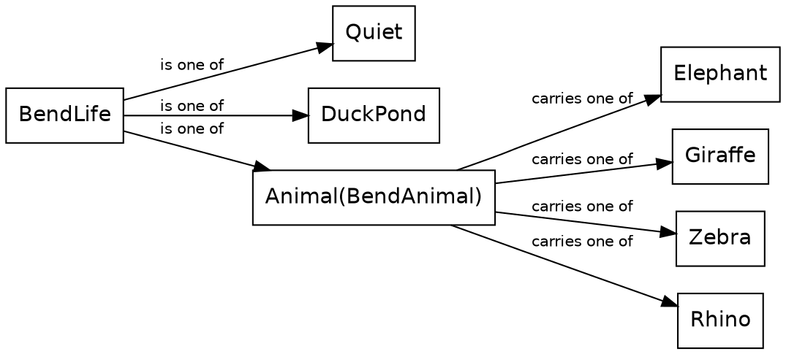

The function that gives a bend its billboards takes the bend's life and the bend itself, a `Geom.Bend`, and takes the life apart with a `match`:

{{code Segment.bend_billboards}}

The `Animal(animal)` line matches a bend with any animal at it, and names the animal it carries `animal`, ready to use. Then `animal.bend_billboards(bend)` calls a different function with the same name. `animal` is a `BendAnimal`, so the call goes to the `bend_billboards` that comes with `BendAnimal`, which places the animal and its baby. A duck pond gets its ducks from the `Pond` module, and a quiet bend gets the empty list, `[]`. The code has the same shape as the type: one line for each tag, and the value a tag carries named right where the line needs it.

### Elephants, mostly

The route's plans say what lives at each bend, and most of them say `Animal(Elephant)`. Only a handful say `Animal(Giraffe)`, `Animal(Zebra)`, `Animal(Rhino)` or `DuckPond`. That's on purpose. The ride is more interesting when most of it is ordinary: the elephants are the fixture, so the rare animal is a surprise.

A tag union lists everything a value can be, and a `match` handles each case. The emojis came ready-made, traced ahead of time. Next, we draw with shapes of our own: a triangle and a rectangle.

## Shapes

A far tree in the ride is a rectangle of trunk under eight triangles. So before the tree, we draw its two shapes: a triangle and a rectangle.

In Roc, a shape is a value that describes something to paint: a region of the screen, and a fill for it. The `Shape` type lists the regions the platform paints, one tag for each:

{{code Shapes.Shape from "Shape : [" to "Polygon({ corners"}}

Each tag carries a record of its data, and every record ends with a `fill`, the paint for the inside. A `Triangle` holds three corners, so every triangle has exactly three, by construction. A `Rectangle` is an upright box, a `Disc` is a circle, and a `Polygon` is any other shape with straight edges. A corner is a `Point.Point`: an `x` and a `y`, measured from the top left of the screen, with `y` growing downward.

### A triangle

Here's a triangle:

```widget shapes triangle
A green triangle on a plain background.
```

And here's the code that makes it:

{{code ShapesWidgetApp.green_triangle}}

The value is a `Triangle` tag with its record, and it's a `Shapes.Shape`, because a `Shape` is what the platform paints. `Point.at` makes a corner from two numbers, and `Brush.flat` makes a fill of one color. `0x2e8b57` is the color, the six hex digits a web page writes after its `#`.

A point's `x` and `y` are each a `Pixels`: an opaque type around an `F64`, like `Distance`. The ride works in metres on the road and pixels on the screen, so two types keep the two apart, and a reader always knows which one a number is. Roc is just as happy with plain `F64`s, if you prefer that style. In a program that moves between the road and the screen all the time, the types earn their keep.

So what draws the triangle? The picture is a small Roc app of its own. For each frame, it hands the platform a list of two shapes: the background, which is a rectangle the size of the picture, and then the triangle. The platform paints the list from first to last, so the triangle lands on the background.

### A rectangle

Next, let's build a rectangle:

```widget shapes rectangle
A brown rectangle on a plain background.
```

{{code ShapesWidgetApp.brown_rectangle}}

`Rectangle` is the tag for an upright box. Its record holds the top left corner, a width and a height, so its sides are always square to the screen. The picture hands the platform the background and then this rectangle, just as it did the triangle.

That's both of a far tree's shapes. Next, we put them together.

## The modules

Safari Ride splits cleanly in two: the ride, and the view of the ride. In this chapter we map the modules on both sides, look at the thin layer of JavaScript that runs them, and open up one sighting.

Here is the whole system, simplified. Each arrow points from a module to a module it imports, and its label says what for. A dashed box stands for a family of modules. Roc forbids import cycles, so no path of arrows loops back.

The whole system, simplified
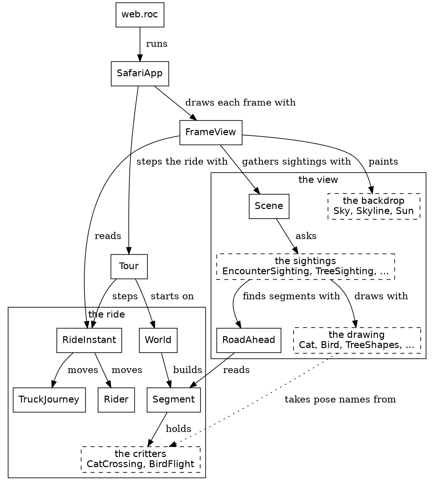

New in this chapter:

- Roc: imports that can't form a cycle
- Modules: `SafariApp`, `Tour`, `FrameView`, `Scene`, `EncounterSighting`

### The ride and the view

The ride is what happens. `RideInstant` holds the four things a step carries, and moves them on: `Rider` moves the rider, and `TruckJourney` moves the truck. `World` lays out the route as a list of segments, and each segment holds its critters, such as the cat and the bird.

The view is what the rider sees. `FrameView` reads one instant of the ride and builds its frame. It paints the backdrop of sky, land and sun, and asks `Scene` for everything else. `Scene` gathers the sightings, and each kind of thing has a sighting module that finds it and a drawing module that draws it.

Every arrow between the two halves points the same way: the view reads the ride. The dotted arrow is the one place where drawing code reads a critter's module. `Cat` takes the cat's pose type and its height from `CatCrossing`, because the crossing decides the pose and the drawing only paints it.

`SafariApp` sits on top of both halves. It steps the ride with `Tour`, which can move the ride forward or back, and it draws each frame with `FrameView`.

### The part that isn't Roc

One tick across the line between JavaScript and Roc
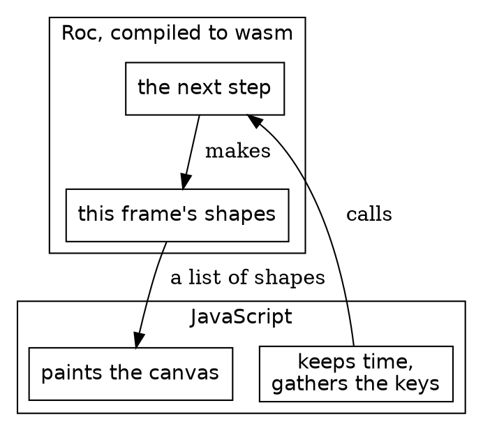

Safari Ride runs in a browser. The Roc compiles to WebAssembly, or wasm, and a thin layer of JavaScript runs it. Each frame, the JavaScript keeps time, gathers the keys and calls into Roc. Roc answers with a list of shapes, and the JavaScript paints them on a canvas. Everything about the ride lives on the Roc side of that line. The JavaScript paints shapes and never hears of a cat. "The platform" comes back to this line.

### What's a sighting?

"The problem" said we need machinery to work out what the rider sees. A sighting is that machinery's answer for one thing, on one frame. Here is a real one. At step 1,529 of the ride, a cat is frozen in the road, and `EncounterSighting` sights it:

| Field | Value |
|---|---|
| `right` | 0.38 metres |
| `forward` | 23.63 metres |
| `pose` | `Frozen` |
| `lift` | 0 |

`right` and `forward` place the cat's foot in the rider's view, in metres from the camera. `lift` is its height off the ground. `pose` tells the drawing how the cat stands. In code, a sighting is a small record:

{{code Pipeline.Sighted}}

The `spot` says where the thing stands in the rider's view, and the `kind` says what it is. It holds no drawing at all. Since a sighting is plain data, a test can check it with numbers. The gate checks this very cat's numbers without drawing a pixel.

`EncounterSighting` finds the cat in a few moves. It goes through the segments of road ahead. A segment is one stretch of road between two bends. It asks `EncounterPoses.cat_poses` where each cat is and how it stands. Then it works out where each cat lands in the rider's view, and keeps only the ones in front of the camera and tall enough on the screen to draw.

Each kind of thing pairs a sighting module with a drawing module. `EncounterSighting` pairs with `Cat` and `Bird`, `TreeSighting` with `TreeShapes`, `TowerSighting` with `Tower`, `TruckSighting` with `Truck`, and `BillboardSighting` with `Billboard`, which draws the farm animals, the safari animals at the bends and the ducks. `Scene.scene_in_view` gathers every sighting and turns each one into a `Rendered`: a picture from the thing's drawing module, plus its depth. `Scene.scene_renderings` then sorts the renderings far to near, so nearer things paint over farther ones.

A sighting also decides what doesn't get drawn. Here are more things from step 1,529, and what their sightings decide. A `forward` below zero is behind the camera.

| What it is | `right` | `forward` | What its sighting decides |
|---|---|---|---|
| The cat, frozen | 0.38 | 23.63 | drawn |
| The nearest tree, a big green one | 3.45 | 21.63 | drawn |
| The nearest tree behind the camera, a gold one | -8.09 | -8.36 | `BehindCamera` |
| The nearest tree the earth's curve hides, a small green one five segments on | -1,433.43 | 446.00 | `BelowHorizon` |
| A big green tree just past it | -1,446.07 | 473.21 | drawn |
| The radio tower past the end of the rider's segment | 20.40 | 355.61 | drawn |
| The truck | 92.19 | 489.15 | drawn |

The earth curves, so a small tree far away sinks below the horizon, while a taller one just past it still shows its top. Of the 214 trees on the segments in view, 136 are drawn, 30 are behind the camera, and 48 are below the horizon. None is too small. The other 78 never reach the screen.

All of this happens within one frame. The next frame sights everything again, from its own step's four carried things. Next, we hold one frame still and look at what's in it, starting with the parts that never change.

## The world

Safari Ride builds its whole world before the rider moves an inch, and from then on it only reads it. In this chapter we read that world: a route made of road segments, and the plan for each one. It's the easiest part of the program to read, because none of it changes.

```widget route
The whole route in one picture, one stretch of road for each plan.
```

Each stretch of the map is one segment: the road from one bend to the next. The ride itself draws no map, and it never needs one. A place on the road is always measured within its own segment, as how far along and how far across. We drew this map for the book.

New in this chapter:

- Roc: tag unions in place of booleans, `match` covering every tag, void modules, `var`, record update, `crash`
- Modules: `World`, `Route`, `Segment`, `Trees`

### Get the types right

Each segment starts as a plan, and a plan is a record:

{{code World.SegmentPlan}}

The fields are small tag unions. `CowHerd.Bull` is `[WithBull, NoBull]`, so a plan says `bull: WithBull`, and the value names itself.

Here are the route's first six plans, from `World.bending_plans`. Each one also says how its segment turns into the next.

| Segment | Length | Turn at the end | Trees | Encounter | Herds |
|---|---|---|---|---|---|
| 1 | 500 metres | 50 degrees right | all green | a bird | cows |
| 2 | 320 metres | 70 degrees left | all green | quiet | cows |
| 3 | 400 metres | 20 degrees right | all green | a bird | cows and pigs |
| 4 | 300 metres | 20 degrees right | gold and green | a cat | cows |
| 5 | 300 metres | 70 degrees left | all green | quiet | cows, with a bull |
| 6 | 300 metres | 70 degrees left | all green | a bird | cows, with a bull |

`World.route` builds the route from these plans, once, before the first step. Each plan becomes a `Segment`, and the segment plants its trees, places its herds and plans its encounter.

The modules that build the world
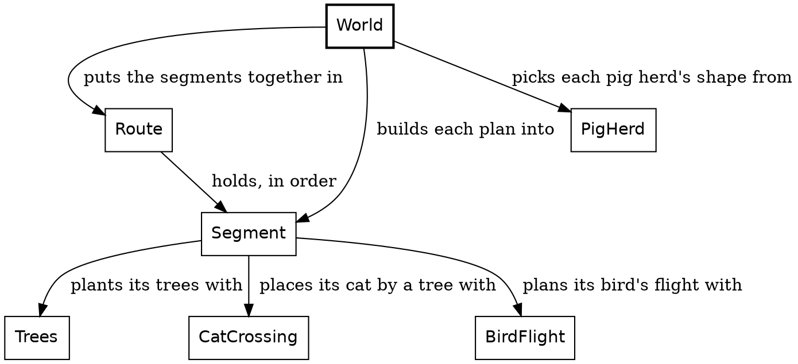

Even the world keeps as little as it can. A segment keeps its herd of cows, not each cow: a cow's place is worked out from the herd whenever something asks for it. Radio towers aren't kept at all. One stands past the end of every segment, and one halfway along any segment longer than a kilometre, so the segment is all a tower needs.

### The functions

`Trees` plants a segment's trees. It's a void module: `Trees :: [].{ ... }` is a type with no values, because `[]` is a tag union with no tags. The type is only a home for the definitions in its block. Here is how it plants a segment:

{{code Trees.roadside_trees}}

The trees stand in pairs, a left tree and a right tree, every few metres along the segment. Three Roc ideas show up here.

`$along`, `$conifer` and `$trees` are each a `var`, a name the loop gives a new value each time around. The `$` marks it. `roadside_trees` is still a pure function, because no code outside it sees a `var` change.

`{ ..left_tree, road_point: ... }` is a record update. It makes a copy of `left_tree` with a new `road_point`, so the right tree matches the left one in everything but its place.

The last `match` picks the next pair's conifer. A green pair is followed by the segment's accent, and any accent is followed by green. `accent_conifer` turns the segment's scheme into its accent:

{{code Trees.accent_conifer}}

A `match` covers every tag of the union it matches on. Leave one out and the program doesn't compile, so a new scheme can't slip past this function unnoticed.

A segment's place in the route is a `Route.SegmentIndex`, an opaque type like `Pixels`, with a `U32` underneath. No other code can mistake an index for a count of trees. `Route.segment_at` looks a segment up:

{{code Route.segment_at}}

An index past the end of the route is a bug in Safari Ride, so `crash` stops the program and says so. `crash` is for bugs, never for a case the program should handle.

Nothing in this chapter moves, and nothing in the next few chapters does either. We hold one frame still and look at everything in it. First, what a picture is made of.


## Nature types

The objects along the road come in six kinds: trees, radio towers, billboards (the cows, the pigs, the ducks and the other animals by the road), the cat, the bird and the truck. Each kind is drawn its own way, and each kind's sighting module finds its own objects on the road. After that, nearly every object takes the same steps. The camera sees it, its kind draws it, and it gets a depth, so that it can be painted in order with all the others, far to near. Written once for each kind, those steps would be the same code six times over. Safari Ride writes them once, in `Pipeline`, and each kind says only how tall it is and how it looks.

New in this chapter:

- Roc: defining a type with a type variable, `Try`, `where`
- Modules: `Pipeline`, `Spot`, `Rendered`, `Geom`, `Along`, `Across`, `Distance`

`Pipeline` and `Rendered` came up in The modules chapter, and here we look at them properly.

### Three forms and a kind

An object takes three forms on its way to the screen:

1. Placed: it stands at a place on the road, measured along and across a segment.
2. Sighted: the camera sees it some distance to the right and forward.
3. Rendered: it's a picture, with a depth that says how far ahead of the camera it stands.

A sighting and a rendering last one frame. How long a placing lasts depends on the object. A tree or a cow is placed on the road once, when the world is built, and stays there for the whole ride. A cat moves, so it's placed anew for each frame.

Each object has a kind, such as `Conifer` or `Billboard`. A kind says how the object looks, never where it is. The first two forms hold the kind, and the fields around it say where the object is. A kind is asked for its height, to see whether the object stands tall enough on the screen to draw, and for its picture, which goes into the rendering. A rendering keeps the picture and not the kind.

`Conifer` is one of four tags, `Green`, `SmallGreen`, `Red` or `Gold`, and the tag alone settles a tree's height and color. `Billboard` is a record with three fields: a still (an emoji drawn as polygons), a height, and which way it faces. A cow, a pig and a duck on the pond are all billboards. Where the object stands lives in the forms around the kind.

### Get the types right

A lowercase name in parentheses, like `(kind)`, is a type variable; this chapter comes to them below.

| Type | What it is |
|---|---|
| `Geom.Placed(kind)` | An object on the road: its `road_point` on its segment, its `lift` off the ground, and its `kind` |
| `Spot` | Where an object stands in one frame: its `lift` off the ground, its `foot` in the rider's view, and the `road_heading`, which way the road runs there |
| `Pipeline.Sighted(kind)` | An object in view: its `spot` and its `kind` |
| `Sprite.Setting` | What a kind draws from: its `spot` and the lens's `focal_length` |
| `Sprite` | The object's shapes, in order, from the Shapes chapter |
| `Rendered` | The object's `sprite`, and its `depth`: how far ahead of the camera it stands |

One object through one frame
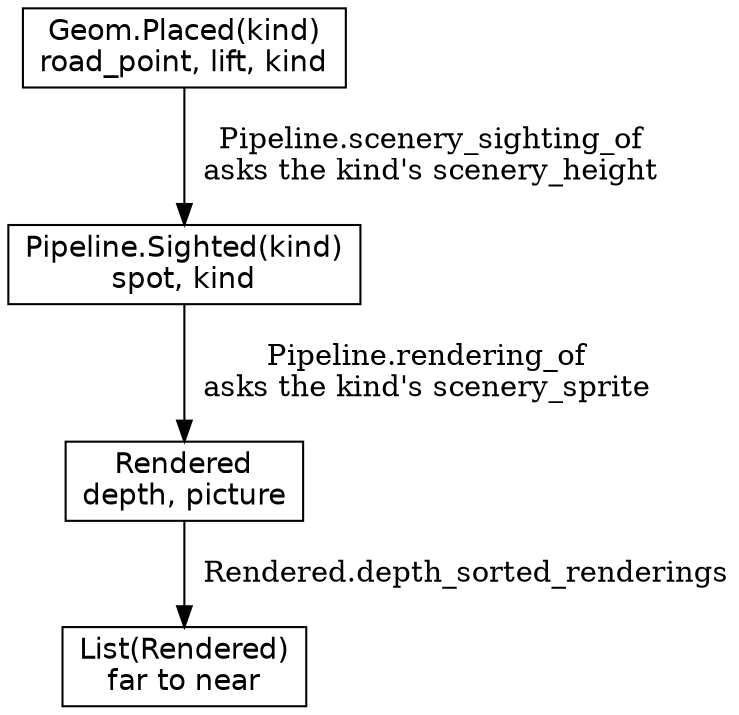

A box is a type, and an arrow is a function that makes the next one. The kind goes in at the top and comes out of `Pipeline.rendering_of` as a picture. `Rendered` has no kind, so a tree's rendering and a cow's are the same type, and every rendering in the frame goes in one list for the depth sort. That sort is `DepthSort`, a stable merge sort that orders the list from far to near.

### A type with a type variable

We've used types that take an argument since the Shapes chapter. A `Sprite` is a `List(Shapes.Shape)` underneath, and a `List` can hold any one type, named in its parentheses. `Geom.Placed` is a type of our own that works the same way:

{{code Geom.Placed}}

The `kind` in its head, `Placed(kind)`, is lowercase, and that makes it a type variable: a name for whatever type goes in the parentheses. The fields use it like any other type. So `Geom.Placed(Conifer)` is a record of a `road_point`, a `lift`, and a `kind` that holds a `Conifer`, just as `List(Shapes.Shape)` is a list that holds shapes. A cow is a `Geom.Placed(Billboard)`.

A `Geom.Placed`'s `road_point` is made of two such types. `Along` is a place along a segment, and `Across` is a place across the road, measured from its middle. Both are opaque, like `Pixels`, so passing one as the other is a compile-time error. One place minus another is a `Distance`, a length in metres, and a length is a different thing from a place, and Roc's `-` always gives back its left side's type, so that subtraction is a named method, `distance_from`, rather than `-`.

A type's head declares its variables. A function's annotation needs no head: a lowercase name in it is a type variable, and it means one type wherever it appears in that annotation. `Pipeline.sighting_of` takes a `Geom.Placed(kind)` and answers with a `Try` that holds a `Pipeline.Sighted(kind)` when the object stands in front of the camera. A `Try` is one of two tags: `Ok`, holding the answer, or `Err`, holding the reason there is none, here `BehindCamera`. Both are in the type, so every caller handles the object behind the camera. The placed object and its sighting name the same `kind`, so a placed conifer can only come back as a sighted conifer, never as a sighted cow.

### Asking a kind by name

`Pipeline` imports neither `Conifer` nor `Billboard`, and neither of them imports `Pipeline`. Yet `Pipeline.rendering_of`, the one function this chapter shows in full, gets a picture out of either one:

{{code Pipeline.rendering_of}}

It hands the sighting's whole `spot` and the lens to the kind's own `scenery_sprite`. It answers with a `Rendered`: the picture it gets back, and a depth. Its depth is how far forward the spot's foot is: `spot.foot().forward()`.

The second line of the annotation, indented under the first, is a `where` clause. Its square brackets hold a list of requirements on the annotation's type variables, here one. `kind.scenery_sprite : kind, Sprite.Setting -> Sprite` says that the type `kind` has a method named `scenery_sprite`, of the type after the colon. A kind meets it by having a method of that name and that type. `Conifer` has one, and so does `Billboard`. Neither says it meets a requirement, and no interface names the two. The name and the type are the whole contract, and the compiler checks them wherever `rendering_of` is called.

`Pipeline.scenery_sighting_of` asks for a kind's height the same way, with `where [kind.scenery_height : kind -> Distance]`. It finds the sighting, then asks the kind for its `scenery_height`, to see whether the object stands tall enough on the screen to draw, and answers `TooSmall` when it stands shorter. The towers and the truck are drawn however small they look. A tower calls `Pipeline.sighting_above_horizon_of`, which asks for its height only to see whether the horizon hides it. The truck calls `Pipeline.sighting_of`, the plainest of the three, which needs no `where` at all.

Because a name and a type are the whole contract, the name has to say what it's for. A kind could well have a method called `height`, of type `kind -> Distance`, that measures something else, and a `where` clause that asked for `height` would take it without a word. The first word of `scenery_height` and `scenery_sprite` says that the method is there for the objects along the road, so a kind meets the contract only on purpose.

Trees, towers and critters go through all three forms. The truck is sighted by `Pipeline.sighting_of`, then has a sighting type of its own, `Truck.SightedTruck`, and makes its `Rendered` by hand, as the rails do. The grass, the sky, the sun, the mountains and the road take simpler paths. The next three chapters are about trees.

## A simple tree

Let's draw a tree. Forget the road for now, and the rider, and the ride. All we know is what kind of tree it is, and where it stands from the camera.

Drawing a tree and placing trees along a road are two nearly separate problems. This chapter and the next draw one tree. The chapter after that, Roadside trees, puts trees in the world, relative to the road and the rider.

A tree is a trunk under eight tiers of foliage, and a far tree's tiers are flat triangles. Every tree a long way off is drawn exactly this way. The tree's kind decides how tall it is and what color.

New in this chapter:

- Roc: nominal types, one branch for two tags
- Modules: `Conifer`, `TreeShapes`, `Fraction`, `Camera`

### Get the types right

A tree passes through these types on its way to the screen:

| Type | What it is |
|---|---|
| `Conifer` | A tree's kind: `Green`, `SmallGreen`, `Red` or `Gold` |
| `Distance` | A length in metres, opaque like `Pixels` and an `F64` underneath |
| `RiderView.RaisedPointAhead` | A point in front of the camera: `right` and `forward` of it, and `height` above the rider's level. `spot.base()` gives the middle of a tree's foot as one |
| `Camera.Upright` | Where an upright thing lands on the screen: its `foot`, and its `height_on_screen` in `Pixels` |
| `TreeShapes.Tier` | One layer of the crown, as fractions of the crown |

A conifer draws from a `Sprite.Setting`, the setting from the Nature types chapter.

Each step of the job is a signature:

| Job | Function | Its type |
|---|---|---|
{{types row Conifer.scenery_sprite Draw a conifer}}
{{types row TreeShapes.tree_sprite Draw a tree of any height and color}}
{{types row TreeShapes.tree_outline Find it on the screen}}
{{types row TreeShapes.tier_triangle Make one tier}}

One tree, from the top
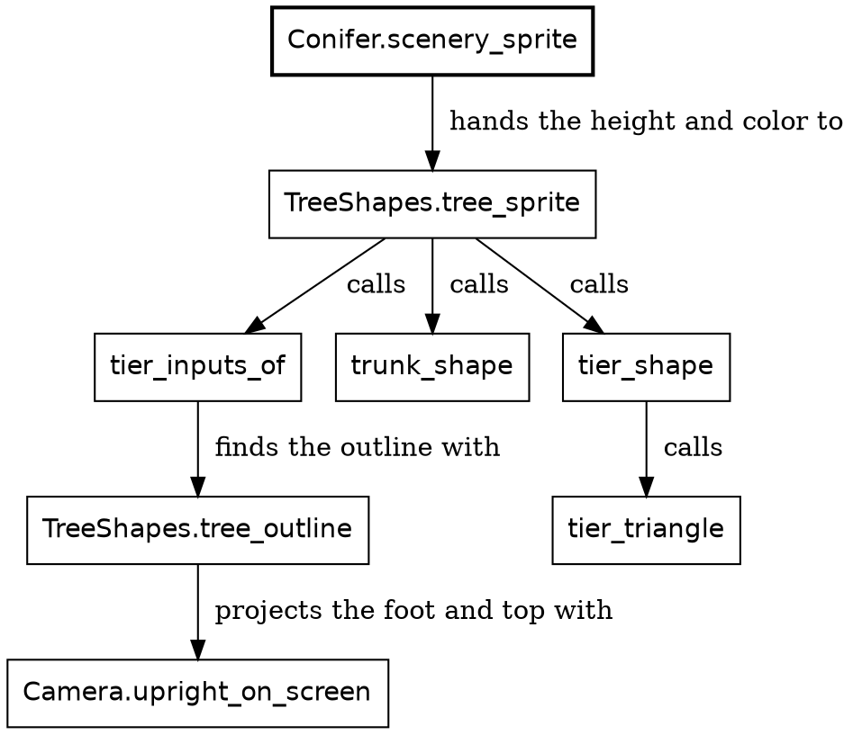

A box is a function, and an arrow is a call. `Conifer.scenery_sprite` is the only box that knows the kind. It derives a height and a color from the kind, and everything below it works from those two. `Conifer` imports `TreeShapes`, and the import runs one way, so `TreeShapes` would draw a fifth kind of tree unchanged.

### The functions

Here's all of `Conifer`:

{{module Conifer}}

`Conifer := [Green, SmallGreen, Red, Gold].{ ... }` is a nominal type. Like `Pixels`, it carries a block of definitions. Unlike `Pixels`, its insides are open to other modules. One symbol makes the difference: `:=` makes a nominal type, whose tags other modules can use, and `::` makes an opaque one. `Trees.accent_conifer`, back in The world chapter, picks `Gold` for a scheme of gold and green.

`scenery_height` derives a tree's height from its kind, so the kind is the one home for it. In `foliage_color`, `Green | SmallGreen =>` is one branch for two tags, because both greens share one color.

`scenery_sprite` takes the kind and a setting, and hands the setting whole to `TreeShapes.tree_sprite`, with the tree's height and color in the record that function wants.

`tree_sprite` finds the tree on the screen, then makes a trunk and eight tiers. Its bars take the setting apart into `spot` and `focal_length`, as a function's bars can take any record apart.

{{code TreeShapes.tree_sprite}}

`tier_inputs_of` starts from `spot.base()`, the middle of the tree's foot as a point in front of the camera, and works out what every tier needs, among them the tree's `outline` on the screen. `trunk_shape` makes the trunk, a rectangle. `tier_shape` makes each tier. `tiers.map(...)` calls it for every tier and gives back the list of answers. `[trunk].concat(...)` puts the trunk first, so the tiers paint over it. For a far tree, `tier_shape` answers with `tier_triangle`, and the next chapter shows the rest of it.

What `trunk_finish_of` and the crown do for near trees can wait, but notice the tags of `TrunkFinish`, `[Shaded, Flat]`. This `Flat` is a different tag from the fill `Flat` in the Shapes chapter. Two tags with one name in two unrelated unions are two different tags.

The tree's outline is where it lands on the screen, and how tall it looks there:

{{code TreeShapes.tree_outline}}

`Camera.upright_on_screen` projects two points through the lens: the tree's foot, and its top, `height` above the foot. The difference between them on the screen is how tall the tree looks.

The trunk and the crown split the tree's height between them:

{{code TreeShapes.trunk_height_share}}

{{code TreeShapes.crown_height_share}}

A `Fraction` is a number from 0 to 1. `Fraction.of` makes one, and it crashes on a number outside that range, because a ratio out of range is a bug in the sum behind it. `complement` is one minus a fraction, so the two shares add up to 1 by construction.

### Triangles

A tier is three fractions:

{{code TreeShapes.Tier}}

`tiers` is a list of eight of these, and each overlaps the next. A tier is one triangle, worked out in pixels, with its apex on the tree's middle line and its base across the tier's bottom:

{{code TreeShapes.tier_triangle}}

That's a tree, and from a distance nobody can tell it's flat. Ride close to one, though, and it looks like cardboard.

## A conifer

A near tree needs to look round, and it has to fatten as you ride past it. So Safari Ride draws two styles of crown: flat triangles far off, and 3-D cones up close. The tree is still alone in front of the camera, and the road can wait one more chapter.

New in this chapter:

- Roc: a payload that exists only where it means something, a list pattern that takes from the end

### Get the types right

The whole decision is one type:

{{code TreeShapes.Crown}}

The square brackets list everything a `Crown` can be. This is a tag union, as in The world chapter, and `Cones` and `Triangles` are its tags. A tag is a capitalized name, and it needs no other declaration. So far a `Crown` is one of two names.

The parentheses go further. As in the Shapes chapter, a tag can carry a value, called its payload. The payload of `Cones` is a record with one field, `shade`, and `Triangles` has no payload at all. So a `Crown` is written one of two ways:

| Value | What it says |
|---|---|
| `Cones({ shade: Fraction.of(0.5) })` | Cones, half shaded |
| `Triangles` | Triangles, and nothing more to say |

A triangle has nowhere to put a shade, and a cone can't be missing one. The only way to reach a `shade` is a `match` branch for `Cones`, and we'll see one shortly.

Three functions carry the decision:

| Job | Function | Its type |
|---|---|---|
{{types row TreeShapes.crown_of Decide, once for the tree}}
{{types row TreeShapes.tier_shape Act on it, for each tier}}
{{types row ConvexHull.cone_hull_points Outline a cone}}

A near tree's tiers
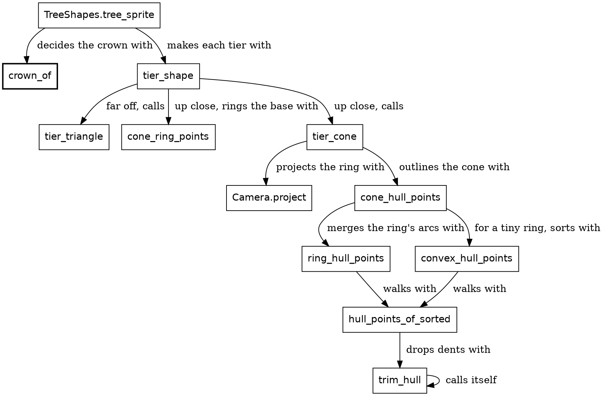

`tree_sprite` asks `crown_of` once, and hands the answer to `tier_shape` for every tier. The arrow from `trim_hull` to itself is a function calling itself, and we'll see why.

### The functions

`crown_of` answers with a `Crown`:

{{code TreeShapes.crown_of}}

Two `TreeShapes` thresholds decide how much of a tree gets drawn: `cone_reach`, 200 metres, and `round_trunk_reach`, 60 metres. Shade fades from full at the camera to none at 80 metres.

```widget tree
Three gold trees, each drawn by `Conifer.scenery_sprite`. Under each are its distance and what `crown_of` said.
```

`tier_shape` acts on that decision. It takes the `crown`, beside a `TierInputs`, the record that `tree_sprite` built as `inputs`. That record holds what every tier of one tree needs: the tree's base and height, the lens, its outline on the screen, and its color.

{{code TreeShapes.tier_shape}}

`Camera.project` only works on points in front of the camera. `RiderView` puts that limit at its near plane, 0.4 metres ahead of the camera. `cone_ring_points` builds a ring of 16 points around the tier's base. If any of them reaches back past the near plane, it answers `Err(BehindCamera)`, and the tier falls back to the flat triangle.

A frame holds only polygons, so we work out the polygon a cone would make. We leave pixels behind for a moment and work in metres. `height_down_crown` says how high a point stands, given how far down the crown it is. `top` and `bottom` count down from the crown's tip, so the ring stands at the tier's `bottom` and the apex at its `top`. `tier_cone` projects the ring and the apex onto the screen:

{{code TreeShapes.tier_cone}}

`Brush.corners_shade` makes a fill that is darker at its edges and lighter in its middle, and `strength` says how much, so a near cone looks rounder than a far one. The shade from `crown_of` goes in as that strength.

That leaves 17 points on the screen: the ring's 16, and the apex. A cone's outline is the shape that wraps around them all, with no dents. That's called a convex hull:

{{code ConvexHull.cone_hull_points}}

The method is Andrew's monotone chain, which A. M. Andrew published in 1979. Put the points in order from left to right. Walk along the top, then walk back along the bottom. Any points can be sorted into that order. `convex_hull_points` sorts them, for a ring too small to have two arcs:

{{code ConvexHull.convex_hull_points}}

`sort_with` sorts by a function that compares two points and answers `Before`, `Same` or `After`, and `left_to_right` is that function: left first, and the higher of two at one x. A cone's ring comes in order already. It's convex on the screen and keeps its order around the circle, so `ring_hull_points` merges its two arcs from the leftmost point to the rightmost, slots the apex in, and has the points in order already. If rounding leaves the merge out of order, it sorts after all. Either way, the walks are `hull_points_of_sorted`:

{{code ConvexHull.hull_points_of_sorted}}

The top walk ends on the rightmost point, where the bottom walk starts, and the bottom walk ends on the leftmost, where the top walk started. So each walk drops its last point before the `concat`, and no corner appears twice. `fold` walks a list from the front, carrying an answer from item to item, and `fold_rev` is the same from the far end, with its arguments the other way around. `trim_hull` serves both walks: before a point goes on, it drops the last point of the hull while that point would make a dent, and it calls itself until none does. `[.., a, b]` is a list pattern that takes the last two items.

{{code ConvexHull.trim_hull}}

A whole cone comes out as one polygon. The ring gets wider on the screen as it gets nearer, so the tree fattens as you pass.

So much for one tree. The road has hundreds.

## Roadside trees

Here's the other tree problem. Safari Ride places 392 trees along its road, and only some of them are in view at any moment. For each frame, it has to find those, and say where each one stands from the camera. Once a tree is found, `Conifer.scenery_sprite` from the chapter A simple tree draws it. The kind still matters here in two places: a gold tree is placed farther from the road, and a tree's height decides whether it's tall enough on the screen to draw.

```widget frame trees
Step 1,529 of the ride, with only the trees on.
```

This is step 1,529 again, the frame with the frozen cat, showing only its trees. There are 136 of them, out of 392. At nine shapes each, they make up 1,224 of the 2,121 shapes in that frame, more than everything else put together.

A tree goes through the three forms from the Nature types chapter, with a `Conifer` as its kind. It's placed once, for the whole ride, and sighted and rendered for each frame that can see it.

New in this chapter:

- Roc: `while` in a pure function
- Modules: `TreeSighting`, `RoadAhead`

### Get the types right

A placed tree has a name of its own: `Trees.RoadsideTree` is another name for `Geom.Placed(Conifer)`. A tree's sighting is a `Pipeline.Sighted(Conifer)`, and its rendering is a `Rendered` like any other.

| Job | Function | Its type |
|---|---|---|
{{types row Trees.roadside_trees Place a segment's trees, once}}
{{types row TreeSighting.trees_in_view Find the trees in view, for each frame}}
{{types row TreeSighting.tree_renderings Render them, for each frame}}

A tree, once and for each frame
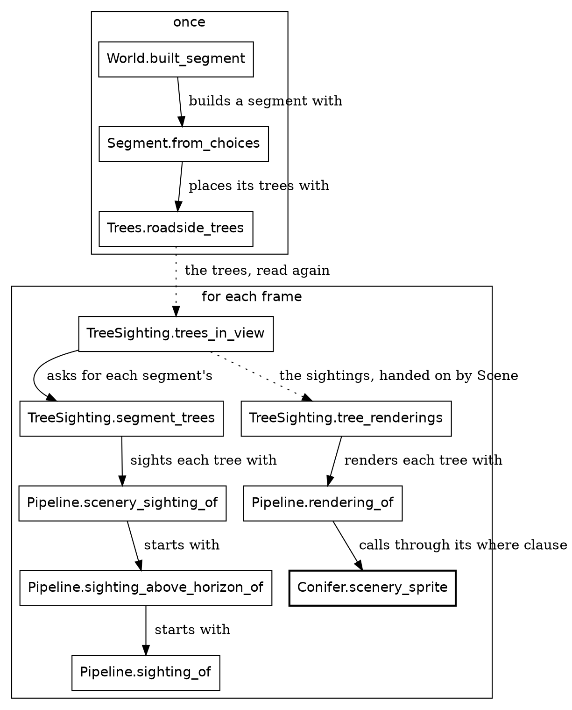

A box is a function, and a solid arrow is a call. A dotted arrow is a step's answer going on to the next step: the trees that `World` placed, read again for each frame, and then the sightings, which go on to be rendered. `Conifer.scenery_sprite`, in bold, is where the chapter A simple tree began.

### Placing

Placing a segment's trees walks along the segment and keeps a list, and a loop says that best.

{{code Trees.roadside_trees}}

Guess which Roc idea from The world chapter comes back? `var` makes a name that can change, and a `$` marks every use of one, so the names that change stand out. The `while` loop changes them, and the function is still pure, because the changes stay inside it.

Trees stand in pairs, one on each side of the road, every 30 metres. `{ ..left_tree, road_point: ... }` makes the right tree from the left one, with a new place across the road, by the record update from The world chapter. The pairs take turns: a big green pair, then a pair of the segment's accent, which is small green, red or gold, then big green again. A gold pair stands farther from the road, because it's so much taller:

{{code Trees.tree_line_distance}}

### Seeing the trees

For each frame, `trees_in_view` goes through the segments of the road ahead, the ones the rider can see. `join_map` is a `map` followed by a flatten:

{{code TreeSighting.trees_in_view}}

{{code TreeSighting.segment_trees}}

From here on, things are measured from the camera, which travels with the rider. We don't need to know much about the rider yet.

{{code Pipeline.scenery_sighting_of}}

`Pipeline.scenery_sighting_of`, from the Nature types chapter, puts each tree through three tests, one inside the next:

1. `Pipeline.sighting_of` asks `RoadAhead.rider_point_at` where the tree's place on the road lies from the rider. The math layer chapter shows how. A tree nearer than the near plane, from the chapter A conifer, is `BehindCamera`.
2. `Pipeline.sighting_above_horizon_of` asks whether the curve of the ground hides the whole tree. If it does, the tree is `BelowHorizon`.
3. `scenery_sighting_of` itself measures the tree on the screen, through the camera's focal length. A tree under 2 pixels tall is `TooSmall`.

`segment_trees` passes along `from_rider`, which says which segment of the road ahead the tree stands on, counted from the rider's. It's usually `Ahead(position)`: a segment so many ahead of the rider's.

So the answer is a `Try`: a sighting, or one of those three reasons. `keep_oks`, in `segment_trees`, keeps the sightings and drops the reasons.

### Spending the detail

Far trees are cheap. They get eight triangles and a plain trunk. A cone costs a ring of 16 points and a hull, so only trees within 200 metres get cones. A shaded trunk looks round, and the effect only shows on a trunk wide enough on the screen, so it goes to the trees within 60 metres, the nearest two pairs, and no others. `tree_sprite` decides it from the tree's distance, as it decides the crown:

{{code TreeShapes.trunk_finish_of}}

{{code TreeSighting.tree_renderings}}

`Pipeline.rendering_of` hands each tree to `Conifer.scenery_sprite`, and the tree's `Rendered` joins the towers' and the critters' in the frame's one list.

So `World` holds every tree's place for the whole ride. Each frame derives its sightings fresh, from those places and the camera, and the next frame derives them all again.

Most things in a frame work this way: placed once, then sighted and rendered for each frame. The grass is simpler still.

## Grass

The grass is one rectangle. It paints over the bottom of the sky, and everything along the road paints over it.

New in this chapter:

- Modules: `Grass`

`Grass` has one color:

{{code Grass.grass_color}}

The backdrop is what's behind the ride. `FrameView.backdrop_shapes` paints it as the sky, the sun and the grass, and this is the grass:

{{code Grass.grass_shape}}

It starts a pixel above the horizon, so the grass overlaps the sky by a pixel and the two meet cleanly:

{{code Grass.grass_top_y}}

It's much wider than the screen because the whole picture tilts when the rider leans, and the corners have to stay filled.

That rectangle is all the grass there is. Everything along the road paints over it, so wherever the frame shows nothing else, the rider sees grass.

The other big thing in the backdrop is more interesting.

## The sun

The sun is a circle. That's the easy part, so it's the part we'll do here.

New in this chapter:

- Roc: tags in place of `null`
- Modules: `Sun`, `Angle`

### A circle

A frame is a list of shapes, and a circle is one of them. `Disc` is a tag from `lib.Shapes`. This is the sun's, from `Sun.sun_shapes`:

{{code Sun.sun_shapes from "Disc({" to "fill: look.disc,"}}

A `Disc` has a center, a radius and a fill. The grass comes after it in the list and paints over whatever falls below the horizon, so the sun can sink behind the land with no more code.

The fill makes it look like a sun. `Sun.look` builds two fills: one for the disc, and a glow behind it:

{{code Sun.look}}

`Radial` runs from pale yellow in the middle to orange at the edge. `Glow` is a wide haze that fades to nothing. Both are tags with records inside, so a fill is plain data, and the browser does the painting. The lens's `focal_length` sets how large the sun is drawn, because a wider view makes it look smaller.

### Angles that can't be mixed up

The sun stands in one direction, and the rider may not be facing it. That needs angles. `Angle.Bearing` is a direction in the world and `Angle.Turn` is a change of direction. Here we pass a `Turn` where a `Bearing` is wanted:

{{fails turn_as_bearing}}

Opaque types do the most work from here on. A `Bearing` and a `Turn` are both floats underneath, but only the `Angle` module can build or open one.

Two tags say whether the sun is in view, so there's no `null` and no off-screen sentinel value. A caller has to handle `OutOfView`, because `match` must cover every tag.

{{code Sun.Sighting}}

{{code Sun.sun_in_view}}

`sun_in_view` asks `Lens.far_point` where the sun lands on the screen. `far_point` takes one record argument, taken apart in its parameter list. `turn.abs() >= quarter_turn` compares two `Turn`s. The angle stays a `Turn` until the trigonometry. `.tan()` works on a float, so only there does `to_radians()` open it.

{{code Lens.far_point}}

`sun_in_view`'s caller, `FrameView.frame_view_at`, is short enough to read whole:

{{code FrameView.frame_view_at}}

Most of what `frame_view_at` calls takes the clock, and that's the hard part. The sun sinks a little with every step, and the sky's colors, the mountains and the truck's headlights all follow it. That's a lot of heavy lifting for a circle. It gets a chapter of its own, The setting sun, once things start to move.

## The sky

The sky changes all through the ride, but a frame only has to ask one question: what color is it right now? The answer depends only on the clock.

New in this chapter:

- Roc: `->` as a promise
- Modules: `Sky`

`Sky` is a set of functions that each take a clock and answer with a color.

The modules around `Sky`
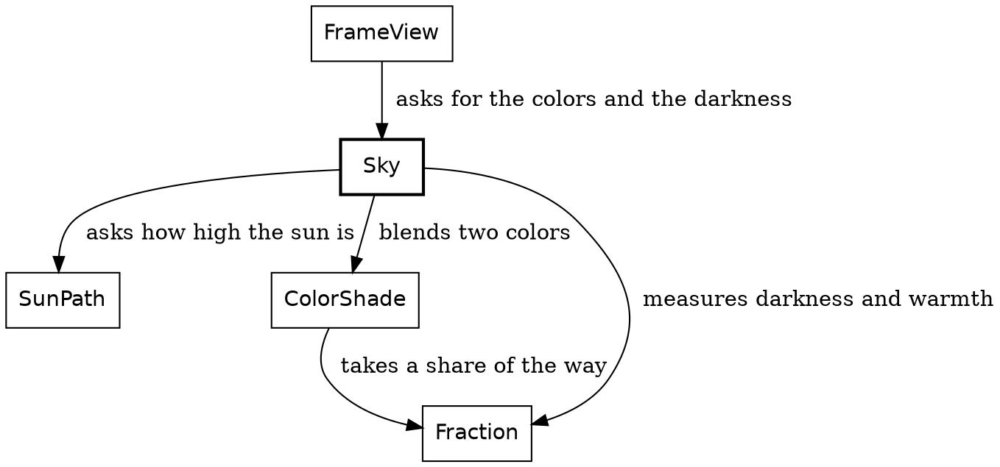

`Sky` sits near the bottom of the system. It imports `SunPath` and a few small types, and it knows nothing of the rider or the road. `FrameView`, above it, asks for the colors at a given clock, and for how dark the sky is.

Every function in this chapter has a `->` arrow, not `=>`. That tells you the function has no effects. An effect is anything beyond working out an answer: reading a file, the time, a random number. The compiler holds the function to that. So the same clock always gives the same sky. If you don't see a `=>`, you only have to think about what the function is given.

Here's the question being asked. `FrameView.frame_view_at` takes the clock from the current instant and hands it to `Sky.colors_at`, which answers both colors.

{{code FrameView.frame_view_at from "sky_colors: Sky.colors_at" to "sky_colors: Sky.colors_at"}}

### Two colors

The sky is two colors, the top of the sky and the horizon. Here they are at five steps of the ride:

| Step | Top of the sky | Horizon |
|---|---|---|
| 0 | `0x8ecae6` | `0x8ecae6` |
| 2,000 | `0x86bfdb` | `0x86bfdb` |
| 3,000 | `0x73a6c4` | `0x9a898f` |
| 4,000 | `0x517697` | `0x9c6662` |
| 5,000 | `0x243a5e` | `0x243a5e` |

Early in the ride and at its end, the two colors match. In between, the horizon stays warmer than the top.

Every color in the sky is a blend of two others, and a blend needs a ratio. `Fraction` is another small opaque type, a ratio from 0 to 1, and only its own block can build one, so a `Fraction` is always in range. It has two ways in. `Fraction.of` takes a ratio that can only be in range and crashes on anything else, because that would be a bug in the sum. `Fraction.clamp` takes a ratio that can rightly fall outside, and holds it at the nearest end.

`color_between` takes one record argument, taken apart in its parameter list, so callers name every field. Each channel moves the same share of the way. An `RgbColor` is opaque, and its `red`, `green` and `blue` each answer a `U8`.

{{code ColorShade.color_between}}

`Sky.colors_at` answers two colors, and the function `sky_top_color` works out the first. It calls `color_between` to blend day into night, by how dark the sky is. `Sky.darkness_at` says how dark that is. It's a `Fraction` too, and The setting sun chapter works it out.

{{code Sky.sky_top_color}}

`sky_horizon_color` is the same sky, warmed toward red near sunset.

{{code Sky.sky_horizon_color}}

`Sky.sky_shape` paints the two as a gradient, down to the horizon. It stays on the top color for the first fifth of the way, then fades:

{{code Sky.sky_shape from "Linear({" to "end_point: { x: Pixels.zero, y: Screen.horizon_y },"}}

A color is one integer all along, `0xRRGGBB`, the form a `Brush` wants. `RgbColor.from_channels` builds one from three channels with method calls on plain numbers. Static dispatch finds `to_i64`, `shl_wrap` and `bitwise_or` on Roc's own types. That makes `from_channels` a leaf: it calls nothing of Safari Ride's own.

{{code RgbColor.from_channels}}

One more thing in the frame goes dark with the sky: the mountains.

## Mountains

However far the rider goes, the mountains never get any closer. They only turn as the rider turns. That makes them much simpler than they look.

New in this chapter:

- Roc: a function in a record field
- Modules: `Skyline`

There are two ranges, one to the north with snow on its peaks, and a lower one to the west. A range is a record:

{{code Skyline.MountainRange}}

It's measured in bearings and pixels, not metres. There's no terrain behind it. All a mountain has is a height at a bearing:

{{code Skyline.range_height}}

A range is highest in its middle and falls to nothing at its ends. Two waves on top of that make the ridges. The rolling land in front of the ranges is a single wave of its own, in the same green as the grass.

To draw a range, we go across the screen two pixels at a time and ask how high the skyline is at each bearing. The caller passes in `height_at`, a function in a record field, so one `silhouette` draws both ranges and the rolling land:

{{code Skyline.silhouette}}

`Skyline.skyline_shapes` paints them back to front:

{{code Skyline.skyline_shapes}}

The rock darkens with `darkness`, the same `Fraction` that darkens the sky, and the snow goes blue. `snow_color` uses the sky's own `ColorShade.color_between`:

{{code Skyline.snow_color}}

That's nature. Next come the things people built.

## The road

A road of straight segments still has to get round its bends. Where two segments meet, something has to pave the corner and put up a rail.

```widget bends
Three bends from above. The rail changes sides with the bend, and a sharper bend pushes the apex further out.
```

Each road here is two segments, seen from above, and the white dot is where the view is from. The rail runs along the outer edge of the bend, and the yellow dot is the apex, where the outer edges of the two segments meet. The first bend turns left and the second right, so their outer edges are on opposite sides. The third is a sharper turn to the right.

New in this chapter:

- Roc: closures that give a repeated call a short name, `List.from_iter` with `until`
- Modules: `BendInView`, `GroundSighting`

`BendInView` knows where two segments meet. `GroundSighting` and `RailSighting` each ask it about a bend, and each answers with plain data for another module to draw.

The modules around `BendInView`
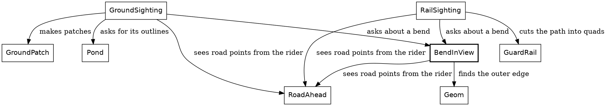

### Get the types right

A point at a bend can be measured two ways. On the road, a point is a `Geom.RoadPoint`, measured along and across the segment before the bend. From the rider, it's a `RiderView.RiderPoint`, right and forward of the camera. `RoadAhead.rider_point_at` is the one map between them. The corner is worked out on the road first, then seen from the rider, and the paving and the rail only ever take rider points.

A bend is a small record:

{{code BendInView.BendInView from "A bend as the rider sees it" to "}.{"}}

`before` says where the first segment lies from the rider, and `bend` holds its length and its turn. The turn is positive to the right. Where the segment after lies comes from `from_rider_after`.

The outer corner is three points. Its type takes the kind of point as a type variable, so the same record holds road points or rider points:

{{code BendInView.OuterCorner}}

Each step of the job is a signature:

| Job | Function | Its type |
|---|---|---|
{{types row BendInView.outer_edge Find the outer edge}}
{{types row BendInView.outer_corner Find the corner, on the road}}
{{types row BendInView.outer_corner_in_view See the corner from the rider}}
{{types row GroundSighting.bend_paving Pave it}}

### Where two segments meet

{{code BendInView.outer_edge}}

A bend to the right has its outer edge on the left. That's why the rail changes sides between the first two bends.

{{code BendInView.outer_corner}}

All three points are measured on the segment before. `end_before` is where its outer edge ends. The next segment is turned, so its outer edge starts a little past that end and a little in from the edge: that's `start_after`, carried back onto this segment. Follow the next segment's outer edge from `start_after` until it meets this segment's outer edge, and that's the apex, the yellow dot. `along_to_apex` is measured along the road from `start_after`. For a turn under a right angle, the apex lies back from `start_after`, so `along_to_apex` comes out negative.

The road is 4 metres wide, and the apex sits halfway round the turn, so at a turn of 45 degrees it lies 4 × tan(22.5°) past the end of the first segment. That's the 1.7 metres the widget shows.

`outer_corner_in_view` turns the three points into the rider's view, for the paving and the rail.

### Paving a corner

A piece of ground is a list of corners and a color.

{{code GroundSighting.road_patch}}

That's what `GroundPatch` paints. It's plain data, so it can be checked with numbers. The widget counts three patches, and here's where they come from.

{{code GroundSighting.road_along}}

Every whole-number type has an `until`, like `U64.until`, and the `U32` one here counts from 0 up to just short of its second argument. `List.from_iter` collects that count into a list.

A segment's road is one patch. Its edges are cut into chunks of 25 metres or less, which keeps each straight cut within a pixel of the curve where the road meets the horizon. The widget's two segments make two patches, and the bend makes the third.

`corner` is a closure: it captures `road`, `vantage` and `from_rider`, so each call names only a chunk and an edge.

{{code GroundSighting.lead_in_length}}

The bend's patch also lays the last 40 metres of the road before it, so the bend's own paving is all the rider needs from a segment just behind.

{{code GroundSighting.bend_paving}}

The patch goes round in order: up the left edge, across the end of the next segment's first chunk, and back down the right. The side on the outside of the turn takes a detour through the outer corner's three points. `before` and `after` are two more closures, so the two lists read alike.

A pond is ground too. A segment that ends at a pond adds two more patches, its bank and then its water, laid out by `Pond.pond_outlines`.

The corner has its paving. Next, it needs a rail.

## Rails

A guard rail is a metal bar on thin posts, along a path on the ground. At each bend, the path runs along the road's outer edge, out to the apex, where the outer edges of the two segments meet, back, and on along the next segment.

New in this chapter:

- Roc: nothing new
- Modules: `RailSighting`, `GuardRail`

The path of a guard rail
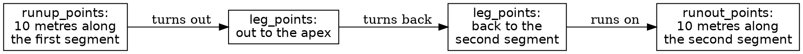

### Get the types right

A quad is a flat piece with four corners: one for each stretch of bar, and one for each post.

{{code GuardRail.RailQuad}}

Each quad goes into the frame's depth sort on its own, so a tree can stand in front of one post and behind the next. A quad has no kind for `Pipeline` to ask about, so it makes its own `Rendered`, at its own depth:

{{code GuardRail.quad_rendering}}

### The functions

For every bend in view, `RailSighting` finds the rail's path and cuts it into quads:

{{code RailSighting.rail_quads_in_view}}

{{code RailSighting.rail_points}}

`rail_points` joins four lists, one for each box in the diagram of the rail's path.

{{code RailSighting.leg_points}}

A leg gets a point about every metre, because a post stands at every point. It leaves out its first point, which is the last point of the leg before it.

`GuardRail.quads_along` turns the path into quads: the bars between neighbouring points, then a post at each point. At a turn of 45 degrees, the path has 25 points, so the rail is 24 bars and 25 posts: 49 quads, each in the depth sort on its own.

A rail is never stored. Every frame works out its bars and posts again, from the route and the rider, and throws them away.

## Radio towers

The radio towers stand well back from the road. One stands past the end of every segment, off to the right, and a long segment has one more halfway along, off to the left. Each is a lattice of thin rods, 80 metres tall.

A tower raises two problems a tree doesn't. Far off, it should sink over the horizon, and up close, it can stand partly behind the camera. It comes in three parts: a place by the road, worked out each frame from its segment; the horizon, which hides it from the bottom up as it recedes; and a shape, a lattice of rods on a square footprint.

New in this chapter:

- Roc: a `match` on a pair
- Modules: `TowerSighting`, `Tower`

### Get the types right

The tower itself is two facts: which way it's turned, and its beacon. The tower at a segment's end is turned to the road, and the one halfway along stands square with it.

{{code Tower.Tower from "A tower in a frame" to "Tower :: {"}}

While its shapes are worked out, a tower's measurements for this frame travel together. Its spot says how far the ground has dropped beneath it, and how much of it the horizon hides is worked out from that spot:

{{code Tower.TowerGeometry}}

Each step of the job is a signature:

| Job | Function | Its type |
|---|---|---|
{{types row TowerSighting.end_tower Place a tower past a segment's end}}
{{types row Tower.scenery_sprite Draw it}}
{{types row EarthCurve.lowest_visible_height Hide its foot}}
{{types row RiderView.line_ahead Make one rod}}

### Where a tower stands

Trees get their spots once, when the world is built. A tower doesn't: each frame, its sighting works out its spot from its segment. Here's the tower past a segment's end:

{{code TowerSighting.end_tower}}

The `beacon` line lights the beacon for this step. The tower halfway along is the same, with `Midway` for its beacon, a square yaw, and one more way to fail, `NoMidTower`. `mid_tower_point` says whether a segment is longer than a kilometre, and where its halfway tower stands. It sits in `TowerSighting` beside the end tower's numbers, so where towers stand has one home, and the world itself knows nothing about towers.

To draw a tower, `scenery_sprite` takes its spot and the lens from the setting, as a cat's does:

{{code Tower.scenery_sprite}}

The four corners of its base come from the spot. Each corner is an offset in the tower's own frame, and it stands on the road through the spot, turned by the tower's yaw. The truck, later on, stands its corners the same way:

{{code Tower.tower_footprint}}

### Over the horizon

The ride's ground curves away, with a radius of 100 km, and everything stands on it: a tower is lowered by how far the ground has dropped beneath its foot, like a tree or the truck. From the rider's eye, 1.2 metres up, the ground curves out of sight 490 metres out, and that's the horizon. Past it, the lowest thing the rider can see is on the line from the eye that grazes the ground there:

{{code EarthCurve.lowest_visible_height}}

A tower hides whatever part of it is under that line, so as it gets further away, it sinks below the horizon from the bottom up. An 80-metre tower shows its tip until about 4.5 km. Once all of it is under the line, its sighting refuses it with `BelowHorizon`, as a tree too small to see is refused with `TooSmall`. The rule is the same for every kind with a height:

{{code Pipeline.sighting_above_horizon_of}}

So a sighted tower always has something to draw.

### Rods

Here's the whole tower, from the top. A tower the horizon hides wholly never gets here, so that case is a crash. Otherwise come the legs, the rings and the braces, and the beacon's disc last, at the top:

{{code Tower.tower_shapes}}

A tower's footprint is a square, and four tags name its corners. Going round the square is a `match`:

{{code Tower.next_corner}}

Four legs run from the corners up to the top. Each starts at the geometry's `hidden`, the height the horizon hides, so nothing below the horizon is drawn:

{{code Tower.leg_shapes}}

Every 20 metres up, short of the top, a ring of four rods joins each corner to the next, which is what `next_corner` is for. Crossed braces fill the lowest two storeys.

Each rod is a line between two points in the rider's view, and it needs some care, because a near tower can stand partly behind the camera:

{{code RiderView.line_ahead}}

The `match` is on a pair, so it has to cover all four combinations. A rod with one end behind the near plane, 0.4 metres ahead of the camera, is cut where it crosses that plane, and a rod with both ends behind it isn't drawn.

That's a tower: a few dozen rods and a disc, worked out again each frame from its segment. The rods never change. The disc on top blinks, and that waits until the clock starts.

## Stills: how we draw a critter

Before we can stand an elephant by the road, we have to be able to draw one. Every critter in Safari Ride is a *still*: a small picture made of filled polygons, stored as data. An elephant has one still. A cat has seven, one for each pose, and a bird has six. Those two have to wait until things start moving, but we can look at them now. Animating a critter comes down to choosing which still to show, and where.

```widget stills
Every pose of the cat and the bird. Click one to see it large, and click it again for its polygons.
```

New in this chapter:

- Roc: a large table of plain data
- Modules: `Still`, `StillShapes`, `CatStills`, `BirdStills`, `EmojiStills`

The stills are the least readable code in Safari Ride, and nobody is meant to read them. They're generated data, encoded as Roc, and this chapter ends with how they got made. Here's how much data each set holds:

| Stills | Kind | Pictures | Polygons | Points |
|---|---|---|---|---|
| `BirdStills` | Hand-drawn | 6 poses | 32 | 119 |
| `CatStills` | Hand-drawn | 7 poses | 275 | 13,219 |
| `EmojiStills` | Emoji-based | one for each animal by the road | 129 | 4,998 |

The distinction matters. The cat and the bird were drawn for this game, and they have poses. The animals by the road started as emoji, and each has one picture.

A polygon is one record: its fill, which is either one flat color or a gradient, and its points:

{{code Still.Polygon}}

The bird is the smallest set, because the perched bird is Roc's logo, and the logo is made of a few straight-edged shapes. The cat has far more points, because its curves are made of many short straight lines. Its seven stills fit in a 31-line file, and those lines are very long.

Every point is measured in units of the still's height. Its feet are at `y` 0, and a standing critter is about 1 tall. That's why no pixels or metres appear here. The same numbers draw a cat in the distance and a cat in the lane.

`StillShapes` does the rest. An `Anchor` says where a still stands on screen, which way it faces and how tall it is:

{{code StillShapes.Anchor}}

Drawing a still is then one sum for each point. The height in pixels scales the point, and the feet place it:

{{code StillShapes.screen_point}}

That's all there is to drawing a critter. Each stills module names its stills, a critter with poses, like the cat, picks one with a `match` on its pose, and `StillShapes.still_shapes` puts it on screen.

### How the stills got made

That's all the Roc in this chapter. If you came for the Roc, you can skip ahead to [The elephant](the-elephant.html). The rest of this chapter is the story of where the pictures came from.

At a larger company, a picture like these would pass through three people. An artist would draw it. A software developer would build the tools that get it into the game. A project manager would look at the result and decide whether it's good enough. On Safari Ride, Claude played the first two roles, and Steve played the third.

The artist's cat was a program. An early version of Safari Ride drew the cat in TypeScript, with splines for its body, tapered capsules for its limbs, chains of joints for its legs, and strokes for its whiskers. That's a lot of code to carry from language to language, and a game only ever shows seven poses.

So the developer wrote a baker, a small program that ran the real drawing code once for each pose. A recorder stood in for the canvas. It kept every filled shape as a polygon and turned every stroke into a thin filled quad, and the result was a flat table of polygons. The drawing code stayed behind, and the table moved on.

The emoji-based animals took a different route. They come from Microsoft's Fluent Emoji, in its Flat style. That set draws every animal whole and from the side, where another set draws a rhino as a face, which looks wrong beside a road. A second baker read each SVG file, walked its shapes in painting order, and cut each curve into short straight lines.

The bull is a hybrid. It comes from the same emoji set, but in its Color style, which is shaded. It's the only still with gradients, on 40 of its 43 polygons, which is why a polygon's fill can be `Shaded`. Its 2,212 points are nearly half of `EmojiStills`.

The Roc bird came last. Its perched pose is the logo, and Claude drew the five flight poses to match, directly as polygons, in the logo's two purples.

The project manager's tool was a contact sheet: every still, side by side, in one image. Each bake wrote one, and Steve looked at it. No test can say whether a cat looks like a cat. The comment in the emoji baker puts the standard well: "an elephant is an elephant".

The bakers belong to the older versions of Safari Ride, in TypeScript and Zig. The polygons they made have been carried along ever since, which is why these files look like generated data. They are.

Now that we can draw a critter, we can stand one by the road.

## The elephant

The critters in this stretch of the book are billboards: one emoji still, standing in one place, always facing the camera. The code calls them billboards too. We'll start with the elephant. It stands at 14 of the route's 18 bends, so it's the bend animal you'll see most. A grown elephant waits beyond the guard rail on the outside of the bend, and its baby stands 14 metres straight on past the bend, where the road would run if it didn't turn.

New in this chapter:

- Roc: a wrapper only one module can build; a `match` that answers with a list
- Modules: `Billboard`, `BendAnimal`

### Get the types right

A billboard is three facts: its still, its height, and which way it faces.

{{code Billboard.Billboard from "Billboard :: {" to "}.{"}}

Where it stands isn't one of them. That's the `Geom.Placed` around it. A species is its emoji and how tall a grown one stands, so a baby is the same species at half the height:

{{code Billboard.Species}}

The emoji is a named still, such as `EmojiStills.elephant`, and only `EmojiStills` can make one:

{{code EmojiStills.EmojiStill}}

So a billboard always holds a still that exists.

### Drawing one

An emoji faces left, so a billboard facing right is its still mirrored. A `match` on which way it faces picks the `flip`, and `StillShapes.standing_still_shapes` draws the still standing at the billboard's spot:

{{code Billboard.scenery_sprite}}

### Placing one at a bend

A segment's ending carries its `bend_life`, what's at its bend. The segment turns that into billboards:

{{code Segment.segment_bend_billboards}}

What's at the bend gives its own billboards. A quiet bend gives nothing, a pond gives its ducks, and an animal gives two, itself and its baby:

{{code Segment.bend_billboards}}

The animal places itself:

{{code BendAnimal.bend_billboards}}

A `match` on the bend's outer side picks which side of the road the grown animal stands on, and which way it faces. It stands just beyond the rail, a metre and a half past the road's edge plus half its own width.

An elephant has no state. Nothing in that function says "elephant". That's what makes the next chapter short.

## Rhinos, giraffes and the other corner critters

A giraffe, a rhino and a zebra have one bend each. They all use the same code as the elephant, and they differ by one row:

{{code BendAnimal.species_of}}

Each animal is a tag, and each answers with its emoji and how tall it stands. The `match` has to cover all four.

To add a lion, we'd add a tag, a row here and a still in `EmojiStills`. The compiler would point at every `match` that needs the new tag.

These animals stand at the bends. Most of the others come in crowds.

## Herds: cows and pigs

Safari Ride's farms are crowds of animals, and a crowd is just a list of critters. The world stores only each herd's counts or shape. Its segment says where along the road the herd stands, and the herd's own module lays out the animals whenever it's asked.

New in this chapter:

- Roc: nothing new
- Modules: `CowHerd`, `Scatter`

### Cows

A herd of 14 cows grazes on the left of the road, in columns of three. Every fourth cow, from the second, is a calf, at half the height.

{{code CowHerd.herd_cows}}

A herd in a perfect grid would look like a parking lot, so each cow strays a little from its place:

{{code CowHerd.herd_cow}}

The stray comes from the sine and cosine of the cow's number. It looks random, but it's the same on every run, so the frames stay exact.

A bull may stand in front of the herd, by the trees. It's the same record again, a bit taller than a cow:

{{code CowHerd.herd_bull}}

### Pigs

A pig is a species, like the elephant's:

{{code PigHerd.pig_species}}

Pigs graze on the right of the road, near the end of a segment. The first two segments with pigs get a big herd, 7 rows of 7. After that, it's two short rows.

{{code PigHerd.herd_pigs}}

The `match` is on the herd's two shapes. How the rider takes a herd is a separate choice, which the route makes: `Unnoticed` or `Distracting`. Only pigs can be `Distracting`, never cows. On the first two herds, the standout pig catches the rider's eye, and the rider slows down to look. That's about the rider more than the pig, so it waits for the rider's chapters.

That's every critter that stands still, and the end of what we can say about one frame.

## The clock

The ride's clock is a single number, and it still gets a module of its own. From here on the clock runs, so we read that module, `Clock`, from top to bottom before we let it go.

New in this chapter:

- Roc: operators as method calls, `expect`
- Modules: `Clock`, `Steps`

Everyone knows what a clock does. The news is what this one refuses to do. Here is a line that adds 7 to a clock:

{{fails clock_plus_seven}}

Roc won't compile it. In Roc, `a + b` calls `a.plus(b)`. `Clock.plus` takes a `Steps`, a count of steps, and a bare 7 isn't one. The error says exactly that.

Here is the whole module:

{{module Clock}}

### Get the types right

`Clock :: U32.{ ... }` says what a clock is: a `U32` underneath, and opaque, so only `Clock`'s own code sees the number inside. `Clock.(n)` builds a clock from a number. In a parameter list it works the other way, and takes the number out.

A clock comes with a partner, `Steps`. A clock is a moment, and a `Steps` is a length of time. A clock plus some steps is a later clock. A clock minus some steps is an earlier one. `steps_since` gives the steps between two clocks. Nothing adds two clocks together, because two moments don't add up to anything.

### The functions

`next` moves a clock on by one step, and Safari Ride calls it once a step:

{{code RideInstant.next from "clock = instant.clock.next()" to "clock = instant.clock.next()"}}

Operators are method calls. `+` calls `plus`, and `<` calls `is_lt`. `is_eq : _` asks Roc to derive equality, so `==` works on clocks too.

Two functions crash. `minus` crashes when it would go back past step 0, and `steps_since` crashes when it would count backward. Either one means the caller has a bug, so the clock stops the program and says why.

Below the block, each `expect` is a test, and `roc test` runs them all. A clock is a plain value, so a test builds one directly. `Clock.at_step(9).plus(Steps.of(3))` starts at step 9 without riding nine steps first.

Next, the clock starts to tick.

## The ride instant

We've held one frame still for a long time. Now it's time to turn the page. Each time the clock ticks, Safari Ride moves the rider and the truck and draws everything again. `RideInstant` is the one record it keeps from one tick to the next, and it holds the rider, the truck's journey, the clock, and the plan for the encounter on the rider's segment. One tick is a step.

```widget step
Press play to run the ride, and the outer buttons to go to either end.
```

The first three lines under the picture read three of that record's four fields, the clock, the rider and the truck, from a real ride. Press the last button, and the widget plays the ride up to step 2,000, eight steps a frame. Press the first, and it's back at the start almost at once, because the steps it has been through are kept in a list.

New in this chapter:

- Roc: nothing new
- Modules: `RideInstant`, `Tour`, `FrameView`

`RideInstant := { ... }.{ ... }` is a nominal type, from the chapter A simple tree: a record with a block of definitions, whose fields stay readable.

{{code RideInstant.RideInstant from "One instant of the ride" to "}.{"}}

### Worked out, not stored

Those four fields are the whole of what Safari Ride keeps from one step to the next. The sun and the beacons keep nothing. The cat and the bird keep one thing between them, the step their animation started on, which is the plan. Each frame works everything else out again from those four. Call this *worked out, not stored*: keep the few things that have to last, and work out the rest. We'll see it everywhere from here on.

That gives three kinds of moving thing, and the rest of the tour is organized around them:

| Kind | Things | How it works |
|---|---|---|
| Clock-driven | The sun, the sky, the beacons, the headlights | Worked out from the clock, with nothing stored |
| Stepped | The rider, the truck | Stored in `RideInstant`, and moved once a step from where it was |
| Rider-driven | The cat, the bird | Worked out from the clock and one stored start step, planned from how the rider is approaching |

Trees and cows are a fourth kind, the easiest of all: they never change.

The game itself has no effectful functions at all. In Roc, a function with effects has a name that ends in `!`, and a type with the `=>` arrow. No function in the game has either. Effects live in the platform. A `?` appears in nine places, such as `Pipeline.scenery_sighting_of`, and it isn't an effect. Written after a `Try`, `?` hands an `Err`, such as `BehindCamera`, straight back to the caller, and otherwise gives the value inside the `Ok`.

### Pausing and stepping

Mostly, Safari Ride is a screensaver: you sit back and watch it. You can also take the controls. Click the ride to give it the keyboard, and Space pauses it. While it's paused, Right moves one step forward and Left moves one step back. While it's running, each moves four steps at a time. J jumps to the next segment of the road, and R starts over.

`SafariApp.model_at_next_step` handles all of that. It takes the model, which is the `Tour` and a pause flag, and a snapshot of the input. It returns the next model:

{{code SafariApp.model_at_next_step from "motion = if input.key_pressed(KeySpace)" to "m.tour.step_forward()"}}

There's no event handler here. Each frame, the platform hands `model_at_next_step` a snapshot, and `model_at_next_step` reads it. `key_pressed` says a key went down since the last frame, so one tap of Space pauses the ride once. `key_down` says a key is being held, so holding Right keeps the ride moving.

Stepping forward is the ordinary step. Stepping back is more interesting, because it's where keeping so little pays off. `Tour` holds the current instant and a list of the instants before it, so going back just means taking the last one off the list:

{{code Tour.step_back}}

Nothing has to be undone. An old `RideInstant` is still a perfectly good value. The cat ends up in the right place because its position was only ever worked out from the rider's, and the sun ends up in the right place because it was only ever worked out from the clock. Neither one needs any code for going backward.

We've seen the things that never change. The beacons are next, because they follow the clock alone.

## The beacons

In Safari Ride, every radio tower has a beacon on top, and the beacons blink. A beacon is the simplest thing in the game that moves. How bright it is depends only on which beacon it is and which step of the ride it is.

```widget beacon
Press play and watch the two towers blink out of step.
```

The widget stands two towers side by side, with beacons that blink opposite each other, and plays two whole blinks, from step 5,400 to step 5,640.

New in this chapter:

- Modules: `Beacon`

### Three rules

A beacon follows three rules:

1. A blink takes 120 steps, from dark up to full brightness and back down.
2. Neighboring towers start their blinks at different points, so the towers along a road don't blink together.
3. A segment longer than a kilometre has a second tower halfway along, and its beacon blinks exactly opposite the one at the segment's end. Only one segment on the route is that long.

None of those rules needs a memory. Ask a beacon about step 5,430 cold, and it can answer. So Safari Ride stores nothing about beacons at all. That's *worked out, not stored*, in its purest form.

### Get the types right

A beacon needs three types, all opaque:

| Type | What it is | Under it |
|---|---|---|
| `Clock` | Which step of the ride it is | A `U32` |
| `Steps` | How many steps something lasts | A `U32` |
| `Beacon` | A beacon at one moment of its blink | A `Fraction`, how bright it is |

`Clock` and `Steps` are the same type of number underneath, so only the types tell them apart. A step of the ride and a length of time are different things, and neither can stand in for the other.

A `Clock` is the ride's own time. It counts the ride's steps, from 0 at the start to about 7,000 at the end, and it moves on one step each frame. The game draws 30 frames a second, so the clock keeps roughly in step with real time, but it's simulated time: pause the ride and it stops, and step back and it runs backward. This is all the arithmetic a clock does with `Steps`:

{{signatures Clock.steps_since Clock.plus Clock.minus}}

A clock is a place in time, and `Steps` is a distance between two of them. Two clocks give the steps between them, and a clock and some steps give a later clock, or an earlier one. Adding two clocks means nothing, so there's no function for it. Adding two `Steps` does mean something, so `Steps` has a `plus`. This book calls the pattern *places and distances*: one opaque type says where something is, a second says how far apart two of them are, and only the sums that make sense get a function.

A `Beacon` is the light on a tower as the scene draws it: a magenta disc, at a brightness. You ask for one by its tower and the step of the ride:

{{signatures Beacon.at}}

A `Beacon.TowerKey` says which tower: the index of its segment, and whether it stands at the segment's end or midway along it.

{{code Beacon.TowerKey}}

A beacon knows how bright it is, and it draws itself. Give it where its middle goes on the screen and how many pixels a metre spans there, and it gives back a magenta disc, whose transparency follows its brightness, or says it's too dim or too small to draw.

### The functions

The modules behind a beacon
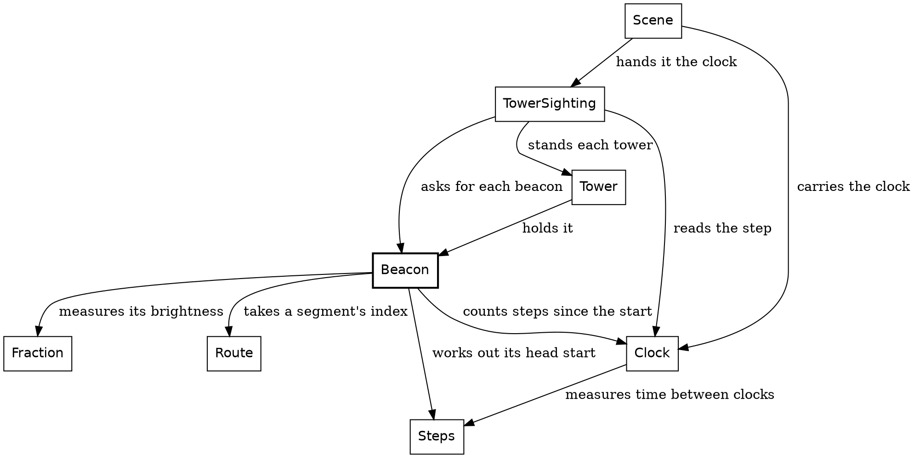

A box is a module, and an arrow is an import. Each frame, `Scene` hands the clock to `TowerSighting`, which finds the towers in view and asks for each tower's beacon at that frame. The clock goes no further. A tower holds its beacon as it shines that frame and decides where it sits, at the tower's top, and the beacon does the rest. Here's the line where the tower past the end of a segment gets its beacon:

{{code TowerSighting.end_tower from "beacon = Beacon.at" to "beacon = Beacon.at"}}

The segment's index and the tower's place say which beacon, and the clock says how bright it is. The tower halfway along a segment has the same line with `Midway` in place of `AtEnd`.

Now down into `Beacon`:

{{code Beacon.at}}

Inside the module, `Beacon.(...)` builds a beacon from its brightness. No other module can. The brightness comes from the beacon's phase, how far it is into its blink:

{{code Beacon.blink_phase}}

`clock.steps_since(Clock.start)` is how a place becomes a distance, and it says which distance: the one from the start of the ride. Adding the beacon's head start gives its phase, and a cosine turns that into a brightness:

{{code Beacon.beacon_brightness}}

`wrapped_to` is the only `%` that `Steps` offers, so a phase of 130 is a phase of 10. (The period is written `Beacon.beacon_period`, with its type's name, even here, because it's defined in the type's block.) `(1 - cos) / 2` runs from 0 up to 1 and back to 0 over one period, and it can't leave that range. So `Fraction.of`, which crashes on a ratio outside 0 to 1, is safe here.

A beacon gets its head start from its segment's index and its tower's place:

{{code Beacon.head_start}}

Each segment's beacon starts 37 steps further into its blink than the last one's, so towers along the road don't blink in unison, which would be boring. 37 shares no factor with 120, so the first 120 segments' beacons all start at different points of the blink. Plenty of other numbers would do.

The tower halfway along a segment blinks opposite the one at its end, and opposite means half a blink on. `half_period` is worked out from the period, so it stays right if the period changes.

The widget's two beacons are the first segment's: the one at its end, with no head start, and the midway one, half a blink on. Step 5,400 is 45 whole blinks in, so the first is dark there and the second is at full brightness. A quarter of a blink later, at step 5,430, they're equally bright, and by step 5,460 they've changed places.

Because the beacon draws itself, its tests need no tower. `Beacon`'s own tests check that a beacon blinks, that the midway one blinks the other way, and that its disc comes out the right size and color, or not at all when it's too dim.

There's no blink abstraction, because nothing else in the game blinks. A beacon goes round and round. The sun goes one way, and a lot more hangs on it.

## The setting sun

Safari Ride needs a sunset. We'll build it the way we build everything here: concepts, then types, then functions.

The concept is three jobs:

1. Move the sun down the sky.
2. Darken the sky.
3. Warm the horizon.

All three come from the clock, and the game stores none of them.

### Get the types right

The types do the work, and a sunset needs four:

| Type | What it is | Under it |
|---|---|---|
| `Clock` | A step of the ride | A `U32` |
| `FarHeight` | A height above the horizon of something far off, like the sun, in pixels, as the lens draws it before the view widens | An `F64`, because a shape can sit between two pixels |
| `Fraction` | A ratio from 0 to 1, like how far toward dusk we are | An `F64` |
| `RgbColor` | A color | An `I64`, `0xRRGGBB` |

All four are opaque. Each is still a number, and the type gives it a name, so a height can't be passed where a fraction is wanted. With those in hand, each job is one or two signatures. The two jobs that change a color have a second row: the first function works out a `Fraction`, and the second turns it into a color.

| Job | Function | Its type |
|---|---|---|
{{types row SunPath.height_at Move the sun}}
{{types row Sky.darkness_at Darken the sky}}
{{types row Sky.sky_top_color}}
{{types row Sky.horizon_warmth_at Warm the horizon}}
{{types row Sky.sky_horizon_color}}

Every one is a `->`, and every one starts from a `Clock`. That's most of the design, before we've read a line of code.

### The functions

The sunset, from the top
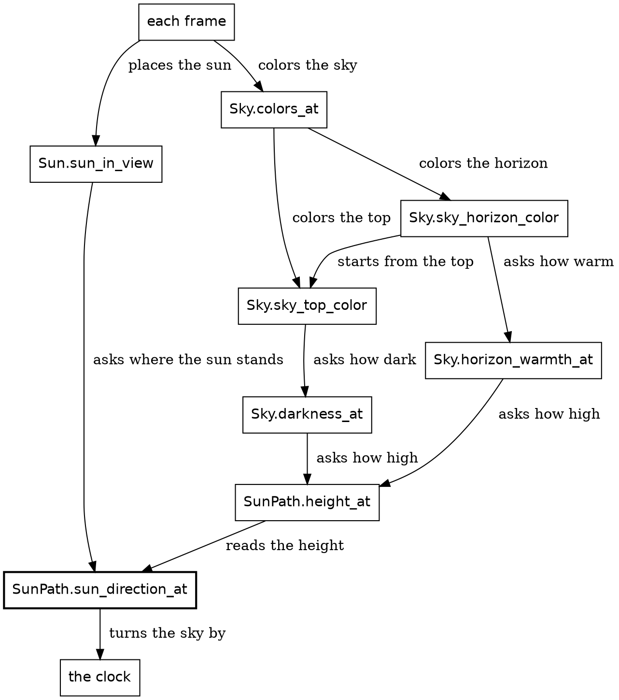

A box is a function, and an arrow is a call. Under the frame, `Sun.sun_in_view` does the first job. `Sky.colors_at` does the other two, as the color of the top of the sky and the color of the horizon. Every path ends at `SunPath.sun_direction_at`, the only box that does anything with the clock but pass it on, because everything in a sunset comes down to where the sun stands.

Here's the top of that diagram in code. Each frame, the game asks for two things, and they make the backdrop:

{{code FrameView.frame_view_at from "backdrop: {" to "sun_sighting: Sun.sun_in_view"}}

`FrameView` hands the clock straight to `Sun` and `Sky`, so everything from here on is in those two and `SunPath`. Let's take the three jobs in order.

### Job one: the sun goes down

```widget sky sun
Press play. The two middle buttons step one frame at a time, for the patient.
```

This widget does only the first job, so the sky stays blue. For each frame it calls `SunPath.height_at`, reads out the answer, and marks it on the chart's gold line.

The sun chapter showed how `Sun.sun_in_view` places the sun on the screen. From the clock, it takes the sun's direction, a bearing and a height, from `SunPath.sun_direction_at`. The rest of the sunset needs only the height:

{{code SunPath.height_at}}

### Job two: the sky darkens

```widget sky sky
Press play. Now the sky darkens too.
```

This widget adds one call, `Sky.darkness_at`, and the sky finally does something. Its answer is the blue line. The top of the sky blends day into night, by that `Fraction`:

{{code Sky.sky_top_color}}

`darkness_at` works out that `Fraction`:

{{code Sky.darkness_at}}

It asks for the sun's height, then picks one of two shapes. They meet when the sun has fully set, one radius below the horizon, and you can see the join in the blue line. Before that, the darkness grows with the square of how far the sun has fallen since the ride began, and reaches 0.6 as the sun fully sets. After that, it rises in a straight line to full dark as the sun sinks one more radius.

{{signatures Sky.darkness_while_up Sky.darkness_after_set}}

Both sit below the module's block, so they're private. Roc needs no keyword for that.

Neither has heard of the clock. The outer functions take a clock, because that's what the frame has to give. The helpers take a height, because the darkness depends on the height, and since they take nothing else, the height is all it can depend on.

### Job three: the horizon warms

```widget sky warmth
Press play. This is the whole sunset.
```

This widget adds `Sky.horizon_warmth_at`, the red line. This job is polish. A sunset without it is still a sunset, just a sad one.

The horizon starts from the top color and blends toward sunset red by the warmth. The warmth is scaled by `horizon_warmth_at_most`, 0.85, so a little of the sky's own color always shows:

{{code Sky.sky_horizon_color}}

`horizon_warmth_at` asks for the sun's height, just as dusk did:

{{code Sky.horizon_warmth_at}}

The horizon is warmest when the sun's height is zero. `from_horizon` is how far the sun is from the horizon, above or below it. `abs` makes the two sides match, which gives the red line its tent. `ratio_to(warmth_reach)` turns that distance into a share of 110 pixels, and `Fraction.clamp` holds the share at 1 for anything farther. The share grows with distance, but warmth should shrink with it, so `complement` turns the share into warmth: one minus the share. A height of zero gives full warmth, and 110 pixels or more gives none.

### Going backward

Play any of those widgets backward, and the sun rises. No code does that. Every function here takes a clock and answers, so it doesn't matter which way the clock runs.

The sun and the beacons can be asked about any step, cold. Hand `Sky.darkness_at` a clock and it answers. The rider and the truck can't do that.

## Stepping through the ride: RideInstant

Where the rider and the truck are depends on where they were, so their state has to be kept. `RideInstant` keeps four things from one step to the next: the rider, the truck, the clock, and the plan for the encounter on the rider's segment. Two of those, the rider and the truck, move by their own physics. This chapter and the next few are about them.

```widget step
Press the last button, then the first.
```

Going forward, the ride has to be played, because each step starts from the one before. Going back, it only reads a list. The rider and the truck are the reason for that difference.

New in this chapter:

- Roc: nothing new
- Modules: none yet. This chapter shows what calls the modules below, and the next few open them.

The modules that do the stepping
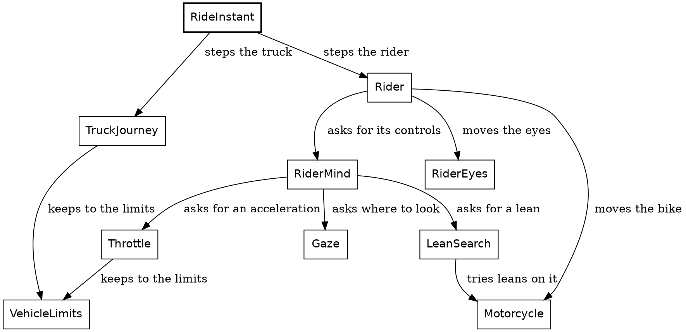

A box is a module, and an arrow points to a module it calls.

Here's the step again, this time whole. Its body is a block: names, then a record, which is the value of the block. The names come in a fixed order, and the order matters. First the rider reads how far the encounter on its segment has got, at the old clock. The code calls that its stage, and the cat chapter explains it. Then the rider steps, and then the clock ticks. Then the truck and the encounter plan answer the rider who has just moved. The rider never reads the truck.

{{code RideInstant.next}}

`Clock.next`, `Rider.rider_at_next_step` and `TruckJourney.truck_progress_at_next_step` all have the same shape: a value goes in, and the next value comes out. Call that *the step function*. There's no mutable rider being nudged. There's a rider, and another rider one step on.

Stepping has a cost, which shows up when we compare it with the sun:

- We can ask about the sun at any step. To find a truck at step 4,000, we have to play the ride that far, or write the answer down by hand.
- A wrong sky only affects the frames it touches. A wrong step moves the rider for the rest of the ride.
- The lines of `RideInstant.next` have to run in order. Frames can be worked out in any order.

The rider's step is the bigger of the two, and it takes up the next four chapters. The truck gets the three chapters after those.

## The rider

The rider is two things: a motorcycle, and a pair of eyes.

| Part | Field | Type | What it is |
|---|---|---|---|
| motorcycle | `route_place` | `RoutePlace` | which segment, and its `road_point` on it, along and across |
| | `yaw` | `Angle.Turn` | which way the bike points |
| | `speed` | `Speed` | how far it goes in a step |
| | `lean` | `Angle.Lean` | how far it leans |
| eyes | `gaze_yaw` | `Angle.Turn` | where the rider is looking |
| | `look_depth` | `Fraction` | how deep the last look went |

New in this chapter:

- Roc: a nominal record of nominal records, record update three levels deep, a value for a motorcycle that doesn't exist
- Modules: `Rider`, `Motorcycle`, `RiderEyes`, `RiderMind`, `RiderCamera`

{{code Rider.Rider from "Rider := {" to "}.{"}}

`Rider := { ... }` is a nominal record, like `RideInstant`, and both of its fields are nominal records too: `Motorcycle` and `RiderEyes`. Nothing in the rider is a bare float. Three of the fields in the table are angles, of two types: `yaw` and `gaze_yaw` are `Turn`s, and `lean` is a `Lean`. Passing a `Lean` where a `Turn` is wanted is a compile-time error. The eyes get a chapter of their own.

The step does its work in order, and the code reads that way: decide, move, cross a bend or stop, then choose where to look:

{{code Rider.rider_at_next_step}}

Static dispatch finds `segment_on` on the `RoutePlace`. The `match` on `segment.segment_ending()` has two tags, and `..` in `Bends({ bend, .. })` ignores the rest of its payload.

{{code RiderMind.controls}}

Every decision the rider makes is `RiderMind`'s. `RiderMind.controls` answers the bike's controls: a lean and an acceleration. Notice its last line. `Throttle` picks the acceleration, and it's asked about a motorcycle that doesn't exist: this motorcycle as it would be at the new lean. `motorcycle.with_lean(lean)` builds that one as a new record. The real motorcycle isn't touched, because no Roc value can be changed.

The Rehearsal chapter takes that idea much further. A small version of it decides what happens at the end of a segment. `cross_bend_if_on_road` makes a motorcycle carried past the bend onto the next segment. If that motorcycle is on the road, it's the answer. If not, the old one is. The rejected motorcycle simply stops being referred to, and nothing has to be undone:

{{code Motorcycle.cross_bend_if_on_road}}

Record update does most of the writing here. Stopping dead updates three levels deep: `..motorcycle` keeps everything but the fields named, `route_place` is itself an update of the old place, and its `road_point` is an update of the old point:

{{code Motorcycle.stopped_at}}

### The picture leans too

When the rider leans, the whole picture leans with it. This is all of that:

{{code RiderCamera.roll_deadband}}

{{code RiderCamera.rider_roll}}

A lean inside the deadband leaves the canvas level, and any other lean passes straight through. It's called once a frame:

{{code RiderCamera.of from "roll: rider_roll" to "roll: rider_roll"}}

The camera turns as well. `Rider.head_yaw` follows the gaze and turns a little with the lean, as a rider's head turns into a bend, and the camera adds it to the motorcycle's yaw.

So a decision is a lean and an acceleration. The motorcycle is what turns them into movement.

## The bike

A lean of 1 degree turns the bike by a tenth of a degree each step, so at a metre a step it goes round a circle 573 metres in radius. That's nearly all the physics.

New in this chapter:

- Roc: nothing new

The modules around `Motorcycle`
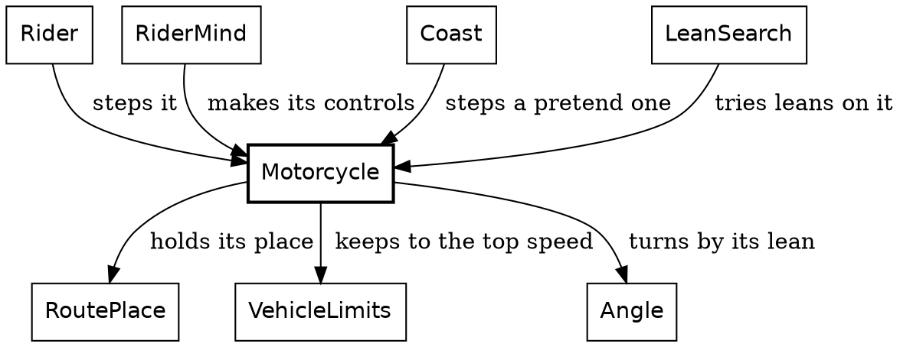

The motorcycle is four fields: where it is on the route, which way it points, how fast it goes, and how far it leans. Its controls are a lean and an acceleration:

{{code Motorcycle.Motorcycle from "Motorcycle := {" to "}.{"}}

{{code Motorcycle.Controls}}

The step is the whole of the physics, in order:

{{code Motorcycle.motorcycle_at_next_step}}

The step works in three parts. First the speed: the acceleration is applied, and `allowed_speed` holds the result to the top speed. Then the turn: `lean.steer(turn_per_lean)` turns the lean into a change of direction, a `Turn`. That's the only way a lean affects where the bike points. Then the move: the bike goes one step's length in the direction halfway through the step's turn, `mid`. `along.plus(...)` adds a `Distance` to a place, which is places and distances again. The new place is a record update of `route_place` with a new `road_point`, inside a new motorcycle.

The bike turns the same amount per step at any speed. That's a cheat, chosen by eye, and it's fine here because the rider chooses each step's lean by trying it out on this same physics.

Two small helpers let the rest of the program pretend:

{{code Motorcycle.with_lean}}

{{code Motorcycle.steady_controls}}

`{ ..motorcycle, lean }` is record update with a shorthand: the field and the local have the same name. `with_lean` makes a motorcycle that doesn't exist, and `steady_controls` makes the controls to coast one on. The Rehearsal chapter uses both hundreds of times a step.

So the work is split. The throttle chooses an acceleration, and the bike turns it into a speed. Choosing the lean has to wait for the Rehearsal chapter.

## The throttle

The rider is always deciding whether to accelerate, brake or hold steady. `Throttle` makes that decision, once a step.

New in this chapter:

- Modules: `Throttle`, `ThrottleLimit`, `Speed`, `Acceleration`, `VehicleLimits`

The modules around `Throttle`
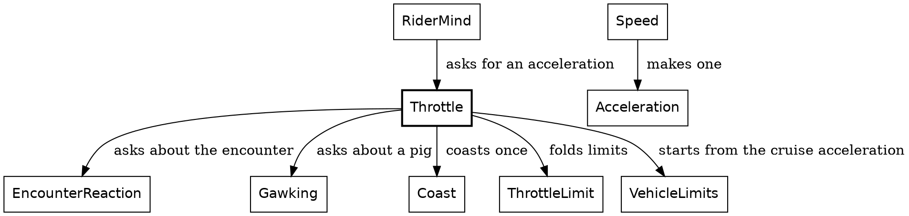

The chain of limits
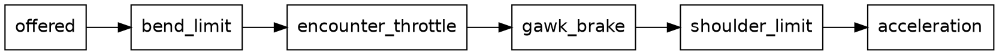

The rider has several reasons to slow down, and they don't know about each other. A bend is coming. A cat is in the lane. There's a pig to look at. Coasting on would carry the bike off the road. `Throttle` writes them as a list of limits, the chain in the second diagram. It starts from `offered`, the cruise acceleration. `fold` hands each limit in turn to `held_to`, with the acceleration so far, and each limit lets it through or lowers it:

{{code Throttle.next_acceleration from "limits = [" to "limits.fold(offered, held_to)"}}

Call this *the chain of limits*. Each limit answers the same type and can be read alone, and adding a reason is one more line. It reads like a list of rules because that's what it is.

Each limit is a `ThrottleLimit`: nothing, or at most some acceleration. `held_to` takes the lower:

{{code ThrottleLimit.ThrottleLimit}}

{{code Throttle.held_to}}

The throttle answers an acceleration, and the motorcycle turns it into a speed.

`Speed` and `Acceleration` are places and distances again: a speed is the place, and an acceleration is the change from one speed to another. To brake for a bend, the rider needs the steady acceleration that takes its speed to a target within so much road. That's `Speed.acceleration_to`. Its `within` is a `Distance`: the road the change has to happen in. The formula is the first line of a physics textbook, v² = u² + 2as, solved for a, with the speed going from `s` to `t`. In the parameter list, `Speed.(s)` and `target: Speed.(t)` unwrap the two speeds into plain numbers, as `Clock.(n)` did in the One whole module chapter:

{{code Speed.acceleration_to}}

It has one caller, `VehicleLimits.braking_to`. That function also holds the speed steady when less than a micrometre of road is left, and crashes on a brake that would take the speed below zero. The rider's bend brake, the gawk brake and the truck all brake through it. The first limit is the bend's:

{{code Throttle.bend_limit}}

The last limit, `shoulder_limit`, comes back in the Rehearsal chapter, because it runs a pretend copy of the bike forward, which is what that chapter is about. The two in the middle come from what the rider sees: `encounter_throttle` is the cat's, and `gawk_brake` the pig's. The cat's has its own chapter, so we'll take the pig first.

## The rider's gaze

The herds chapter left one pig waiting. On the first two segments with pigs, one pig in the big herd catches the rider's eye. The rider turns to look and slows down, and the camera turns too.

Looking and slowing down are two different things, and they last different lengths of time. The eyes follow the pig, and they give up once it's too far to the side. The speed drops for the pig, and it stays down until the segment ends. So the code has two words for them. A *look* is what the eyes do, and *gawking* is what the speed does. This chapter takes them in that order.

```widget gaze
Press play to ride the stretch around the first distracting pig, seen from above. Each step is one call to `Rider.rider_at_next_step`, and the lines under the picture read the rider's `speed`, `gaze_yaw` and `look_depth`.
```

### Get the types right

The rider's record has two fields we haven't used yet:

| Field | Type | What it is |
|---|---|---|
| `gaze_yaw` | `Angle.Turn` | How far the rider looks from the way the bike points |
| `look_depth` | `Fraction` | How far a look went, from 0 to 1, fading once the gaze is back on the road |

Mind what `gaze_yaw` is measured from. The road has a direction, `yaw` is how far the bike points from the road, and `gaze_yaw` is how far the eyes point from the bike. Each is measured from the one before it, which is what a `Turn` is.

Three small types say what a pig can do to the rider. Each one carries its payload only where it means something. A segment's `pigs` field is `NoPigs` or `Herd`, and only `Herd` carries a payload: the herd itself, and its `interest`. The interest is `Distracting` or `Unnoticed`, which says whether the herd catches the rider's eye:

{{code Segment.Pigs}}

The rider looks at a pig or at the road, and only a pig has an angle:

{{code Gaze.GazeTarget}}

A pig asks something of the throttle, or it doesn't, and that's the `ThrottleLimit` from the throttle chapter.

So the job is a short list:

| Job | Function | Its type |
|---|---|---|
{{types row Gaze.desired_gaze Choose where to look}}
{{types row RiderEyes.next_gaze_yaw Turn the head}}
{{types row RiderEyes.next_look_depth Keep the depth of the look}}
{{types row Gawking.is_gawking Know whether the rider is gawking}}
{{types row Gawking.gawk_brake Work out the brake}}

One step of the gaze
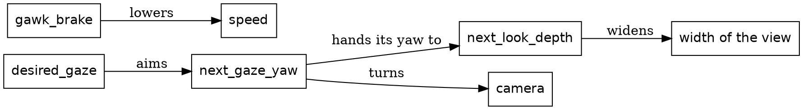

The chain from `desired_gaze` is the look, and `gawk_brake` is the gawking. Nothing joins them. Both ask about the same pig, and neither asks about the other.

### The look

`Rider.rider_at_next_step` moves the eyes last, after the bike has moved:

{{code RiderEyes.eyes_at_next_step}}

Before the eyes move, the rider chooses where to look. `Rider.rider_at_next_step` asks `RiderMind.gaze_target`, since every decision is `RiderMind`'s, and `gaze_target` hands the question to `Gaze.desired_gaze`:

{{code Gaze.desired_gaze}}

The pig has to be near, and it has to be in sight. Near means within 150 metres, measured along the road. In sight is an angle:

{{code Gaze.turn_to}}

That's the direction to the pig, less the way the bike points. The pig stands beside the road, so the angle grows as the rider comes closer. At 35 degrees the rider lets it go. There's no timer and no flag saying the look is over. The first pig stands about 11 metres from the middle of the road, so it reaches 35 degrees about 16 metres ahead.

### Turning the head

{{code RiderEyes.next_gaze_yaw}}

Toward a pig, the gaze turns by at most 4 degrees a step, and `clamped_within` holds the change to that limit on either side. On the way back the same clamp holds it to 0.2 degrees a step.

A gaze within 0.2 degrees of straight ahead goes all the way there, so the last step of the return lands exactly home, and the return ends.

Nothing here turns the bike. The gaze goes to the camera, and to nothing else that moves:

{{code Rider.head_yaw}}

The second term is the rider's head going with the lean. So when the rider looks right, the road slides left on the page, and the bike keeps going where it was going.

### The depth of a look

{{code RiderEyes.next_look_depth}}

While the gaze is off straight ahead, the depth rises with how far it has turned, and it doesn't drop. Once the gaze is home, the depth fades by 0.0012 a step, so a full look takes more than 800 steps to fade.

The depth has one job. It widens the view:

{{code RiderEyes.attention}}

`RiderCamera.ride_focal_length` sets how wide the view is. It asks `Rider.attention`, which takes the stronger of two pulls: this look's, and a crossing cat's, which the cat chapters cover. So a pig widens the view, and the view stays wide for a while after.

### Gawking

Whether the rider is gawking is a plainer question than whether it's looking:

{{code Gawking.is_gawking}}

Like the look, it starts when the pig is within 150 metres. It only asks where the rider is, with no angle, so it lasts until the segment ends, long after the look.

`gawk_brake` is the third link in the throttle's chain. It gives a brake while the rider has noticed a pig, and `held_to` keeps the brake when it's lower than the acceleration so far:

{{code Throttle.next_acceleration from "Gawking.gawk_brake(motorcycle, segment)," to "Gawking.gawk_brake(motorcycle, segment),"}}

{{code Gawking.gawk_brake}}

The formula is the one the throttle uses for a bend, with a pig for a bend. The rider aims to be down to 0.2 metres a step by 25 metres before the pig. Past that point `room` would go below zero, so `gawk_least_distance` holds it at a metre and the brake stays on.

### The first pig

Here's all of that on the third segment of the route:

| Step | What happens | Speed | `gaze_yaw` | `look_depth` |
|---|---|---|---|---|
| 885 | The rider looks, with the pig just inside 150 metres | 1.94 metres a step | 4.0 degrees | 0.114 |
| 1,049 | The gaze is at its widest | 0.2 metres a step | 34.95 degrees | 0.999 |
| 1,050 | The rider lets the pig go | 0.2 metres a step | 34.75 degrees | 0.999 |
| 1,224 | The gaze is back on the road | 0.2 metres a step | 0 degrees | 0.997 |

The look takes 165 steps, and getting the eyes back takes 174. The rider crawls for 173 steps more with nothing to look at, and reaches the next segment at step 1,397. The gaze is home at every one of the ride's 18 seams between segments, and an expect holds that. A seam needs no reset anyway: the bike doesn't turn at a seam, and `gaze_yaw` is measured from the bike.

That's the pig's part of the rider's step. The truck is the other stepped thing.

## The truck

All through the ride, the rider follows a truck up the road. How the truck moves comes in the next chapter, and its lights in the one after. This chapter draws it: a plain truck, standing at a place on the road that's already known, and facing along the road.

```widget truck
A truck from behind, from behind and to one side, and from the side.
```

New in this chapter:

- Modules: `Truck`, `TruckBody`, `TruckShape`, `TruckSighting`, `TruckPlacement`

### How to draw a truck

Here's the whole job in one function. Given a sighted truck and the camera's lens, it works out the truck's setting, then draws its headlight beams, its body and its brake lights, each painted over the one before:

{{code Truck.truck_sprite}}

The body is drawn the same way, one level down. It takes the truck's spot, places each face, sorts the faces far to near so that a nearer face covers a farther one, and clips and projects each one:

{{code TruckBody.body_sprite}}

The modules that draw the truck
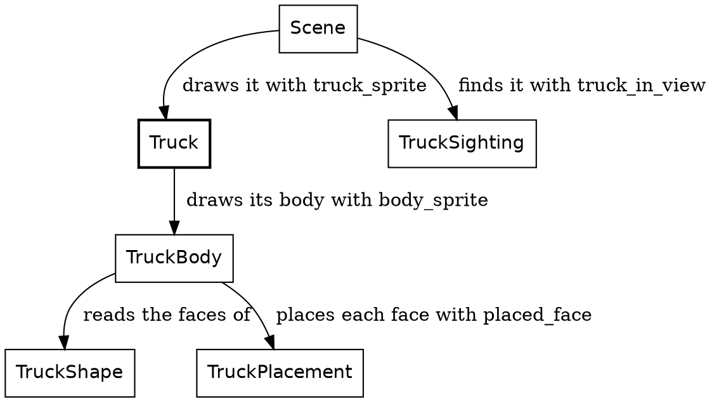

The rest of this chapter opens those pieces: what the truck looks like, and how it's placed on the road.

### What the truck looks like

The truck is blue: a dark blue body, darker blue sides, a lighter blue roof, and black tires. There's no glass, so the windshield is the body's color.

`TruckShape` says what the truck looks like, and nothing else. It doesn't know where the truck is, or that there's a road. Each part of the truck is a face, a color and its corners:

{{code TruckShape.TruckFace}}

A corner is a point in the truck's own frame, three distances measured from the middle of the trailer:

{{code TruckShape.TruckPoint}}

The sides come first. Each one is a single outline, the trailer and the cab together, walked from the back of the trailer to the nose and back:

{{code TruckShape.sides}}

The trailer's back, the roof, the windshield and the nose are each a strip across the truck. Here's the windshield, sloping down from the cab's roof to its nose:

{{code TruckShape.windshield}}

The tires are circles standing on the road, one on each side of each axle:

{{code TruckShape.tires}}

And the whole truck is its faces, in one list:

{{code TruckShape.truck_faces}}

### Shape, placement, projection

That shape gets to the screen in three stages:

| Stage | What it does |
|---|---|
| Shape | Says where each corner of each face is in the truck's own frame |
| Placement | Turns one point by the road's heading, carries it out from the truck's foot, and lowers it by the ground's drop |
| Projection | Turns one whole face into a polygon on the screen |

Placement works a point at a time. Projection works a face at a time, for two reasons. A face that reaches behind the camera is clipped, and clipping can cut corners off a face and add new ones, so it needs the whole outline. And the faces are sorted by depth before they're drawn, and the sort orders faces, not points.

### Placement: one rigid body

A truck doesn't bend, so every corner moves together. `TruckSighting` finds the truck on the road ahead and works out two things once: the truck's spot, and which of its lights are on.

{{code Truck.SightedTruck}}

Every sighting's spot holds the object's foot in the rider's view, and which way the road runs there. `road_heading_at` finds that direction from two points on the road: the object's own, and a point one metre further along. It brings both into the rider's view, and the angle between them is the heading.

{{code RoadAhead.road_heading_at}}

A solid thing stands each of its points through its spot. A point is an offset in the thing's own frame. It is turned by the road's heading and by how the thing faces against the road, carried out from the foot, and lowered by the ground's drop. The tower stands its footprint this way, turned by its yaw:

{{code Spot.standing_point}}

The truck faces straight along the road, so its placement is one line. The headlights and the brake lights use it too:

{{code TruckPlacement.raised_point}}

The truck is drawn from its spot and the camera's lens:

{{code TruckPlacement.TruckSetting}}

Every corner is lowered by the same drop, how far the ground has curved away beneath the truck's spot. Across a 12-metre truck the drop changes by a few centimetres at most, far less than a pixel. `TruckPlacement.placed_face` places every corner of a face this way, and that's what `body_sprite` sorts and draws.

With the lights off, the beams and the brake lights are empty pictures, and `truck_sprite` draws just the body. The truck is drawn however small it stands, because the rider is always looking for it.

That's a truck. Next, it moves.

## The truck's motion

The truck is what the rider chases. It starts 500 metres up the road, and for most of the ride the rider closes in on it, but not steadily:

| Step | Rider, along the route | Truck, along the route | Lead |
|---|---|---|---|
| 0 | 0 metres | 500 metres | 500 metres |
| 2,000 | 1,831 metres | 2,274 metres | 443 metres |
| 4,000 | 4,796 metres | 5,051 metres | 255 metres |
| 6,000 | 6,790 metres | 6,931 metres | 141 metres |

The closest the rider gets is 50 metres, at step 6,374. After that the rider slows to stop at the route's end, at step 6,746. The truck doesn't wait. It drives on past the end of the route and vanishes, since nothing is drawn beyond the end. You never catch it. Some riders have complained about the darn truck, and that's the design. At least for now haha.

New in this chapter:

- Modules: `TruckJourney`

### A tease, carried out by physics

The truck's driver is teasing the rider: staying ahead, but letting the rider gain. That's the hand of god, a rule that bends the world on purpose, for the story. Here it's one function, `tease_position`. Given how far the rider has come, it says where the truck would like to be. The lead it aims for shrinks from 500 metres at the start of the route to 100 at the end.

Everything else is plain physics. The truck speeds up while it's short of that mark and holds its speed once it's past it. It slows for the bends, and that's mostly where the rider gains. The tease only ever speeds the truck up, so near the end the rider can get closer than the 100 metres it aims for. The truck can always pull away again, because it outdoes the rider by 10%, in both its acceleration and its top speed.

### Remembered, not worked out

The sun is worked out from the clock. `sun_direction_at` takes a clock, so you can ask about any step and get an answer, without running the ride up to it.

The truck can't be worked out that way, because where it is depends on where the rider has been. So the truck is carried forward. Its step, `truck_progress_at_next_step`, takes a `TruckProgress` and returns the next one. The ride remembers four things from one step to the next, the rider, the truck, the clock and the encounter plan, and the truck is one of them.

That's what makes the order of a step matter. The rider moves first, and then the truck reads where the rider has got to. The rider never reads the truck.

### Get the types right

The truck's state is three fields:

{{code TruckJourney.TruckProgress from "How far along" to "pace : TruckJourney.Pace,"}}

`route_position` is a `Distance` along the whole route, the same measure as the rider's progress, so the two can be compared directly. `Pace` says whether the truck's last step slowed it down:

{{code TruckJourney.Pace}}

A bend ahead of the truck is its own type, and so is the answer to "is there one":

{{code TruckJourney.ComingBend}}

{{code TruckJourney.NextBend}}

`BendAhead` carries a `ComingBend`: how far off the bend is, and its turn, an angle. `NoBendAhead` carries nothing: the route ends before another bend, or the truck is already past the end. The only way to read a bend's distance is inside the branch where there is a bend.

### The functions

The modules around `TruckJourney`
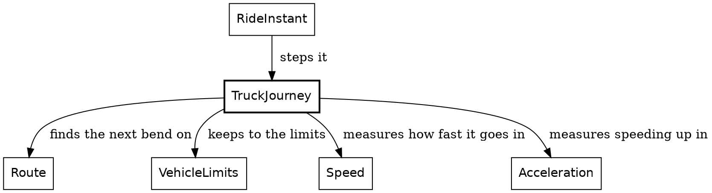

`RideInstant` moves the truck once a step. All it hands over is how far along the route the rider has just got to, and the route itself:

{{code RideInstant.next from "truck = TruckJourney.truck_progress_at_next_step(" to "{ rider_distance: rider_place.distance_along(route), route },"}}

That record is the whole of the chase. `TruckJourney` imports none of the rider's modules, and the rider's modules don't import `TruckJourney`. What the two share is `VehicleLimits`, the limits both keep to, which is where the truck's 10% comes from.

The step works out the tease, then looks for the next bend:

{{code TruckJourney.truck_progress_at_next_step}}

Here's the tease itself. The lead shrinks in step with the rider's progress along the route:

{{code TruckJourney.tease_position}}

Finding the next bend walks the route's segments with their ends, and takes the first one that ends past the truck:

{{code TruckJourney.next_bend}}

Read its signature out loud: `next_bend : Route, Distance -> NextBend`. The next bend, on a route, past a distance. That's what a signature should do: say what the function is for, before you read its body.

Then the two ways to take a step. Both sit below the module's block, so they're private, and both are arithmetic on `Speed`. Within 60 metres of a bend, the truck brakes so it reaches the bend at its cautious speed. `VehicleLimits.turn_speed` is the speed a turn allows, and the rider's throttle asks it too. The truck's own rule is that limit times its caution, 80%, to leave a margin:

{{code TruckJourney.cautious_turn_speed}}

{{code TruckJourney.progress_braking_for}}

`VehicleLimits.braking_to` works out one steady brake that reaches the target speed at the bend. A steady brake can land a little under the target, so `target_speed.max(...)` holds the truck there. A brake that would take the speed below zero is a bug, and `braking_to` crashes on one. Otherwise, the truck chases:

{{code TruckJourney.progress_toward_tease}}

That's a truck you can chase. The next chapter lights it.

## The truck's lights

The ride runs from day into night, so the truck's headlights come on near the end. The truck brakes for bends, so its brake lights show whenever you're close to it, even by day. The truck drives exactly the same with its lights on or off.

Each frame, `FrameView` builds both lamps together. It hands the sky's darkness to `TruckHeadlights` and the truck's pace to `TruckBrakeLights`:

{{code FrameView.ride_facts from "headlights: TruckHeadlights.at(" to "brake_lights: TruckBrakeLights.at("}}

New in this chapter:

- Modules: `TruckHeadlights`, `TruckBrakeLights`

Each kind of lamp gets a module, and each module owns two things: whether its lamp is on, and how the lamp looks. Both are `[On, Off]`, and a `Truck` holds one field per lamp:

{{code Truck.Truck from "Which of" to "Truck := {"}}

### The headlights

The headlights work like a light sensor on the lamps themselves: once the sky is dark enough, they're on. `Sky.darkness_at` answers a `Fraction`, 0 by day and 1 at full dark, and the sensor reads that:

{{code TruckHeadlights.at}}

They come on at this darkness:

{{code TruckHeadlights.headlights_on_darkness}}

On this ride, that's step 3,555 of 6,746. Once on, they stay on, because from there the sky only darkens.

Their `sprite` matches both tags, and an `Off` lamp is an empty sprite. When they're on, it paints two beams as wedges that fade from the lamp toward their far end. Their points are placed the way the body's are, with `TruckPlacement.raised_point`:

{{code TruckHeadlights.sprite}}

### The brake lights

The brake lights have a twist: they don't read the light at all. They follow the truck's pace, so they're on while its last step slowed it, by day or by night:

{{code TruckBrakeLights.at}}

Their picture works the same way as the headlights': two lamps on the back of the trailer, each with a glow around it, and nothing when they're off:

{{code TruckBrakeLights.sprite}}

### All together

`Sprite.composite` makes one picture of several, each painted over the ones before:

{{code Sprite.composite}}

`Truck.truck_sprite`, from the chapter that drew the truck, puts the beams first, then the body, then the brake lights:

{{code Truck.truck_sprite from "Sprite.composite([" to "lights.brake_lights.sprite(setting),"}}

`TruckBody` knows nothing of the lights: they're drawn around it.

Step the ride back past step 3,555, and the headlights go off again. Nothing turns them off; they only ever read the sky. The brake lights read the truck's last step, which the ride keeps, so they come back with it.

## The cat

A cat walks out into the lane, freezes as the rider bears down on it, and leaps clear at the last possible moment. It's one of the most elaborate effects in Safari Ride, and it's where the rider and the world start to push on each other.

```widget cat
Press play and watch the crossing.
```

Play it, and the gap falls from 50 metres to 0, with the rider held at a metre a step. The cat waits on the right verge until 41 metres, where the last line changes to "The rider may not accelerate". It walks out, and at 31 metres it freezes in the lane. It stays frozen until 7 metres, where it coils, leaps at 6 and lands at 4. At 3 metres it has collapsed on the far verge, and the rider may accelerate again. Below that, nothing changes.

New in this chapter:

- Roc: a list of frames as data; a `crash` that the data rules out
- Modules: `CatCrossing`, `Cat`, `Animation`, `EncounterPlan`, `EncounterPoses`, `EncounterSighting`

### Two halves, and one fact remembered

A crossing comes in two halves. `CatCrossing` is what the cat does: where it crosses, and what it does at each step of its crossing. `Cat` is how it looks this frame, which is just its pose. The pose type, `CatPose`, is defined in `CatCrossing`, not in `Cat`, because the crossing is what changes the pose:

{{code Cat.Cat from "Cat := {" to "}.{"}}

The animation itself is a list of frames, played one a step on the ride's clock. All the ride has to remember is the step it started on. That's an `EncounterPlan`:

{{code EncounterPlan.EncounterPlan from "When the encounter" to "].{"}}

Everything else about the cat is worked out from that one step and the clock.

The modules around `CatCrossing`
```dot
digraph cat {
  node [shape=box, fontname="Helvetica"];
  CatCrossing [style=bold];
  World -> Segment [label="  marks some segments CatCrosses"];
  Segment -> CatCrossing [label="  builds and holds it"];
  RideInstant -> EncounterPlan [label="  keeps the plan"];
  EncounterReaction -> CatCrossing [label="  reacts to it"];
  EncounterSighting -> EncounterPoses [label="  asks where it stands"];
  EncounterPoses -> CatCrossing [label="  asks for its instant"];
  Cat -> CatCrossing [label="  takes its poses from"];
  CatCrossing -> Animation [label="  plays its frames"];
  CatCrossing -> EncounterPlan [label="  is planned by its span"];
  EncounterPlan -> Animation [label="  answers a Stage"];
  Cat -> CatStills [label="  draws a still"];
}
```

### When it plays

The ride plans the crossing once, from how fast the rider is coming. The aim is for the cat to be across just as the rider arrives 3 metres short of it. The crossing takes 38 steps, so the plan is made when a rider who kept their speed would cover the rest of the gap, down to 3 metres, in 38 steps. That's what coming within reach means. A faster rider covers more road in that time, so the plan is made farther off:

| Rider's speed | The crossing starts at a gap of |
|---|---|
| 1 metre a step | 41 metres |
| 1.5 metres a step | 60 metres |
| 2 metres a step | 79 metres |

What the ride plans by is a span: how many steps the animation takes, and the gap it ends at.

{{code EncounterPlan.StepSpan}}

The cat's span is its 38 frames, ending 3 metres short:

{{code CatCrossing.crossing_span}}

The plan is made on the first step where the rider is within reach. Until then, and while the rider is at rest, nothing is planned:

{{code EncounterPlan.plan_for}}

After that one look, the cat doesn't care what the rider does. If the rider brakes, the cat still crosses on time, and the rider simply arrives a little later.

Once a plan exists, the ride's clock says where the animation has got to. That's a `Stage`:

{{code Animation.Stage}}

`Waiting` before it starts, `Playing` while it runs, counting steps in, and `Past` after it ends, counting steps since. The tags carry only what each case needs, so there's no step count to misread while the cat is waiting.

A plan and the clock together make a `Timing`:

{{code EncounterPlan.Timing}}

{{code EncounterPlan.timing_at}}

A `Timing` and the animation's length make the `Stage`:

{{code EncounterPlan.stage_at}}

### Who moves first

Each step, the world and the rider change each other, and the order matters. The rider reacts to the cat as it stood at the start of the step: if the crossing is playing, the throttle holds. Then the rider moves, and the ride checks the plan again. If the moved rider has just come within reach, the plan is made at the new clock. At each new segment the plan is forgotten, because only the encounter on the rider's own segment is ever live.

So within one step, the rider answers the world, and then the world answers the rider. The cat never sees the rider again once it's planned, but the rider sees the cat every step.

### What it looks like

The whole crossing is a list of frames, one a step:

| Frames | Frame numbers | What the cat does |
|---|---|---|
| walking out | 1 to 10 | strides and rests, from behind its tree most of the way to the middle of the road |
| frozen | 11 to 34 | stands in the lane |
| the leap | 35 to 38 | coils, flies twice, lands on the far verge |

That counts frames from 1, as the widget does; in the code, a `Playing` stage counts the steps in from 0.

After the last frame it lies collapsed on the far verge. Each frame is a pose and where the cat is on its way across:

{{code CatCrossing.CrossingFrame}}

{{code CatCrossing.CrossingWay}}

The leap is four keyframes, set by eye:

{{code CatCrossing.leap_frames}}

`crossing_timeline` puts the frames on the road. A closure, `location_of`, turns each frame's way across into a place by this crossing's tree:

{{code CatCrossing.crossing_timeline}}

The span and the timeline both come from the one list, `crossing_frames`, so the animation's length and its frames can't disagree.

### How a timeline plays

Asking for the cat at a stage is one function:

{{code CatCrossing.cat_instant_at}}

The timeline answers with a `match` on the stage and a lookup in the list:

{{code Animation.Timeline from "instant : Animation.Timeline" to "Past(_) => timeline.after"}}

A `Playing` stage past the end of the frames would be a bug, and the timeline crashes rather than guess. It can't happen here, because the length the ride plans by is the length of the list.

### Getting it on screen

The cat reaches the screen in two parts, and the camera is only in the second. First, `EncounterPoses` works out where each cat in view stands this frame, with no camera at all. Only the rider's own segment plays its crossing; a cat on a segment ahead is still waiting behind its tree:

{{code EncounterPoses.cat_poses}}

Then `EncounterSighting` asks where the camera sees each one. Through `Pipeline.scenery_sighting_of`, it drops any behind the camera or too small to draw:

{{code EncounterSighting.cats_in_view}}

From there, a cat is a kind like a tree or a cow, and it joins the frame's depth sort.

The ride remembers one step for the cat, and works out everything else, frame by frame, from it and the clock. While it crosses, the cat also asks two things of the rider: hold the throttle, and look. That's the rider's side of the story, and it comes two chapters on.

## The bird

The bird is Roc's logo, sitting on a treetop. As the rider comes near it takes off, flies across the road and ahead, and drops onto a tree on the far side. It moves the way the cat does, through the same plan and the same kind of timeline, and it took much less code.

```widget bird
Press play and watch the bird fly.
```

The widget's camera stays put, 18 metres short of the first tree. The gap counts down as if a rider were coming, and it only drives the clock. Play it, and the gap falls from 75 metres to 0, with the rider held at 1.25 metres a step. The bird sits on the tip of the left tree, 6.4 metres up, until a gap of 60 metres. It takes off side on, turns away at about 55 metres, and is highest, 10.7 metres up, near the middle of its flight, shrinking as it goes. It starts to dive at a gap of 20 metres, and at 15 it's perched on the tip of the far tree, 4.9 metres up. Below that, the picture stays as it is.

New in this chapter:

- Roc: tags inside tags, opening a `Try` by hand, `match` as an expression
- Modules: `BirdFlight`, `Bird`

### Two halves

A bird comes in the same two halves as a cat. `BirdFlight` is what it does: the tree it leaves and the tree it flies to. `Bird` is how it looks this frame, which is its pose:

{{code Bird.Bird from "Bird := {" to "}.{"}}

A pose can carry a tag of its own. A bird side on or seen from behind has its wings up or down, so those tags carry a `WingBeat`. As with the cat, the pose type is defined in the module that changes it, `BirdFlight`:

{{code BirdFlight.BirdPose}}

The modules around `BirdFlight`
```dot
digraph bird {
  node [shape=box, fontname="Helvetica"];
  BirdFlight [style=bold];
  World -> Segment [label="  marks some segments BirdHere"];
  Segment -> BirdFlight [label="  builds and holds it"];
  Scene -> EncounterSighting [label="  asks for the birds in view"];
  RideInstant -> EncounterPlan [label="  keeps the plan"];
  EncounterSighting -> EncounterPoses [label="  asks where it stands"];
  EncounterPoses -> BirdFlight [label="  asks for its instant"];
  Bird -> BirdFlight [label="  takes its poses from"];
  BirdFlight -> Animation [label="  plays its frames"];
  BirdFlight -> EncounterPlan [label="  is planned by its span"];
  Bird -> BirdStills [label="  draws a still"];
}
```

### When it plays

The ride plans the flight the way it plans a cat's crossing: once, when the rider first comes within reach, from how fast the rider is coming. A flight is 36 frames. It's planned to end when a rider who kept their speed would be 15 metres short of the tree the bird left, so the rider sees it land before passing that tree:

{{code BirdFlight.flight_span}}

So a faster rider sets the bird off farther away:

| Rider's speed | The flight starts at a gap of |
|---|---|
| 1 metre a step | 51 metres |
| 1.25 metres a step | 60 metres |
| 2 metres a step | 87 metres |

The widget's rider comes at 1.25 metres a step, so the bird takes off at 60. Once it's planned, the flight plays on the ride's clock, a frame a step, whatever the rider does. Its stage is worked out exactly as the cat's is, from the plan's timing and the flight's own length:

{{code BirdFlight.flight_stage}}

### What it looks like

A flight is a list of poses, one a step: a flap side on as it takes off, seven flaps seen from behind, then a flap's length of diving.

| Frames | What the bird does |
|---|---|
| 1 to 4 | one flap, side on |
| 5 to 32 | seven flaps, seen from behind |
| 33 to 36 | dives |

That counts frames from 1, as the widget does. Before the first frame the bird sits on the tree it leaves, and after the last it sits on the tree it flew to.

`flight_timeline` puts the poses on a path:

{{code BirdFlight.flight_timeline}}

The path eases along the straight line between the two treetops, and rises above it in an arc 5 metres high at the middle:

{{code BirdFlight.flight_location}}

With `t` for `share`, how far through the flight the bird is, `4t(1 − t)` is 0 at both ends and 1 halfway, so the arc starts and ends on the line. The last line is a record update: everything about the point on the line, with its lift raised.

### Finding a tree

A segment's bird is chosen when the world is built. The segment picks the perch, the fifth tree on the left:

{{code Segment.fifth_left_tree}}

Then the bird picks where to fly: the first tree on the far side of the road at least 25 metres farther along.

{{code BirdFlight.flight_from}}

`find_first` answers a `Try`, and the `match` opens it by hand, turning "not found" into the bird's own error, `NoTreeToFlyTo`. The bird always starts on the left because its perched and side-on stills face right and are never mirrored, so on a left tree it faces the road.

The segment puts the two together. A route that plans a bird on a segment with no tree for it is a bug, so each failure crashes with its own reason:

{{code Segment.from_choices from "BirdHere =>" to "QuietRoad => QuietRoad"}}

`match` is an expression here. Its answer is the value of the `encounter` field, an `Encounter`: a cat crossing, a bird's flight, or a quiet road, in a module of its own.

### Getting it on screen

The bird reaches the screen the way the cat does: `EncounterPoses` places it with no camera, and `EncounterSighting` asks where the camera sees it. Only the rider's own segment plays its flight. A bird on a segment ahead is still perched on its first tree.

`Bird` draws it from its still, at its height:

{{code Bird.scenery_sprite}}

A perched bird stands exactly where its tree's top is, at the same depth, and the scene paints trees before birds when depths tie, so the bird is drawn over its tree.

The bird asks nothing of the rider, so the rider's reactions pass it by. All it adds to the game is a list of poses, a path, and the stills to draw them.

## What a cat does to the rider

A crossing cat asks two things of the rider: hold the throttle, and look. Both are the rider's own reactions. They live on the rider's side, in one module, `EncounterReaction`, which knows which encounters ask anything of the rider.

New in this chapter:

- Roc: a `match` inside a `match`
- Modules: `EncounterReaction`, `Attention`

The modules around `EncounterReaction`
```dot
digraph reaction {
  node [shape=box, fontname="Helvetica"];
  EncounterReaction [style=bold];
  Throttle -> EncounterReaction [label="  asks for a throttle limit"];
  Rider -> EncounterReaction [label="  asks how hard it's held"];
  RiderCamera -> Rider [label="  reads its attention"];
  EncounterReaction -> Encounter [label="  asks which it is"];
  EncounterReaction -> CatCrossing [label="  reads its peak and span"];
  EncounterReaction -> ThrottleLimit [label="  answers one"];
  EncounterReaction -> Attention [label="  answers one"];
}
```

### When the rider feels it

The order inside a step matters here. The rider reacts to the cat as it stood at the start of the step, then moves. Only after the move does the ride make its plan, if the rider has just come within reach. So on the step the crossing is planned, the rider hasn't felt it yet; the hold starts on the next step. The camera, drawing the frame, reads the cat as it stands now.

Once planned, the cat never reads the rider again. The rider's speed sets the cat off once, and from then on the effect runs one way: the cat keeps the rider from speeding up, and nothing the rider does moves the cat.

### Hold the throttle

A limit on the throttle is a `ThrottleLimit`, from the throttle chapter: either nothing, or at most some acceleration.

While a cat crosses, the rider may not speed up. That's `AtMost(Acceleration.steady)`, which caps the acceleration at zero without braking:

{{code EncounterReaction.encounter_throttle}}

The outer `match` asks what's on the segment, and the inner one asks where the crossing has got to. `Waiting | Past(_)` is one branch for two tags, and `_` ignores a payload. A bird and a quiet road both answer `NoLimit`.

The cat's limit is one of the four in the throttle's chain of limits, beside the bend, the gawking and the road's shoulder. The chain starts from the cruise acceleration and keeps the lowest. Holding at steady also keeps the rider from going faster than the plan assumed, so the cat is across before the rider arrives.

### Look

How hard something holds the rider's eye is an `Attention`. A full look to the side is 1, and a crossing cat holds the eye harder than that, so underneath it's an `F64`, not a `Fraction`:

{{code Attention.Attention from "Attention :: F64.{" to "Attention :: F64.{"}}

The encounter on the rider's segment answers one:

{{code EncounterReaction.encounter_attention}}

The cat's pull rises as it crosses, up to its peak of 1.8, then fades over 83 steps once it's across, about 80 metres past the cat at a metre a step:

{{code EncounterReaction.cat_attention}}

`Playing` and `Past` both carry a step count, and this is where both are used: one says how far into the crossing, the other how long since it ended.

`Rider.attention` takes the stronger of two pulls: the cat's, and the depth of the rider's last look, which lingers after the eyes come home. The camera widens its view for that attention, or for the lean, whichever asks for the wider view. That's how a crossing cat seems to fill more of the picture.

Each segment has one encounter at most: a cat, a bird, or a quiet road. A cat asks for both, a bird for neither, and the rider's reactions to everything else, the bends and the pigs, live in the rider's own chapters.

## Rehearsal

The rider has no steering wheel. Nothing tells it where to go. Each step, it has to choose a lean, and it does that by working out what would happen. Call this *rehearsal*: run the real rules on a pretend copy, read the result, and throw it away.

Safari Ride's rider steers by rehearsing. Each step it tries twelve leans. It keeps a low and a high bound on the lean, and each try moves one of them in. After the twelfth try, it takes the lean halfway between the two bounds.

```widget rehearsal
Click a mark to see that try at a lean.
```

Each try lets a motorcycle that doesn't exist coast down the road with one lean, and the white arc is where it goes. The yellow line is the road's middle, where the search wants each coast to end. A try that ends left of it sends the next try further right, and one that ends right of it sends the next further left, and by the twelfth they've closed in. This is step 374 of the ride, just after a bend.

New in this chapter:

- Roc: a `while` that stops early, with `return`; `for` over a range
- Modules: `Coast`, `LeanSearch`

The calls of one rehearsal
```dot
digraph rehearsal {
  rankdir=LR;
  node [shape=box, fontname="Helvetica"];
  controls [label="RiderMind.controls"];
  best [label="LeanSearch.best_lean"];
  search [label="LeanSearch.search_tries"];
  project [label="Coast.coast_outcome"];
  keeping [label="Coast.coast_keeping"];
  advance [label="Motorcycle.motorcycle_at_next_step"];
  throttle [label="Throttle.next_acceleration"];
  controls -> best [label="  asks for a lean"];
  best -> search [label="  runs 12 tries"];
  search -> project [label="  coasts each try"];
  controls -> throttle [label="  asks about that lean"];
  throttle -> project [label="  the 13th coast"];
  project -> keeping [label="  drops the path"];
  keeping -> advance [label="  a step at a time"];
}
```

`Coast` answers one question. If the rider stopped changing anything now, and coasted, what would happen? It takes the motorcycle alone, never the eyes, and runs the physics. The step is the same `Motorcycle.motorcycle_at_next_step` that moves the real rider, handed `steady_controls()`: the current lean, and no acceleration. The step is a function, so a pretend motorcycle can be stepped as easily as the real one.

{{code Coast.coast_outcome}}

`coast_keeping` runs the coast, and it can keep the path the motorcycle took, which is what the widget draws as the white arc. `coast_outcome` asks it to drop the path, since the ride only needs where the coast ended. The loop is in `coast_keeping`:

{{code Coast.coast_keeping}}

The coast's bounds are the road's edges, 5 centimetres in, or wherever it starts if that's further out. The `while` moves the motorcycle a step at a time until it crosses one of those bounds, gets 25 metres further along its segment, or runs for 2,000 steps, and `return` leaves the function from inside the loop. The answer says where the coast went:

{{code Coast.Outcome}}

`LeanSearch` asks `Coast` that question at twelve different leans. The rider wants the coast to end near the middle of the road. More lean to the right always moves the end of a coast to the right, so each try can rule out half the leans left between the bounds. That's a bisection, a binary search over leans. It's a `for` loop, with `$bounds.low` and `$bounds.high` closing in on each other. `LeanSearch.tried_motorcycle` is the motorcycle with the lean halfway between the bounds. It doesn't exist, and `Coast` gives it a future that didn't happen:

{{code LeanSearch.search_tries from "lean_try = {" to "$bounds = bounds_after(lean_try)"}}

The search starts with bounds a degree either side of the current lean, `max_lean_change`, so the lean it picks is never more than a degree from the last. That's what stops the bike flicking from one lean to another. Which way each try sends the next is a `match` on what the rehearsal found. Running off the left means more right, and running off the right means more left. A coast that stays on the road compares where it ends with `aimed_across`, the road's middle:

{{code LeanSearch.lean_correction}}

After the last try, the lean it keeps is the midpoint of the bounds that try narrowed to:

{{code LeanSearch.best_lean}}

`RiderMind.controls` calls that on its first line, and on its second asks the throttle about the motorcycle at that lean. That's where the rehearsals start: `RiderMind.controls` is the top of the calls in the picture above.

Each real step of the ride runs thirteen coasts that never happen: twelve for the lean, and one more in `Throttle`, which uses `Coast` to ask whether the road is about to run out.

In a language with mutable objects, a rehearsal has a problem to solve before it starts. It needs to copy the rider, or save it and restore it, and it needs to be sure the copy shares nothing with the original, all the way down. It needs to know that the physics doesn't quietly update something global, like a scoreboard or a random number generator. In Roc, none of that comes up. `Motorcycle.motorcycle_at_next_step` has a `->`, so it can't reach anything but its arguments. The old motorcycle stays intact because every value does. A rehearsal that goes wrong costs nothing, and `LeanSearch` is about 100 lines above its tests.

The last limit of the throttle is the same idea with one rehearsal in it. It runs the coast, and brakes only if the coast leaves the road:

{{code Throttle.shoulder_limit}}

That's the last of the rider.

## The math layer

All this time, a layer of math has been doing the measuring. This chapter opens it up, from the modules everything imports down to Roc's own arithmetic.

New in this chapter:

- Roc: records as coordinate systems, `fold` and `map2`, a record type with a type variable for a region
- Modules: `Lens`, `Geom`, `RoadAhead` and `Camera` up close

A lot of Safari Ride is math and physics, and most of it is geometry a reader could do on paper. It's here because this kind of code suits a compiled functional language unusually well, for a short list of reasons:

- A formula is an expression, and a function with no effects is the same thing with a name.
- Units can be types, and a type that only wraps a number is still just the number when the program runs.
- A coordinate system can be a record, so the fields say which one a point is in.
- It's compiled, so even the last chapter's rehearsals are affordable.

### The most imported modules

Safari Ride has 96 modules, not counting `web.roc`, `main.roc` and `game.roc`. The import graph is lopsided in a good way: a handful of modules are imported by many others. The table counts importers among the game's modules, leaving out the test programs, and its Lines column counts each module's code above its `expect`s:

| Module | Imported by | Lines | What it is |
|---|---|---|---|
| `Distance` | 55 | 66 | A length in metres |
| `Fraction` | 28 | 88 | A ratio from 0 to 1 |
| `Geom` | 25 | 146 | Road points, bends, and how a point moves round one |
| `Angle` | 21 | 199 | Four opaque types for rotation |
| `Along` | 19 | 61 | A place along a segment |
| `Pixels` | 18 | 69 | A length on screen |
| `RoadAhead` | 16 | 219 | Where the road ahead lies from where the rider is |
| `Across` | 15 | 68 | A place across the road |
| `RiderView` | 15 | 249 | Points measured from the rider, and the near plane |
| `Screen` | 15 | 113 | The canvas: its size, its middle, its horizon |

`Sprite` is imported by 15 as well. It's how one object looks in one frame, so every kind of object that draws one imports it. `Shapes` is imported about as widely as the modules in the table, but the table leaves it out because it's in `lib/`, a folder of modules shared with the repository's other canvas apps. After those the count drops to 13, for `Animation` and `Steps`, and then 11, for `Segment`. Most modules are imported by one, two or three others.

These ten are the core utility modules, and nearly everything else is a small module that takes one of them and adds a single idea. Six of the ten are nothing but numbers with rules, and most of those are under 100 lines. Two modules carry every object to the screen: `RoadAhead` finds a cat, a tower or a truck on the road, and `Camera`, which isn't in the table, puts it on the screen.

The modules of the math layer
```dot
digraph math {
  node [shape=box, fontname="Helvetica"];
  LeanSearch -> Coast [label="  coasts a try"];
  LeanSearch -> Motorcycle [label="  tries a lean"];
  LeanSearch -> Angle [label="  bounds a lean"];
  Coast -> Motorcycle [label="  steps it"];
  Coast -> Geom [label="  reads the road's width"];
  Motorcycle -> Angle [label="  turns by its lean"];
  Motorcycle -> Geom [label="  crosses a bend"];
  RoadAhead -> Geom [label="  carries points round bends"];
  RoadAhead -> RiderView [label="  answers rider points"];
  Camera -> Lens [label="  asks the pinhole"];
  Camera -> RiderView [label="  takes rider points"];
  Camera -> Screen [label="  answers screen points"];
  Lens -> Angle [label="  turns by the view"];
  Lens -> Screen [label="  finds the horizon"];
  Geom -> Angle [label="  turns by the bend"];
}
```

The picture leaves out the unit types that everyone shares. What's left is two families that meet only at `Angle` and `Geom`. `RoadAhead`, `Camera` and `Lens` say how the world looks from the bike, and `Motorcycle`, `Coast` and `LeanSearch` say where it's going.

### Numbers with units

Here we add a speed to a length:

{{fails speed_as_distance}}

Eighteen small opaque types run through Safari Ride, and the tour has met most of them one at a time. Set side by side, they're a system:

| Type | Under it | What it measures |
|---|---|---|
| `Clock` | `U32` | A place in the ride |
| `Steps` | `U32` | A length of time |
| `Angle.Bearing` | `F64` | A place on the compass |
| `Angle.Turn` | `F64` | The angle between two bearings |
| `Angle.Lean` | `F64` | Roll, which only reaches direction through a rate |
| `Angle.LeanChange` | `F64` | How much a lean changes |
| `Distance` | `F64` | A length in metres |
| `Along` | `F64` | A place along a segment |
| `Across` | `F64` | A place across the road |
| `Pixels` | `F64` | A length on screen |
| `FarHeight` | `F64` | A place above the horizon, far off, as the resting lens draws it |
| `FarRise` | `F64` | How far apart two far heights stand |
| `Speed` | `F64` | Metres a step |
| `Acceleration` | `F64` | Metres a step, each step |
| `Fraction` | `F64` | A ratio from 0 to 1 |
| `Attention` | `F64` | How strongly something holds the eye, from 0 up |
| `Route.SegmentIndex` | `U32` | A place in the route |
| `SegmentFromRider.Position` | `U32` | How many segments ahead of the rider |

This is the opaque type doing the job of a unit. The methods in the block after each type's declaration are a small statement of dimensional analysis. `Speed.distance_in` takes `Steps` and gives a `Distance`. `Along.plus` takes a `Distance` and gives an `Along`, and `Along.distance_from` takes two `Along`s and gives a `Distance`. `Lean.steer` takes a rate and gives a `Turn`. There's no `Bearing.plus(Bearing)`, because that sum has no meaning. If you try to write one, the compiler stops you.

The bug these prevent is the most common one in this kind of code: a correct formula with the wrong number in it. Most physics bugs type-check in a language where everything's a float.

The price is a long list of short methods, and a certain amount of `.to_radians()`.

The units run from the road to the screen. Once a point is measured from the rider, its `right` and `forward` are `Distance`s, and a length on screen is `Pixels`. `Pixels` is signed, because a place on screen is measured from the top left corner, so a point off the left of the screen is negative, and so is one above its top edge. The units stop at `lib.Shapes`, which takes plain numbers. Inside a function, a formula wants plain floats too. So a function that's about to do trigonometry unwraps its arguments at the top, with `.to_metres()` and the like, and wraps its answer again at the end. And because `Along` can't be passed as `Across`, a function that takes both can't have them swapped.

### One record per space

A point in Safari Ride is in one of four spaces, and the record's fields say which. Here we hand a point measured from the rider to a function that wants a point on the road:

{{fails rider_point_as_road_point}}

The points are plain records. They don't need to be opaque, since a record's type is its fields, and a `RoadPoint`'s fields are opaque already.

{{code Geom.RoadPoint}}

{{code RiderView.RiderPoint}}

{{code RiderView.RaisedPoint}}

{{module Point}}

Roc's records are structural: a record's type is just its field names and their types. That gives *one record per space* at no cost: `along` and `across` are on the road, `right` and `forward` are from the rider, `right`, `forward` and `height` are from the rider with a height, and `x` and `y` are pixels. Reading any function, the field names say where it is.

Going from the road to the rider is a translation and a rotation, and this is the function where the opaque places give way to floats. `distance_from` makes the translation, and the rotation is written the way it would be on paper:

{{code RoadAhead.to_rider_point}}

From there to the screen is a pinhole camera, which is similar triangles. Dividing by `forward` is all of perspective. Nearly everything on screen passes through this function, and it's short:

{{code Camera.project}}

`project` takes a `RaisedPointAhead`, and that one is opaque. The only way to make one is to check the point against the near plane, a little ahead of the camera, so `forward` is never zero or negative by the time it's divided by.

A thing standing on the ground is projected twice, at its feet and at its head. `StillShapes.standing_anchor` calls `upright_on_screen` with a record of the height and the focal length, written right there in the call:

{{code Camera.upright_on_screen}}

These two functions cover two of the three sorts of thing from the problem chapter, and the third needs neither:

| Sort | Examples | Has | Lacks |
|---|---|---|---|
| Solids | the truck, the radio towers, the guard rails, the road and its ponds | every corner has its own place along, across and above the road | nothing |
| Cards | the cat, the bird, the cows, pigs and other animals by the road, the far trees | a foot on the road, and a width and a height on the screen | depth: they're flat, and always face you |
| Far scenery | the sun, the mountains, the rolling land | a direction and a height above the horizon | distance: they never come nearer |

A solid is projected corner by corner, each corner through `project`, as `Camera.clipped_polygon` does for the truck's faces, the rails and the ground. A card is one projected foot plus a size, which is `upright_on_screen`. Far scenery needs no projection of distance at all: its direction picks a place across the screen, and its height above the horizon is already in pixels. A tree is the one thing that changes sort. Far off it's a card, but up close its crown is cones, and every point of a cone's ring goes through `project` like a solid's corner.

The focal length comes from a lens. `resting_focal_length` is a value computed from other values, with no function in sight, and `field_of_view` is a `Turn`, so taking half of it needs no comment about radians.

{{code Lens.resting_focal_length}}

The view widens as the rider leans. `focal_length_for_lean` takes the lean as a `Fraction` of the full lean, 20 degrees, and gives a focal length. `RiderCamera.ride_focal_length` calls `focal_length_for`, which works out one focal length for the lean and one for the attention and takes the shorter, so the wider view wins:

{{code RiderCamera.focal_length_for_lean}}

{{code RiderCamera.focal_length_for}}

### Round the bends

```widget route
The route again. This map comes from adding up the turns, which the ride itself never does.
```

The road has no global coordinates. A point on it is measured within one segment, `along` and `across`, and nothing in the game holds a world coordinate for it. Each segment knows only its length and the turn at its end. Those come from `World.bending_plans`, a list of eighteen records like the one below, and a last plan ends the route. It reads like configuration, but it's ordinary Roc: plain values, tags whose types `SegmentPlan` and `BendingPlan` declare, and a `Distance` and a `Turn` built from their units. So a misspelled tag is a compile-time error. Here's the inside of one plan:

{{code World.bending_plans from "length: Distance.metres(1200.0)," to "bend_life: Animal(Rhino),"}}

So to see something three segments ahead, a point has to be carried back round each bend between it and the rider, one at a time. That's one rotation per bend. The road ahead, a `RoadAhead.RoadView`, keeps its bends already worked out: each bend's cosine and sine, and where the segment after it starts, computed once for all the points carried across them. A `while` walks those bends backward. The point starts on the far segment, and each pass moves it onto the segment before. The last line does the one translation and rotation from above:

{{code RoadAhead.rider_point_ahead from "var $point = road_point" to "to_rider_point($point, vantage)"}}

The rotation itself is one formula: turn the point by the bend, then move it to where the next segment starts. The two segments share the corner on the inside of the bend, whichever way it turns, so the next segment starts a little past the end of this one, toward the turn:

{{code Geom.point_before_worked_bend}}

This is why a sighting never needs to know where a segment is. It hands `RoadAhead.rider_point_at` which segment the point is on, the point's place on that segment, and the camera's vantage, and gets back a `RiderPoint`.

The ground also curves away. That's one formula, the small-angle drop of a sphere, with `right` and `forward` taken out to metres before they're squared. Its radius, 100 km, isn't the earth's. It's the surface everything by the road stands on, and it puts the horizon 490 metres out. A sighting asks it once per object, at the object's foot, and the whole object is lowered by that one drop.

{{code EarthCurve.ground_drop}}

### Cutting a polygon

Here's a triangle with one corner behind the rider, before and after cutting:

| | Corners, as metres right and metres ahead |
|---|---|
| Before | (0, -1), (2, 5), (-2, 5) |
| After | (0.47, 0.4), (2, 5), (-2, 5), (-0.47, 0.4) |

The corner behind the camera has gone, and two new ones stand on the near plane, 0.4 metres ahead.

Anything that crosses the near plane has to be cut, or dividing by `forward` flips it across the screen. The textbook algorithm walks a polygon's edges, keeping the corners in view and adding a new corner wherever an edge crosses the plane. Safari Ride writes the cut once, for any region with an edge. A `Region` is a record of two functions: one says whether a corner is inside, and one says where an edge crosses the boundary. Its type variable, `point`, is the type of point the cut gives back:

{{code RiderView.Region}}

In Roc, the walk is a pairing and a `fold`. `next_corners` is the list of corners rotated by one, so `map2` pairs each corner with the one after it, and the last with the first. Each pair is an edge. `fold` then builds the new polygon from the edges, one at a time. `List.with_capacity` is the one line about performance, and `edge_points_onto` is passed by name:

{{code RiderView.points_in_region}}

A fold's step is a plain function of the list so far and one edge:

{{code RiderView.edge_points_onto}}

The near plane is one region, and cutting by it is one line:

{{code RiderView.clipped_points}}

The ground's horizon is a second region, a circle round the rider.

The cut can change the type of point as well as the count. The near plane takes `RaisedPoint`s and gives back `RaisedPointAhead`s, the type `project` takes, while the horizon gives back `RaisedPoint`s. That's what the type variable is for.

`GroundPatch`, `GuardRail`, `TruckBody` and `TruckBrakeLights` all cut through `Camera.clipped_polygon`. `GroundPatch` first cuts its corners at the horizon, with `EarthCurve.points_before_horizon`:

{{code Camera.clipped_polygon from "in_front = RiderView.clipped_points(" to "Brush.flat(color),"}}

### Arithmetic all the way down

At the very bottom are Roc's own builtins: `.sin()`, `.cos()`, `.sqrt()` and the rest. `Throttle.shoulder_brake` uses `F64.e.pow(x)`. It takes the number of steps a rehearsed coast needs to reach the shoulder, and turns that into a braking limit.

So from top to bottom, a rider chooses a lean by simulating physics, and the physics is plain arithmetic on opaque numbers. None of it has any effects. In the next chapter, we'll see what that's worth when the program has to change.

## Proving it

There are no animals in this chapter. It's about what happens to a program of this size when something has to change, which is the question a reader who cares whether Roc scales should ask.

A language with no hidden state doesn't make a refactor safe by itself. It makes it possible to write a test strict enough to be trusted. Such a test rests on one fact from the ride instant chapter: four fields decide a frame, and a frame is a value. So a frame can be compared, exactly, with the same frame from an hour ago.

| Step | What the frame shows | Hash of its pixels | Shapes |
|---|---|---|---|
{{proof row 0 The start of the ride}}
{{proof row 100 A bird in flight}}
{{proof row 1529 A cat frozen in the road}}
{{proof row 1542 The same cat in mid-leap}}
{{proof row 3000 The ride under way}}
{{proof row 3698 A distant truck, its glow barely a pixel}}
{{proof row 5700 The truck at dusk, lights on}}
{{proof row 6250 The truck braking in plain view}}
{{proof row 9000 Past the end, on the second lap}}

Each row is one frame of the ride. Run the ride to that step today and you get that hash and that many shapes, and a change to the program has to leave every row as it is. This page's numbers come from the same file the check reads, `gates/proof.expected`.

New in this chapter:

- Roc: `expect` with its data beside it, `crash` as an assertion, a fold whose direction matters
- Modules: `RasterFrame`, `ShapesFrame`, `StepBack`, `SafariFrame`, `ShapesPixels`

The proof tools and what they read
```dot
digraph proving {
  node [shape=box, fontname="Helvetica"];
  gates [label="the proof tools\nRasterFrame, ShapesFrame, StepBack", style=dashed];
  Tour [style=bold];
  gates -> Tour [label="  ride it"];
  gates -> SafariFrame [label="  paint the frame"];
  gates -> ShapesPixels [label="  paint the shapes alone"];
  SafariFrame -> ShapesPixels [label="  paints the shapes"];
  SafariFrame -> backdrop [label="  paints the backdrop"];
  ShapesPixels -> ScanlineFill [label="  fills each shape"];
  backdrop [label="the backdrop\nSkyAndGrassPixels, SunPixels", style=dashed];
}
```

Everything here lives in `gates/`, and the game never runs any of it. The merge gate is the check a change has to pass before it lands. It runs the lints, every `expect`, the tutorial's build and the proof tools. The gate's programs reach the game's modules through `game.roc`, a package whose only job is to list them.

### A fixture is a value

Getting a test to step 1,529 of a game normally takes some doing. Here it takes a loop. `Tour.initial` is a value, and `Tour.step_forward` is the outermost step function. Underneath it is `RideInstant.next_or_restart`, quoted below, which either continues the ride or starts it again. The step answers `Continued` or `Restarted`, each carrying the next tour. `step_forward` doesn't care which, so one `match` branch takes the next tour from either tag:

{{code Tour.step_forward}}

Testing here is just calling a function. There are no mocks, no fakes, no browser and no waiting. The tests are completely deterministic.

`RideInstant.next_or_restart` is one `if`, and it's worth seeing because it puts the end of the ride in one place. A ride that's finished starts again, so `Tour` needs no notion of game over:

{{code RideInstant.next_or_restart}}

### The frame hash

`RasterFrame` rides to a step, paints the frame into 576,000 exact pixels, and prints an FNV-1a hash of them. The painter is `SafariFrame`, in pure Roc. It uses `ShapesPixels`, which does in Roc what `shapes_canvas.js`, the JavaScript that paints the page, does on a canvas. The gate holds each hash to a line of `gates/proof.expected`, exactly. There's no tolerance: one different pixel in one frame fails it.

A frame is only evidence for what's in it, so the steps in the table at the top of this chapter aren't arbitrary. Most are there for a scene. Step 0 is the start, and 3,000 shows the ride under way, with no scene of its own. Step 9,000 is past the end: the ride lasts 7,071 steps, so the clock at step 9,000 reads 1,928, and the frame shows the ride started again.

We add a frame whenever something could go wrong without any listed frame changing. A brake light wired to `Off`, for example, would pass every hash but one: step 6,250's, the truck braking in plain view.

Exact hashes have a consequence that reaches into the code. Float addition isn't associative, so a sum's order is part of its meaning here. `Route.segments_with_ends` says so in its doc comment, and it's one of the few places in Safari Ride where the direction of a fold is a decision:

{{code Route.segments_with_ends}}

That's also why each operation on `Speed`, `Fraction`, `Angle` and the rest does exactly the float arithmetic its name says, and nothing more. Wrapping a number in an opaque type changes the names, not the sums. So a change that retypes a module, say to use `Speed` where it used bare floats, changes the types throughout, and if it leaves the arithmetic alone, every hash stays where it is. If a hash moves, the retyping changed the program, and the gate says so.

This is how the code in this tour got its shape. Its modules were renamed, retyped and reorganized, and each merge had to leave the frames alone. Roc's types caught what they catch, the hashes caught the rest, and the picture didn't change.

There's one limit to all this. The hash proves the pixels `ShapesPixels` paints, but the page's pixels come from the browser's canvas, with anti-aliasing. What the two share is the list of shapes. `web/page_check.mjs` runs each built page against a stand-in canvas, and beyond that the JavaScript is tested only by its own checks.

### Two more proofs

`ShapesFrame` paints each frame twice: once with its polygons whole, as the browser gets them, and once cut into triangles, as the native program gets them. It counts the pixels that differ, and the gate requires zero of 576,000, at every step in the table.

`StepBack` checks that one step back goes back exactly one step, at every depth of the whole ride, and that as many steps back as the ride took land on step 0. It's in the gate because of a real bug. `Tour` keeps a list of the instants before the current one, for stepping back, and that list once stopped recording when it was full:

| | One step back from step 3,000 lands on |
|---|---|
| When the list kept only its first 2,048 instants | 2,047 |
| Now | 2,999 |

Holding the first 2,048 instants was a perfectly consistent thing for a list to do, so nothing else caught it. The test asks `Tour.step_back` and compares clocks, and since `Tour.step_back` is this small, there isn't much else to ask:

{{code Tour.step_back}}

### `expect`

The rest of the testing is ordinary `expect`s. An `expect` sits at the top level of a module, under the code it checks, and `roc test` runs it. There are over a thousand, and they're Safari Ride's only other tests. The tour has already shown sixteen of them, in the whole of `Clock` and `Pond`. A pure function needs nothing else: literal arguments, literal answer. Each `expect` asserts one thing, and the checks test both answers a function can give, not just the one it usually gives. Two of `Clock`'s checks say a clock is not less than another, that step 9 isn't less than itself and step 10 isn't less than step 9, so they're written with `!`, Roc's boolean not.

A test's data can sit beside it as a plain definition. Here's a motorcycle to step, with no rider around it, because `Motorcycle` doesn't import `Rider`. The test needs nothing the module doesn't:

{{code Motorcycle.riding}}

It's called like any other value, and the steps that follow are named, so three `expect`s can read them:

{{code Motorcycle.first_step}}

The gate makes `expect` honest in one further way. It counts the lines that start with `expect` in the source, and each of them has to print `PASS` exactly once when the gate's `roc test` runs. So an `expect` in a module that no test run compiles fails the gate, and so does one indented out of `roc test`'s reach. An `expect` can only name what its module imports, so a check sits where its test data can be seen, and a module never takes on an import just for a test. A check that needs more than one module goes in `gates/expects/`, a folder of expect modules, one for each topic, each importing whatever its checks need. The checks of `Coast`'s projections and `LeanSearch`'s search are in `RiderExpects`, the expect module for the rider.

Even a truck can be checked this way. A test can't ask where the truck is at step 4,000 without riding there, but it doesn't need to. A `TruckJourney.TruckProgress` is a record, so a test writes one down and calls `TruckJourney.truck_progress_at_next_step` once.

### Crashes that help

{{code Fraction.of}}

Every `Fraction.of` in the game is an assertion, and the gate runs a lot of them. A ratio outside 0 to 1 stops the program, with a sentence saying the sum behind it is wrong. `Try` is the right answer when a value can honestly be absent. This isn't that case. A wrong ratio is a bug, and the sooner it's a crash the better.

Here's one of the many places it's used. `smoothstep` wraps its answer in `Fraction.of` because its algebra says the answer stays between 0 and 1, and nothing else checks that. A proof run rides through it thousands of times, so if the algebra were wrong, the gate would be first to know.

{{code Easing.smoothstep}}

The same holds for the code's other `crash`es, including two dozen `?? crash`es on lookups that can't miss. Each one states a belief about the program, and every gate run tests it.

### The page itself

This tutorial is built from the code. Every fenced snippet here came through Roc's own parser, by name. Each program shown failing is run through the compiler, and the compiler's message is quoted as it printed it. The gate builds the page, so renaming a function quoted here fails the gate until the prose catches up, and the message under `turn_as_bearing`, in the sun chapter, is the compiler's own.

The gate also runs a set of lints over the Roc source, before anything else. Each lint's count of violations is held exactly, and every count is zero. So a vague name, or a boolean parameter that should be a tag, fails the gate before a single hash is computed.

All of that runs without a screen. The tour still hasn't said how a list of shapes reaches one, or where the effects went.

## The platform

The platform is what puts the list of shapes on a screen: the host, the JavaScript, and the modules every canvas app shares. Safari Ride has very little to say about it, on purpose. "The part that isn't Roc", in the modules chapter, gave the outline, and this chapter adds the code.

The modules around `SafariApp`
```dot
digraph platform {
  node [shape=box, fontname="Helvetica"];
  web [label="web.roc"];
  SafariApp [style=bold];
  web -> WasmApp;
  web -> SafariApp;
  WasmApp -> CanvasApp;
  SafariApp -> CanvasApp;
  SafariApp -> Input;
  SafariApp -> Tour;
  SafariApp -> Backdrop;
  SafariApp -> Screen;
  SafariApp -> Shapes;
  CanvasApp -> Input;
  CanvasApp -> Shapes;
  Tour -> Shapes;
  Backdrop -> Shapes;
}
```

New in this chapter:

- Roc: an app as a record, `roc glue`
- Modules: `WasmApp`, `CanvasApp`, `Input`, `Shapes`

`WasmApp`, `CanvasApp`, `Input` and `Shapes` are in `lib/`, and they're the same for every canvas app.

| The same modules, built as | By | For |
|---|---|---|
| Wasm | `web.roc` | The page |
| A native program | The merge gate | The proof tools |
| A native program on roc-ray | `main.roc` | A desktop window |

### An app is a value

{{code SafariApp.canvas_app}}

An app here is a record, handed to a runner. `CanvasApp(model)` has a type parameter for whatever the app keeps. Safari Ride's model is its `Tour` and a pause flag, and the app reads like configuration, because almost all of it is.

`CanvasApp.untimed_model_at_next_step` takes a step function and gives back the same function with one more argument, a number of seconds, which it ignores. Safari Ride counts steps, not seconds, and this is the one place that says so: the runner offers the seconds, and they go nowhere.

`web.roc` is ten lines. Its last is `program = WasmApp.program(SafariApp.canvas_app)`, and that's the whole connection between the game and the web.

### Keys

The ride instant chapter showed `SafariApp.model_at_next_step` reading a snapshot of the keys. A snapshot is a value, so a test could write one down. Everything the keys do is a function from `Tour` to `Tour`, so moving four steps or one is a loop of single steps. `Tour.steps_forward` takes the count as `Steps` and steps forward that many times. `var` is back, in a function that's still pure. `$tour` can't be seen from outside.

{{code Tour.steps_forward}}

`Tour.steps_back` is the same loop around `Tour.step_back`. The app passes four steps a frame while playing and one while paused:

{{code SafariApp.model_at_next_step from "steps_a_frame = match motion {" to "m.tour.steps_back(steps_a_frame)"}}

### A frame is a list

| What's in the shapes of step 1,529 | How many |
|---|---|
| `Triangle` | 868 |
| `Quad` | 727 |
| `Polygon` | 518 |
| `Disc` | 8 |

What the game hands back each frame is a `List(Shapes.Shape)`. A shape is a tag: `Triangle`, `Quad`, `Disc`, `Polygon` and a few more, each with its fill. The table counts the shapes of step 1,529, the cat frozen in the road: 2,121 in all, nearly all of them triangles, quads and polygons. Two of the tags aren't shapes. `Blend` and `View` are marks in the list that change how what comes after them is painted. A frame is a flat list, so a mark is the cheapest way to say that.

The rider's lean is one of those marks. The whole picture banks into a turn, backdrop included, so `FrameView.leaned_shapes` puts the whole frame, backdrop first, inside one view: a camera built from nested tags by `Screen.leaned_by`, turned by the rider's roll:

{{code FrameView.leaned_shapes}}

{{code Screen.leaned_by}}

### Where the effects went

One tick, in order
```dot
digraph one_tick {
  rankdir=LR;
  node [shape=box, fontname="Helvetica"];
  pace [label="canvas_app_runner.js\npaces the clock"];
  advance [label="advance\n(Roc)", style=bold];
  frame [label="frame\n(Roc)", style=bold];
  read [label="roc_glue.js\nreads the shapes"];
  paint [label="shapes_canvas.js\npaints them"];
  release [label="release\n(Roc)", style=bold];
  pace -> advance -> frame -> read -> paint -> release;
}
```

The game has no effectful functions, so where did the effects go? They never got as far as Roc. The wasm platform asks the app for a record of eleven functions over a boxed model, a `Box(model)`: the model behind a pointer, which the host can hold without knowing what's inside. They are `init`, `model_at_next_step`, `frame_shapes`, `release`, `sounds`, `width`, `height` and `fps`, and for sound, which Safari Ride leaves empty, `tone_count`, `tone_freq` and `tone_ms`. Every one has a thin arrow, `->`, so none of them has effects. The host, in `web/platform/host.zig`, keeps the box, and all that crosses between it and Roc is numbers and a list of shapes. Wasm's edge has no records, so the snapshot of the keys is flattened into seven numbers, and `Input.of` rebuilds it. `roc glue` reads `web/platform/Frame.roc` and generates `roc_glue.js`, which knows the layout of a frame in wasm memory, so `roc_glue.js` is never edited by hand.

Each step goes like this, as the diagram shows. `canvas_app_runner.js` paces the clock and gathers the keys. It calls `model_at_next_step`, then `frame_shapes`, in Roc. The platform hands those two to the host as its advance and frame functions, which is why the diagram calls them that. The runner reads the shapes back through the generated glue, and `shapes_canvas.js` paints them on a canvas. The host keeps the list until the next frame, then hands it back so that Roc can drop it. That's `release`, a function whose body is `{}`: Roc knows the layout of what it's dropping, and the host shouldn't have to.

The JS is about 490 lines for every canvas app there is. It knows nothing of cats. A name ending in `!` marks a function with effects, and the only ones near Safari Ride are the `main!` and `echo!` of the gate programs. Those are ordinary command-line apps, and the proof tools need effects to print a hash.

The roc-ray build is the spike that proved the idea, and it isn't kept current, as Safari Ride's README says.

That's the last of the parts. Next, we'll put them back together by returning to the loop from the start of the tour.

## Zooming back out

Safari Ride is a loop. It designs a world once, and each time the clock steps, it moves what moves, finds what's near enough to see, and draws it. Every box on that loop has now been opened.

```widget ride
The ride again, with nothing in it left unexplained.
```

The loop, and the chapters that opened it
```dot
digraph opened {
  node [shape=box, fontname="Helvetica"];
  world [label="design the world (once)\nThe world, The road"];
  tick [label="the clock steps\nOne whole module"];
  move [label="move the rider and the truck\nStepping through the ride to The truck's motion,\nRehearsal"];
  look [label="look around\nRoadside trees, Radio towers,\nThe cat, The bird"];
  draw [label="draw it against the backdrop\nThe sky, The platform"];
  world -> tick [label="  starts the clock"];
  tick -> move [label="  each step"];
  move -> look [label="  from the new places"];
  look -> draw [label="  hands what it sees"];
  draw -> tick [label="  next step"];
}
```

### Four things remembered

Here's the whole book in one sentence: four things are remembered, and everything else is worked out.

{{code RideInstant.RideInstant from "One instant of the ride" to "}.{"}}

Those four fields are all the state there is. The sky's colors, where the sun stands, the beacons, the headlights, the cat's pose and the bird's, every sighting and every picture are worked out again from them on every page of the flipbook, and thrown away. `Tour` keeps a list of the instants before this one, for stepping back, but each of those is the same record of four fields.

### One step, in order

The four don't move independently. They read each other, so the order within a step is part of the game. `RideInstant.next`, shown in full in the chapter on stepping through the ride, takes them in this order:

1. The rider reads the world as it stood at the old clock: where the encounter on the rider's segment has got to. If a cat is crossing, the throttle holds.
2. The rider moves, and the clock ticks.
3. The truck reads how far along the route the new rider is, and aims at that. The rider never reads the truck.
4. The encounter plan is kept, forgotten if the rider has just reached a new segment, or made now, from the new rider at the new clock.

The rider reacts to the cat every step. The cat reacts to the rider once, when its plan is made, and never again: after that, it plays on the clock alone. So on the step a crossing is planned, the rider hasn't felt it yet.

Swap two of those lines and you get a different ride: a truck that read the rider from before the move would aim at a mark one step behind. Stepping back never runs the four in any order at all: `Tour.step_back` takes an old instant off the list, and nothing is replayed.

### All four at a glance

| Remembered | Type | What moves it each step | What reads it |
|---|---|---|---|
| The rider | `Rider` | `Rider.rider_at_next_step`, reading the encounter's stage at the old clock | The camera, and so every sighting; the truck and the plan, within the step |
| The truck | `TruckJourney.TruckProgress` | `TruckJourney.truck_progress_at_next_step`, reading how far along the new rider is | `TruckSighting`, and the brake lights |
| The clock | `Clock` | `Clock.next` | The sky, the sun, the mountains, the beacons, the headlights, and the encounter's stage |
| The encounter plan | `EncounterPlan` | `EncounterPlan.plan_at_next_step`: kept, forgotten at a new segment, or made from the new rider at the new clock | With the clock, the encounter's stage: the cat's and the bird's poses, and the rider's held throttle and look |

Turn it around, and ask of each thing on the screen where it comes from:

| What you see | Kept, or worked out from |
|---|---|
| The rider's view | Worked out from the rider, the route, the encounter plan and the clock |
| The sky | Worked out from the clock |
| The sun | Worked out from the clock, and the camera's heading and lens |
| The mountains | Worked out from the clock, and the camera's heading and lens |
| The beacons | Worked out from the clock and the tower each one tops |
| The trees, the cows, the pigs and the ducks | Worked out from the world, built once, and the camera |
| The cat and the bird | Worked out from the encounter plan and the clock, and the camera |
| The truck | Kept: one of the four |
| Its headlights | Worked out from the clock, by way of the sky's darkness |
| Its brake lights | Worked out from the truck, which says whether its last step slowed it |

That's the loop from the start of the tour. The patterns that kept turning up along the way are gathered in the appendix that follows.

## Appendix: the patterns

Eight patterns kept turning up in the tour. They're patterns in a loose sense: shapes of code that Roc makes easy to write and hard to break.

| Name | What it is | Where to see it |
|---|---|---|
| Worked out, not stored | Keep the few things that must persist, and derive the rest each frame | `RideInstant`, `Cat`, `Sky` |
| A sighting decides, drawing paints | A pure function answers with plain data, and something else draws it | `EncounterSighting`, `TowerSighting` |
| Places and distances | One opaque type for where, a second for how far apart, and only the sums that make sense | `Clock` and `Steps`, `Bearing` and `Turn`, `Along` and `Distance`, `Speed` and `Acceleration` |
| Rule and timeline | One function says how far along an animation is, and a timeline, plain data, says what the animal looks like at each stage | `BirdFlight.flight_stage` and `BirdFlight.flight_timeline` |
| The step function | A value goes in, and the next value comes out | `Rider.rider_at_next_step`, `TruckJourney.truck_progress_at_next_step`, `Tour.step_forward` |
| The chain of limits | One value passes through independent rules, each of which can only lower it | `Throttle.next_acceleration` |
| One record per space | Field names say which coordinate system a point is in | `RoadPoint`, `RiderPoint`, `RaisedPoint`, `Point.Point` |
| Rehearsal | Run the real rules on a pretend copy, read the result, and throw it away | `Coast`, `LeanSearch`, `Motorcycle.cross_bend_if_on_road` |

Code that reads like configuration deserves a line of its own, because the tour kept stopping to admire it: `Pond`, `World.bending_plans`, the timelines, and `SafariApp.canvas_app`. None of them is a config format. They're ordinary Roc values, so the compiler checks them, and a tag that's misspelled is a compile-time error.

## Appendix: what catches you out

This page lists what catches a reader of Roc out in Safari Ride, sorted by what shows up first. Everything on it comes from a chapter, and the last column says which.

### Reading the code

| What you see | What's going on | Chapter |
|---|---|---|
| A method call with no import | Static dispatch finds `next` from the type of the value | One whole module |
| A helper with no keyword to say it's private | Anything outside the module's block is private | The setting sun |
| `var` and `for` under a `->` | A local that nothing outside can see, with `$` marking what changes. The function is still pure | Roadside trees, Rehearsal |
| `?? crash` on a lookup | It isn't error handling. It states a belief about the program, and every gate run tests it | The world, Proving it |
| An `expect` that can't see a type | It can only name what its module imports, so `Coast`'s projections are checked in the gate's `RiderExpects` | Proving it |

### Running it

| What you see | What's going on | Chapter |
|---|---|---|
| A crash with a sentence about a sum | `Fraction.of` crashes on a ratio outside 0 to 1, because such a ratio means the sum behind it is wrong. A ratio that can rightly fall outside the range goes through `Fraction.clamp` instead | The sky, Proving it |
| The first frame of an animation shown too soon | `Waiting` and `Past` aren't progress of 0 and 1. Before its animation starts and after it ends, a critter can rest in a place or pose that no frame of the animation shows | The cat |
| Beacons that stop, or run backward | The clock counts steps, not seconds, so pausing freezes them and stepping back reverses them | The beacons |
| A frame hash that moves after a sum was reordered | Float addition isn't associative, so a sum's order is part of its meaning | Proving it |
| A green gate over a wrong brake light | The gate is blind to whatever no listed frame shows | Proving it |
| A page that differs from the hashed frame | The hash proves `ShapesPixels`'s pixels. The page's come from the browser's canvas, with anti-aliasing | Proving it |

## Appendix: glossary

This book uses these words in one sense only.

| Word | What it means |
|---|---|
| Across | A place across the road, measured from its middle. Left is negative. |
| Along | A place along a segment, measured from its start. |
| Backdrop | The sky, the grass and the sun. It's the first thing in every frame. |
| Billboard | A critter that stands still and always faces the camera, like the elephant. The bull is the fanciest one, with gradients in its still. |
| Canvas | Where the painter puts shapes. Safari Ride's frames are for a canvas 960 pixels wide and 600 pixels tall. |
| Card | A flat thing that always faces you, with a foot on the road and a width and a height on the screen, like the cat. |
| Corner | One of the points of a polygon. |
| Critter | Any animal in the ride, from the cat to the elephant. It's just our word for them: other people would say animals. A tree or a tower is never a critter. Critters come in two sorts: billboards, and motion critters. |
| Depth | How far ahead of the camera something is. Far things come first in a frame. |
| Encounter | The one event a segment can hold: a cat crossing, a bird flying, or neither, a quiet road. |
| Encounter plan | One of the four things remembered: whether the encounter on the rider's segment is planned yet, and the step it starts at. |
| Far scenery | The sun, the mountains and the rolling land: a direction and a height above the horizon, and never any nearer. |
| Frame | Everything shown for one step: the backdrop, the mountains and the ground, then a series of pictures, far to near. |
| Gawking | What the speed does for a pig: the rider slows for it, and stays slow to the end of the segment. |
| Kind | Which sort of object something is, like `Conifer`. |
| Look | What the eyes do for a pig: they turn toward it, and follow it until it's too far round. A crossing cat holds the eye without a look: it raises the rider's attention, which widens the view. |
| Motion critter | A hand-drawn critter that moves, like the cat and the bird. |
| Near plane | The closest the camera can see, 0.4 metres ahead. Anything that crosses it is cut there. |
| Object | A thing in the picture with a place of its own: a tree, a tower, a critter or the truck. |
| Painter | What puts shapes on the canvas. The page's painter is the browser's canvas, and the proof's is written in Roc. |
| Sprite | How one object looks in one frame. A frame holds many pictures, one for each object in view, so "a picture" never means the whole frame. |
| Placed | Put on the road, measured `along` and `across` a segment, and `lift` off the ground. |
| Polygon | A shape with five or more corners. A frame's shapes with three or four are triangles and quads. |
| Rendered | Made into a picture, with its depth attached. |
| Road ahead | The rider's segment and the segments after it, as far as the rider can see. |
| Route | The list of segments that makes up the whole ride. |
| Segment | One stretch of road, from one bend to the next. |
| Shape | One item in a frame's list, such as a polygon, a disc or a rectangle. |
| Sighting | An object's spot and its kind, for one frame. It's a `Pipeline.Sighted`. |
| Solid | A thing whose every corner has its own place along, across and above the road, like the truck. |
| Spot | Where an object stands in one frame: its place on the road, its height off the ground, and where that puts its foot in the rider's view. Its sighting works it out once, and every picture is drawn from it. It's a `Spot`, from the module `Spot`. |
| Step | One tick of the ride. Each step has one frame. |
| Still | A critter's drawing, as polygons traced ahead of time. |
| Tier | One layer of a conifer's crown. |

## Credits

Safari Ride was designed by Steve Howell. Claude wrote most of the code and this tutorial under his direction.

The animals by the road are drawn from Microsoft's [Fluent Emoji](https://github.com/microsoft/fluentui-emoji), in its Flat style, under the MIT license.

The way these chapters open and close, the predictions under the widgets and the appendix "what catches you out" are ideas from Braeden Foster's [Rocco tutorial](https://github.com/Pixelsprout/rocco-engine).
