# Safari Ride: a tour of a real Roc program

*[The live ride goes here, running as you read.]*

This is Safari Ride. A rider cycles down a long road through open country, past trees, cows and pigs, with a truck somewhere ahead. Radio masts blink in the distance. A bird takes off as the rider comes near. A cat walks into the lane, freezes, and leaps for the far verge. The sun goes down behind the mountains, and the truck turns on its headlights.

Safari Ride has the important parts of a game's world: terrain, physics, a camera, things that react to the player, and a day that ends. It doesn't have game mechanics yet. Nothing keeps score.

A safari is a guided tour, so this is a tour of a tour. It starts with the big picture, zooms in on a few parts of the program, and zooms back out at the end. Safari Ride is about eighty modules of Roc, which is enough to show how Roc holds up in a program with a lot going on. The tour assumes you can already read Roc. Each chapter points out a few Roc ideas as they come up, and the useful ones come up more than once.

Each chapter zooms too, on a smaller scale. A title line sits above each block of code and each diagram, and it can carry a marker. Two markers call out a change of direction, and two say what a quoted function calls.

| Marker | What it says |
|---|---|
| 🔭 | Looking out over the whole |
| 🐾 | Following the trail down to the details |
| 🌳 | A branch, which calls others of Safari Ride's own |
| 🍃 | A leaf, which calls none of them |

## The problem

The problem is simple to state. Design a world once. Then, each time the clock ticks, move what moves, find everything near enough to see, and draw it against the backdrop.

The problem, as a loop
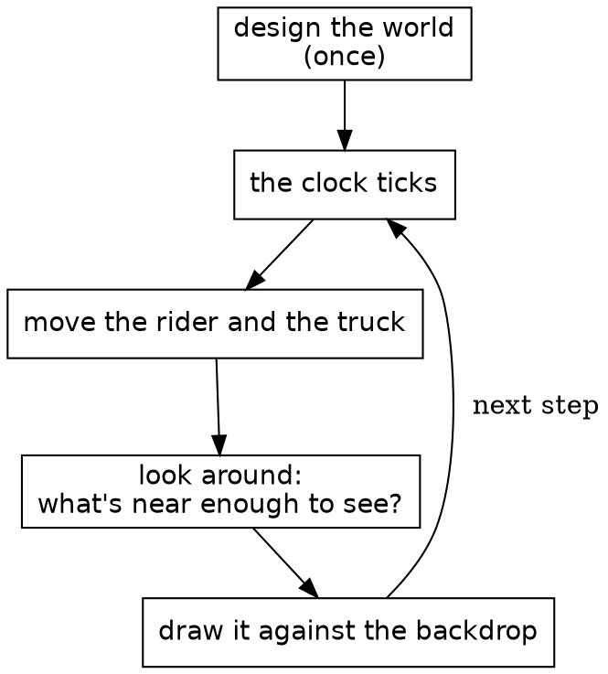

It works like a flipbook, the little stack of drawings that seems to move when you riffle the pages with your thumb. Each page is drawn whole. Safari Ride draws a page about thirty times a second.

The middle box is the heart of it. On a real safari, a guide scans the land and calls out what's there: a cat by the third tree, a bird on the far side. Each of those is a sighting, true for that instant and gone the next. Safari Ride takes its sightings the same way, fresh on every page.

So far that's all boxes and arrows. What a box looks like in Roc is still missing.

## One whole module

Before the map, here's a whole module, so you know what the boxes on it look like up close.

New in this chapter:

- Roc: opaque types, `is_eq : _`, `expect`, static dispatch
- Modules: `Clock`

This is the clock from the second box above, all of it.

{{module Clock}}

Most of Safari Ride's small modules have this shape: a comment saying what the thing is, its imports, and one type named after the module. `Clock :: U32.{ ... }` is an opaque type: a `U32` underneath, with its methods in the block after it. `Clock.(n)` wraps a number, and in a parameter list it unwraps one, and only this module can do either. Nothing else can add 7 to a clock or pass a tree count as one. `is_eq : _` asks Roc to derive equality. Below the type, each `expect` is a check that `roc test` runs.

It's called like this, once a step:

{{code RideInstant.next from "clock: instant.clock.next()," to "clock: instant.clock.next(),"}}

`instant.clock.next()` is static dispatch: `next` comes from the type of `instant.clock`, so the call needs no import.

A claim about a clock is one line, because a clock is a value. The `expect` that starts at step 5,699 gets there with `Clock.at_step`, and nothing has to ride that far.

That's one module of about eighty, and nothing yet says how the rest fit together.

## The modules

Here's how they fit: the whole system, simplified.

New in this chapter:

- Roc: imports that can't form a cycle
- Modules: `SafariApp`, `Scene`, `SceneDraw`, `CatSighting`

An arrow points from a module to one it imports, so a module is composed of what it points at. Dashed boxes each stand for a family of modules. Roc doesn't allow import cycles, so nothing here can point back up.

The whole system, simplified

There are two halves. The ride is `Rider`, `Truck` and `World`, with `World` composing the route from its scenery and critters. It knows nothing of drawing. The view is everything that turns the ride into a picture: the sightings find what's in sight, and the drawing paints it. The dotted arrow is the view reading the ride, and no arrow goes the other way. `RideInstant` sits over both, holding one instant of the ride and stepping to the next, and the browser only sees `SafariApp`, which hands it a list of shapes each frame.

### The part that isn't Roc

Safari Ride runs in a browser, and that takes a thin layer of JavaScript. The Roc compiles to wasm. Each tick, the JS keeps the clock, gathers the keys, and calls into Roc. Roc answers with a list of shapes, and the JS paints them on a canvas. The JS knows nothing of cats, and the Roc knows nothing of canvases. The whole game is on the Roc side of that line, and the same app also runs natively. `canvas_apps/ARCHITECTURE.md` has the details, and the platform chapter comes back to it.

### What's a sighting?

Most things in the view come in pairs, and the names say which half is which: `CatSighting` and `CatDraw`, `TreeSighting` and `Tree`, `TowerSighting` and `Tower`, `TruckSighting` and `TruckDraw`.

A sighting answers one question each frame: which of these can the rider see right now, and how should each one look? `CatSighting` goes through the segments ahead, asks `Cat` where it is, works out where that lands in the rider's view, and drops any cat behind the camera or too small to matter. What it hands back is a plain record with no drawing in it:

{{code CatSighting.CatSighting}}

`Scene` gathers every sighting's items, a depth sort puts them in order, and `SceneDraw` hands each one to the module that paints it. Because a sighting's answer is plain data, it can be checked with numbers, without drawing anything. The rule is simple: a sighting decides, and drawing paints.

All of that is about one frame, and a frame is gone by the next one. What lasts from one step to the next hasn't come up yet.

## All that's stored

What lasts from step to step fits in one record.

New in this chapter:

- Roc: nominal types, code with no effects in it
- Modules: `RideInstant`, `Tour`

A record is the plainest shape in Roc, and it's nearly all this needs. `RideInstant := { ... }.{ ... }` makes the module's own type out of one. That's a nominal type, which can carry a block of definitions, and unlike an opaque type it leaves its fields readable.

{{code RideInstant.RideInstant from "One instant of the ride" to "}.{"}}

Those three fields are the whole of what Safari Ride keeps from one step to the next. The cat has no state, and neither does the bird, the sun or the beacons. Each frame works them all out again from the rider, the truck and the clock.

That gives three kinds of moving thing, and the tour is organized around them:

| Kind | Things | How it works |
|---|---|---|
| Stepped | The rider, the truck | Stored in `RideInstant`, and moved once a step from where it was |
| Rider-driven | The cat, the bird | Worked out from how the rider is approaching, with nothing stored |
| Clock-driven | The sun, the sky, the beacons, the headlights | Worked out from the clock, with nothing stored |

Trees and cows are a fourth kind, the easiest of all: they never change.

Purity makes some things free. `Tour`, the whole ride, is little more than a list of past instants, so stepping back only needs an older one. The cat follows along, since it was never anywhere but where the rider's position puts it, and the sun rises again.

The game itself has no effectful functions at all. It has no `!` names, no `=>` arrows, no `?` and no `where`. Effects live in the platform.

Four kinds of thing have been named, and so far none has been shown.

## What never changes

The fourth kind is the easiest, so it goes first. Trees, cows, the pond and the road are built once and only read after that.

New in this chapter:

- Roc: void modules, tag unions written in a field's type, `match` that has to cover every tag, `crash`
- Modules: `World`, `Pond`, `Trees`

The modules around `World`
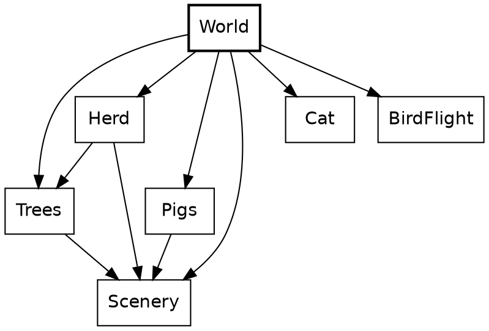

A piece of the world can be just a value. Here's the second whole module, and it's charming in a way code rarely is. `Pond` is a void module, a type with no values whose block holds definitions, and it has two record aliases and six ducks.

{{module Pond}}

Above its `expect`s, there are no functions here at all. The ducks are read where the critters are sighted:

{{code CutoutSighting.pond_sightings from "if Scenery.is_pond" to "Pond.ducks.map("}}

`World` turns a route, a plain list of records, into segments of road. A plan for a segment shows how much tag unions can do with no declaration. `[WithBull, NoBull]` is written right in the field's type, and it says more than a boolean would at every place a segment is written down.

{{code World.SegmentPlan}}

A `match` on a closed union has to cover it: leaving out a tag is a compile-time error.

{{code Trees.accent}}

Here's where it's called, picking the colour for a pair of small trees:

{{code Trees.plant_onto from "conifer =" to "Small => Trees.accent(scheme)"}}

`SegmentIndex` is another small opaque type, a `U32` for a segment's place in the route. A place in the route can't be confused with a count of trees, because nothing outside can do arithmetic on it. `crash` appears here too. It isn't for error handling: an index that isn't in the world is a bug in Safari Ride, not a case to handle.

{{code World.SegmentIndex from "## The segment of `world`" to "?? crash"}}

A value that never changes can be checked once, whole. `Pond`'s one function is below its block, and it's there for a test:

{{code Pond.is_on_water}}

The `expect` under it, in the module above, runs that over all six ducks. One line covers the whole pond.

Nothing in this chapter moves, and the ride does.

## The sky

The sky is the simplest thing that moves, because it depends on one number.

New in this chapter:

- Roc: `->` as a promise, privacy without a keyword, records destructured in a parameter list, tags in place of `null`, code that doesn't compile
- Modules: `Sky`, `Fraction`, `Angle`

From a distance, the sky is a few questions put to a clock.

🔭 The modules around `Sky`
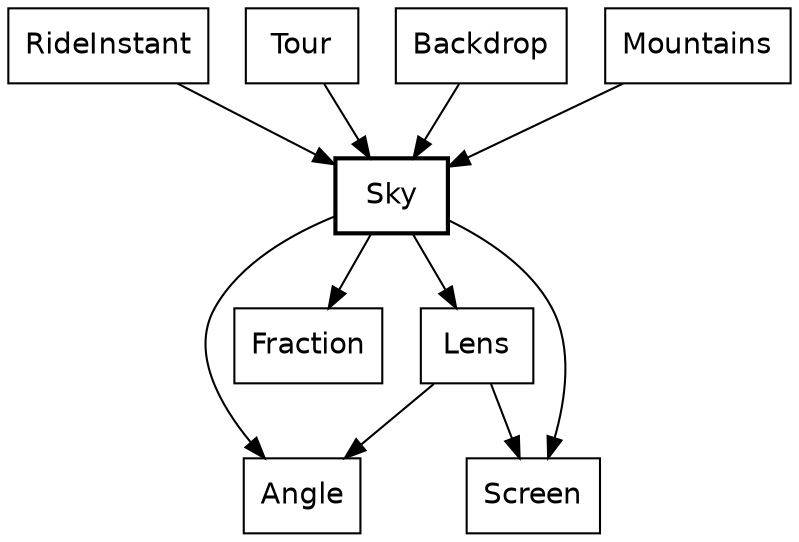

`Sky` sits near the bottom of the system. Leaving out small math helpers, it imports only the angle and fraction types and the lens and screen geometry, and it knows nothing of the rider, the road or the drawing. Those above it each ask for a colour or a sun at a given clock.

*[The sky widget goes here: drag the clock and watch the sun set.]*

Drag across it from left to right, and the clock runs from step 0 to step 6,000. The sun sinks steadily, and near step 3,980 its centre meets the horizon: the sun line reads 0.0 px, and the warmth line tops out at 99%, since it rounds down. The marked stretch of the ruler is where the horizon has any warmth at all. The disc is gone near step 4,730, and the dusk line reaches 100% near step 5,490, before the marked stretch ends. Dragging back raises the sun along the same path.

Every function in this chapter has a `->` arrow, not `=>`. In Roc that's a promise the compiler holds: no effects, so the same clock always gives the same sky. If a function has no `=>` and no `$` in sight, there's nothing behind it to think about.

Here's one of the questions being asked. `Tour.sky_top` takes the clock from the current instant and hands it to `Sky`.

🌳 {{code Tour.sky_top}}

Here's what happens behind that call. In this diagram a box is a function, not a module, and an arrow is a call. Only `Sky`'s own functions are shown, without the two helpers of `dusk_at`.

The calls inside `Sky`
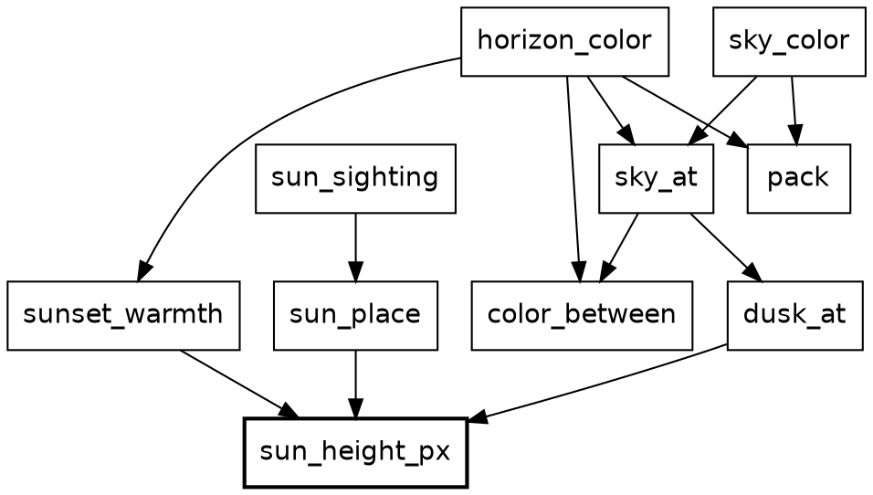

Every curve comes down to the box in bold, which is the only one that turns the clock into a number. The rest is colour on one side and the sun's place on the other.

The trail starts at the clock, and climbs to the colours.

### A function of the clock

The bottom of the tree is back in `Clock`, seen whole above. `Clock.to_f64` opens the opaque type. The `to_f64` it calls is `U32`'s, which belongs to Roc, so nothing of Safari Ride's is called.

🐾 🍃 {{code Clock.to_f64}}

`sun_height_px` calls it. The sun's height is a straight line. It starts at 244 pixels, reaches the horizon around step 3,980, and has fully set around step 4,730. `to_f64` is the clock's one door to a float, and this is the only place that uses it.

🌳 {{code Sky.sun_height_px}}

The next answers are `Fraction`s. `Fraction` is a third small opaque type, a ratio from 0 to 1, and only its own block can build one, so a `Fraction` is always in range. It has two ways in. `Fraction.of` takes a ratio that can only be in range and crashes on anything else, because that would be a bug in the sum. `Fraction.clamp` takes a ratio that can rightly fall outside, as a sun sunk far below the horizon does, and holds it at the nearest end.

Dusk is a curve and then a line, which means two cases, `dusk_while_up` and `dusk_after_set`. `Sky` keeps them below its block. Anything outside `Sky :: [].{ ... }` is private to the module, so a helper stays a helper without any keyword.

🌳 {{code Sky.dusk_while_up}}

🌳 {{code Sky.dusk_after_set}}

`dusk_at` calls `sun_height_px`, then one of those two:

🌳 {{code Sky.dusk_at}}

And here's the walk up the stack: each frame, `RideInstant.shapes` hands the answer to the mountains, whose rock and snow go dark with it.

🌳 {{code RideInstant.shapes from "Mountains.draw({" to "}),"}}

The horizon's warmth is a third shape, a tent centred on the instant the sun touches the horizon. Three curves come off one number, and they're plain functions rather than anything more general. Nothing else in the game needs them. Here's `sunset_warmth`:

🌳 {{code Sky.sunset_warmth}}

### From curves to colours

A colour ends up as one integer. `pack` gets there with method calls on plain numbers, and static dispatch finds `to_i64_wrap`, `shl_wrap` and `bitwise_or` on Roc's own types, so this is a leaf, the only one on the diagram.

🍃 {{code Sky.pack}}

`color_between` takes one record argument, destructured in its parameter list, so callers name every field. Each channel moves the same share of the way, and `Sky.Rgb` is a plain record alias, three floats with nothing to guard.

🌳 {{code Sky.color_between}}

`sky_at` calls it with the dusk from above. It's private, like the two dusk helpers:

🌳 {{code Sky.sky_at}}

The top of the tree is two calls. `sky_color` is the one `Tour.sky_top` asked at the start of this chapter, and `horizon_color` is the same sky, warmed toward red by `sunset_warmth`.

🌳 {{code Sky.sky_color}}

🌳 {{code Sky.horizon_color}}

### Angles that can't be mixed up

One trail on the diagram is left, the sun's place, and it starts at the bottom again.

The sun is the one thing here that also depends on where the rider is looking. Two tags say the two answers, so there's no `null` and no off-screen sentinel value. A caller has to handle `OutOfView`, because `match` must cover every tag.

🐾 {{code Sky.SunSighting}}

Opaque types do the most work from here on. `Angle.Bearing` is a direction in the world and `Angle.Turn` is a change of direction. Both are floats underneath, but only the `Angle` module can build or open one. `sun_place` is the first code to want a plain number, because `r_tan` takes a float, and it's another caller of `sun_height_px`.

🌳 {{code Sky.sun_place from "scale =" to "y: (Screen.horizon_y"}}

`sun_sighting` calls it once the sun is known to be in view. It also takes one record argument, destructured in its parameter list.

🌳 {{code Sky.sun_sighting}}

Its caller, `RideInstant.sun`, is short enough to read whole:

🌳 {{code RideInstant.sun}}

`turn_from_view.abs() >= visible_turn_limit` compares two `Turn`s. The code never touches radians until `sun_place` has to do trigonometry. Passing a `Turn` where a `Bearing` is wanted is a compile-time error:

{{fails turn_as_bearing}}

That's every box on the diagram: one number goes in, and colours and a place for the sun come out, with nothing kept from one frame to the next.

The sun would set the same way on an empty road. A clock can't tell that a rider is coming.

## The cat

The cat reacts to the rider, which no clock can do. It's the best scene in Safari Ride. It walks out, freezes in the lane as the rider bears down on it, and leaps clear at the last possible instant.

New in this chapter:

- Roc: type parameters, operators on opaque types, `var`, `for` and `return` in a pure function, `|` and `_` in patterns, open records
- Modules: `Cat`, `Animation`, `Beats`, `Distance`, `Speed`, `CrossingReaction`

From a distance, the cat is one function in two halves, with a shared module underneath.

🔭 The modules around `Cat`
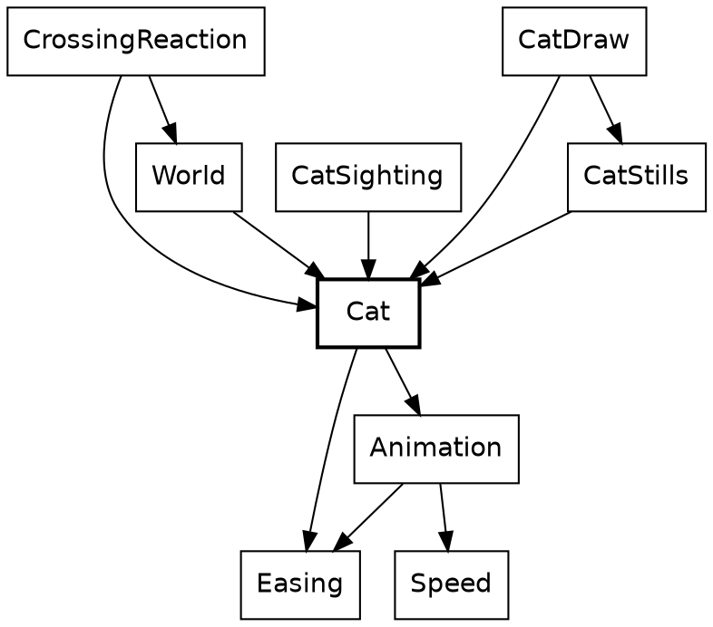

`Cat` says what a cat does, and `Animation` holds what a cat shares with a bird. Everything that uses a cat imports it, and `Cat` imports none of them: it doesn't know it's drawn, sighted or reacted to.

*[The cat widget goes here: drag the rider's gap and watch the crossing play.]*

Drag across it from left to right, and the gap falls from 50 metres to 0, with the rider held at a metre a step. The cat rests on the right verge until 41 metres, where the marked stretch of the ruler starts and the last line changes to "The rider may not accelerate". It walks out, and at 31 metres it freezes in the lane. It stays frozen down to 7 metres, coils, and is in the air from 6 metres to 4. At 3 metres, where the marked stretch ends, it has collapsed on the far verge and the rider may accelerate again. Below that, nothing changes.

The slider isn't scrubbing a video. Every position of it is a call to `Cat.instant_at`. The arrow is `->` again, so the type already says there's no hidden cat being updated somewhere. Method syntax chains the two halves of the job: `.instant(...)` is defined on the `Timeline` that `crossing_timeline` returns.

🌳 {{code Cat.instant_at}}

A crossing and an approach go in, and the cat at that instant comes out. The same crossing at the same approach gives the same cat, a thousand frames apart.

`CatSighting.cat_in_view` calls it, adding the distance to the segment to get the gap:

🌳 {{code CatSighting.cat_in_view from "gap =" to "instant ="}}

What `Cat` gets from `Animation` comes down to three types. The first and last are plain record aliases, and `Instant(pose)` takes a type parameter, which a cat fills with its own poses.

{{code Animation.Approach}}

{{code Animation.Stage}}

{{code Animation.Instant}}

`Stage` is the hinge. It's a tag union where two of the tags carry a payload, and `Waiting` and `Past` aren't progress of 0 and 1, because a critter can rest somewhere no part of its animation reaches. If `Waiting` were just 0, a perched bird would show the first frame of its flight.

The two halves meet at that type. A rule turns an `Approach` into a `Stage`, and a timeline turns a `Stage` into an `Instant`. `crossing_stage` decides how far along things are, and `crossing_timeline` decides what that looks like. They know nothing of each other.

Here are the calls. In this diagram a box is a function, not a module, and an arrow is a call.

The calls from `Cat` into `Animation`
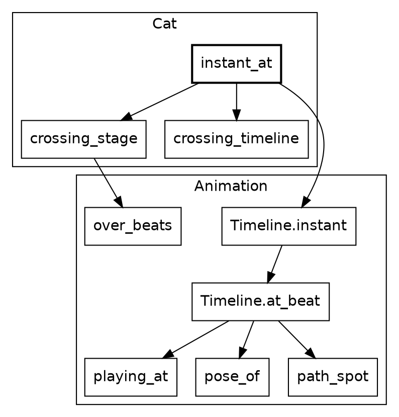

`Cat` reaches into `Animation` twice, once for each half. `crossing_timeline` calls nothing there, because all it does is write a score down.

The trail now goes down to the leaves, and climbs back to `instant_at` one call at a time, starting with the rule.

### When it plays

The bottom of this half is arithmetic on opaque types. Neither field of an `Approach` is a plain number: like `Clock` and `Angle`, `Distance` and `Speed` are opaque types. An animation's beats are an opaque type too, `Beats`: fractional, and tied to no clock, so a place in an animation can't be passed as a step of the ride.

The leaves are the doors in and out of these types. `Beats.to_f64` unwraps in its parameter list, and `Distance.metres` wraps in its body.

🐾 🍃 {{code Beats.to_f64}}

🍃 {{code Distance.metres}}

`Speed.distance_in` calls both. `Speed.(s)` in a parameter list is how its module opens one. Outside this module, nothing can, so a distance can't be passed as a speed.

🌳 {{code Speed.distance_in}}

`Speed` also defines `is_lte`, which is what lets `speed <= standstill` work in the next snippet with an ordinary operator.

The rule lives in `Animation`. `over_beats` destructures its first argument in place, and the `Approach` after it, so the body reads in plain names. Here's where `distance_in` gets called, on the second line:

🌳 {{code Animation.over_beats}}

And `Cat.crossing_stage` calls the rule with the cat's own numbers. `crossing_beats` comes to 38: 10 to walk out, 24 frozen, and 4 for the escape.

🌳 {{code Cat.crossing_stage}}

The cat plays over beats rather than over a stretch of road because it has to finish before the rider reaches it, however fast the rider comes. A faster rider makes it start earlier. The bird uses `over_gap`, because a bird simply reacts to how close the rider is. Each critter picks the rule that suits it.

### What it looks like

A timeline is data, so the cat's whole performance reads in one place, like a score. This half has two strands: the score, which is `Cat`'s, and the code that plays it, which is `Animation`'s. The score comes first, from its smallest function up.

`spot_across` sits below `Cat`'s block, so it's private, and it's a single record. `Along.start` is a value rather than a call, which leaves nothing of Safari Ride's being called.

🍃 {{code Cat.spot_across}}

`crossing_timeline` calls it three times before the score starts:

🌳 {{code Cat.crossing_timeline from "## The whole of a crossing" to "end = spot_across"}}

The score's words are tags. A cat's pose is a closed tag union, and nothing outside `Cat` needs to know its tags. Because it's closed, a `match` on it that misses a pose is a compile-time error.

{{code Cat.Pose}}

A cut has to say which side of it its own beat falls on, and two tags say that better than a boolean would. `crossing_timeline`'s comment says why it matters: those leap beats sum to a float just under the beat they stand for.

{{code Animation.Cut}}

Tags with payloads do almost everything in the score: `Through` and `Before` say where a stretch ends, and `Holds` and `Alternates` say how the cat looks. Here's the first track of `crossing_timeline`:

🌳 {{code Cat.crossing_timeline from "looks:" to "finally: Holds(Collapse),"}}

There are two tracks because a cat's looks and its movement change at different instants. Its body moves just ahead of its path, so the `looks` track above cuts at 0.8, 2.8 and 3.8 beats into the escape, while the `path` track in the rest of `crossing_timeline` cuts at 1 and 3. One list of phases tying them together wouldn't fit the cat or the bird.

🌳 {{code Cat.crossing_timeline from "path:" to "finally: StaysAt(end),"}}

`Timeline` is nominal, the middle ground: unlike an alias it can carry methods, and unlike an opaque type anyone can build one, which is right for data that needs no guarding. `Timeline(pose)` takes a type parameter, which is how a cat and a bird share it.

{{code Animation.Timeline from "## A whole animation" to "}.{"}}

That's the score. The other strand is `Animation` playing it, and its trail starts at an operator. `Beats.is_lte` opens two `Beats` and compares the floats inside.

🍃 {{code Beats.is_lte}}

`is_short_of` is one `match`, and it looks like a leaf. It's a branch, because `<=` on two `Beats` is a call to `is_lte`, and `<` is a call to `is_lt`. An operator on an opaque type runs code of Safari Ride's own.

🌳 {{code Animation.is_short_of}}

Finding the stretch that's playing shows one more Roc idea. In `playing_at`, `var $from` is a local variable that a `for` loop reassigns, inside a pure function. Roc allows that because nothing outside can see it: `playing_at` still has a `->` arrow, and the `$` marks what changes. An early `return` ends the loop.

🌳 {{code Animation.playing_at}}

`Timeline.at_beat` calls it once for each track, which is what lets the two tracks cut wherever they like. `Animation.Timeline.(score)` in a parameter list opens the nominal type, the way `Speed.(s)` opens an opaque one. `pose_of` and `path_spot` turn what's playing into a pose and a spot, and the bird chapter reads `path_spot`.

🌳 {{code Animation.Timeline from "## The critter at `beat`" to "path_spot(path.plays, fraction)"}}

`Timeline.instant` is the one place in this half that knows about stages. Its `match` covers all three tags, and `portion` turns a `Fraction` of the way through into a beat.

🌳 {{code Animation.Timeline from "## The critter at `stage`." to "Past(_) => score.after"}}

Back at the top, nothing in `instant_at` is unknown any more.

🔭 🌳 {{code Cat.instant_at}}

`crossing_stage(approach)` is the rule with the cat's numbers, `crossing_timeline(cat)` is the score, and `.instant` plays the one at the other. A `Stage` is all that passes between them.

### What it does to the rider

So far the cat hasn't touched the rider. That's a separate question, answered in one place.

The modules around `CrossingReaction`
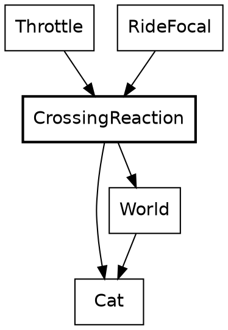

`Throttle` and `RideFocal` know nothing of cats. They ask `CrossingReaction`, which is the only part of the rider's code that does.

This trail starts back in `Cat`, at two small questions about the same `Stage`.

`is_in_danger` asks whether the crossing is playing. `|` in a pattern covers two tags with one branch, and `_` ignores a payload.

🐾 🌳 {{code Cat.is_in_danger}}

`focus` is where `Past`'s payload is used. `beyond` is how far past the end of the crossing the rider has come, and the cat's hold on the rider's eye fades over that distance, counted in beats. `beats_to_cover` divides by the speed, so a rider at a standstill gets an answer first. `Attention` is another opaque type.

🌳 {{code Cat.focus}}

`CrossingReaction.reaction_to` calls both. `..` in the argument's type makes it an open record: this function needs `along` and `speed`, and accepts any record that has them, so it doesn't depend on `RiderState`. `speed` here is the opaque `Speed` again, and `match` on `segment.crossing` has to name every tag.

🌳 {{code CrossingReaction.reaction_to}}

A cat in the lane stops the rider opening the throttle, without braking, and widens the view as it pulls the rider's eye. Two tags, `MayAccelerate` and `NoAcceleration`, stand where a boolean might have gone. The next call up, `crossing_attention`, is one line, and its caller, `ride_focal`, is the lens:

🌳 {{code RideFocal.crossing_attention}}

🌳 {{code RideFocal.ride_focal}}

This is the only loop in the design. The rider's speed decides where the cat has got to, and the cat holds the rider's speed down. It settles, and it's also why `over_beats` has to stay the cat's rule. A bird asks nothing of the rider, so it falls through to the same answer as an empty road.

Each stretch of road has exactly one `crossing`: `CatCrosses`, `BirdFlies` or `QuietRoad`. A cat and a bird in the same place can't be written down.

### Getting it on screen

The last step is finding the cat in the rider's view.

The modules that put a cat on screen
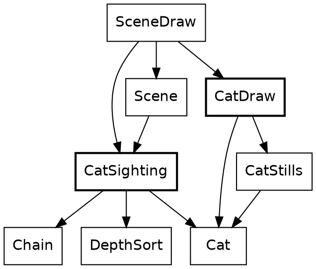

`CatSighting` and `CatDraw` never import each other. `SceneDraw` is what carries a sighting's answer to the drawing.

`cat_in_view` places the cat and decides whether it's big enough to draw. An empty list or a list of one is how it says "maybe".

🌳 {{code CatSighting.cat_in_view}}

`segment_cat` calls it for a segment with a cat, and `in_view` flattens the answers with `join_map`, so a "no" simply disappears:

🌳 {{code CatSighting.in_view}}

Looking back over the chapter, notice what isn't in it: a cat in `RideInstant`, an update loop, or a flag saying the cat has already crossed.

Roc doesn't force that, but pure functions make the stateless version the easy one to write, and every `->` shows it stayed that way.

One thing about time is still missing. The sun only goes one way, and nothing so far repeats on the clock.

## The beacons and the headlights

The cat walked out of its place in the order. Two clock-driven things were left behind when it did, and both are brief. One of them comes round again, and the other switches once.

New in this chapter:

- Roc: a pair of opaque types with only the sums that make sense, records of tag unions written in place
- Modules: `Steps`, `TowerSighting`, `Tower`, `Mountains`, `TruckDraw`

### A blink

The modules behind a beacon
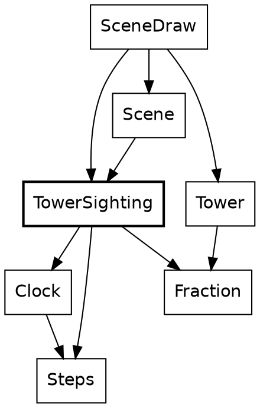

A beacon is the only thing in Safari Ride that repeats on the clock, so it's the first thing that needs to ask how far into a cycle it is. That question isn't about an instant of the ride. It's about a length of time, and Safari Ride keeps those two apart.

*[The beacon widget goes here: drag the clock and watch the masts blink out of step.]*

Drag across it from left to right, and the clock runs through two whole blinks, from step 5,400 to step 5,640. The left mast starts dark and the right one at full brightness. At step 5,430, where the first marked stretch starts, both read 49%, and by step 5,460 they've changed places. Each marked stretch is where the left mast is more than half bright. At the far end of the ruler the masts are back where they began.

`Clock` says which step it is. `Steps` says how long something lasts. Both are opaque `U32`s, and `Clock.minus` turns two clocks into `Steps`, the same way two `Angle.Bearing`s make an `Angle.Turn`. Adding two clocks means nothing, so `Clock` has no `plus`, and no code can. Call this *places and distances*: one opaque type for where something is, a second for how far apart two of them are, and only the sums that make sense.

Here, `wrapped_to` is `Steps`'s one way to reach `%`. The result is a `Fraction` built with `of`, because `(1 - cos) / 2` can only be in range:

{{code TowerSighting.beacon_brightness}}

Each mast starts somewhere else in the cycle, so the masts along a road don't blink together. This function is one line of method calls, and every call in it is on a `Steps`:

{{code TowerSighting.beacon_offset_for}}

The sighting calls both, adding the two `Steps`. `view.clock.minus(Clock.start)` is how a place becomes a distance, and it says which distance: the one from the start of the ride.

{{code TowerSighting.tower_if_ahead from "if center.forward <= Geom.near_plane" to "view.clock.minus(Clock.start)"}}

Its caller gives each mast its key, the segment's index. Records with named fields stand in for what would otherwise be five arguments in a row, and `InChain(position)` is a tag carrying a payload, saying where the segment lies from the rider:

{{code TowerSighting.segment_towers from "end_tower = tower_if_ahead(" to "end_tower.concat(mid_tower(view, position))"}}

A mast halfway along a segment takes the key plus 60. That's a small piece of number theory hiding in a constant: 60 staggers of 37 steps come to 2,220, which is 18 periods of 120 and 60 left over, so the mid-mast blinks exactly opposite the end mast.

Notice where the clock stops. `beacon_brightness` on a `TowerSighting` is a `Fraction`, and neither `Tower` nor `SceneDraw` imports `Clock`. A sighting decides, and drawing paints. A beacon's blink is decided in the same place as whether the mast is in view at all.

There's no blink abstraction. `Animation.Alternates` also follows a wave, and the resemblance ends there: it picks a pose, and this picks a brightness. Nothing else in the game blinks.

The clock counts steps, not seconds, so pausing the ride freezes the beacons, and stepping back runs them backwards.

### One switch

The modules behind the headlights
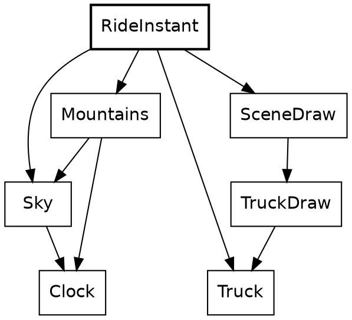

The truck's headlights come on once the sun has gone behind the mountains, at step 4,039 of a ride that lasts 7,040. `Mountains` knows the skyline and already imports `Sky`, so the question is asked there. The argument is an opaque `Clock`, and the answer is a plain `Bool`, which is about to be turned into something better:

{{code Mountains.is_sun_behind_mountains}}

`Truck.Lights` is a record of two tag unions, written in place. `[On, Off]` needs no declaration, and two independent lamps aren't one state with four values, so they're two fields:

{{code Truck.Lights}}

`RideInstant` puts it together. It has to be up here. `Truck` is in the ride half of the system and `Mountains` is in the view, and no arrow goes from the first to the second. `RideInstant` imports both.

{{code RideInstant.truck_lights}}

Lamps are to the truck what a pose is to a cat. The sighting carries them, and the drawing does what they say, with each `match` covering both tags:

{{code TruckDraw.draw from "beams =" to "].join()"}}

That's the clock-driven things. Each is a function with a `Clock` in its arguments, and nothing about them outlives the frame.

The rider-driven kind still has only one member, and one cat can't say whether `Animation` was written for critters or just for cats.

## The bird

A second critter settles that. The bird is Roc's logo, sitting on a treetop. As the rider comes near it takes off, flies across the road and ahead, and drops onto a tree on the far side. It's a rider-driven thing like the cat, and it cost much less, which is the point of this chapter.

New in this chapter:

- Roc: record update, tags inside tags, closures, opening a `Try` by hand, `match` as an expression
- Modules: `BirdFlight`, `BirdSighting`, `RocBird`, `BirdStills`

The modules around `BirdFlight`
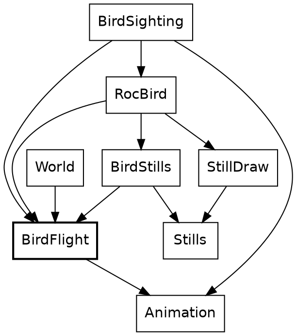

The family has the cat's shape. `BirdFlight` says what a bird does and imports nothing that draws it. `BirdSighting` finds it, `RocBird` draws it, and `BirdStills` holds its pictures. `Animation` is underneath, and most of what the bird does is ask `Animation` for something.

The only sum in `BirdFlight` is a tree's place plus the shortest hop. The rest is constants, tags and one timeline.

*[The bird widget goes here: drag the rider's gap and watch the bird fly.]*

Drag across it from left to right, and the gap falls from 75 metres to 0. The bird sits on the left tree, 5.9 metres up, until 60 metres, where the marked stretch of the ruler starts. It takes off side on, turns away at about 55 metres, and reaches 10.2 metres near the middle of the stretch, shrinking as it goes. It dives from 20 metres, and at 15, where the marked stretch ends, it's perched on the far tree, 4.5 metres up. Below that, the picture stays as it is.

### Two rules

A rule turns where the rider is into a `Stage`. The cat's rule was `over_beats`, and the bird's is `over_gap`. The first argument of each is destructured in place, and both answer the same tag union. `over_gap` has a shorter job, so here it is first. `Fraction.clamp` is the right door because a rider far off gives a ratio well outside 0 to 1, and `<=` works on a `Fraction` because `Fraction` defines `is_lte`:

{{code Animation.over_gap}}

The bird calls it with two constants, and passes no speed, since this rule doesn't take one:

{{code BirdFlight.flight_stage}}

Beside it, again, is the cat's rule. Its second argument is the whole `Approach`:

{{code Animation.over_beats}}

The two say different things about the same road:

| | `over_gap` | `over_beats` |
|---|---|---|
| It reads | The gap | The gap and the speed |
| It starts | 60 metres off, always | Earlier for a faster rider |
| It ends | 15 metres off, always | `buffer` metres short, always |
| It's for | Something that reacts to how close the rider is | Something that has to finish in time |
| A stopped rider | Leaves the bird hanging where the gap puts it | Holds the cat at the start of its crossing |

The extra case in `over_beats` is there because its ratio divides by a stretch that a stopped rider makes zero. `over_gap` divides only by constants, so it has no such case. That hanging bird is real: nothing in `over_gap` knows a bird can't hover. The rider never drops below 1.1 metres a step inside a bird's 45 metres on this route, so it doesn't come up.

Now the one-liners, side by side. A bird's and a cat's `instant_at` have the same shape:

{{code BirdFlight.instant_at}}

{{code Cat.instant_at}}

Each is a rule's `Stage` handed to a timeline's `instant`. Neither half knows which other half it's been paired with. Call this *rule and score*: one function says how far along things are, and one piece of data says what that looks like. It's composable in the plain sense, because a third critter can take either rule with a timeline of its own, and a new rule would work with both timelines already written.

### A score one beat long

`BirdFlight` sets the length of a flight to one beat, so that a cut on the timeline is simply a share of the flight:

{{code BirdFlight.flight_beats}}

The bird needs one small helper. It sits below the block, so it's private, and it builds an `Alternates` from two poses. `Animation.Looks(BirdFlight.Pose)` is `Looks(pose)` with the type parameter filled in, which is how the cat's timeline type came to fit a bird:

{{code BirdFlight.wings_beating}}

Then the score. `Animation.Timeline.( ... )` wraps a record in the nominal type, and `Side(WingsUp)` is a tag whose payload is another tag. `flight_beats.portion(takeoff_share)` is a method on the opaque `Beats`, and `landing_share.complement()` is one on the opaque `Fraction`. It reads almost like configuration, and most of it is:

{{code BirdFlight.flight_timeline from "length: flight_beats," to "finally: Holds(Diving),"}}

Wings beat all the way through the first two stretches. `count` runs from the start of the timeline, so the wing beat carries on across the cut from side-on to from-behind without restarting.

The path track shows why a `Track` has `finally`. A flight is one unbroken curve, so it has no cuts at all:

{{code BirdFlight.flight_timeline from "path: {" to "rise: flight_arc.to_metres(),"}}

That `Arc` is a tag. `path_spot` is where it's played. `{ ..on_line, lift: ... }` is record update: the spot on the straight line, with one field replaced. The curve is `4t(1 - t)`, a parabola that's 0 at both ends and 1 at the middle, so `rise` means what its comment says. This is the polite end of the math chapter.

{{code Animation.path_spot}}

The stills are data too. Nested tags get checked all the way down, so a `match` that forgets `Away(WingsDown)` is a compile-time error. The function reads as a table, and there's nothing else in it:

{{code BirdStills.pose_polys}}

`RocBird.draw` hands that to `StillDraw.draw_still`, which is what a cow uses, and a bird's feet go through the same `Camera.project` as a tree's top. That's the drawing.

### Finding a tree

Where a bird flies is decided once, when the world is built. `route_from` shows the plain end of Roc's list functions. `keep_if` takes a closure, and `is_far_enough` is one, closing over `from`. `first()` answers a `Try`, which is one of the few that Safari Ride opens by hand. A route is a tag union with two tags: a bird with no tree to fly to `Sits`, which beats a flight of length zero.

{{code BirdFlight.route_from}}

The caller's return type is written in place, a tag union that exists for this one function and fits straight into the `crossing` field of a segment:

{{code BirdFlight.crossing_among}}

And that's called from a `match` in the middle of a record, which is a reminder that `match` is an expression. The plan's plain `BirdCrosses` tag comes in, and `BirdFlies(route)` goes out:

{{code World.built_segment from "crossing: match plan.crossing {" to "QuietRoad => QuietRoad"}}

Each frame, a sighting reads the route back. `|` in a pattern covers two tags with one branch. The crossing is matched in full, so a third kind of crossing would stop here until someone says what a bird sighting should do about it:

{{code BirdSighting.segment_bird}}

Nothing in this chapter is new machinery, and that's what it shows. Above their `expect`s, the four bird modules come to about 450 lines, a quarter of them coordinates for the stills, and `Animation` has nothing in it about birds.

Everything so far can be asked about any instant, cold. Hand `Cat.instant_at` a gap and it answers. The rider and the truck can't do that.

## The stepped things

Where the rider and the truck are depends on where they were, so their state has to be kept, and it's the only state there is. This chapter is about the two fields of `RideInstant` that aren't a clock.

New in this chapter:

- Roc: a named open record, guards, list patterns, recursion
- Modules: `Rider`, `RiderState`, `Bike`, `Throttle`, `Truck`, `Acceleration`

The modules that do the stepping
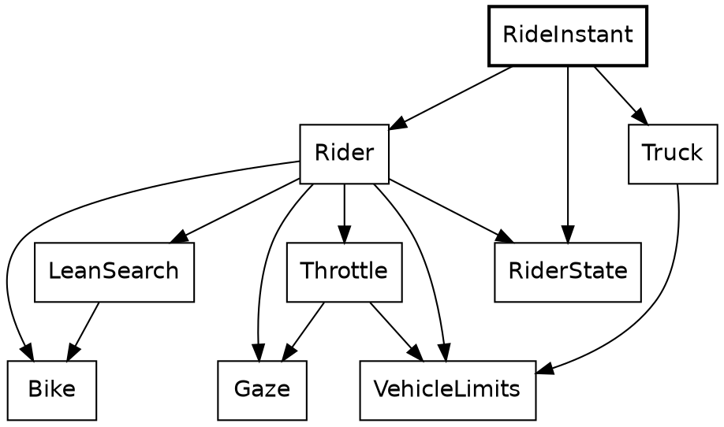

Here's the step again, this time whole. Its body is a block: names, then a record, which is the value of the block. The rider moves first, and the truck reads where the rider has just got to, so the order of those lines is a rule of the game, and `dist` is what carries it.

{{code RideInstant.next}}

`Clock.next`, `Rider.advance` and `Truck.advance` all have the same shape: a value goes in, and the next value comes out. Call that *the step function*. There's no mutable rider being nudged. There's a rider, and another rider one step on, and the old one is still a perfectly good value, which `Tour` keeps in a list.

Stepping has a price, and it's worth stating against the cat:

- A cat can be asked about any gap. A truck at step 4,000 has to be played there, or written down by hand.
- A wrong critter rule is wrong in the frames it touches. A wrong step moves the rider for the rest of the ride.
- `RideInstant.next` has an order, and frames don't.

*[The step widget goes here: pause the ride, step back and forward, and watch the three stored fields change.]*

### The rider

A plain record alias holds the rider, and `RideInstant` stores one. Count the opaque types: `SegmentIndex`, `Along`, `Across`, `Turn`, `Speed`, `Lean`, `Bearing` and `Fraction`. Nothing in it is a bare float. Four fields of this one record are angles, of three different types, and passing one type where another is wanted is a compile-time error.

{{code RiderState.RiderState}}

The step is four things in order, which is close to how it reads. Static dispatch finds `segment_in` on the `SegmentIndex`. The `match` on `seg.ending` has two tags, and `Continues(_)` ignores its payload:

{{code Rider.advance}}

A decision is a record of two opaque values. There's something to notice in the last line of this next function. `Throttle` is asked about a bike that doesn't exist yet: the rider as it would be with the new lean, which `Bike.with_lean` makes by building a new record. The real rider isn't touched, because nothing can touch it.

{{code Rider.decide}}

That idea gets larger soon. A small version of it decides what happens at the end of a segment. `resolve_cross` works out the rider on the next segment and keeps that only if it lands inside the lane. The rejected rider simply stops being referred to, and nothing has to be undone:

{{code Rider.resolve_cross}}

Record update does most of the writing in this module. Its plainest use is stopping dead, where `..s` keeps everything but the two fields named:

{{code Rider.stopped_at}}

### The bike

The modules around `Bike`
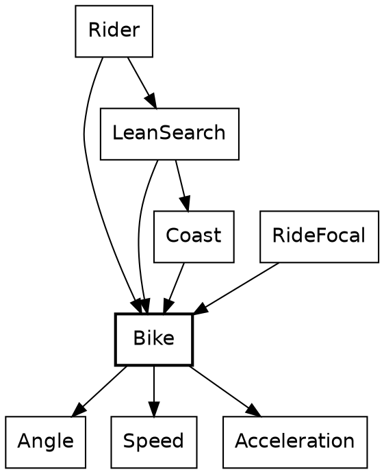

`Bike` is under 60 lines above its `expect`s, and it's the physics. Its type is the first one in the tour that names the rest of a record. `..others` makes `Motion` open, like the `..` in `reaction_to`: it's any record with these six fields and whatever else, with `others` standing for the whatever else.

{{code Bike.Motion}}

A structural type like this has to be named when it appears twice. Here it appears in the argument and in the result, and that's the promise: what goes in comes out with the same other fields. A `RiderState` goes in, with its `segment`, `gaze_yaw` and `focus`, and a `RiderState` comes out, though `Bike` has never heard of a gaze. Compare `CrossingReaction.reaction_to`, whose open record is only read, and which hands nothing back.

Call this *a narrow view of a wide record*. A module says exactly which fields it cares about, and the compiler takes care of the rest, with no base class and no copying fields across by hand. The smallest example in the program is a function with one job:

{{code Bike.with_lean}}

`{ ..s, lean }` is record update with a shorthand: the field and the local have the same name. `Rider.decide` called it above. Here's the step, which `Rider.advance` called:

{{code Bike.simulate_rider_step}}

Reading down, the types do their share of explaining. A `Lean` can't be added to anything but a `Lean`, and it only reaches direction through `lean.steer(turn_per_lean)`, which is the single door from roll to yaw. The bike then moves along the middle of the step's turn, which is what `s.yaw.plus(turn.times(0.5))` means. `speed.step_length()` is a `Distance`, and `Along.plus` takes one, so the move itself is places and distances. `to_radians()` appears at the last line that can do without it: `r_cos` wants a float.

### The throttle

The modules around `Throttle`

The rider has several reasons to slow down, and they don't know about each other. A turn is coming. A cat is in the lane. There's a pig to look at. The road is about to run out. `Throttle` writes them as a line of gates. An `Acceleration` goes in, a gate lets it through or lowers it, and the next gate gets what's left:

{{code Throttle.get_forward_accel_decel from "a2 = crossing_gate(" to "a4 = shoulder_brake(state, a3)"}}

Call this *the gate chain*. Each gate has the same shape and can be read alone, and adding a reason is one more line. It reads like a list of rules because that's what it is.

Each gate compares two opaque `Acceleration`s with an ordinary `<`, which works because `Acceleration` defines `is_lt`. `crossing_gate` shows two more things about patterns. A guard, `if a > Acceleration.steady`, adds a condition to a branch, and `|` joins two tags in one. When the guard fails, `NoAcceleration` falls through to the last branch. This is where `CrossingReaction`'s tag from the cat chapter lands: the cat stops the rider opening the throttle, and a rider already braking stays braking.

{{code Throttle.crossing_gate}}

`Speed` and `Acceleration` are places and distances again: two speeds make an acceleration, and an acceleration moves a speed. The sum behind braking for a turn is the first line of a physics textbook, `v² = u² + 2as`, solved for `a`. This function is a good example of how far opaque types reach into a parameter list. `target: Speed.(t)` opens the field's `Speed` where it's destructured:

{{code Speed.acceleration_to}}

The first gate calls it, for the distance left to the point where the rider commits to the turn. Three modules use that one line of physics: this one, `Gaze` to slow for a pig, and `Truck`.

{{code Throttle.bend_brake from "bend_a =" to "state.speed.acceleration_to({ target: v_end, within: d })"}}

After the gates, `clamp_v` holds the speed between rest and the limit, and the function's last move is a small piece of bookkeeping. The chain works in accelerations and the limits are speeds, so the answer is taken back with `.change_from(state.speed)`, the other half of the same pair of types.

The rest of `Throttle` is plainer than this section makes it sound.

### The truck

The modules around `Truck`
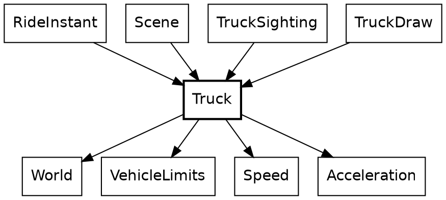

The truck is what the rider chases. It starts 500 metres ahead and keeps to a schedule that brings it to within 100 at the route's end. Its state is three fields:

{{code Truck.TruckState}}

The schedule is a straight line, and a pure function of the rider's progress, destructured from a record so the call site has to name both `Distance`s:

{{code Truck.scheduled_position}}

Its one caller is the truck's step function, the same shape as the rider's. `NextBend` is a tag union with a payload on one side, so the only way to read a `distance` is to be inside the branch where there is one:

{{code Truck.advance from "schedule = scheduled_position(" to "NoBendAhead => advance_on_schedule(truck, schedule)"}}

And that's called from `RideInstant.next`, above, with the rider's distance as the only thing the truck knows of the rider. Nothing in `Rider` imports `Truck`, and nothing in `Truck` imports `Rider`. The chase is one record literal in `RideInstant`.

Finding the next turn shows a list pattern. `[]` is the end of the route, and `[segment, .. as later_segments]` takes the first segment and names the rest. Recursion walks the list, carrying where the current segment starts. Only `Truck` and `Paint` use a list pattern. Elsewhere the same walk is a `fold`.

{{code Truck.next_bend_on from "match segments {" to "next_bend_on(later_segments, { route_position, segment_start: segment_end })"}}

It's called through a smaller function, which supplies the 0 so nobody else has to:

{{code Truck.next_bend}}

Then the two ways to take a step. Both sit below the block, private, and both are arithmetic on `Speed` by name. `target_speed.max(...)` keeps braking from undershooting, and `speed < truck.speed` is the whole of what turns on the brake lights. They're on while the truck is slowing down, and they go off when it's settled at the speed for the turn, even with the turn still ahead.

{{code Truck.advance_braking}}

{{code Truck.advance_on_schedule}}

`brake_lights` is state because it's a fact about the last step. Headlights aren't, and they stay out of `TruckState`. That's the three kinds of moving thing in one vehicle: the place and speed are stepped, the headlights are clock-driven, and the tyres don't change.

The truck has no `Animation`, and it's worth saying why. A timeline has a known length and can answer for any point along it. The truck has neither. Its next step depends on its last, and its route depends on the rider. `TruckSighting`'s `lead` is the same quantity as an `Approach`'s `gap`, and it has a different name because it's being chased.

The rider's lean has been passed over twice now, with `LeanSearch` doing something the last few sections kept pointing at. That needs the math.

## The math layer

The lean comes at the end of this chapter, on top of everything else in it.

New in this chapter:

- Roc: records as coordinate systems, `fold`, `fold_rev` and `map2`, two functions that call each other
- Modules: `Geom`, `Chain`, `Camera`, `Lens`, `Coast`, `LeanSearch`, `Num_`

A lot of Safari Ride is math and physics, and this is the chapter that goes through the floor of the tour and looks at what's holding it up. Most of it is geometry a reader could do on paper. It's here because this kind of code suits a compiled functional language unusually well, for a short list of reasons that each get a section:

- A formula is an expression, and a function with no effects is the same thing with a name.
- Units can be types, for no runtime cost. [check: confirm a `::` wrapper around `F64` costs nothing at runtime, in the dev and wasm builds.]
- A coordinate system can be a record, so the fields say which one a point is in.
- Physics that's a pure function can be run for pretend, which is the best thing in this chapter.
- It's compiled, so running it for pretend hundreds of times per frame is affordable.

### The workhorses

Safari Ride has 79 modules, not counting `web.roc`, `main.roc` and `game.roc`. The import graph is lopsided in a good way. Counting who imports what, leaving out the gates, a handful stand out, and the lines here are the ones above each module's `expect`s:

| Module | Imported by | Lines | What it is |
|---|---|---|---|
| `Distance` | 37 | 63 | A length in metres |
| `Along` | 29 | 57 | A place along a segment |
| `Across` | 27 | 79 | A place across the road |
| `Angle` | 21 | 176 | Three opaque types for rotation |
| `Scenery` | 19 | 124 | The record types of what stands by the road, and the lane's width |
| `Fraction` | 17 | 92 | A ratio from 0 to 1 |
| `Geom` | 17 | 185 | Road points, rider points, and how to turn one into the other |
| `World` | 17 | 411 | The route |
| `Chain` | 16 | 188 | Where the road lies from where the rider is |

After those nine the count drops to 12, for `Screen`, 11 for `Speed` and 10 for `DepthSort`. Most modules are imported by one, two or three others. `lib`'s `Shapes`, `Trig` and `DeviceMath` are imported about as widely, and they're shared with the other canvas apps.

These are the workhorses, and there being so few says something about the program. Everything else is a small module that takes one of these and adds a single idea. Five of the nine are nothing but numbers with rules, and the top three are under 80 lines each. Composable is the right word for this, and it isn't a slogan: a cat, a mast and a truck are all found on the road through `Chain`, and all reach the screen through `Camera`.

The modules of the math layer
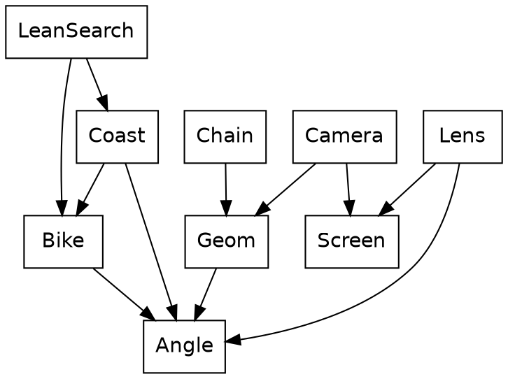

Two families share `Angle` and don't otherwise meet: `Geom`, `Chain`, `Camera` and `Lens` say how the world looks from the bike, and `Bike`, `Coast` and `LeanSearch` say where it's going.

### Numbers with units

Fifteen small opaque types run through Safari Ride, and the tour has met most of them one at a time. Set side by side, they're a system:

| Type | Under it | What it measures |
|---|---|---|
| `Clock` | `U32` | A place in the ride |
| `Steps` | `U32` | A length of time |
| `Beats` | `F64` | A place in an animation, or a length of one |
| `Angle.Bearing` | `F64` | A place on the compass |
| `Angle.Turn` | `F64` | The angle between two bearings |
| `Angle.Lean` | `F64` | Roll, which only reaches direction through a rate |
| `Distance` | `F64` | A length in metres |
| `Along` | `F64` | A place along a segment |
| `Across` | `F64` | A place across the road |
| `Speed` | `F64` | Metres a step |
| `Acceleration` | `F64` | Metres a step, each step |
| `Fraction` | `F64` | A ratio from 0 to 1 |
| `Attention` | `F64` | How strongly something holds the eye, from 0 up |
| `World.SegmentIndex` | `U32` | A place in the route |
| `Chain.Position` | `U32` | A place in the view ahead |

This is the opaque type doing the job of a unit. The block after each type is a small statement of dimensional analysis. `Speed.distance_in` takes `Beats` and gives a `Distance`. `Along.plus` takes a `Distance`, and two `Along`s give one back. `Lean.steer` takes a rate and gives a `Turn`. There's no `Bearing.plus(Bearing)`, because that sum has no meaning, and the omission is a feature with a compiler behind it.

The bug these prevent is the most common one in this kind of code: a correct formula with the wrong number in it. Most physics bugs type-check in a language where everything's a float.

The price is a long list of short methods, and a certain amount of `.to_radians()`. The headers of the float ones all say the same thing: "Each operation does the plain float arithmetic its name says." That sentence is there for a reason that belongs to the proving chapter.

The units stop at the road. A `RiderPoint`'s `right` and `forward` are plain `F64`s, and so is everything in pixels. That's where the formulas live, and a formula wants floats: `.to_metres()` is the door out, used at the top of a function that's about to do trigonometry. `Along` can't be passed as `Across`, which rules out the classic swap in a function with both.

### One record per space

A point in Safari Ride is in one of four spaces, and the record's fields say which. The points are plain records. They don't need to be opaque, since a record's type is its fields, and a `RoadPoint`'s fields are opaque already.

{{code Geom.RoadPoint}}

{{code Geom.RiderPoint}}

{{code Geom.SpacePoint}}

{{code Screen.Point}}

Passing a `RoadPoint` where a `RiderPoint` is wanted is a compile-time error, and the message names the fields. [check: a `fails/` program would prove this, and show the message.] Structural records give *one record per space* for nothing: `along` and `across` are on the road, `right` and `forward` are from the rider, and `x` and `y` are pixels. Reading any function, the field names say where it is.

Going from the road to the rider is a translation and a rotation, and this is the function where the opaque places give way to floats. `distance_from` makes the translation, and the rotation is written the way it would be on paper:

{{code Geom.to_rider_point}}

From there to the screen is a pinhole camera, which is similar triangles. Dividing by `forward` is all of perspective. Nearly everything on screen passes through this function, and it's two lines:

{{code Camera.project}}

`RocBird.draw` calls it with a record built on the spot for the bird's feet:

{{code RocBird.draw from "feet = Camera.project(" to "cam_focal,"}}

The focal length comes from a lens. `focal` is a value computed from other values, with no function in sight, and `field_of_view` is a `Turn`, so taking half of it needs no comment about radians. [check: whether a value like this inside a `.{ }` block is evaluated at compile time, as top-level values are.]

{{code Lens.focal}}

The view widens as the rider leans. One `Fraction` goes in, and a focal length comes out. `RideFocal.ride_focal` from the cat chapter calls this through `cam_focal`, taking the wider of what the lean and the rider's attention ask for:

{{code Lens.focal_for_lean}}

{{code Lens.cam_focal}}

### Round the bends

The road has no map. A point on it is measured within one segment, `along` and `across`, and nothing in the game holds a world coordinate for it. Each segment knows only its length and the turn at its end. `World.route` is nineteen records like this one, and it reads like configuration: a list of plain values, with the tags declared by `SegmentPlan` and an opaque `Distance` and `Turn` built from their units. It's checked like any other Roc, so a misspelled tag is a compile-time error.

{{code World.route from "length: Distance.metres(1200.0)," to "creature: Rhino,"}}

So to see something three segments ahead, a point has to be carried back round each bend between it and the rider, one at a time. That's one rotation per bend, and `fold_rev` is the shape of it. The accumulator is a `RoadPoint`, it starts on the far segment, and each step moves it onto the segment before. `before_in` gives the segments between, and the closure is the only thing the loop does. The last line does the one translation and rotation from above:

{{code Chain.rider_point_ahead from "on_rider_segment =" to "Geom.to_rider_point(on_rider_segment, road.vantage)"}}

The rotation itself is plain, with two cases, because a right-hand bend pivots on the far side of the lane:

{{code Geom.in_segment_before}}

This is what lets `CatSighting`, `BirdSighting`, `TowerSighting`, `TreeSighting` and the rest not care where a segment is. They name a position in the chain and a point on that segment, and they get back a `RiderPoint`. That's a workhorse doing its job, and it's why `Chain` has sixteen importers.

The ground also curves away. That's one line, the small-angle formula for the drop of a sphere, with a record destructured in the parameter list and `right` and `forward` squared where they stand. There are two radii in the program, and neither is the earth's. `Geom.ground_curve_radius`, 100 km, is the surface the road and the truck stand on, and it puts the horizon 490 metres out. `Tower.sink_radius`, 20 km, only sets how soon a far tower goes: a tower is gone at 1.8 km, where the ground's curve would leave it in view to 4 km.

{{code Geom.ground_drop}}

### Cutting a polygon

Anything that crosses the camera's plane has to be cut, or dividing by `forward` flips it across the screen. The textbook algorithm walks a polygon's edges, keeping corners in view and adding a new corner wherever an edge crosses the plane. In Roc, that's a pairing and a `fold`. `map2` zips each corner with the next one, which is the list rotated by one, and `fold` builds the new polygon. `List.with_capacity` is the one line about performance, and `clip_edge_onto` is passed by name:

{{code Geom.clip_near}}

A fold's step is a plain function of the list so far and one edge:

{{code Geom.clip_edge_onto}}

`Ground`, `GuardRail` and `TruckShape` call it the same way. `patch.corners.map(...)` makes the `SpacePoint`s, and what comes back is a shorter or longer list of the same type:

{{code Ground.draw from "in_front = Geom.clip_near(" to "Paint.push_poly(patch.color, Camera.project_all(in_front, cam_focal))"}}

### Rehearsal

The rider has no steering wheel. Nothing tells it where to go. Each step, it has to choose a lean, and it does that by working out what would happen.

*[The rehearsal widget goes here: pause, and draw the coasting arcs the search tried on this step.]*

`Coast` answers one question. If the rider stopped changing anything now, and coasted, what would happen? It takes the rider, and it runs the physics. The call is the same `Bike.simulate_rider_step` that moves the real rider, with no lean change and steady speed. That's the whole trick, and it's why `Bike` has to be a function and not a method that writes to a bike.

{{code Coast.coast_from from "judge_place(" to "{ lean_step: Angle.upright, accel: Acceleration.steady },"}}

`Coast.Progress(others)` carries a `Bike.Motion(others)`: a narrow view of a wide record again, so `Coast` can take the whole rider without knowing what's in it. `coast_from` moves the bike and its partner `judge_place` says where it got to, and the two call each other until the coast reaches the shoulder, makes 25 metres of progress, or runs for 2,000 steps. The answer is a record saying which of those happened:

{{code Coast.Outcome}}

`Coast.project` sets it going, with the road's edges as bounds:

{{code Coast.project}}

`LeanSearch` asks `Coast` that question at a dozen different leans. The rider wants the coast to end somewhere near the middle of the lane, and more lean to the right moves the end of a coast to the right, so this is a bisection. It's a recursive function with its whole state in one record argument, `low` and `high` closing in on each other. `Bike.with_lean(state, mid)` is a rider who doesn't exist, handed to `Coast`, who gets a future that didn't happen:

{{code LeanSearch.search_lean_from from "mid = low.halfway_to(high)" to "low: mid,"}}

The decision about which way to go is a `match` on what the rehearsal found. Running off the left means more right, running off the right means less, and staying on the road compares the end of the coast with the target:

{{code LeanSearch.want_more_right}}

Its caller gives the search its bounds, at most a degree either side of the current lean. That's what stops the bike flicking from one lean to another:

{{code LeanSearch.best_lean}}

And `Rider.decide` calls that, on its first line. The walk up the stack ends there.

Call this *rehearsal*: run the real rules on a pretend copy, read the result, and throw it away. The numbers are worth stating. Twelve coasts for the lean and one more in `Throttle`, which uses `Coast` to ask whether the road is about to run out. Over the whole ride, a coast averages about 44 simulated steps. So each real step of the ride runs about 570 steps of bike physics that never happen, and the 7,040 steps of the ride come to about four million. With no drawing, on the dev backend, the whole ride takes about three seconds: under half a millisecond a step, against a budget of 33. [check: the 44 is `forward / speed` from one coast per step, measured at 9aa3814, not a counter inside `coast_from`; the three seconds is one native run, and the page runs wasm.]

In a language with mutable objects, this function has a problem to solve before it starts. It needs to copy the rider, or save it and restore it, and it needs to be sure the copy really is one, all the way down. It needs to know that the physics doesn't quietly update something global, like a scoreboard or a random number generator. Here, those worries have nowhere to live. `Bike.simulate_rider_step` has a `->`, so it can't reach anything but its arguments. The old rider is intact because every rider is. Being wrong about a future costs nothing, and `LeanSearch` is 105 lines.

The last gate of the throttle is the same idea with one rehearsal in it. It runs the coast, and brakes only if the coast leaves the road:

{{code Throttle.shoulder_brake}}

### Arithmetic all the way down

The floor of this layer is lower than it needs to be. `lib/DeviceMath.roc` computes `sin`, `cos`, `sqrt` and `atan` in Roc, with no call to a math library. `Num_` does the same for `exp`, which is a Taylor series after a range reduction. It's nothing but names and multiplications, and it's the kind of code that looks exactly as it does in a textbook:

{{code Num_.exp_poly}}

{{code Num_.exp_real}}

`Throttle.shoulder_brake_at` is the caller, so a rehearsed coast's length decays into a braking force through this. [check: why these are hand-written rather than builtins. They came with the Codex port, and the reason is probably that the same bits come out on every target. Ask Steve before saying so.]

Top to bottom, then: a rider chooses a lean by simulating physics, and the physics is plain arithmetic on opaque numbers, from the frame down to the polynomial. There's no effect anywhere in that sentence. What that's worth when the program has to change is still an open question.

## Proving it

There are no animals in this chapter. It's about what happens to a program of this size when something has to change, which is the question a reader who cares whether Roc scales should ask.

New in this chapter:

- Roc: `expect` with its data beside it, `crash` as an assertion, a fold whose direction matters
- Modules: `RasterFrame`, `ShapesFrame`, `StepBack`, `SafariFrame`, `ShapesPixels`

The answer rests on one fact, which the tour has been repeating since the first table. Three fields decide a frame, and a frame is a value. So a frame can be compared, exactly, with the same frame from an hour ago.

The proof tools and what they read
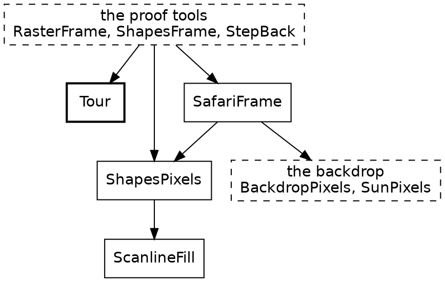

Everything here lives in `gates/`, and the game never runs any of it. The gate programs reach the game through `game.roc`, a package whose only job is to list the modules they read. [check: the builder's includes can't reach `gates/`, `lib/` or `web.roc`, which is why these chapters describe those and don't quote them. Decide whether the builder should.]

*[The proof widget goes here: ride to a step, ride there again, and see the same shapes both times.]*

### A fixture is a value

Getting a test to step 1,570 of a game normally takes some doing. Here it takes a loop. `Tour.initial` is a value, and `Tour.step_forward` is a step function, the one at the very top, wrapped around `RideInstant.next_or_restart`. The `if` chain is the only management a history needs, and its comment says why half of the list goes at once:

{{code Tour.step_forward}}

There's nothing to mock, because nothing was injected. No clock has to be faked, because the clock is a field. There's no browser to start, no window to open and no delay to wait out, and two runs can't disagree. A step of the ride takes nothing from outside it.

`RideInstant.next_or_restart` is one `if`, and it's worth seeing because it puts the end of the ride in one place. A ride that's finished starts again, so `Tour` needs no notion of game over:

{{code RideInstant.next_or_restart}}

### The frame hash

`RasterFrame` rides to a step, paints the frame into 576,000 exact pixels, and prints an FNV-1a hash of them. The painter is `SafariFrame`, in pure Roc, and its `ShapesPixels` is the twin of `shapes_canvas.js`. The gate holds each hash to a line of `gates/proof.expected`, exactly. No tolerance. One different pixel in one frame fails it.

A frame is only evidence for what's in it, so the steps aren't arbitrary:

| Step | What the frame shows |
|---|---|
| 0 | The start of the ride |
| 100 | A bird in flight |
| 1,570 | A cat frozen in the lane |
| 1,586 | The same cat in mid-leap |
| 3,000 | The ride under way |
| 3,742 | A distant truck, its glow too small to draw |
| 5,700 | The truck at dusk, lights on |
| 6,520 | The truck braking in plain view |
| 9,000 | Past the end, on the second lap |

The ride lasts 7,040 steps, so the clock at step 9,000 reads 1,959. [check: what 3,000 and 9,000 are there for; the gate's header doesn't say.]

The list grows by a rule: if a thing can be wrong without any listed frame changing, the gate is blind to it. A brake light wired to `Off` would pass every hash until 6,520 was added. A green hash means nothing for what no frame shows.

Exact hashes have a consequence that reaches into the code. Float addition isn't associative, so a sum's order is part of its meaning here. `World.route_length` says so in its doc comment, and it's one of the few places in Safari Ride where the direction of a fold is a decision:

{{code World.route_length}}

That's also what the sentence in the headers of `Speed`, `Beats`, `Fraction`, `Angle` and the rest is for. "Each operation does the plain float arithmetic its name says, so code moved onto this type computes exactly what it did before." An opaque type adds names and takes nothing away. A retyping that adds `Speed` to a module changes the types throughout, and if it leaves the arithmetic alone, every hash stays where it is. If a hash moves, the retyping changed the program, and the gate says so.

This is how the code in this tour got its shape. About fifty modules were renamed, retyped and reorganized, many of them in parallel, and each merge had to leave the frames alone. Roc's types caught what they catch, the hashes caught the rest, and the picture didn't change. [check: the number, and whether "many" should say how many at once.] A language with no hidden state doesn't make a refactor safe by itself. It makes it possible to write a test strict enough to be trusted.

The limit, stated flatly: the hash proves `ShapesPixels`'s pixels, and the page's pixels come from the browser's canvas, with anti-aliasing. What the two share is the list of shapes. `web/page_check.mjs` runs each built page against a stand-in canvas, and past that the JS has only its own checks.

### Two more proofs

`ShapesFrame` paints each frame twice: once with its polygons whole, as the browser gets them, and once cut into triangles, as the native runner gets them. It counts the pixels that differ, and the gate requires zero of 576,000, at every step in the table.

`StepBack` checks that one step back goes back exactly one step, at depths either side of the history's cap. It's in the gate because the answer was once no, and its header says how: the list stopped recording when full, so a step back from frame 3,000 landed on 2,047. Holding the first 2,048 instants was a perfectly consistent thing for a list to do. The test works by asking `Tour.step_back` and comparing clocks, and since `Tour.step_back` is this small, there isn't much else to ask:

{{code Tour.step_back}}

### `expect`

Below the frames, the proving is plain. An `expect` sits at the top level of a module, under the code it checks, and `roc test` runs it. There are over a thousand, and they're Safari Ride's only other tests. The tour has already shown twenty-six of them, in the whole of `Clock` and `Pond`. A pure function needs nothing else: literal arguments, literal answer. Each `expect` asserts one thing, and they cover both sides. `Clock`'s check that a clock equals itself one step on is false, so it's written with `!`. `Num_.round_real` has a run of its boundaries, from `-0.5000000000000001` up through `0.49999999999999994`, on both sides of each. [check: those two numbers are quoted by hand, since an `expect` has no name for an include to find. It wants an include form of its own.]

A test's data can sit beside it as a plain definition. `Bike` doesn't import `RiderState`, and `Motion` is open, so its fixture is a record that has the six fields and makes up the rest. `segment` and `focus` are bare numbers here, because `Bike` carries them through and never looks. A narrow view of a wide record pays off twice: the test needs nothing the module doesn't.

{{code Bike.riding}}

It's called like any other value, and the steps that follow are named, so three `expect`s can read them:

{{code Bike.first_step}}

The gate makes `expect` honest in one further way. The source is the count: every line that starts `expect`, in a module any root reaches, has to print `PASS` exactly once. An `expect` that nothing compiles fails, and so does one that's indented out of reach. One more consequence: an `expect` can only name what its module imports, so a check sits where its test data can be seen, and a module doesn't take on an import for a test's sake. `Coast`'s projections are checked in `Throttle`, which can see a `Speed`, and `LeanSearch`'s search in `Rider`, which can see a `RiderState`.

Even a truck can be checked this way, though it can't be asked about step 4,000 cold. A `TruckState` is a record, so a test writes one down and calls `Truck.advance` once.

### Crashes that help

Every `Fraction.of` in the game is an assertion, and the gate runs a lot of them. A ratio outside 0 to 1 stops the program, with a sentence saying the sum behind it is wrong. `Try` is the right answer when a value can honestly be absent. This isn't that case. A wrong ratio is a bug, and the sooner it's a crash the better:

{{code Fraction.of}}

Here's one of the many places it's used, with `smoothstep` trusting its own algebra. A proof run rides through it thousands of times, so if the algebra were wrong, the gate would be first to know.

{{code Easing.smoothstep}}

The same holds for the code's other `crash`es, including two dozen `?? crash`es on lookups that can't miss. Each one states a belief about the program, and every gate run tests it.

### The page itself

This tutorial is built from the code. Every fenced snippet here came through Roc's own parser, by name, and the failing program in the sky chapter is run through the compiler, which is quoted. The gate builds the page. So renaming a function quoted here fails the gate until the prose catches up, and the compiler message under `turn_as_bearing` is the compiler's.

Lints round it out: shale's Roc lints run first, with each count held exactly, and every count is at zero. A name that's vague or a boolean parameter that should be a tag fails before a single hash is computed.

All of that runs without a screen. The tour still hasn't said how a list of shapes reaches one, or where the effects went.

## The platform

The rest of the program is what puts this on a screen, and Safari Ride has very little to say about that, on purpose. The tour touched this early on. Here it is with the code.

New in this chapter:

- Roc: an app as a record, functions in record fields, `var` and `while`, `roc glue`
- Modules: `WasmApp`, `CanvasApp`, `Input`, `Shapes`

The modules around `SafariApp`
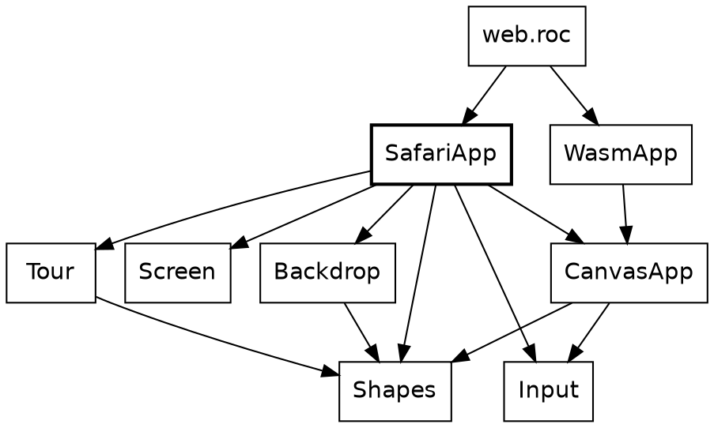

`WasmApp`, `CanvasApp`, `Input` and `Shapes` are in `lib/`, and they're the same for every canvas app.

### An app is a value

An app here is a record, handed to a runner. `CanvasApp(model)` has a type parameter for whatever the app keeps. Safari Ride's model is its `Tour` and a pause flag, and the app reads like configuration, because almost all of it is:

{{code SafariApp.canvas_app}}

`CanvasApp.untimed_advance(step)` takes a function and answers a function, the same one with a seconds argument to ignore. Safari Ride counts steps, and this is the place that says so: a runner offers the seconds, and they go nowhere.

`web.roc` is thirteen lines, most of them its header. Its body is `program = WasmApp.program(SafariApp.canvas_app)`, and that's the whole connection between the game and the web.

### Keys

Input comes as a value too. `Input.Snapshot` says which keys are down and which were just struck, so a test could write one down, and `key_pressed(KeyR)` takes a tag. Everything the keys do is a function from `Tour` to `Tour`, so moving four steps or one, forward or back, is one helper with a function in a record field. `var` and `while` are back, in a function that's still pure. `$tour` and `$i` can't be seen from outside.

{{code SafariApp.repeat}}

`Tour.step_forward` and `Tour.step_back` are plain values to pass here:

{{code SafariApp.step from "if input.key_down(KeyRight) {" to "step_once: Tour.step_forward,"}}

Stepping back through the ride is a keypress because `Tour.step_back` is a list lookup, and nothing else in the game knows it happens.

### A frame is a list

The answer to all of this is a `List(Shapes.Shape)`. A shape is a tag: `Poly`, `Disc`, `Rect` and a few more, each with its fill. Two of them aren't shapes. `Blend` and `View` are marks in the list that change how what comes after them is painted, because a frame is a list, and a mark is the cheapest way to say that.

The rider's lean is one of those marks. The whole picture banks into a turn, backdrop included, so `SafariApp.frame` builds a camera out of nested tags and puts it at the front. The rest is `Tour` answering questions, each a one-liner:

{{code SafariApp.frame from "centre = {" to ").prepend(lean)"}}

### Where the effects went

Early on, the tour said the game has no effectful functions. It's fair to ask where they went, and the answer is that they never got as far as Roc. The wasm platform asks for a record of functions over a boxed model:

`init`, `advance`, `frame`, `release`, `sounds`, `width`, `height` and `fps`, with the tones' `tone_count`, `tone_freq` and `tone_ms`. Every one has a thin arrow, `->`. The host in `web/platform/host.zig` keeps the box, and all that crosses is numbers and a list of shapes. Wasm's edge has no records, so the input is flattened into seven numbers, and `Input.of` rebuilds it. `roc glue` generates `roc_glue.js`, which knows the layout of a frame in wasm memory, from `Chain.roc`, so that file is never edited.

Each tick goes like this. `canvas_app_runner.js` paces the clock and gathers the keys. It calls `advance`, then `frame`, in Roc. It reads the shapes back through the generated glue, and `shapes_canvas.js` paints them on a canvas. The host keeps the list until the next frame, then hands it back so that Roc can drop it. That's `release`, a function whose body is `{}`: Roc knows the layout of what it's dropping, and the host shouldn't have to.

The JS is about 490 lines for every canvas app there is. It knows nothing of cats. The only `!` names near Safari Ride are the `main!` and `echo!` of the gate programs, which are ordinary command-line apps, and the proof tools need them to print a hash.

The same modules are compiled three ways, which is about the strongest statement of the line between the game and the platform that a program can make. The page builds them to wasm. The gates build them natively. And `main.roc` hands the same `SafariApp.canvas_app` to `native/CanvasAppRunner.roc` on roc-ray. That third one is the spike that proved the idea and it isn't kept current, as the README says, so the page is the maintained side. The first two run on every gate.

That's the last of the parts. Each has been seen alone, and the first diagram hasn't been looked at since.

## Zooming back out

Every box on the first diagram has now been opened.

*[This chapter ties the tour together once the stepped things, the proof and the platform are written. It returns to the flipbook and the first diagram: the clock ticks, and everything composes from three stored fields.]*

## Appendix: the patterns

The tour named these in passing. They're patterns in the loose sense: shapes that kept turning up, and that Roc makes easy to write and hard to break.

| Name | What it is | Where to see it |
|---|---|---|
| Worked out, not stored | Keep the few things that must persist, and derive the rest each frame | `RideInstant`, `Cat`, `Sky` |
| A sighting decides, drawing paints | A pure function answers with plain data, and something else draws it | `CatSighting`, `TowerSighting` |
| Places and distances | One opaque type for where, a second for how far apart, and only the sums that make sense | `Clock` and `Steps`, `Bearing` and `Turn`, `Along` and `Distance`, `Speed` and `Acceleration` |
| Rule and score | One function says how far along, and one piece of data says what that looks like | `over_gap` and `flight_timeline` |
| The step function | A value goes in, and the next value comes out | `Rider.advance`, `Truck.advance`, `Tour.step_forward` |
| A narrow view of a wide record | An open record names the fields it uses and carries the rest through | `Bike.Motion(others)` |
| The gate chain | One value passes through independent rules, each of which can only lower it | `Throttle.get_forward_accel_decel` |
| One record per space | Field names say which coordinate system a point is in | `RoadPoint`, `RiderPoint`, `SpacePoint`, `Screen.Point` |
| Rehearsal | Run the real rules on a pretend copy, read the result, and throw it away | `Coast`, `LeanSearch`, `Rider.resolve_cross` |

Code that reads like configuration deserves a line of its own, because the tour kept stopping to admire it: `Pond`, `World.route`, the timelines, and `SafariApp.canvas_app`. None of them is a config format. They're ordinary Roc values, so the compiler checks them, and a tag that's misspelled is a compile-time error.

## Appendix: what catches you out

The patterns say what works. This page says what bites, sorted by what shows up first. Everything on it comes from a chapter, and the last column says which.

### Reading the code

| What you see | What's going on | Chapter |
|---|---|---|
| A method call with no import | Static dispatch finds `next` from the type of the value | One whole module |
| A helper with no keyword to say it's private | Anything outside the module's block is private | The sky |
| A `match` that looks like a leaf and isn't | `<=` on an opaque type is a call to its `is_lte`, so an operator can run code of the program's own | The cat |
| `var` and `for` under a `->` | A local that nothing outside can see, with `$` marking what changes. The function is still pure | The cat |
| `?? crash` on a lookup | It isn't error handling. It states a belief about the program, and every gate run tests it | What never changes, Proving it |

### Getting it to compile

| What you see | What's going on | Chapter |
|---|---|---|
| An open record that has to be named | `..others` needs a name when it appears twice, because the name promises that the same fields come out as went in | The stepped things |
| An `expect` that can't see a type | It can only name what its module imports, so `Coast`'s projections are checked in `Throttle` | Proving it |

### Running it

| What you see | What's going on | Chapter |
|---|---|---|
| A crash with a sentence about a sum | `Fraction.of` takes a ratio that can only be in range. A ratio that can rightly fall outside wants `Fraction.clamp` | The sky, Proving it |
| A pose cut on the wrong side of its beat | The leap's beats sum to a float just under the beat they stand for, so a cut says `Through` or `Before` | The cat |
| The first frame of an animation shown too soon | `Waiting` and `Past` aren't progress of 0 and 1, because a critter can rest where no part of its animation reaches | The cat |
| A bird hanging in the air | `over_gap` doesn't know a bird can't hover. A stopped rider would leave one there, and on this route the rider doesn't stop inside a bird's 45 metres | The bird |
| Beacons that stop, or run backwards | The clock counts steps, not seconds, so pausing freezes them and stepping back reverses them | The beacons and the headlights |
| A frame hash that moves after a sum was reordered | Float addition isn't associative, so a sum's order is part of its meaning | Proving it |
| A green gate over a wrong brake light | The gate is blind to whatever no listed frame shows | Proving it |
| A page that differs from the hashed frame | The hash proves `ShapesPixels`'s pixels. The page's come from the browser's canvas, with anti-aliasing | Proving it |

## Credits

Safari Ride was designed by Steve Howell. Claude wrote most of the code and this tutorial under his direction.

The way these chapters open and close, the predictions under the widgets and the page of surprises are ideas from Braeden Foster's [Rocco tutorial](https://github.com/Pixelsprout/rocco-engine).
