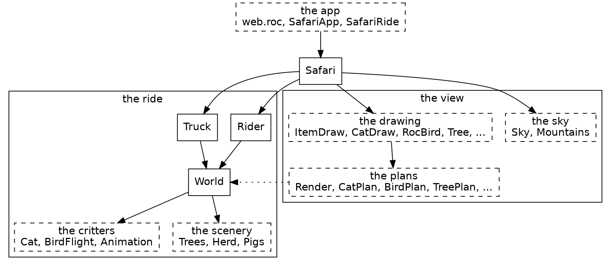
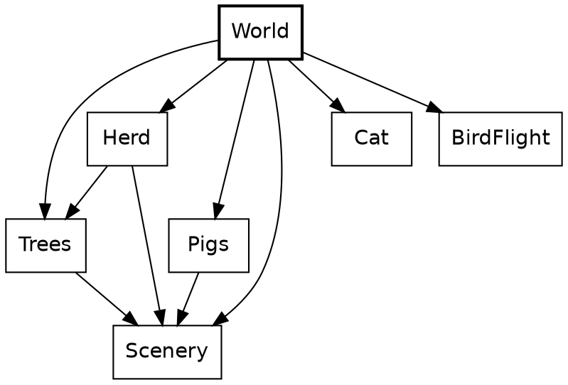
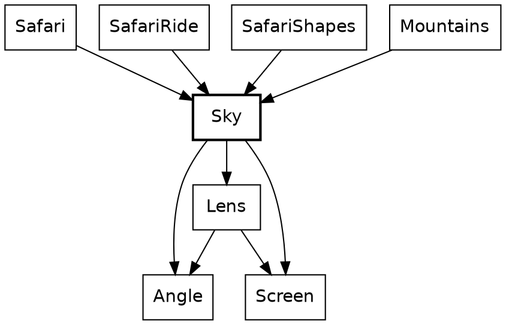
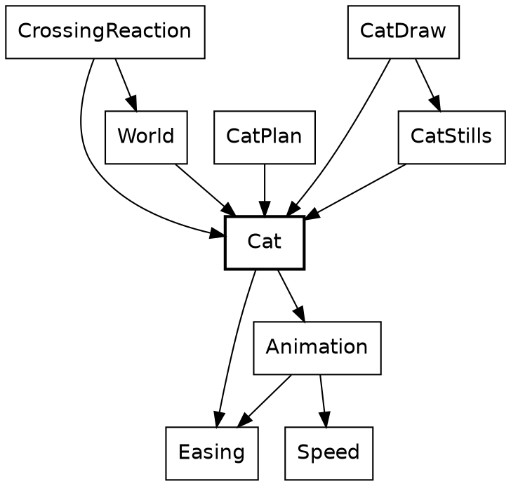
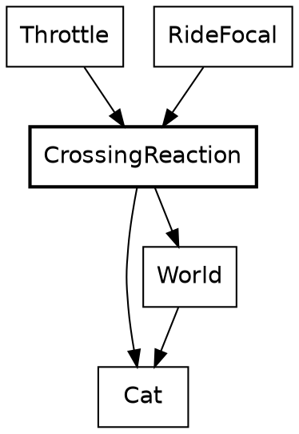
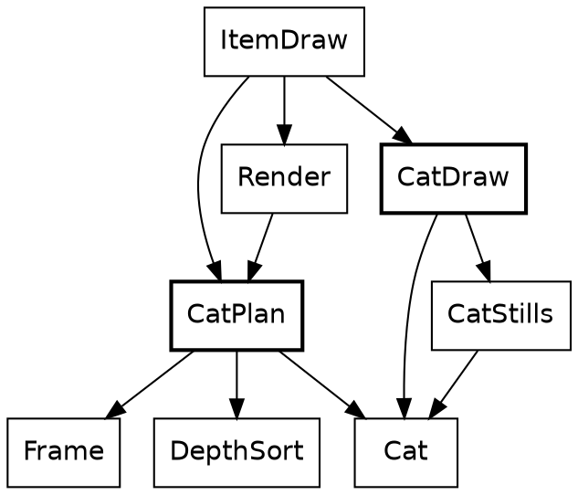

# Safari Ride: a tour of a real Roc program

*[The live ride goes here, running as you read.]*

This is Safari Ride. A rider cycles down a long road through open country, past trees, cows and pigs, with a truck somewhere ahead. Radio masts blink in the distance. A bird takes off as the rider comes near. A cat walks into the lane, freezes, and leaps for the far verge. The sun goes down behind the mountains, and the truck turns on its headlights.

Safari Ride has the important parts of a game's world: terrain, physics, a camera, things that react to the player, and a day that ends. It doesn't have game mechanics yet. Nothing keeps score.

This tour reads the program from the bottom up. It's about seventy modules of Roc, which is enough to show how Roc holds up in a program with a lot going on. It assumes you can already read Roc. Each chapter points out a few Roc ideas as they come up, and the useful ones come up more than once.

Here's the whole system, simplified. An arrow points from a module to one it imports, so a module is composed of what it points at. Dashed boxes each stand for a family of modules. Roc doesn't allow import cycles, so nothing here can point back up.

There are two halves. The ride is `Rider`, `Truck` and `World`, with `World` composing the route from its scenery and critters. It knows nothing of drawing. The view is everything that turns the ride into a picture: the plans find what's in sight, and the drawing paints it. The dotted arrow is the view reading the ride, and no arrow goes the other way. `Safari` sits over both, holding the ride and stepping it, and the browser only sees `SafariApp`, which hands it a list of shapes each frame.

## All that's stored

A record alias is the plainest way to name a shape in Roc, and it's all this needs. `Safari` itself is a void module: `Safari :: [].{ ... }` is a type with no values, and its block holds the definitions other modules can reach.

{{code Safari.Ride}}

Those three fields are the whole of what Safari Ride keeps from one step to the next. The cat has no state, and neither does the bird, the sun or the beacons. Each frame works them all out again from the rider, the truck and the clock.

That gives three kinds of moving thing, and the tour is organized around them:

| Kind | Things | How it works |
|---|---|---|
| Stepped | The rider, the truck | Stored in `Ride`, and moved once a step from where it was |
| Rider-driven | The cat, the bird | Worked out from how the rider is approaching, with nothing stored |
| Clock-driven | The sun, the sky, the beacons, the headlights | Worked out from the clock, with nothing stored |

Trees and cows are a fourth kind, the easiest of all: they never change.

Purity makes some things free. Safari Ride can pause and step backward, because a step back only needs an older `Ride`. The cat follows along, since it was never anywhere but where the rider's position puts it, and the sun rises again.

The game itself has no effectful functions at all. It has no `!` names, no `=>` arrows, no `?` and no `where`. Effects live in the platform, which is the last chapter.

## What never changes

Trees, cows, the pond and the road are built once and only read after that, so they're the place to start.

`World` turns a route, a plain list of records, into segments of road. A plan shows how much tag unions can do with no declaration. `[WithBull, NoBull]` is written right in the field's type, and it says more than a boolean would at every place a segment is written down.

{{code World.SegmentPlan}}

A `match` on a closed union has to cover it: leaving out a tag is a compile-time error.

{{code Trees.accent}}

The first opaque type in the tour is a small one. `SegmentIndex :: U32.{ ... }` is a `U32` that only its own block can open, and the block is also where its methods live. A segment's place in the route can't be confused with a count of trees, because nothing outside can do arithmetic on it. Opaque types come back in every chapter.

`crash` appears here too. It isn't for error handling: an index that isn't in the world is a bug in Safari Ride, not a case to handle, and `??` says what to do with the missing value.

{{code World.SegmentIndex from "## The segment of `world`" to "?? crash"}}

## The sky

The sky is the simplest thing that moves, because it depends on one number.

`Sky` sits near the bottom of the system. Leaving out small math helpers, it imports only the angle type and the lens and screen geometry, and it knows nothing of the rider, the road or the drawing. Those above it each ask for a colour or a sun at a given clock.

*[The sky widget goes here: drag the clock and watch the sun set.]*

### A function of the clock

Every function in this chapter has a `->` arrow, not `=>`. In Roc that's a promise the compiler holds: no effects, so the same clock always gives the same sky. If a function has no `=>` and no `$` in sight, there's nothing behind it to think about.

{{code Sky.sun_height_px}}

`Clock` is another small opaque type: a whole number of steps that only ever goes up by one. `to_f64` is its one door to a float, and this is the only place that uses it. The sun's height is a straight line. It starts at 244 pixels, reaches the horizon around step 3,980, and has fully set around step 4,730.

Dusk is a curve and then a line, which means two cases. `Sky` keeps the two halves below its block. Anything outside `Sky :: [].{ ... }` is private to the module, so a helper stays a helper without any keyword.

{{code Sky.dusk_at}}

{{code Sky.dusk_while_up}}

{{code Sky.dusk_after_set}}

The horizon's warmth is a third shape, a tent centred on the moment the sun touches the horizon. Three curves come off one number, and they're plain functions rather than anything more general. Nothing else in the game needs them.

{{code Sky.sunset_warmth}}

### Angles that can't be mixed up

The sun is the one thing here that also depends on where the rider is looking. Two tags say the two answers, so there's no `null` and no off-screen sentinel value. A caller has to handle `OutOfView`, because `match` must cover every tag.

{{code Sky.SunPos}}

Opaque types do the most work in this next function. `Angle.Bearing` is a direction in the world and `Angle.Turn` is a change of direction. Both are floats underneath, but they're opaque types (`::`), so only the `Angle` module can build or open one, and a `Turn` can't be passed where a `Bearing` is wanted. `sun_bearing.turn_from(heading)` is static dispatch: the method comes from the type of `sun_bearing`, with no import needed at the call. The function also takes one record argument, destructured in its parameter list, so callers name every field.

{{code Sky.sun_pos}}

`turn_from_view.abs() >= visible_turn_limit` compares two `Turn`s. The code never touches radians until `sun_place` has to do trigonometry.

{{fails turn_as_bearing}}

## The cat

The cat is the best scene in Safari Ride. It walks out, freezes in the lane as the rider bears down on it, and leaps clear at the last moment.

`Cat` says what a cat does, and `Animation` holds what a cat shares with a bird. Everything that uses a cat imports it, and `Cat` imports none of them: it doesn't know it's drawn, placed or reacted to.

*[The cat widget goes here: drag the rider's gap and watch the crossing play.]*

The slider isn't scrubbing a video. Every position of it is a call to this function. The arrow is `->` again, so the type already says there's no hidden cat being updated somewhere. Method syntax chains the two halves of the job: `.moment(...)` is defined on the `Timeline` that `crossing_timeline` returns.

{{code Cat.moment_at}}

A crossing and an approach go in, and a moment comes out. The same crossing at the same approach gives the same cat, a thousand frames apart. `crossing_stage` decides how far along things are, and `crossing_timeline` decides what that looks like. They know nothing of each other.

### When it plays

`Approach` is a plain record alias. Its `speed` field isn't a plain number, though. Like `Angle`, `Speed` is an opaque type.

{{code Animation.Approach}}

`Speed` wraps an `F64`, and its methods live in a block after the type. `Speed.(s)` in a parameter list is how the module opens one. Outside this module, nothing can, so a distance can't be passed as a speed. An animation's beats are an opaque type too, `Beats`: fractional, and tied to no clock, so a place in an animation can't be passed as a step of the ride.

{{code Speed.distance_in}}

`Speed` also defines `is_lte`, which is what lets `speed <= standstill` work in the next snippet with an ordinary operator.

The stage is a tag union where two of the tags carry a payload. `Waiting` and `Past` aren't progress of 0 and 1, because a critter can rest somewhere no part of its animation reaches. If `Waiting` were just 0, a perched bird would show the first frame of its flight.

{{code Animation.Stage}}

{{code Cat.crossing_stage}}

The rule lives in `Animation`. Its first argument is destructured in place, and so is the `Approach` after it, so the body reads in plain names.

{{code Animation.over_beats}}

The cat plays over beats rather than over a stretch of road because it has to finish before the rider reaches it, however fast the rider comes. A faster rider makes it start earlier. The bird uses `over_gap`, because a bird simply reacts to how close the rider is. Each critter picks the rule that suits it.

### What it looks like

A timeline is data, so the cat's whole performance reads in one place, like a score. Tags with payloads do almost everything here: `Through` and `Before` say where a stretch ends, `Holds` and `Alternates` say how the cat looks, and `Line`, `StaysAt` and `Arc` say where it goes. `Animation.Timeline.( ... )` wraps a record in the nominal type `Timeline`. Nominal (`:=`) is the middle ground: unlike an alias it can carry methods, and unlike an opaque type anyone can build one, which is right for data that needs no guarding.

{{code Cat.crossing_timeline from "looks:" to "finally: Holds(Collapse),"}}

There are two tracks because a cat's looks and its movement change at different moments. Its body moves just ahead of its path, so the `looks` track above cuts at 0.8, 2.8 and 3.8 beats into the escape, while the `path` track below cuts at 1 and 3. One list of phases tying them together wouldn't fit the cat or the bird.

{{code Cat.crossing_timeline from "path:" to "finally: StaysAt(end),"}}

`Timeline(pose)` takes a type parameter, which is how a cat and a bird share it. A cat's pose is a closed tag union, and nothing outside `Cat` needs to know its tags. Because it's closed, a `match` on it that misses a pose is a compile-time error.

{{code Cat.Pose}}

A cut has to say which side of it its own beat falls on, and two tags say that better than a boolean would. `crossing_timeline`'s comment says why it matters: those leap beats sum to a float just under the beat they stand for.

{{code Animation.Cut}}

Finding the stretch that's playing shows one more Roc idea. `var $from` is a local variable that a `for` loop reassigns, inside a pure function. Roc allows that because nothing outside can see it: `playing_at` still has a `->` arrow, and the `$` marks what changes. An early `return` ends the loop.

{{code Animation.playing_at}}

### What it does to the rider

So far the cat hasn't touched the rider. That's a separate question, answered in one place.

`Throttle` and `RideFocal` know nothing of cats. They ask `CrossingReaction`, which is the only part of the rider's code that does.

`..others` in the argument's type makes it an open record: this function needs `along` and `speed`, and accepts any record that has them, so it doesn't depend on `Pose.RiderState`. `speed` here is the opaque `Speed` again, and `match` on `segment.crossing` has to name every tag.

{{code CrossingReaction.reaction_to}}

A cat in the lane stops the rider opening the throttle, without braking, and widens the view as it pulls the rider's eye. Two tags, `MayAccelerate` and `NoAcceleration`, stand where a boolean might have gone, so the call site reads as a sentence.

This is the only loop in the design. The rider's speed decides where the cat has got to, and the cat holds the rider's speed down. It settles, and it's also why `over_beats` has to stay the cat's rule. A bird asks nothing of the rider, so it falls through to the same answer as an empty road.

Each stretch of road has exactly one `crossing`: `CatCrosses`, `BirdFlies` or `QuietRoad`. A cat and a bird in the same place can't be written down.

### Getting it on screen

The last step is finding the cat in the rider's view.

`CatPlan` and `CatDraw` never import each other. `ItemDraw` is what carries a plan's answer to the drawing.

`CatPlan` asks for the moment, places it, and decides whether it's big enough to draw. An empty list or a list of one is how it says "maybe", because the caller flattens them with `join_map`.

{{code CatPlan.cat_in_view}}

A plan decides how a thing looks, and drawing only paints it. That rule runs through all of Safari Ride.

Notice what isn't in this chapter: a cat in `Ride`, an update loop, or a flag saying the cat has already crossed. Roc doesn't force that, but pure functions make the stateless version the easy one to write, and every `->` shows it stayed that way.

## Credits

Safari Ride was designed by Steve Howell. Claude wrote most of the code and this tutorial under his direction.
