# Safari Ride: a tour of a real Roc program

Safari Ride is a small Roc program with a lot to look at. In this book, we read it with you.

## Introduction

Safari Ride is running in the page below. It's a big page, so give the ride a little while to load. Then it starts by itself.

```widget ride
The ride, running as you read. Click it to give it the keyboard: Space pauses it, and the arrow keys step it.
```

Watch it all the way through. A motorcycle carries its rider down a long country road. Cows and pigs graze in the fields, and trees crowd the roadside. A truck runs on ahead. A cat waits by the road for its moment to cross, and a bird takes off as the rider comes near. As the sun sets behind the mountains, the truck turns on its headlights. At the end of the road the rider stops, and the ride starts over.

Safari Ride is written in Roc, and this is a book about Roc. If you're brand new to Roc, the [official Roc tutorial](https://www.roc-lang.org/tutorial) makes a quick first stop. The tutorial teaches the language through small examples. This book picks up from there, with one real program: how its code is organized across many modules, and how Roc's larger ideas, such as opaque types, type variables and `where` clauses, solve the problems the ride poses. The book quotes the real code behind what's on the screen. The book explains each new Roc idea where the code first needs it.

You'll learn two things as you read: Roc, and how a ride like this one is animated. The animation is a handful of plain ideas. Each frame is one picture, and a step moves the world on before the next. Far things look small, and near things cover far ones. The book explains each of these in plain words where the ride first needs it. A chapter near the end gives the trigonometry behind them. If both are new to you, you'll get both at a walking pace.

### Run it yourself

Safari Ride is open source, in the `canvas_apps/safari` folder of [roc-apps](https://github.com/showell/roc-apps). It builds with the Roc nightly that the repository's `roc-version` file names, `nightly-2026-11-03-34bd006`. With that installed, two commands check the whole ride and run its tests:

```text
cd canvas_apps/safari
roc check web.roc
roc test web.roc
```

`roc check` checks the type of every value in every module the ride uses, and `roc test` runs the 645 `expect` tests those modules hold. Then break something on purpose. In `Billboard.roc`, delete the `FacesRight => Mirrored` line from the `match` in `scenery_sprite`, and run `roc check web.roc` again. The compiler names the missing case, as the {{chapter Tag unions: billboard critters}} chapter shows. Put the line back, and the check passes again.

## One page

Safari Ride works like a flip book. Each frame is one page, and the ride shows a new page thirty times a second. Here's one page, held still. It's the page at step 1,529, with the cat out on the road:

```widget frame moving
Step 1,529 of the ride, held still.
```

This chapter makes a first pass over that page. It names the page's parts in the code. Later chapters show how each part is made.

In the code, a page starts as one value of the `FrameView` type:

{{code FrameView.FrameView from "FrameView := {" to "}.{"}}

You can read it as English for now. A `# ...` line marks a gap in the quoted code. Four of the fields are parts of the picture you can see: the backdrop of sky and grass, with the sun when it's in view; the mountains; the road and its ponds; and the scene, which holds the things in view on and beside the road. The fifth field is the camera's roll: how far the whole page leans when the bike leans. The roll comes from the rider, so the second half of the book explains it.

One function gives back the `FrameView` for any moment of the ride:

{{signatures FrameView.frame_view_at}}

That line is a type annotation: the function's name, a colon, and its type. `frame_view_at` takes a `Route`, the whole road, and a `RideInstant`, one moment of the ride, such as the one at step 1,529. After the arrow comes what it gives back, the moment's `FrameView`. One more function turns the `FrameView`, backdrop and all, into a single list of shapes, leaned by the roll:

{{signatures FrameView.leaned_shapes}}

Roc code runs on a platform, and Safari Ride's platform paints that list on the screen. So each page starts from one moment of the ride and ends as one list of shapes.

In the first half of the book, we hold this page still and build it part by part, starting with the things beside the road. In the second half, the pages turn. The chapters ahead teach Roc slowly, one idea at a time, so the syntax here can wait for them. In the next chapter, we break the ride into the pieces we build.

## The problem

Safari Ride shows a world in motion, seen from the rider's seat. Thirty times a second, it puts a new picture of that world on the screen. Each picture is a frame, and between frames a step moves the world on, so the pictures move. Whoever is watching can take the controls at any moment.

That's what you see. For us, it's an engineering problem, and our first job is to break it into pieces we can build one at a time. We get one frame right before anything moves. That plan costs something: the first half of the book holds that frame still. In return, every piece we build stands on a piece that already works. The plan gives the problem five pieces:

The five pieces
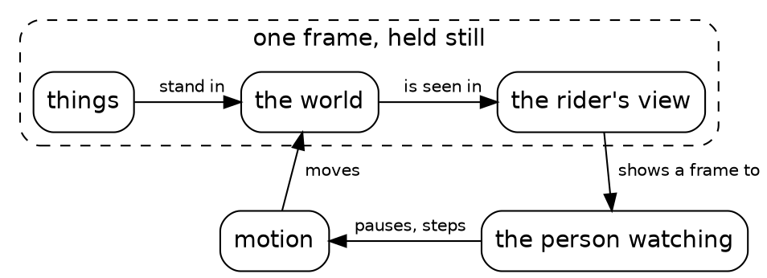

| Piece | Challenge | The problem |
|---|---|---|
| Things | Components | A tree, a cow and a radio tower must each be built from shapes the screen can show. Every frame starts from a blank screen, so every frame must hold all of its shapes, every time. |
| The world | Structure | A long road runs through open country, past trees, herds, ponds and radio towers. Something must lay it all out, and say where every one of them stands. |
| The rider's view | Perception | The screen shows only what the rider sees. A tree far down the road looks small, and a tree close by looks big. For everything in the world, the program must work out what the rider perceives: where it lands on the screen, and how big, if the rider sees it at all. Where two things overlap, the nearer one covers the farther one. |
| Motion | Persistence | The rider rides on, the truck drives ahead, the cat crosses the road and the sun goes down. At every step, something must move each of them on, and the moves must fit together. The cat times its crossing to the rider coming toward it, and a cat in the road stops the rider speeding up. |
| The person watching | Interaction | A viewer mostly sits back and watches, but they also need to pause the ride, and step it forward and back. So the program must give them controls, and answer each one straight away. |

We take the pieces in turn. Things come first: what a cow or a tree is, and the shapes it's made of. Then the rider's view: the trip every thing takes from its place on the road into the frame, with the math behind it saved for a chapter near the end. The world comes after the view, because every part of it takes that same trip: the sky, the mountains, the road and everything along it. Those three make one frame, held still. Motion fills the second half of the book: moments that follow one another like a flip book's pages, and the clock, the rider, the truck, the cat and the bird, each moved on from step to step. The person watching comes last, at the platform, where the frames go out and the keys come in.

Before the first piece, three short chapters cover Roc itself: how a program is laid out, its types, and its functions.

## Platforms, packages and modules

A Roc program runs on a platform, it's made of modules, and it can use packages. Those three words say where Safari Ride's code lives.

A platform is the layer underneath a Roc program that deals with the outside world. For Safari Ride, that's the screen and the keyboard. The Roc code describes each frame, and the platform paints it. In this page, the platform is WebAssembly and a little JavaScript. On a desktop, the same Roc code runs on a native platform called roc-ray.

Each Roc program is an app, and the app's first line of code names its platform. Here's Safari Ride's app for the web, the whole file:

{{module web}}

Lines that start with `#` are comments. The first line of code names the platform, and gives it the short name `pf`.

The first line also names a package, `lib`. A package is a bundle of modules: the app gives it a short name, and the path says where it is. The `lib` package holds what Safari Ride shares with the live pictures in this book, such as what a shape is and what a key press is.

A module is one file of Roc, named for what it holds. `SafariApp.roc` holds the `SafariApp` module, and `import SafariApp` brings it in. `import lib.WasmApp` brings in the `WasmApp` module from the `lib` package.

The brackets after `app` name the two things the app hands the platform, and the last two lines define them. `Model` is the type of what the app keeps as it runs, and here it's the one in `SafariApp`.

`SafariApp.canvas_app` is the whole ride as one value, and the `WasmApp.program` function fits it to the web platform. Its result is the app's `program`. The {{chapter The platform}} chapter, near the end, opens that value. The next chapter reads the types inside those modules.

## Types

Types are at the heart of every Roc program. A type says what a value holds, and the compiler checks every value against its type. That gives this book its rule: get the types right, and everything else follows. A type that holds just the values that make sense leaves each function a plain job, and the compiler checks the rest. So a good way to meet a Roc program is to read its types.

This book shows Safari Ride's types first, and they reach every part of the program, from a single number to the whole ride. Types describe the structure of a program's data and the rules it keeps, and each stop shows one way they do it.

### Distance pins down a number

Safari Ride's types are built from numbers. A length and a speed are both an `F64` underneath, so the ride gives each a type of its own. Here's the start of a length's:

{{code Distance.Distance from "Distance ::" to "metres = |metres|"}}

The `::` makes `Distance` opaque: inside is an `F64`, and only the `Distance` module opens it. `metres` wraps a number of metres as a `Distance`. So a `Distance` is more precise than an `F64`: its type says what the number means, and the compiler keeps a length apart from a speed or any other number. The {{chapter Opaque types: the clock}} chapter shows that precision catching a bug.

### A billboard spells out its fields and its choices

```widget frame moving
Step 1,529 of the ride, held still: the frame these types describe.
```

Every thing beside the road has a kind, and each kind is a type, such as `Conifer` for a tree. A cow is a `Billboard`, an emoji that stands on the grass, looking left or right:

{{code Billboard.Billboard from "Billboard ::" to "Facing : [FacesLeft, FacesRight]"}}

Each line inside the first braces names a field and its type, so a billboard is an emoji, a height and a facing. A `Billboard.Facing` is one of two tags, `FacesLeft` or `FacesRight`. A tag is a name, and a type made of tags lists every value it holds. So the type spells out a billboard's structure, its three fields, and a rule it keeps: it faces one of exactly two ways.

### Plain records lay out the road

The `World` module holds the road's plan as a short list of stretches, called segments, and each segment's plan is a record of the `SegmentPlan` type:

{{code World.SegmentPlan}}

Some types are plain data. A `:` gives this record type a short name, so any module can build a plan and read its fields. Here's the plan for the last stretch of road:

{{code World.last_plan}}

After a value's name, the same `:` gives the value its type, and the lines after it define the value. The `World.route` value is the whole road, built from the plans once, before the ride starts. So plain records lay out the whole road, as data any module can build and read.

```widget route
The whole route from above, one stretch for each plan. A mark shows where a cat crosses or a bird flies.
```

### A type variable carries every kind

The screen shows what a camera on the rider sees. Each thing takes three forms on its way there, and each form is a type. First, a thing has a place on the road:

{{code Geom.Placed}}

The `kind` in parentheses is a type variable: it stands for whatever type fills it. So a cow on the road is a `Geom.Placed(Billboard)`, and one type serves every kind. Next comes the thing as the camera sights it:

{{code Pipeline.Sighted}}

A sighting keeps the kind, and adds a `Spot`: where the thing stands in the rider's view. Last comes the thing as `Pipeline.rendering_of` renders it:

{{code Rendered.Rendered from "Rendered ::" to "}.{"}}

A rendering holds the thing's depth, how far ahead of the camera it stands, and its sprite: the shapes that show it, in the order they're painted.

{{code Sprite.Sprite from "Sprite ::" to ").{"}}

A rendering drops the kind, so renderings of every kind share one type, and trees and cows meet in one list. So the type variable carries the kind as far as the trip needs it, and the rendering lets it go.

### One record captures the whole ride

One record holds the whole ride at one moment:

{{code RideInstant.RideInstant from "RideInstant := {" to "}.{"}}

The `:=` makes `RideInstant` nominal: a new type whose fields any module reads, a third way to name a type. Its four fields are everything the ride carries from one step to the next: the rider, the truck, the clock, and the plan for when the cat or the bird ahead starts to move. We derive everything else that changes from them, such as the sun's height from the clock. So one small record captures the whole ride. Motion is then one function from a moment to the next:

{{signatures RideInstant.next_or_restart}}

It returns one of two tags, written in place in square brackets, and each tag carries the next moment.

### The tour keeps the past

The app's model is one line:

{{code SafariApp.Model}}

`motion` is two tags written in place: the ride is playing or paused. The tour holds the route, the moment on show, and the moments before it:

{{code Tour.Tour from "Tour :: {" to "}.{"}}

Stepping back works because `past_instants` keeps those moments. So the feature starts in the type.

### Types come first

You've read three ways to name a type: `:` for a short name, `::` for an opaque type, and `:=` for a nominal one.

On the way, the types pinned down a number, spelled out a thing's fields and choices, laid out the road, carried every kind, captured the whole ride and kept its past. Each described the data's structure or a rule it keeps, and the same few kinds of type served the whole program. The next chapter takes one function apart, and then we start with things.

## Functions

Every chapter from here on is full of Roc functions, so here we learn to read one, piece by piece. A Roc function takes its arguments and returns one value. The `darkness_at` function returns how dark the sky is at a step of the ride:

{{code Sky.darkness_at}}

### A function is a value

In Roc, a function is an ordinary value, like a number. Its code is an anonymous function, and `=` gives it a name. Roc calls a named value a constant: once named, it keeps its value. Inside a function's body, the constants are named again on each run, so each run has its own. Here's the function, piece by piece:

| Code | Term | What it says |
|---|---|---|
| `##` | doc comment | Describes the code under it. |
| `darkness_at : Clock -> Fraction` | type annotation | The function's name, a colon, and its type. `darkness_at` takes a `Clock`, which counts the ride's steps, and returns a `Fraction`, a number from 0 to 1. |
| `->` | thin arrow | Separates what the function takes from what it returns. |
| `darkness_at =` | constant | `=` names the function. |
| `\|clock\|` | anonymous function | The function itself starts here. |
| `clock` | argument | What the function is given. |
| `{` and `}` | block | Names for values, then one last expression. A block is an expression too, and its value is that last expression's value. |
| `height = ` | constant | A name for a value, which the lines below it use. |
| `SunPath.height_at(clock)` | function call | Calls `height_at` from the `SunPath` module, with `clock` as its argument. |
| `if` and its two branches | `if` expression | The block's last expression, so its value is what the function returns: one of the two calls, picked by whether the sun is still up. `SunPath.height_when_set`, the sun's height once it has set, is a constant from the same module. `darkness_while_up` and `darkness_after_set` are functions further down in the `Sky` module, outside its type's braces, and a module calls those by their bare names. |

Because a function is a value, the chapters ahead pass functions to other functions and keep them in records' fields.

### A body is one expression

A function's body is always one expression. A block is one kind, and a short body can be a plain expression, written straight after the `|`. The `Distance` module's `metres` turns a number of metres, an `F64`, into a length:

{{code Distance.metres}}

Inside the body, `metres` is the argument. The function sits inside `Distance`'s braces, so it goes by `Distance.metres`, and the bare name is free for the argument. `Distance.(metres)` wraps the number as a `Distance`. So a one-line function and a ten-line one have the same shape: arguments in, one expression's value out.

### An annotation states the contract

An annotation states what a function takes and what it returns, with commas between the things it takes:

{{signatures Sky.color_at_darkness}}

`color_at_darkness` takes an `RgbColor` and a `Fraction`, and returns an `RgbColor`. The compiler holds every call to that contract. The book often shows a function's annotation alone, until its body's turn comes, because the annotation already says what goes in and what comes out.

### A method belongs to its type

Many calls in the book put a value first, as in `SunPath.height_at(clock).minus(FarHeight.zero)`. That's a method call. A method is a function that belongs to a particular type. Here's a function built from method calls, which returns how warm the horizon's color is, from how near the sun stands to the horizon:

{{code Sky.horizon_warmth_at}}

| Code | Term | What it says |
|---|---|---|
| `SunPath.height_at(clock)` | function call | Returns the sun's height, a `FarHeight`. |
| `.minus(FarHeight.zero)` | method call | `FarHeight` has a `minus` method. The value before the dot is its first argument, so this is `FarHeight.minus(SunPath.height_at(clock), FarHeight.zero)`. |
| `.abs()` | method call | A method whose one argument is the value before the dot. `minus` returns a `FarRise`, the rise from one height to another, so this calls `FarRise.abs`. |
| `from_horizon.ratio_to(warmth_reach)` | method call | Divides one `FarRise` by another: how far the sun stands from the horizon, as a share of `warmth_reach`, a constant rise further down in the module. |
| `Fraction.clamp(…).complement()` | function call, then method call | `clamp` keeps a number between 0 and 1, as a `Fraction`, and `complement` returns 1 minus it. |

A type's methods are the functions between its `.{` and `}`, as `Distance`'s were. The compiler infers every value's type, so it resolves each method call to that type's own function when the program compiles. Even `>=` in `darkness_at` calls a method, `is_gte`.

### Every function has this shape

A function is a value, its body is one expression, its annotation states its contract, and its methods belong to its types. Every function from here on is built the same way. The next chapter starts on the things beside the road.

## Things

The things beside the road are its trees, its radio towers and its animals. We start with the animals. Here we learn how a thing becomes data, and how one function turns that data into a sprite. Here's a cow and a bull on the grass, from Safari Ride's own code:

```widget cow
A cow and a bull on the grass beside the road.
```

### A billboard stands in for an animal

The ride has a lot of animals: herds of cows, some led by a bull, herds of pigs, ducks on the ponds, and an elephant at a bend in the road. The cat and the bird move, and they get chapters of their own.

Every other animal is a billboard: a flat picture of its emoji, standing on the grass and turned square to the camera, like a cardboard cutout. That takes far less code than modeling an animal, and it's charming.

A billboard faces left or right, and one that faces right is its emoji mirrored. That's the `Billboard` type from the {{chapter Types}} chapter: an emoji, a height and a facing. We traced each emoji into polygons ahead of time, and the `EmojiStill` module holds them as plain data. So a billboard is data from end to end.

### A species record names the animal

A billboard animal starts from a record of the `Billboard.Species` type: its emoji, and how tall a grown one stands. A plain `:` names that type, so any module reads its fields. Here are the cow's and the bull's, from the `CowHerd` module:

{{code CowHerd.cow}}

{{code CowHerd.bull}}

The bull's height comes from the cow's: `cow.adult_height` reads a field of the `cow` record, and `.times(1.15)` is a method call on that `Distance`. So the bull derives from the cow, and a change to the cow's height carries over to the bull.

### A function picks the calves

A herd looks better with a few calves in it. A herd's cows count from 0, and every fourth cow, starting with cow 1, is a calf: cows 1, 5, 9 and so on. A calf is a billboard half as tall as a grown cow. Here are twenty cows in a row, numbered:

```widget herd
Twenty cows, numbered from 0. Cows 1, 5, 9, 13 and 17 are calves.
```

One small function makes the choice:

{{code CowHerd.is_calf}}

`is_calf` takes a `U64`, a whole number from zero up, and returns a `Bool`, `True` or `False`. `cow_number.rem_by(4)` is the remainder after dividing by 4, and `==` compares it with 1, which gives the `Bool`.

A second function puts `is_calf` to work, and returns each cow's billboard:

{{code CowHerd.cow_billboard}}

Its `if` picks one of two billboards: a young one when `is_calf` returns `True`, and a grown one when it returns `False`. A `Billboard` is opaque, so only the `Billboard` module builds one, and `young_billboard` and `adult_billboard` are two of its functions that do. `CowHerd` calls `cow_billboard` for every cow it places. So the herd's look comes down to two small functions over a number.

### Every kind returns a sprite

Calf, cow or bull, a billboard's sprite comes from a function called `scenery_sprite`, in the `Billboard` module. Every kind of thing beside the road has one, in its own module. The billboard's has a longer definition, built around a `match`, which the next chapter teaches, so here's its annotation alone:

{{signatures Billboard.scenery_sprite}}

It takes a `Billboard` and a setting, and returns a sprite. The `Conifer` module's `scenery_sprite` takes a tree instead, and the `Tower` module's takes a tower, but every one takes a setting and returns a sprite. A setting is a record:

{{code Sprite.Setting}}

The `focal_length` says how strong the camera's lens is: the longer it is, the bigger everything looks, as when a camera zooms in. The `darkness` says how dark the sky is, from 0 by day to 1 at night, so everything beside the road can dim as night falls.

The `spot` comes from a camera: it's what a sighting holds. So the picture at the top of this chapter places the cow and the bull on the road by hand, the cow 10 metres ahead and 5 metres left of the middle, and sights them with a camera at the start of the road. The rider's own camera comes in the {{chapter The rider}} chapter.

What comes back is a sprite, a list of shapes: for the cow, its emoji as polygons. So whatever its kind, a thing reaches the frame through one shape of function, a setting in and a sprite out.

At the bends in the road stand four more kinds of billboard animal: elephants, giraffes, zebras and rhinos. They come next, with the `match` that picks which ones to mirror.

## Tag unions: billboard critters

Four kinds of big animal stand at the bends in the ride's road: elephants, giraffes, zebras and rhinos. Each animal stands with its baby:

```widget bend_animals
The four bend animals and their babies, lined up on the grass: two pairs face right, and two face left.
```

Here we learn tag unions and `match`: a type that is exactly one of a few tags, and code that handles each tag in turn. A nominal type and a tag that carries a value come along with them.

### A tag union lists every case

Each emoji shows its animal from the side, so a billboard faces left or right. The `Billboard` module gives those two ways a type of their own:

{{code Billboard.Facing}}

The type is a list of tags in square brackets. A tag is a value in its own right: `FacesLeft` is a value, and so is `FacesRight`. A type made of tags is a tag union, and a value of a tag union is always exactly one of its tags. So the type lists every case there is.

### A match handles every case

The {{chapter Things}} chapter showed the annotation of `Billboard.scenery_sprite` alone. Here's the whole function:

{{code Billboard.scenery_sprite}}

A `Billboard` is opaque, and `Billboard.(billboard)` in the arguments opens it into a record named `billboard`, so the function can read `billboard.facing` and the other fields. Only the `Billboard` module can write `Billboard.(billboard)`.

Braces hold a block or a record: a block holds lines of code, and a record holds fields with colons. The block names `flip`, and its last expression makes the sprite. `billboard.emoji.still()` returns the emoji's traced still: a list of filled polygons, measured in units of the animal's own height, so one still serves a cow far off and a cow by the road. `StillShapes.standing_still_shapes` scales it to the billboard's height, and `Sprite.from_shapes` makes the shapes a sprite. In that last record, `flip` alone is short for `flip: flip`.

Every emoji faces left, so a billboard that faces right needs its emoji mirrored. The `match` makes that choice: each line under it takes one tag of `billboard.facing` and returns a tag. `FacesLeft` gives `AsDrawn`, and `FacesRight` gives `Mirrored`. Those two are the tags of another tag union, `StillShapes.Flip`, and `flip` names the one the `match` returns. The compiler infers the type of `flip` from where it's used.

A `match` handles every tag of its type, and the compiler checks that it does. Leave out the `FacesRight` line, and the compiler stops with an error that names it:

```text
This match expression doesn't cover all possible cases.

Missing patterns:
        FacesRight
```

Here, getting the types right pays the most. A tag union lists every case, so when a new tag joins it, the compiler names every `match` that has yet to handle it.

### A nominal type sets its tags apart

The bend animals are a tag union too, with four tags:

{{code BendAnimal.BendAnimal from "BendAnimal :=" to "Rhino]"}}

Each tag is an animal. `BendAnimal` uses `:=`, so it's a nominal type: a new type, apart from any other tag union with the same tags. The `species_of` function turns each one into its species record, an emoji and a grown height, like the cow's in the {{chapter Things}} chapter:

{{code BendAnimal.species_of}}

The `match` has one line for each of the four tags, so every bend animal has a species, and a grown giraffe is always 4.5 metres tall.

### A tag carries a value

A bend is quiet, or it holds one thing: an animal and its baby, or a pond of ducks. The `Segment` module's `BendLife` type says what's at a bend:

{{code Segment.BendLife}}

`Quiet` and `DuckPond` are plain tags, like the ones above. `Animal(BendAnimal)` is a tag that carries a value: an `Animal` always comes with one `BendAnimal`. So `Animal(Giraffe)` is a whole value, a bend with a giraffe at it. The route's plan stores a `BendLife` for each bend, and a `BendLife` is exactly one of its three tags, so each bend gets one thing.

What a bend's life can be
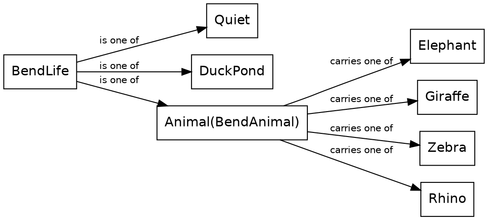

The function that returns a bend's billboards takes the bend's life and the bend itself, a `Geom.Bend`, and takes the life apart with a `match`:

{{code Segment.bend_billboards}}

The `Animal(animal)` line matches a bend with any animal at it, and names the animal it carries `animal`, ready to use. Then `animal.bend_billboards(bend)` calls a different function with the same name. `animal` is a `BendAnimal`, so the call goes to the `bend_billboards` that comes with `BendAnimal`, which places the animal and its baby. A duck pond gets its ducks from the `Pond` module, and a quiet bend gets the empty list, `[]`. So a tag's value rides along with it, and the `match` hands it to the code that needs it.

### Elephants, mostly

The route's plans say what lives at each bend, and most of them say `Animal(Elephant)`. Only a handful say `Animal(Giraffe)`, `Animal(Zebra)`, `Animal(Rhino)` or `DuckPond`. We chose that mix: the elephants are the fixture, so a rare animal is a surprise.

A tag union lists every case, a `match` handles each one, a nominal type sets its tags apart, and a tag can carry a value. The emojis came ready-made, traced ahead of time. Next, we build shapes of our own: a triangle and a rectangle.

## Shapes

A far tree in the ride is a trunk under eight triangles. So before we build a tree, we build its two shapes: a triangle and a rectangle.

In Safari Ride, a shape is a value that describes something to paint. The first four tags of the `Shapes` module's `Shape` type are the kinds of region the platform paints, each a region of the screen with a fill:

{{code Shapes.Shapes from "Shape : [" to "Polygon({ corners :"}}

Each tag carries a record, and every record ends with a `fill`, the paint for the inside. The ride produces a great many triangles, plenty of four-cornered things, a few round lights, and outlines traced from emoji and mountains, so those are its four regions. More tags follow them in the type, for other jobs, such as a line of text, and the {{chapter The platform}} chapter takes two of them.

### A triangle

Here's a triangle:

```widget shapes triangle
A green triangle on a plain background.
```

And here's the code that makes it:

{{code ShapesWidgetApp.green_triangle}}

The value is a `Triangle` tag with its record. The record names three corners, `first`, `second` and `third`, so every triangle has exactly three, by construction. A corner is a `Point`, a record with an `x` and a `y`. `Point.at` makes one from two plain numbers, measured from the top left of the picture, with `y` growing downward. The picture is 640 pixels wide and 324 tall.

`Point.at` turns each of those numbers into a `Pixels`, an opaque type around an `F64`, like `Distance`. The ride works in metres on the road and in pixels on the screen, and two types keep the two apart, so each number's type names its unit.

The `fill` is green. `RgbColor.of` makes a color from `0x2e8b57`. The `0x` marks a number in hex: the six digits a web page writes after its `#`. `Brush.flat` makes a fill of that one color.

The platform paints the triangle. The picture is a small Roc app of its own, and it hands the platform a list of two shapes: the background, a rectangle that fills the picture, and then the triangle. The platform paints the list from first to last, so the triangle lands on the background.

### A rectangle

Next, a rectangle:

```widget shapes rectangle
A brown rectangle on a plain background.
```

{{code ShapesWidgetApp.brown_rectangle}}

The rectangle's code has the triangle's structure:

| | The triangle | The rectangle |
|---|---|---|
| Its type | `Shapes.Shape` | `Shapes.Shape` |
| What builds it | the `Triangle` tag | the `Shapes.rectangle` function, which returns a `Quad` |
| Where it is | three corners, each from `Point.at` | a top left corner from `Point.at`, and a width and a height from `Pixels.of` |
| Its fill | `Brush.flat(RgbColor.of(0x2e8b57))`, green | `Brush.flat(RgbColor.of(0x8b5a2b))`, brown |

Here's the function:

{{code Shapes.rectangle}}

`|{ top_left, width, height, fill }|` takes the record apart, naming each of its fields. The body works out where the right and bottom edges are, with `plus`, which adds two `Pixels`. Then it gives the quad its four corners, clockwise from the top left. Each side's two corners share an `x` or a `y`, so the sides are always square to the screen.

A far tree needs just those two shapes. Next, we put them together, with functions of our own.

## Lists and map: a far tree

With a triangle and a rectangle in hand, we can build the far tree. The tree comes from small functions: the tiers of its crown, a test that pins them, a triangle for each tier, and the order of the trunk and the tiers in its sprite.

```widget far_tree
One far tree, magnified so that it stands tall in the picture.
```

### Eight tiers

The crown is eight tiers, stacked from the tip down. Each tier is a record of three fractions:

{{code TreeShapes.Tier}}

`top` and `bottom` say where the tier starts and ends, as shares of the crown's height, measured down from the tip. `width` says how wide the tier's bottom is, as a share of the crown at its widest.

The widths start as a list of eight plain numbers:

{{code TreeShapes.tier_widths}}

In a type, square brackets list tags. In a value, as here, they make a list, and every item in a list has the same type. These eight are `F64`s, chosen by eye.

`map` calls a function on each item of a list and returns a list of the answers. Here we hand it `Fraction.of` by name, and `Fraction.of` turns an `F64` into a `Fraction`, so `tier_widths` is a `List(Fraction)`.

### Tops and bottoms

Each tier also needs a top and a bottom. They follow a rule, so another `map` works them out:

{{code TreeShapes.tiers}}

`map_with_index` is `map` with one more thing for the function: the item's place in the list, counting from 0. The function here is written in place, and returns a record. Each tier's top is a tenth of the crown lower than the top of the tier above, and its bottom is three tenths below its top, so each tier overlaps the next.

### Freezing the tiers

`tiers` is a constant, the same eight records every time the program runs. So we can write all eight down, and have Roc check them:

{{expect TreeShapes.tiers}}

An `expect` is a test. Its body is a `Bool`, and `roc test` runs every `expect` in a program and reports each one that comes out `False`. Its table is the tiers, written out by hand. Change a width or the rule, and the test reports it.

### A triangle for each tier

A tier is a set of shares. A triangle is corners on the screen. Between the two stands the tree's outline: where its foot lands on the screen, and how tall the tree looks there.

{{code Camera.Upright}}

The camera works the outline out from where the tree stands, by perspective, which the {{chapter The math layer}} chapter explains near the end of the book. Three small functions read the crown's place from the outline:

{{signatures TreeShapes.crown_top_y TreeShapes.crown_height TreeShapes.crown_half_width}}

`crown_top_y` gives the tree's tip, and the other two are fixed shares of the tree's height on the screen, chosen by eye. Then `tier_triangle` makes one tier:

{{code TreeShapes.tier_triangle}}

It takes the outline and a record, and `|outline, { tier, foliage_color }|` takes the record apart into its fields, as `Shapes.rectangle` did. Like `Distance`, `Pixels` has its own `plus`, `minus` and `scaled_by`, which multiplies a length by a `Fraction`.

On the screen, `y` grows downward, as it did in the {{chapter Shapes}} chapter, so `plus` moves down from the tip.

### Painting the tree

The trunk is a rectangle:

{{signatures TreeShapes.trunk_shape}}

It hands `Shapes.rectangle` a width, a height and a top left corner from the outline. Its `finish` says whether the trunk is shaded.

`tree_sprite` produces the whole tree's sprite, and the order of its shapes matters:

{{code TreeShapes.tree_sprite}}

The body first darkens the foliage and the trunk's brown as dusk falls. Then `tier_inputs_of` works out what every tier needs, once for the whole tree. From how far ahead the tree's foot stands, `crown_of` and `trunk_finish_of` pick how much detail it gets: for a far tree, `crown` is `Triangles`, and the trunk's finish is `Flat`. The end of the chapter says what nearer trees get.

The last line puts the list together. `[trunk]` is a list of one shape, and `concat` joins two lists into one, so the trunk comes first. The platform paints a list from first to last, so the tiers land on the trunk. Each tier also lands on the tier above it and covers that tier's bottom, which is where the overlap goes.

`tiers.map(...)` makes one shape for each tier with `tier_shape`, whose `match` on the crown has a `Triangles` branch for the far tree:

{{code TreeShapes.tier_shape from "Triangles =>" to "Triangles =>"}}

`colored_tier` is the tier with the tree's foliage color, so a far tree's tier goes straight to `tier_triangle`. The other branch builds the near tree's tiers.

### What you're missing

`tree_sprite` builds this way every tree at least `cone_reach`, 200 metres, ahead of the camera. Nearer trees get more. Each tier becomes a cone, which looks round and fattens as the rider passes under it, and the nearest cones are shaded. `crown_of` makes that choice, and `tier_shape` builds the cones. A cone on the screen is the outline round its ring and its tip, which the `ConvexHull` module finds.

Within `round_trunk_reach`, 60 metres, the trunk's finish is `Shaded`, and the trunk looks round.

Cones take far more work to build, and far off they look just like triangles, so the ride spends that work only where it shows.

So a far tree is a handful of small functions over one list of tiers. Every tree beside the road runs through this same code, wherever it stands. The next chapter follows the trip around that code, from a place on the road to the frame.

## The pipeline

For each frame, every thing beside the road takes the same trip to the screen. In the {{chapter Lists and map: a far tree}} chapter, `TreeShapes.tree_sprite` takes a setting and returns a tree's sprite. This chapter follows the trip around that function: where the setting comes from, and where the sprite goes. A tree, a cow, a radio tower, the cat, the bird and the truck each start from a place on the road, and end as a rendering, a sprite with a depth, in the frame's one list. The `Pipeline` module holds the functions that sight and render, so we call the trip the pipeline.

```widget pipeline
Step 1,529 of the ride, with only what came through the pipeline: its trees, critters and towers, the cat and the truck.
```

Here's the trip:

The pipeline
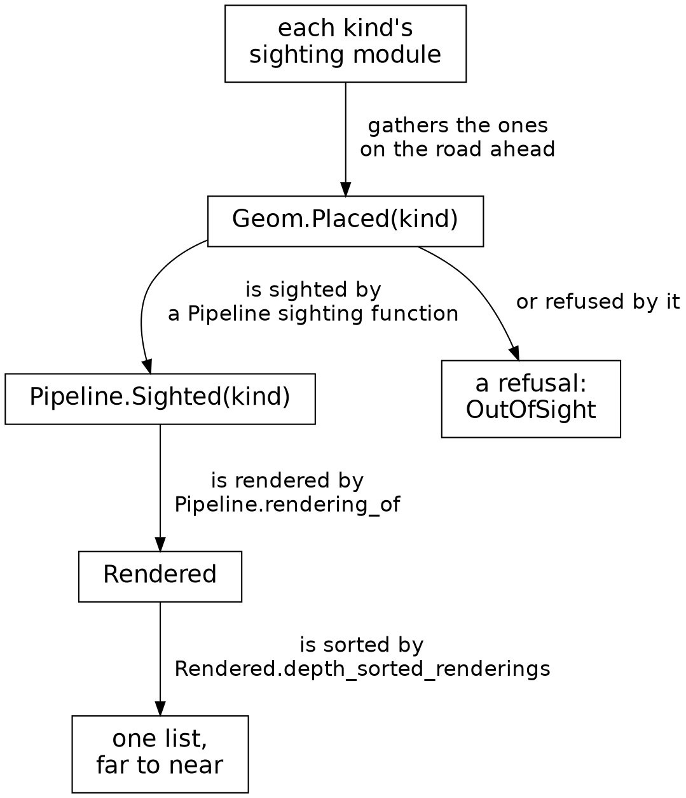

Each sort of thing has a sighting module, such as `TreeSighting`, and some serve several kinds: `BillboardSighting` sights every billboard. A sighting module gathers its placed things on the road ahead, and hands each one to a `Pipeline` function that sights it, as the {{chapter Errors as tag unions}} chapter shows for `TreeSighting`.

### Placed

The trip starts from where a thing stands on the road:

{{code Geom.Placed}}

`kind` says what the thing is. Its type is the type variable `kind`, so a placed tree is a `Geom.Placed(Conifer)`, and a placed cow is a `Geom.Placed(Billboard)`. `lift` says how far off the ground it stands, and `road_point` is its place on the road:

{{code Geom.RoadPoint}}

`along` is how far the place lies along its segment of road, and `across` is how far it lies from the middle of the road, growing to the right. Each is an opaque type around a number of metres, as `Distance` is:

{{code Along.Along from "Along ::" to "metres = |metres|"}}

So the compiler rejects a call that passes an `across` where an `along` belongs.

### Sighted

The screen shows what the camera sees, and the camera is the rider's eye: it sits 1.2 metres above the road and looks where the rider looks. So for each frame, the pipeline sights every placed thing in play, and works out where it stands from the camera:

{{code Pipeline.Sighted}}

A sighting keeps the thing's kind and swaps its place on the road for a `Spot`, a place seen from the camera:

{{code Spot.Spot from "Spot ::" to "}.{"}}

`lift` is still how far off the ground the thing stands, and `road_heading` is which way the road runs there. `foot` is where the thing stands in the camera's view, and its type starts from a plain record of two distances:

{{code RiderView.RiderPoint}}

`right` and `forward` count metres from the camera, and a negative `forward` is behind it. A `RiderView.RiderPointAhead` is the same record behind a `::`, and only `RiderView.rider_point_ahead` builds one, from a point in front of the camera. So a spot's foot is always in front of the camera, by construction. This `spot` is the one `tree_sprite` took from its setting in the {{chapter Lists and map: a far tree}} chapter.

A sighting function can also return a refusal, such as `OutOfSight`, in place of a sighting. The rest of this chapter shows what happens to the sightings that are kept.

### Rendered

`Pipeline.rendering_of`, which the {{chapter Where clauses: asking a kind}} chapter explains, renders each sighting that's kept, and returns a `Rendered`:

{{code Rendered.Rendered from "Rendered ::" to "of = "}}

A `Rendered` holds a depth and a sprite. The `::` makes it opaque, as it does `Distance`. The sprite is what a kind's `scenery_sprite` returns from a setting, and the depth is how far ahead of the camera the thing stands. A tree's rendering and a cow's have the same type.


### One list

Every rendering has that one type, so a frame gathers them all in one list:

{{code Scene.scene_renderings}}

A `Scene` holds a list of renderings for each sort of thing, and `join` makes one list of them all. The guard rail's renderings come in through `scene.rails`, as the {{chapter Rails}} chapter shows. `Rendered.depth_sorted_renderings` sorts the list from far to near with `DepthSort.sort_by`, and the platform paints it in that order, so a near thing covers a far one.

So every thing beside the road makes the same trip: placed on the road, sighted by the camera, rendered as a sprite with a depth, and sorted into the frame's one list. Its kind rides through the first two types, and the third holds just a sprite and a depth. The trip can also end early, at the sighting, and the {{chapter Errors as tag unions}} chapter goes back to that box. First, the next chapter shows how `rendering_of`, written once, gets a sprite out of every kind.

## Where clauses: asking a kind

One function, `Pipeline.rendering_of`, renders every kind of thing beside the road. Here it renders five of them:

```widget kinds
A tree, a cow, a radio tower, the cat and the bird, each rendered by `Pipeline.rendering_of`, and each at its own distance so that it shows clearly.
```

One function can render every kind because of this chapter's new Roc idea, the `where` clause, which constrains a type variable to types that have certain methods. First, here's one kind from the inside.

### A kind from the inside

A tree needs a height and a color. The types around it hold where it stands. So the `Conifer` type says which tree it is, and its methods give the height and the sprite:

{{module Conifer}}

`Conifer :=` makes a nominal type, as `BendAnimal` is in the {{chapter Tag unions: billboard critters}} chapter: four tags, and a name that keeps them apart from any other union of the same tags. The functions inside the type's braces, `scenery_height` and `scenery_sprite`, are its methods, and a value calls one with a dot: `conifer.scenery_height()`. Everything outside the braces is private to the module, such as the heights, the colors and `foliage_color`, and a call names it plainly: `foliage_color(conifer)`. In the `match`, `Green | SmallGreen =>` gives both greens one color.

`scenery_sprite` hands the height and the color to `TreeShapes.tree_sprite`, the function that builds the far tree's sprite. Why the two methods sit inside the braces is the rest of this chapter.

### One function for every kind

`rendering_of` takes a sighting, with the focal length and the darkness that the whole frame shares, and returns a `Rendered`, the thing's sprite and its depth. The sprite comes from the kind, so `rendering_of` calls the kind's own `scenery_sprite` method.

The `Rendered` coming out is the same type for every kind. The sighting going in carries its kind: it's a `Pipeline.Sighted(kind)`, and `kind` is a type variable, so it stands for any type at all. Only some types have a `scenery_sprite`. So `rendering_of` needs a constraint on `kind`: any type, as long as that type has a `scenery_sprite`.

Roc writes that constraint as a `where` clause, on the line after the annotation:

{{code Pipeline.rendering_of}}

This table explains the code's concepts:

| Concept | Purpose | Explanation |
|---|---|---|
| A type variable | Generality | `kind` in `Pipeline.Sighted(kind)` stands for whatever type the caller's sighting holds. |
| A `where` clause | Constraint | `where [kind.scenery_sprite : kind, Sprite.Setting -> Sprite]` constrains `kind` to types that have a method named `scenery_sprite`, which takes a `kind` and a `Sprite.Setting` and returns a `Sprite`. The square brackets hold a list of constraints, here just one. |
| A method | Placement | A method is a function inside a type's braces, and only a method meets a `where` clause. So the `Conifer` module puts `scenery_sprite` inside the braces, with `scenery_height`, and its private helpers outside. |
| A method call | Dispatch | `sighting.kind` is the sighting's `kind` field, which holds a value of the type `kind`. `.scenery_sprite(...)` calls that type's method, with the value before the dot as its first argument. |

The rest of the body builds the setting: the focal length and the darkness the frame shares, and the sighting's own spot.

### The compiler checks each call

Each call to `rendering_of` fills `kind` with one particular type. The ride renders its trees in one line of `Scene.scene_in_view`. There `trees_seen` is a `List(Pipeline.Sighted(Conifer))`, so the type is `Conifer`:

{{code Scene.scene_in_view from "trees:" to "trees:"}}

The compiler looks inside `Conifer`'s braces, finds a `scenery_sprite` of the right type, and the call compiles. The compiler checks every other call the same way, so it picks which `scenery_sprite` runs for each type when the program compiles. Every call returns a `Rendered`, whatever the kind, so a frame's renderings of trees, cows and towers all go in one list.

Every type that fills `kind` has to pass the compiler's check. Here a program hands `rendering_of` a `Rock`, a kind that is just one tag. The program is a small app of its own, which uses Safari Ride's modules as its `game` package. Only `Rock` and `rock_rendering` matter here. A name that ends in `!`, such as `main!`, marks a function with effects, which the {{chapter Pure functions and effects}} chapter explains, and the `_` names an argument that `main!` leaves unused:

{{fails kind_without_sprite}}

The message names the method the clause requires, and the type the compiler checked. The fix is a `.{ }` after `Rock`'s tags with a `scenery_sprite` inside, as `Conifer` has.

### Asking for a height

Sighting a thing needs its height. A far thing shows only when its top clears the horizon, and only when it stands tall enough on the screen to be worth showing, two tests the next chapter shows. So `Pipeline.scenery_sighting_of`, which sights the trees, the billboard critters, the cat and the bird, constrains its kind with a `where` clause of its own, to types that have a `scenery_height`:

{{code Pipeline.scenery_sighting_of from "where" to "where"}}

### Names that say what they're for

Roc matches a `where` clause by the method's name and type alone. Suppose the clause named a method called just `height`. The bird could well have one that says how high it flies, and the sighting would test the bird against the wrong number, yet the program would compile. So every method the pipeline's clauses name starts with "scenery", which makes an accidental match unlikely.

So a kind meets the pipeline with two methods inside its braces, `scenery_height` and `scenery_sprite`. The tree, the cow, the radio tower, the cat and the bird each have both, and the compiler checks both methods of every kind when the program compiles.

The next chapter takes the sightings that are refused.

## Errors as tag unions

Every frame, the pipeline tries to sight each thing on the road ahead, and its sighting functions refuse some of them. For a thing behind the camera, a thing the horizon hides or a thing too small to see, the sighting returns an `Err`. This chapter follows an answer that can fail, up through the functions that ask for it.

Here are some things from step 1,529 and what their sightings return. `right` and `forward` place each thing's foot from the camera, in metres, and a `forward` below zero is behind it. A thing less than 0.4 metres in front of the camera, short of what we call its near plane, counts as behind it too:

| What it is | `right` | `forward` | Its sighting |
|---|---|---|---|
| The cat, frozen in the road | 0.38 | 23.63 | kept |
| The nearest tree behind the camera | -8.09 | -8.36 | out of sight: behind the camera |
| The nearest tree the horizon hides, a small one | -1,433.43 | 446.00 | out of sight: below the horizon |
| A big tree just past it | -1,446.07 | 473.21 | kept |
| The next radio tower | 20.40 | 355.61 | kept |

A small tree far off sinks below the horizon, while a taller one just past it still shows its top. The ride's ground curves on a radius of 100 km, so its horizon is near. Of the 214 trees on the segments in view, 136 are kept, 30 are behind the camera, and 48 are below the horizon. The program returns one answer for every refusal, `OutOfSight`.

Each test lives in its own function, and each function asks the one below it first. A radio tower takes two of the tests, the near plane and the horizon, so here's its stack:

How a refusal travels
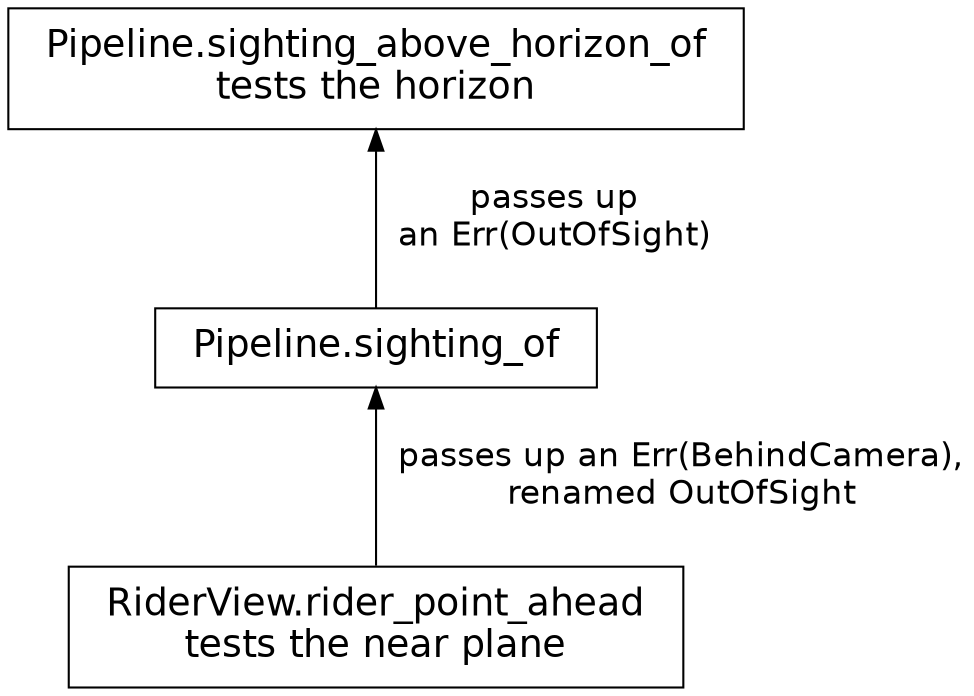

### An answer that can fail

A sighting function's answer is a `Try`, Roc's type for an answer that can fail. A `Try` is one of two tags: `Ok`, holding the answer, or `Err`, holding a tag that says what went wrong. Here's the first sighting function, whole:

{{code Pipeline.sighting_of}}

Its type ends in `Try(Pipeline.Sighted(kind), [OutOfSight])`: a sighting, or `OutOfSight`. The last line wraps the spot and the kind in an `Ok`.

`RiderView.rider_point_ahead` gives back a `Try` of its own, and the `?` after it handles both answers. When the answer is an `Ok`, the `?` unwraps it, and `foot` is the point ahead. When it's an `Err`, the `?` ends `sighting_of` and gives back an `Err`. So every line after the `?` runs only for a thing in front of the camera.

`rider_point_ahead` takes a point seen from the rider, and its refusal says what's wrong with that point:

{{signatures RiderView.rider_point_ahead}}

A sighting's callers treat every refusal alike, as out of sight. So the `?` has a function after it, `|BehindCamera| OutOfSight`, and the `Err`'s tag goes through that function on its way up. The function's argument is written as the tag itself, a pattern like the ones a `match` lists.

### A test on top

The next function asks `sighting_of` first, then makes a test of its own:

{{code Pipeline.sighting_above_horizon_of}}

The first line asks `sighting_of`, and its plain `?` passes an `Err(OutOfSight)` straight up. Then the function tests the horizon, with the kind's height from its `where` line, as in the {{chapter Where clauses: asking a kind}} chapter. `drop()` is how far the curving ground has dropped below level at the thing's foot. The function gives back the same tag for its own refusal, so both functions have the same type after the arrow.

`Pipeline.scenery_sighting_of` stacks one more test on top in the same way: a thing that would stand under 2 pixels tall on the screen is out of sight too. The trees, the billboards, the cat and the bird take all three tests. A radio tower is kept however small it looks, so it's sighted by `sighting_above_horizon_of`.

### Where the refusals stop

A segment holds many trees, so its sighting module asks for each tree's sighting and keeps the ones that come back:

{{code TreeSighting.segment_trees}}

`keep_oks` calls the function it's given on each item of a list, keeps the `Ok` values, and drops the `Err`s. So `segment_trees` gives back a plain list of sightings, and the refusals stop there.

There's one truck, so `Scene` matches on its answer instead:

{{code Scene.truck_renderings}}

A `TruckFate` is the truck's sighting, a `Try`, and the `match` covers both its tags. For an `Err`, the truck's renderings are an empty list.

### Try or crash

A `Try` is for a value that can rightly be missing, such as a tree behind the camera. Other facts hold whenever the program is right, such as a share lying between 0 and 1. A fact like that is an invariant. A value that breaks one means a bug, and a made-up answer would hide the bug until it surfaced somewhere far from its cause.

So the program stops at once instead. `Fraction.of` makes a share from a ratio:

{{code Fraction.of}}

`from_ratio` returns a `Try`, and the `match` covers both tags. For an `Err`, `crash` stops the program with a message that says which invariant broke. Use `crash` to enforce invariants.

So a refusal is an ordinary value: a `?` passes it up, a function after the `?` can rename it, and a `keep_oks` or a `match` is where it stops. A value missing only through a bug gets a `crash` instead. The next chapter starts on the world the things stand in, with its sky and its grass.

## The sky and the grass

Behind everything beside the road stands the backdrop: the sky above the horizon and the grass below it. The horizon on the screen is the line halfway down it, where a level look from the rider lands. In a frame the sky is two colors, one at the top and one at the horizon, with a fade between them, and the grass is one rectangle. At step 1,529 the sky's two colors happen to match, for a reason the end of this chapter gives.

```widget frame sky
Step 1,529 of the ride: the trees, the grass, and the sky over them, one day blue.
```

One function in the `Sky` module returns both colors at the ride's clock, as one record:

{{code Sky.colors_at}}

`Sky.Colors` is a record of two `RgbColor`s, `top` and `horizon`. Each color has a function of its own.

### The top of the sky

The top of the sky blends from day into night, by how dark the sky is:

{{code Sky.sky_top_color}}

`day_sky` and `night_sky` are two constants in the module, a pale blue and a deep one. Each constant carries an annotation, as a function does, and here the type is an `RgbColor`. `Sky.darkness_at`, from the {{chapter Functions}} chapter, says how dark the sky is, as a `Fraction`. `ColorShade.color_between` blends the two colors:

{{code ColorShade.color_between}}

It takes one record, so every call names its three fields. A color is three channels, its red, green and blue, and each channel moves the same share of the way from `from` to `to`. `blend` is a function named inside the body, and it takes a function as its argument, such as `RgbColor.red`, which reads one channel of a color. The last line calls `blend` once for each channel. The share is a `Fraction`, which its type keeps between 0 and 1, so each channel lands between its values in `from` and `to`.

### The horizon

The horizon has the top's color, warmed toward red while the sun is near it:

{{code Sky.sky_horizon_color}}

`Sky.horizon_warmth_at` says how near the sun stands to the horizon, as a `Fraction`, and `horizon_warmth_at_most` holds the warmest horizon to 85% of the way to `sunset_red`, so a little of the sky's own color still shows.

### The fade

`Sky.sky_shape` returns the two colors as one shape:

{{code Sky.sky_shape}}

`Screen.above_horizon_rect` is the rectangle from above the top of the screen down to the horizon, 200 pixels past each side. A fill is a tag union, `Brush.Fill`, and `Brush.flat` makes its plainest tag, one color. This fill is its `Linear` tag, whose color fades along a line, from `start_point` to `end_point`. Both points sit at `x` zero, so the line runs straight down, from the top of the screen to the horizon. Its `stops` say where along that line the fade begins and ends: the fade holds the top color for the first fifth of the way, `sky_top_stop`, then reaches the horizon's color at the end. The platform works out every color in between. `Brush.opaque_rgba` makes each color fully solid.

### The grass

The grass is one rectangle below the horizon, in one color, which darkens with the sky:

{{code Grass.grass_color_at}}

`Sky.color_at_darkness` takes a color by day and how dark the sky is, and returns the color dimmed to match. Everything the sky lights dims through it, from the grass to the truck. Here's the rectangle:

{{code Grass.grass_shape}}

The grass's top edge sits one pixel above the horizon, so its top row covers the sky's last one, and the two always meet. When the bike leans, the camera rolls with it, and the whole frame turns about the middle of the screen. A rectangle the size of the screen would turn with it and leave its corners bare. So `Screen.margin_rect` makes a rectangle that reaches `Screen.roll_margin`, 200 pixels, past each side of the screen, as the sky's does, and the grass reaches 200 pixels below the screen too. That covers a lean of up to 30°, more than the ride ever leans.

Every function here works from the clock alone, or from colors worked out from it. So the backdrop at step 1,529 is the same on every run of the ride. At that step the sun is still high: the sky is near its day color and the horizon has yet to warm, so the two colors match and the picture shows one pale blue. In the second half of the book the clock runs, and the two colors part. One more part of the frame darkens with it: the mountains.

## Mountains

However far the rider goes, the mountains stay as far away as ever. They only turn as the rider turns. So the ride treats them as far scenery: a mountain is just a height at a direction.

```widget frame mountains
Step 1,529 of the ride: the trees, the grass, the sky, and the mountains along the horizon.
```

There are two ranges: a high one to the north, with snow on its peaks, and a lower one to the west. In front of both runs a band of low, rolling land, in the grass's own green.

### Directions

A direction needs a type, and so does a change of direction. `Angle.Bearing` is a direction in the world, such as north, and `Angle.Turn` is how far to turn from one direction to another. Both are opaque types around one float, and only the `Angle` module builds or opens them. Here a `Turn` is passed where a `Bearing` belongs:

{{fails turn_as_bearing}}

The compiler refuses it. A bearing plus a turn is a bearing. The turn from one bearing to another is a turn. The `Angle` module's functions keep the two types apart everywhere.

### A range

A range is a record:

{{code Skyline.MountainRange}}

Its `center` is the bearing of its middle, and `half_width` is the turn from the middle to either end. `height_ceiling` is how high above the horizon it reaches at most. The two wave counts shape its ridges. A range's height at a bearing comes from one function:

{{signatures Skyline.range_height}}

The range is highest in its middle and falls to zero at its ends, and two waves on top of that height make its ridges, with sizes we chose by eye. The rolling land is a little under one wave of its own, all the way round.

### Across the screen

To find a range's outline, the ride goes across the screen two pixels at a time, and asks which bearing each column looks along. The middle of the screen looks along the camera's heading, and a column to its right looks a little further right, by a turn that comes from the lens. `Lens.turn_at_x` gives that turn from the column's place across the screen and the focal length. A column is a record:

{{code Skyline.SkylineColumn}}

A silhouette is one flat region whose top edge follows the heights along the columns. One function returns a silhouette, whichever range or land it is:

{{code Skyline.silhouette}}

The record it takes has a field that holds a function: `height_at`, which says how high the silhouette stands at a column. A function is a value like any other, so it can sit in a record field. `silhouette` calls `height_at(column)` for each column and finds where that height lands on the screen with `Lens.y_for_height`. A mountain is so far off that its distance drops out: how high it looks depends only on its height above the horizon and the lens. Then `silhouette` joins the tops into one region closed along `base_y`, which is the grass's top for the ranges and the horizon for the land. The `if` holds the top at `base_y` or above it.

### Back to front

`Skyline.skyline_shapes` calls `silhouette` three times, with a different `height_at` each time, and returns the results back to front, in the order they're painted: the west range, the north range, the north's snow, then the land:

{{code Skyline.skyline_shapes}}

`aim` is the camera, as far as the skyline needs it. The `..` in its type, `{ heading : …, focal_length : …, .. }`, means the record may hold more fields, and this function reads just these two.

Each `height_at` is an anonymous function written in place. The west range's asks `west_range_height` for the column's bearing. The north range's reads the height the column already holds, since the snow needs it too. The land's asks `land_height`. The snow is a `Try`: when too little of it shows on the screen, it's `Err(NoSnow)`, and the `match` gives an empty list.

At dusk the rock darkens through `Sky.color_at_darkness`, as the grass does, and the land takes the grass's own color. The snow goes blue, through the same blend the sky uses:

{{code Skyline.snow_color}}

The mountains are far scenery: they turn with the rider and stay as far away as ever. Next comes the road.

## The road

In front of the mountains, the road comes nearer as the rider rides. It's ground, laid on the grass in front of the mountains and under everything beside the road.

```widget frame road
Step 1,529 of the ride: the road, over the grass and under the trees.
```

The ground comes in patches, and a patch is a list of corners on the ground and a color. The road's patches all come from one function:

{{code GroundSighting.road_patch}}

Each corner is a `RiderPoint`, a point on the ground seen from the rider, so the `GroundPatch` module can find where each corner lands on the screen and place the patch there. The {{chapter The math layer}} chapter follows a corner onto the screen.

### A segment's ground

The route is a chain of straight segments with a bend between each one and the next. Each segment in view gets its own ground from one function:

{{code GroundSighting.ground_patches from "ground_patches : RoadAhead.RoadView," to "].join()"}}

A segment's ground is up to three things: the road along it, the paving at its bend into the next segment, and a pond if it ends at one. Each comes as a list, and `join` makes them one. The segment just behind the rider can still show its last stretch, and its bend's paving lays that stretch, so its own road list is empty. The last segment of the road ahead gets an empty list for its bend, `RoadEndsInView`, since the road in view ends there.

### Along a segment

The road along a segment is one patch:

{{code GroundSighting.road_along}}

`corner` is a function named inside the body. It uses `road`, `vantage` and `from_rider` from around it, so each call names only a chunk and an edge. A function that uses names from around it like this is a closure.

The patch starts at the left corner of the segment's start, runs up the right edge to the end of every chunk, and comes back down the left, so its corners go round in order. So the right edge counts one corner more than the left: the left's first corner is already the patch's first. `U32.until(0, n)` counts from 0 up to just short of `n`, and `List.from_iter` collects the count into a list of chunk numbers.

The edges are cut into chunks of at most `road_chunk_length`, 25 metres. The ride's ground curves away from the rider, on its 100 km radius, and a straight edge any longer would part from the curve by more than a pixel near the horizon.

All of a segment's chunks share one patch. The platform smooths each patch's edges on its own, and where two patches met, the grass would show through as a pale seam.

### At a bend

Where one segment bends into the next, the two roads leave a gap on the outside of the turn. Here are three bends, seen from above:

```widget bends
Three bends from above. The off-white dot is where the view is from, the orange lines are the guard rails, and the yellow dot is each bend's apex, where the two roads' outer edges meet.
```

The paving fills the bend's outer corner. The `BendInView` module works it out, one step at a time:

| Job | Function | Its type |
|---|---|---|
{{types row BendInView.outer_edge Find the outer edge}}
{{types row BendInView.outer_corner Find the corner, on the road}}
{{types row BendInView.outer_corner_in_view See the corner from the rider}}

A bend to the right has its outer edge on the left, so the paving changes sides as the road turns. An outer corner is three points: where the first road's outer edge ends, where the next road's outer edge starts, and between them the apex, where the two outer edges, carried on straight, cross. `OuterCorner` takes the kind of point as a type variable, so the same record holds road points first and rider points after.

`GroundSighting.bend_paving` lays the corner as one more patch. It starts 40 metres before the bend, `lead_in_length`, runs up the left edge, across the end of the next road's first chunk, and back down the right. Whichever side is outside the turn takes in the corner's three points. Both roads end inside the paving, so road lies over road where they meet, and the patches join cleanly. Since the paving lays the last 40 metres of the road before the bend, it stands in for the road along the segment just behind. Forty metres is enough, because only a bend sharper than a right angle would show road further back, and every bend on the route is gentler than that.

The ponds are ground too. A segment that ends at a pond lays two more patches, its bank and then its water.

The corner has its paving. Next, each bend gets a rail around its outside.

## Rails

At each bend, a guard rail runs along the outside of the turn: a metal bar half a metre up, on thin posts. It's the first part of the road itself that stands up off the ground.

```widget frame rails
Step 1,529 of the ride: the road, with its guard rails at the bends ahead.
```

The rail follows a path on the ground. It runs along the road's outer edge for the last 10 metres before the bend, out to the apex, back to the next segment's outer edge, and on along it for 10 metres more:

The path of a guard rail
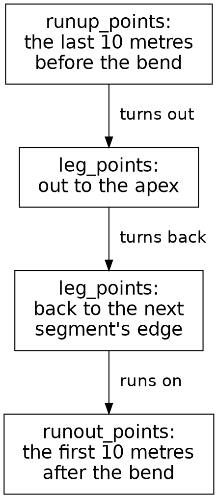

### From path to quads

`RailSighting` finds the rail at every bend in view:

{{code RailSighting.rail_quads_in_view}}

`join_map` maps each segment in view to a list, here the quads of its bend's rail, and joins the lists into one. For each segment with a bend after it, `rail_points` finds the path, and `GuardRail.quads_along` cuts it into quads. The path joins four lists, one for each box of the diagram:

{{code RailSighting.rail_points}}

`outer_corner_in_view`, from the {{chapter The road}} chapter, returns the bend's outer corner, and the first line takes that record apart into its three points. A leg between two of them gets a point about every metre:

{{code RailSighting.leg_points}}

The points are about a metre apart, and a post will stand at each one. `drop_first(1)` drops a leg's first point, `from`, because that's the last point of the leg before it.

### Bars and posts

`GuardRail.quads_along` turns the path into flat pieces with four corners each: a bar between each two neighbouring points, then a post at each point. A piece is a record:

{{code GuardRail.RailQuad}}

Its corners are `PointAtHeight`s, points seen from the rider at a height measured from the rider's own level, so a bar's top corners stand higher than its bottom ones. Where the ground has curved away, that height can be below zero.

Each quad goes into the frame's depth sort on its own, at a depth that's the mean distance of its corners, so a tree can stand in front of one post and behind the next. A quad holds only its corners and a color, so `quad_rendering` makes its rendering directly. The things beside the road go through `Pipeline.rendering_of` instead:

{{code GuardRail.quad_rendering}}

`{ ..quad, color: … }` is a record update: a new quad, the same as `quad` but for its color, which is dimmed with the sky. `quad` itself stays as it was. `map_ok` works on a `Try`: it applies its function to an `Ok` and leaves an `Err` as it is, so a quad wholly behind the camera stays refused, and `Scene` drops those with `keep_oks`.

`rail_quads_in_view` finds each rail afresh every frame, its bars and posts from the route and the rider, and the depth sort places each one. Next come the radio towers, which go back through the pipeline as things beside the road.

## Radio towers

The radio towers are the tallest things beside the road: lattices of thin rods, 80 metres high, standing well back from it. One stands past the end of every segment, off to the right, and a long segment has one more halfway along, off to the left.

```widget frame towers
Step 1,529 of the ride: the road and its rails, with the radio towers standing back from it.
```

A tower raises two problems of its own. Far off, it should sink below the horizon from the bottom up, as the ground curves away under it. Up close, it can stand partly behind the camera. The chapter takes them in that order, after the tower's place by the road.

### Where a tower stands

A tower is two facts: its yaw, which way its square footprint is turned, and its beacon, the light at its top:

{{code Tower.Tower from "A tower in a frame" to "Tower :: {"}}

Trees get their places once, when the world is built. A tower's beacon blinks with the clock, so its sighting builds the tower afresh each frame, from its segment and the clock. Here's the tower past a segment's end:

{{code TowerSighting.end_tower}}

`end_tower` turns the tower 30 degrees from square to the road. `tower_if_ahead` stands the tower at its point by the road, and returns its sighting if it's in front of the camera and some of it shows above the horizon. The tower halfway along is the same, with its footprint square to the road, a `Midway` beacon, and one more way to fail: `mid_tower_point` gives `Err(NoMidTower)` for a segment of a kilometre or less. `TowerSighting` is the one home for where towers stand.

### Over the horizon

The ride's ground curves away on its 100 km radius, and a tower stands on it. From the rider's eye, 1.2 metres up, the ground curves out of sight 490 metres out. Past that horizon, the lowest thing the rider can see lies on the line from the eye that grazes the ground there. One function finds that lowest height at any point on the ground:

{{signatures EarthCurve.lowest_visible_height}}

The ground hides whatever part of a tower is under that line, so as a tower gets further away, it sinks from the bottom up. An 80-metre tower still shows its tip about 4.5 km off. Once all of it is under the line, `Pipeline.sighting_above_horizon_of` refuses it as `OutOfSight`, as in the {{chapter Errors as tag unions}} chapter. So a sighted tower always has something to paint.

### Rods

`Tower.tower_shapes` returns a tower as a few dozen rods, and a disc for its beacon when the beacon is bright enough and big enough to show. It starts by checking that some of the tower shows above the horizon:

{{code Tower.tower_shapes from "if hidden_on_tower(geometry) >= tower_height" to "a tower hidden wholly below the horizon"}}

Its sighting has already refused a tower the horizon hides wholly. We enforce invariants with `crash`, and the invariant here is that every tower this function gets shows some part above the horizon. Otherwise come the legs, the rings and the braces, and the beacon's disc, when it shows, last, at the top.

A tower's footprint is a square, and four tags name its corners. Going round the square is a `match`:

{{code Tower.next_corner}}

Four legs run from the corners up to the top, each starting at the height the horizon hides. Every 20 metres up, a ring of four rods joins each corner to the next one round, and crossed braces fill the lowest two storeys.

Each rod is a line between two points seen from the rider. A near tower is wide, so its foot can stand ahead of the camera while a corner of its footprint stands beside or behind it. So each rod goes through this function:

{{code RiderView.line_ahead}}

The `match` is on a tuple, `(start, end)`: two values side by side, in parentheses. So it covers all four combinations of its two `Try`s. A rod with one end short of the near plane, 0.4 metres ahead of the camera, is cut where it crosses that plane. A rod with both ends behind it is refused.

Each frame derives a tower afresh, its rods and its disc, from its segment, the clock and the camera. The disc on top blinks with the clock, which starts running in the second half of the book, in the {{chapter The beacons}} chapter. The last things to stand in the frame are the herds.

## Herds

The farms along the road are crowds of billboards: herds of cows on the left, herds of pigs on the right. A herd is a list of placed billboards. The `CowHerd` and `PigHerd` modules lay the animals out again for each frame that needs them.

```widget frame critters
Step 1,529 of the ride: the whole still frame so far, now with its herds and the animals at the bends.
```

### Cows

The world stores a cow herd as two counts: how many cows, and how many rows stand behind the front one. The route's herd is fourteen cows, in columns of three:

{{code CowHerd.herd_cows}}

`U64.until(0, cow_count)` counts the cows, and `herd_cow` places the cow with each number. A bull, if the herd has one, goes at the front of the list.

A herd in a perfect grid would look like a parking lot, so each cow strays a little from its place:

{{code CowHerd.herd_cow}}

The cow's number picks its column and its row: `div_trunc_by` divides and drops the remainder, and `rem_by` keeps only the remainder. Each row stands a little further along the road than the one in front of it, and further from the road. Then `Scatter.stray_of` moves the cow a little, along and across, with two phases, 2.7 and 1.9, chosen by eye. `stray_of` derives the stray from the cow's number, so it looks random and comes out the same on every run. The last expression is the placed cow: a place on the road, a lift of zero, and the billboard `cow_billboard` picks, a calf for every fourth cow.

### Pigs

A pig herd has two shapes, as a tag union:

{{code PigHerd.herd_pigs}}

The first two herds of pigs are big, seven rows of seven, and the rest are two short rows. A `BigHerd` carries its sizes, and `TwoRows` is a plain tag, so each branch of the `match` calls the function for its shape. In the first two herds, one pig stands out from the rest and catches the rider's eye, and the rider's chapters in the second half come back to it.

`BillboardSighting` sights every herd's billboards, as the pipeline sights any thing beside the road.

The herds are the last of the animals that stand still. Everything in the frame at step 1,529 now has its chapter, except the things that move: the cat, the bird and the truck. The first half of the book ends here: one frame, built part by part, from the things beside the road to the world they stand in.

## Immutable values: a flip book

The first half of the book held one page still, step 1,529, and built it part by part. Now the pages turn. The picture below holds a real ride. The bar is the whole route, with the rider and the truck as two dots on it, and the lines of text read out the clock, the rider and the truck. The figure under the bar is the rider seen from behind, with the lean drawn three times as steep. Press play and let it run for a moment. Press play again to stop it, then press the step-back button a few times.

```widget step
Press play, press it again to stop, then step back.
```

The ride steps back one moment at a time, as easily as it went forward. A Roc value stays exactly as it was made, and the ride changes from start to finish. A flip book shows how both hold.

The {{chapter One page}} chapter called the ride a flip book. Each page is a still drawing, and the motion comes from the flipping. In Safari Ride, each page is a moment, a value of the `RideInstant` type, and one function makes the next one:

{{signatures RideInstant.next_or_restart}}

It takes the road and a moment, and returns a tag union written in place: the next moment, tagged `Continued`, or the ride's first moment again, tagged `Restarted`, once the rider reaches the end of the road. Either way, it returns a new moment and leaves the old one as it was.

The platform does the flipping. Thirty times a second it asks the app for its next state, and while the ride plays, the app moves on to the next moment through `next_or_restart`. Then the platform paints that moment's picture, which `FrameView.frame_view_at` works out from the moment and the road. The picture above flips much faster than that, to cover more road. The same moment always gives the same picture, so you can hold any page still and study it, as the first half of the book held step 1,529.

### Turning back

Every old moment stays as it was made, so the ride keeps the ones since it last started, and stepping back turns to an earlier page. Here's the function behind the step-back button you just pressed:

{{code Tour.step_back}}

A `Tour` holds the moment on show, and a list of the moments before it. `Tour.(tour)` opens the tour to read its fields. `step_back` takes the last moment off that list and puts it on show, with a record update of those two fields. The old tour stays as it was. At the ride's start the list is empty, so `last` returns `Err(ListWasEmpty)`, and the tour stays where it is.

### What a moment holds

Here, once more, is everything a moment holds:

{{code RideInstant.RideInstant from "RideInstant := {" to "}.{"}}

That's four things: the rider, the truck, the clock, and the plan for when the cat or the bird ahead starts to move. The ride carries those four from step to step, and derives everything else in a frame from them and the road.

## Records

`Tour.step_back` makes a new tour with a record update, and record updates run all through the ride. A Roc record stays as it was made, so a field with a new value means a new record.

The motorcycle is a record of four fields: its place on the route, which way it's turned, its speed and its lean. The rider's step uses this function to hold the bike at the end of the road:

{{code Motorcycle.stopped_at}}

Here's the function, piece by piece:

| Code | Term | What it says |
|---|---|---|
| `{ ..motorcycle, … }` | record update | A new record with every field of `motorcycle`, except the ones named after it. |
| `route_place: { ..place, … }` | record update | The new `route_place` is an update of the old place in turn, and its `road_point` is an update of the old point. So the new motorcycle's `along` is `at`, three records deep. |
| `speed: Speed.at_rest` | field | A second field with a new value. |

`motorcycle` itself stays as it was, and so do `place` and its road point. Every step of the ride builds its next moment as a new record, out of the old moment's fields.

## Pure functions and effects

The same moment always gives the same next moment, and the same picture. In Roc, a function's type guarantees that sameness: the type says whether the function has effects.

An effect is anything beyond working out an answer: reading a key, reading the time, painting a canvas. A function with effects carries two marks, one in its name and one in its type, and the compiler rejects a pure function that calls one:

| Code | Term | What it says |
|---|---|---|
| `->` | thin arrow | A pure function. It returns an answer worked out from its arguments alone, so the same arguments always give the same answer. |
| `=>` | thick arrow | A function with effects. It sits in the type in place of `->`. |
| `!` | `!` suffix | Ends the name of every function with effects, such as `main!`, where a Roc program with effects starts. |

A `match` branch's `=>` is another use of the same symbol. Every function the ride runs has the thin arrow. The effects live in the platform, under the ride's code. The platform times the frames, reads the keys and paints the picture.

### The keys

The viewer's keys reach the ride as a plain value. For each step, the platform reads the keys and hands the app's step a snapshot of them. The step is pure, so the same model and the same snapshot always give the same next model. The {{chapter The platform}} chapter shows how the keys reach the step.

So every moment of a ride follows from the road it runs on and the keys the viewer presses, and the ride can make any moment again. The next chapter starts on the first of the four things a moment carries: the clock.

## Opaque types: the clock

Every moment of the ride carries a clock, which counts the steps since the ride started. Step 1,529, the page the first half held still, is a clock. The sun and the sky follow the clock alone, and each beacon follows the clock and its tower.

### A moment and a length

The ride uses time in two ways. A moment is a point in the ride, such as step 1,529. A length is a stretch of the ride, such as three steps. A moment plus a length is a later moment. So Safari Ride gives each its own type: a `Clock` is a moment, and a `Steps` is a length.

Both hold a whole number, so a bare number could pass for either. Here's a line that tries to add 7 to the first clock:

{{fails clock_plus_seven}}

The compiler rejects the line. `+` calls the `plus` method, and `Clock.plus` takes a `Steps`. The line passes it a bare 7. With the types right, a mixed-up sum is a compile error, found before the ride ever runs. The {{chapter Mountains}} chapter splits direction the same way: a `Bearing` is a direction, and a `Turn` is a change of direction.

### The module

Here's the whole `Clock` module:

{{module Clock}}

`Clock :: U32.{ … }` makes `Clock` an opaque type. It holds a `U32`, and code outside the module reaches that number through the functions between the braces. Those functions keep moments and lengths apart:

| Function | Takes | Returns |
|---|---|---|
| `next` | a clock | the clock one step on |
| `plus` | a clock and a length | a later clock |
| `minus` | a clock and a length | an earlier clock |
| `steps_since` | two clocks | the length between them |

`RideInstant.next` calls `Clock.next` once a step. `plus` reads the number inside a length with `length.to_u32()`, from the `Steps` module. `<` calls `is_lt`, just as `+` calls `plus`, so two clocks compare as their steps do.

### Two invariants

We enforce invariants with `crash`, and the clock has two. Every clock is at step 0 or later, so `minus` crashes when it would go back past step 0. Every length counts forward, so `steps_since` crashes when the clock it counts from comes later. Either crash means a bug in the caller, and its message says which invariant broke.

### Tests

Each `expect` below the module's braces is a test, and `roc test` runs them all. A clock is a plain value, so a test builds one directly. `Clock.at_step(9).plus(Steps.of(3)) == Clock.at_step(12)` passes when step 9 plus three steps is step 12. The last three tests try `<` on a clock before another, a clock against itself, and a clock after another. `!` flips a `Bool`.

The clock is the first of the four things a moment carries. The sun and the sky are derived from it alone, at any step, and the beacons from it and their towers. The next chapter explains the step itself, which moves all four on together.

## The ride instant

A moment carries four things: the rider, the truck, the clock, and the plan for when the cat or the bird ahead starts to move. A step makes the next moment from this one. This chapter explains that step, then groups the ride's moving parts by how they change.

### One step

Here's the step, whole:

{{code RideInstant.next}}

`next_or_restart`, from the {{chapter Immutable values: a flip book}} chapter, calls this step until the rider reaches the end of the road. The doc comment on `next` gives the order, and the order matters. The rider moves first, reading where the encounter ahead has got to. Then the clock ticks. Then the world answers the rider who has just moved: the truck aims at how far along the route the rider now is, and `plan_at_next_step` keeps the encounter plan, drops it at a new segment, or makes one from this step's rider. The last line puts the four together into the next moment, and the old moment stays as it was.

The rider reads the encounter as a stage, where its animation has got to:

{{code Animation.Stage}}

`Waiting` comes before the animation starts, `Playing` counts the steps in, and `Past` counts the steps since it ended. The {{chapter The cat}} chapter shows how the plan and the clock make one.

### Carried and derived

Those four fields are all the ride carries from one step to the next. The ride derives everything else in a frame from them and the road, afresh for each frame. So the ride's moving parts come in three kinds:

| Kind | Things | How it changes |
|---|---|---|
| Clock-driven | The sun's height, the sky, the beacons | Derived from the clock, and for a beacon its tower |
| Stepped | The rider, the truck | Carried in the moment, and moved on once a step by its step function |
| Rider-driven | The cat, the bird | Derived from the clock and the carried plan, which the rider's approach sets |

The trees and the cows stay put.

`Clock.next`, `Rider.rider_at_next_step` and `TruckJourney.truck_progress_at_next_step` all have the same shape: a value goes in, and the next value comes out. Call that a step function. Set beside the clock-driven kind, stepping has a cost:

- A function of the clock returns the sun at any step, straight away. To find the truck at step 4,000, the ride has to play that far.
- A wrong sky spoils only the frames it touches. A wrong step moves the rider for the rest of the ride.
- The lines of `RideInstant.next` run in order. Once the moments exist, the platform can paint their frames in any order.

So the stepped parts need the most care.

The clock-driven things come next, and the beacons are the simplest of them: they follow the clock and their towers.

## The beacons

Every radio tower has a magenta beacon on top, and the beacons blink. A beacon is the simplest moving thing in the ride: its brightness depends on two things only, which beacon it is and the clock.

```widget beacon
Press play and watch the two towers blink out of step.
```

The picture stands two towers side by side and plays two whole blinks, from step 5,400 to step 5,640. Their beacons blink opposite each other.

### Three rules

A beacon follows three rules:

1. A blink takes 120 steps, from dark up to full brightness and back down.
2. Each segment's beacons start their blinks at a different point from the last segment's, so the towers along the road blink at different times.
3. The tower halfway along a segment blinks exactly opposite the tower at the segment's end.

Every rule reads the tower and the clock alone. So the ride derives each beacon afresh, every frame. Ask for a beacon at step 5,430 cold, and the answer comes straight from the clock.

### Which beacon, and when

A tower's sighting asks for its beacon with one line. Here it is for the tower past a segment's end:

{{code TowerSighting.end_tower from "beacon = Beacon.at" to "beacon = Beacon.at"}}

The record names the beacon. `in_view.index` is the segment's index in the route, counting from 0, and `AtEnd` is the tower's place on it. The tower halfway along passes `Midway` instead. The record's type is a `TowerKey`:

{{code Beacon.TowerPlace}}

{{code Beacon.TowerKey}}

The clock says when. Here's the function the line calls:

{{code Beacon.at}}

A `Beacon` is an opaque type around a `Fraction`, its brightness, and `Beacon.(…)` builds one. Only the `Beacon` module can build one, so every beacon in the ride comes from this function.

### The phase

The brightness comes from the beacon's phase, which counts how many steps into its blink the beacon is:

{{code Beacon.blink_phase}}

`clock.steps_since(Clock.start)` turns a moment into a length: the steps since the ride began. The beacon's head start goes on top, and that's where the second and third rules live:

{{code Beacon.head_start}}

`beacon_stagger` is 37 steps, so each segment's beacon starts 37 steps further into its blink than the last one's. 37 and 120 have only 1 as a common factor, so the first 120 segments' beacons all start at different points of the blink. The tower halfway along starts half a blink later than the tower at the end, so the two blink opposite each other. `half_period` is the period divided by two, so it follows the period if the period changes.

`into_blink` brings a sum of steps inside one blink:

{{code Beacon.into_blink}}

`wrapped_to` keeps the remainder after dividing by the period. So the route's second segment, at index 1, has a beacon at its end with a head start of 37 steps. At step 83 the sum is 120, a whole blink, and its phase is back to 0.

### The brightness

A cosine turns the phase into a brightness:

{{code Beacon.beacon_brightness}}

`(1 - cos) / 2` is 0 at the start of a blink, 1 halfway through, and 0 again at the end. A cosine rises and falls smoothly, so the beacon eases into full brightness and out of it again. The formula also stays between 0 and 1 all the way. That matters, because `Fraction.of` enforces the invariant that every share lies between 0 and 1, with a `crash`.

The picture's two beacons belong to the first segment, whose head start is 0. Step 5,400 is 45 whole blinks into the ride, so the beacon at the end is dark there, and the one halfway along is at full brightness. A quarter of a blink later, at step 5,430, the two are equally bright. By step 5,460 they've changed places.

### A disc, or a refusal

`Tower.tower_shapes` passes `Beacon.disc` two things: the point on the screen where the beacon's middle lands, and how many pixels a metre spans there. `disc` returns a disc, or a refusal:

{{signatures Beacon.disc}}

The disc is 3 metres in radius, and see-through as far as the beacon is dim. `disc` returns `TooDim` for a beacon below a brightness of one part in fifty, and `TooSmall` for a disc whose radius comes to under half a pixel. Every beacon bright enough and big enough gets its disc.

Everything `Beacon` works with comes in as arguments: a tower's key, a clock, a point on the screen and a scale. So its tests build those values directly, apart from any tower or ride. They check the head starts, the phase, the blink and the opposite blink halfway along, and the disc's size, color and refusals.

A beacon repeats every 120 steps. The sun moves one way through the whole ride, and the sky and the light on everything follow it.

## The setting sun

The sun is the one thing in the sky that moves. As it sinks, the sky darkens, the horizon warms, and everything the sky lights dims with it. All of that is derived from the clock alone. This chapter explains the sunset in three jobs: the sun goes down, the sky darkens, and the horizon warms.

### The sun goes down

```widget sky sun
Press play. The two middle buttons step one frame at a time.
```

This picture does only the first job, so its sky stays blue. For each frame, the picture calls `SunPath.height_at`, reads out the sun's height, and marks it on the chart's gold line:

{{code SunPath.height_at}}

`SunPath.sun_direction_at` works out the sun's direction at a clock, a bearing and a height, with the ride's one piece of spherical trigonometry. The sky turns about its pole as the earth does, at a latitude of 45° on the winter solstice, so the sun sinks along an arc into the southwest. The sky's part of the sunset needs only the height. Where the sun lands on the screen needs its bearing too, which comes next.

### In view, or out of view

The sun stands in one direction, and the rider may be facing another. Two tags say whether it's in view:

{{code Sun.Sighting}}

For an `OutOfView` sun, `Sun.sun_shapes` returns an empty list, and a `match` on a `Sighting` handles that tag too, since a `match` covers every tag. Here's the function that returns the `Sighting`:

{{code Sun.sun_in_view}}

`Lens.far_point` says where something infinitely far off lands on the screen, and refuses with `BehindCamera` when it lies behind the camera. A sun that lands somewhere is still out of view when its glow stays wholly off the screen. At step 1,529, the frame the first half held still, the sun stands behind the rider, so `sun_in_view` returns `OutOfView` there. The pictures in this chapter always face the sun, so it's always in view in them.

The sun in view is a glow and a disc:

{{code Sun.sun_shapes}}

The glow adds its light to the sky, over the rectangle above the horizon, and the disc comes after the glow in paint order. The grass comes after the backdrop's sun and covers whatever of the disc has sunk below the horizon, so the sun sets behind the land by paint order alone.

### The sky darkens

```widget sky sky
Press play. Now the sky darkens too.
```

This picture adds one call, `Sky.darkness_at`, whose answer is the blue line, and its grass dims too. The {{chapter Functions}} chapter took that function apart: it asks for the sun's height and picks one of two shapes, on either side of the moment the sun has fully set:

{{signatures Sky.darkness_while_up Sky.darkness_after_set}}

While the sun is up, the darkness grows with the square of how far the sun has fallen since the ride began, and reaches `darkness_at_set`, 0.6, as it fully sets. After that, the darkness climbs in a straight line to full night as the sun sinks a further `night_depth`. The two shapes meet as the sun fully sets, and you can see the join in the blue line. Both helpers take only a height, so the darkness depends on the sun's height alone.

The sky's top color blends from day to night by that darkness, as the {{chapter The sky and the grass}} chapter showed, and everything the sky lights, the grass and the rock and the trees, dims through `Sky.color_at_darkness` by the same `Fraction`.

### The horizon warms

```widget sky warmth
Press play. This is the whole sunset.
```

This picture adds `Sky.horizon_warmth_at`, the red line, and the same warmth reddens the sun's own glow and disc. The horizon is warmest when the sun's height is zero, on the horizon itself. `from_horizon` is how far the sun is from it, above or below, and `abs` makes the two sides match, which gives the red line its tent. `ratio_to` divides that by `warmth_reach`, 110, `Fraction.clamp` holds the ratio at 1 at most, and `complement` turns it around, so a height of zero gives full warmth, and 110 or more gives a warmth of zero.

### Going backward

Play any of those pictures backward, and the sun rises, with the same code. Every function here takes a clock and returns an answer, so the clock can run either way. The sun, the sky and the beacons each return their answer for any step, straight from the clock.

The rider and the truck are another kind of thing: the ride carries them, and moves them one step at a time. The next chapters explain them, starting with the rider.

## The rider

Where the rider is depends on where it was a step ago, so the ride carries the rider in the moment and moves it one step at a time. The rider is the larger of the two stepped things, and these modules do its stepping, and the truck's:

The modules that do the stepping
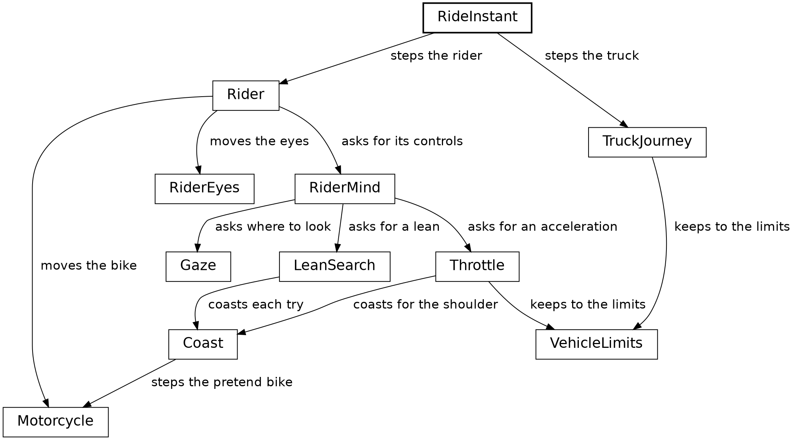

A box is a module, and an arrow points to a module it calls. This chapter explains the rider and its motorcycle. The throttle, the lean search and the gaze each get a chapter of their own after it, and the truck's chapters follow.

A rider is two parts: a motorcycle, and a pair of eyes.

{{code Rider.Rider from "Rider := {" to "}.{"}}

Both fields are nominal records of their own, and between them they hold six values:

| Part | Field | Type | What it is |
|---|---|---|---|
| motorcycle | `route_place` | `RoutePlace` | which segment, and where on it, along and across |
| | `yaw` | `Angle.Turn` | which way the bike points |
| | `speed` | `Speed` | how far it goes in a step |
| | `lean` | `Angle.Lean` | how far it leans |
| eyes | `gaze_yaw` | `Angle.Turn` | where the rider is looking |
| | `look_depth` | `Fraction` | how deep the last look went |

Three of the six are angles, of two types: a `Lean` is the bike's tilt, apart from a `Turn`, so passing one where the other belongs fails to compile, as a bearing and a turn did in the {{chapter Mountains}} chapter.

### The rider's step

The step works in order, and the code reads that way: decide, move, cross a bend or stop, then choose where to look:

{{code Rider.rider_at_next_step}}

The `match` on the segment's ending has two tags. `Bends({ bend, .. })` takes the payload's `bend` field. In a pattern, `..` stands for the rest of a record's fields.

### Deciding

Every decision the rider makes belongs to `RiderMind`:

{{code RiderMind.controls}}

A decision is the bike's controls, a lean and an acceleration:

{{code Motorcycle.Controls}}

Look at the last line of `controls`. `controls` passes `Throttle.next_acceleration` a pretend motorcycle: this motorcycle as it would be at the new lean. Two small helpers serve such pretend motorcycles:

{{code Motorcycle.with_lean}}

{{code Motorcycle.steady_controls}}

`{ ..motorcycle, lean }` is a record update with a shorthand field: the field and the argument share the name `lean`. `with_lean` makes a motorcycle as it would be at another lean, and the real motorcycle stays as it was. `steady_controls` makes the controls that keep the lean and the speed as they are. The rider's steering, in the {{chapter Variables and loops: rehearsal}} chapter, uses both.

### One step of physics

A lean of one degree turns the bike by a tenth of a degree each step, so at a metre a step it goes round a circle with a radius of 573 metres. That's nearly all the physics. Here's the motorcycle:

{{code Motorcycle.Motorcycle from "Motorcycle := {" to "}.{"}}

The step is the whole of the physics, in order:

{{code Motorcycle.motorcycle_at_next_step}}

It works in three parts:

1. **The speed.** `accelerated_by` adds the acceleration to the speed, and `allowed_speed` holds the result to the top speed.
2. **The turn.** `lean.steer(turn_per_lean)` turns the lean into a change of direction, a `Turn`, and that's the only way a lean changes where the bike points.
3. **The move.** The bike goes one step's length in the direction halfway through the step's turn, `mid`. `along.plus(…)` adds a `Distance` to a place along the road, as `Clock.plus` adds a length to a moment. The new place is a record update of `route_place`, inside a new motorcycle.

The bike turns the same amount per step at any speed. That's a cheat, chosen by eye, and it holds up because the rider chooses each step's lean by trying it out on this same physics.

### The end of a segment

The end of a segment uses a small version of the same trying out. `cross_bend_if_on_road` makes a motorcycle carried past the bend onto the next segment. If that motorcycle is on the road, it's the answer, and if it's off the road, the old one is:

{{code Motorcycle.cross_bend_if_on_road}}

At the end of the road, the throttle brakes the bike to rest. A last step can still carry it past the end, so `stop_at_route_end` holds it there with `Motorcycle.stopped_at`, from the {{chapter Records}} chapter.

### The picture leans too

When the bike leans, the camera rolls with it, and the whole picture leans:

{{code RiderCamera.rider_roll}}

A lean inside `roll_deadband`, a thousandth of a radian, leaves the picture level, and any other lean passes straight through. The camera turns as well: the rider's head follows the gaze and turns a little into a bend, and the camera adds the head's turn to the motorcycle's yaw, as the {{chapter The rider's gaze}} chapter shows.

So for each step, `RiderMind.controls` returns a lean and an acceleration, and `motorcycle_at_next_step` turns them into a new place on the road. The next chapter shows how the throttle chooses the acceleration. The {{chapter Variables and loops: rehearsal}} chapter shows how the rider chooses the lean.

## The throttle

The rider is always choosing whether to accelerate, brake or hold steady. The `Throttle` module returns that choice once a step, as an acceleration.

The modules around `Throttle`
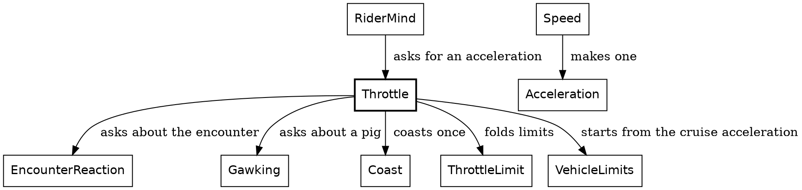

The chain of limits
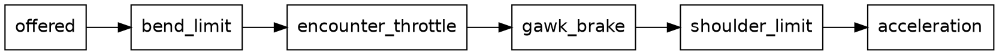

The rider has several reasons to slow down, and each is a rule of its own. A bend is coming. A cat is in the lane. There's a pig to look at. Coasting on would carry the bike off the road. `Throttle` writes them as a list of limits, the chain in the second diagram. It starts from `offered`, the cruise acceleration. `fold` hands each limit in turn to `held_to`, with the acceleration so far, and each limit lets it through or lowers it:

{{code Throttle.next_acceleration from "limits = [" to "limits.fold(offered, held_to)"}}

Call this *the chain of limits*. Each limit reads alone, and a new reason to slow down is one more line in the list.

Each limit is a `ThrottleLimit`: `NoLimit`, or `AtMost` some acceleration. `held_to` takes the lower:

{{code ThrottleLimit.ThrottleLimit}}

{{code Throttle.held_to}}

The throttle returns an acceleration, and the motorcycle's step turns it into a speed.

`Speed` and `Acceleration` are a pair like the clock and its steps: a speed is a value, and an acceleration is the change from one speed to another. To brake for a bend, the rider needs the steady acceleration that takes its speed to a target within so much road. That's `Speed.acceleration_to`. Its `within` is a `Distance`: the road the change has to happen in. The formula is the first line of a physics textbook, v² = u² + 2ad, solved for a, with the speed going from `s` to `t` over the distance `within`. In the parameter list, `Speed.(s)` and `target: Speed.(t)` unwrap the two speeds into plain numbers, as `Clock.(n)` does in the {{chapter Opaque types: the clock}} chapter:

{{code Speed.acceleration_to}}

It has one caller, `VehicleLimits.braking_to`. That function also holds the speed steady when at most a micrometre of road is left, and enforces the invariant that every speed is zero or more, with a `crash`. The rider's bend brake, the gawk brake and the truck all brake through `braking_to`. The first limit is the bend's:

{{code Throttle.bend_limit}}

`exit_speed` is the speed the bend ahead allows, or rest on the route's last segment, so the same limit brings the rider to a stop at the end of the road.

The last limit, `shoulder_limit`, comes back in the {{chapter Variables and loops: rehearsal}} chapter, because it runs a pretend copy of the bike forward, which is what that chapter is about. The two in the middle come from what the rider sees: `encounter_throttle` is the cat's, and `gawk_brake` the pig's. The cat's comes in the {{chapter What a cat does to the rider}} chapter, and the pig's comes after Rehearsal, in the {{chapter The rider's gaze}} chapter.

## Variables and loops: rehearsal

The rider steers by leaning, and for each step the rider chooses a lean by rehearsal. The lean search runs the bike's real step on a pretend motorcycle, reads where that motorcycle ends up, and throws the pretend one away. For each step, it tries twelve leans this way. Each try narrows the range the next one picks from, and the rider steers at the lean the tries close in on: the one that keeps the bike nearest the middle of the road.

```widget rehearsal
Click a mark to see that try at a lean.
```

The picture holds step 374 of the ride, just after a bend. Each white arc is one try: a pretend motorcycle coasting down the road at one lean. The yellow line is the road's middle, and the search looks for the lean whose coast ends nearest it. The last mark is the lean the rider steers at.

### Where the rehearsals start

For each step, the rider's controls come from `RiderMind.controls`, from the {{chapter The rider}} chapter. Its first line asks the lean search for a lean. Its second asks the throttle how hard to accelerate, for the motorcycle at that lean, built with `with_lean`. Both calls run rehearsals.

### A coast

`Coast` answers one question: if the rider held the lean and the speed from now on, where would the bike go? The answer is an `Outcome`:

{{code Coast.Outcome}}

The coast ends on the road at a place across it, or leaves the road at a shoulder after so many steps. One function runs it:

{{code Coast.coast_end}}

`var $point` declares a variable: a name the function can set again, marked by the `$` at its front. Each pass of the `while` loop sets `$motorcycle` to the bike a step on, and `$point` to where it now is. The bounds are the road's edges, 5 centimetres in, or wherever the bike starts if that's further out. The loop runs until the bike crosses a bound, gets 25 metres along the road, which is as far ahead as the rehearsal needs to look, or has run for 2,000 steps, which ends a slow rider circling in place. Then the last lines read where the coast ended.

The variables live and die inside `coast_end`. The function takes a motorcycle and returns an answer, and the same motorcycle always gives the same answer, so `coast_end` is as pure as every other function in the ride.

Each pass makes its step with this:

{{code Coast.coasting_step}}

`Motorcycle.motorcycle_at_next_step` is the real step, the same one that moves the real rider. `steady_controls` hands it the lean as it is and an acceleration of zero. The step is a pure function, so a pretend motorcycle steps exactly as the real one does.

### Twelve tries

A lean further right always ends a coast further right. So each try rules out half the leans still in play, and twelve tries narrow the choice down fast. That's a bisection: a binary search over leans.

{{code LeanSearch.best_lean}}

`for _ in 0..<lean_search_round_count` runs its body twelve times. `0..<12` counts from 0 up to 11, and `_` stands in for the count, since the body needs only the bounds. The bounds start a degree either side of the bike's lean, so the lean it picks is always within a degree of the last one. Each try coasts the motorcycle at the lean halfway between the bounds:

{{code LeanSearch.tried_motorcycle}}

`lean_correction` reads where that coast went, and returns which way to lean more:

{{code LeanSearch.lean_correction}}

`Leaves({ side: Left, .. })` matches any coast off the left, whatever its count of steps. Off the left shoulder means lean more right, and off the right means more left. A coast that stays on the road compares where it ends with `aimed_across`, the road's middle. After the twelfth try, the search returns the lean halfway between the bounds it has narrowed to.

### Why rehearsing is safe

A rehearsal runs the real rules on a copy of the rider, and in Roc the copy is cheap. `tried_motorcycle` returns a new motorcycle, and the real one stays as it was. `motorcycle_at_next_step` has the thin arrow, so it reaches only its arguments. A rehearsal touches only its own copy.

Each real step of the ride runs thirteen coasts: twelve for the lean, and one more in the throttle. That last one asks whether the bike, held as it is, would leave the road at a shoulder, and brakes if so:

{{code Throttle.shoulder_limit}}

So every part of the rider's step, rehearsals included, is a function from the moment before to the moment after. One part is left: where the rider looks, the next chapter's subject.

## The rider's gaze

The herds chapter left one pig waiting. On the first two segments with pigs, one pig in the big herd catches the rider's eye. The rider turns to look and slows down, and the camera turns too.

Looking and slowing down last different lengths of time. The eyes give up once the pig is too far to the side, and the speed stays down until the segment ends. So the code has two words for them: a *look* is what the eyes do, and *gawking* is what the speed does. This chapter takes them in that order.

```widget gaze
Press play to ride the stretch around the first distracting pig, seen from above. The lines under the picture read the rider's `speed`, `gaze_yaw` and `look_depth`.
```

### Get the types right

Two fields of the rider's record carry the gaze:

| Field | Type | What it is |
|---|---|---|
| `gaze_yaw` | `Angle.Turn` | How far the rider looks from the way the bike points |
| `look_depth` | `Fraction` | How far a look went, from 0 to 1, fading once the gaze is back on the road |

Each angle is a `Turn` from the one before: `yaw` is how far the bike points from the road, and `gaze_yaw` is how far the eyes point from the bike.

Three small types say what a pig can do to the rider. A segment's `pigs` field is `NoPigs`, or a `Herd` with its `interest`, which says whether the herd catches the rider's eye:

{{code Segment.Pigs}}

The rider looks at a pig or at the road, and only a pig has an angle:

{{code Gaze.GazeTarget}}

So the job is a short list:

| Job | Function | Its type |
|---|---|---|
{{types row Gaze.desired_gaze Choose where to look}}
{{types row RiderEyes.next_gaze_yaw Turn the head}}
{{types row RiderEyes.next_look_depth Keep the depth of the look}}
{{types row Gaze.noticed_pig Tell whether the rider has noticed a pig}}
{{types row Gawking.gawk_brake Work out the brake}}

One step of the gaze
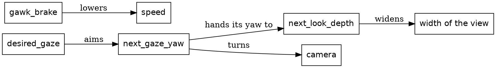

The chain from `desired_gaze` is the look, and `gawk_brake` is the gawking.

### The look

`Rider.rider_at_next_step` moves the eyes last, after the bike has moved:

{{code RiderEyes.eyes_at_next_step}}

Before the eyes move, the rider chooses where to look. `RiderMind.gaze_target` hands that question to `Gaze.desired_gaze`:

{{code Gaze.desired_gaze}}

The pig has to be near, and it has to be in sight. Near means from 150 metres before the pig, measured along the road. In sight is an angle:

{{code Gaze.turn_to}}

`turn_to` is the direction to the pig, less the way the bike points. The pig stands beside the road, so the angle grows as the rider comes closer, and at 35 degrees the rider lets it go.

### Turning the head

{{code RiderEyes.next_gaze_yaw}}

Toward a pig, the gaze turns by at most 4 degrees a step, and on the way back by at most 0.2, held there by `clamped_within`. A gaze within 0.2 degrees of straight ahead goes all the way home, so the return ends exactly there.

The bike keeps its own heading. The gaze goes to the camera alone:

{{code Rider.head_yaw}}

The second term is the rider's head going with the lean. When the rider looks right, the road slides left on the page, and the bike keeps going where it was going.

### The depth of a look

{{code RiderEyes.next_look_depth}}

While the gaze is off straight ahead, the depth rises with how far it has turned, and holds there. Once the gaze is home, the depth fades by 0.0012 a step, so a full look takes more than 800 steps to fade.

The depth has one job. It widens the view:

{{code RiderEyes.attention}}

The `Attention` type, an opaque `F64`, is how hard something holds the rider's eye, with a full look at 1. `Easing.smoothstep` eases the look's pull in and out. `RiderCamera.ride_focal_length` sets how wide the view is from `Rider.attention`, the stronger of this look's pull and a crossing cat's. So a pig widens the view, and the view stays wide for a while after.

### Gawking

Gawking asks a plainer question: has the rider noticed a pig on this segment?

{{code Gaze.noticed_pig}}

The `if` after `CatchesEye(pig)` is a guard: the branch matches only when the tag matches and the guard is true. Like the look, the noticing starts when the pig is within 150 metres. It asks only where the rider is, so it lasts until the segment ends, long after the look.

`gawk_brake` is the third link in the throttle's chain, a brake while the rider has noticed a pig:

{{code Throttle.next_acceleration from "Gawking.gawk_brake(motorcycle, segment)," to "Gawking.gawk_brake(motorcycle, segment),"}}

{{code Gawking.gawk_brake}}

The formula is the throttle's bend brake, with a pig for a bend: the rider aims to be down to 0.2 metres a step by 25 metres before the pig. Past that point, `gawk_least_distance` holds `room` at a metre, so the brake stays on.

### The first pig

Here's the look and the gawking on the third segment of the route:

| Step | What happens | Speed | `gaze_yaw` | `look_depth` |
|---|---|---|---|---|
| 885 | The rider looks, with the pig just inside 150 metres | 1.94 metres a step | 4.0 degrees | 0.114 |
| 1,049 | The gaze is at its widest | 0.2 metres a step | 34.95 degrees | 0.999 |
| 1,050 | The rider lets the pig go | 0.2 metres a step | 34.75 degrees | 0.999 |
| 1,224 | The gaze is back on the road | 0.2 metres a step | 0 degrees | 0.997 |

The look takes 165 steps, and getting the eyes back takes 174. The rider crawls on, eyes on the road, to the next segment at step 1,397. An expect holds that the gaze is home at every one of the ride's 18 seams between segments.

That's the pig's part of the rider's step. The truck is the other stepped thing, and its chapters start with its sprite.

## The truck

All through the ride, the rider follows a truck up the road. The truck is the ride's one true solid: a body of flat faces in three dimensions, seen from wherever the camera stands, with headlights for the dark and brake lights for the bends. Here the truck stands at one place on the road. How it moves comes in the next chapter.

```widget truck
A truck from behind, from behind and to one side, and from the side.
```

### The whole job

One function makes the truck's sprite. The sprite holds the headlight beams, the body and the brake lights, painted in that order:

{{code Truck.scenery_sprite}}

`Sprite.composite` makes one sprite of several, each painted over the ones before:

{{code Sprite.composite}}

The setting is the one every kind gets, the truck's spot, the lens and the sky's darkness:

{{code Sprite.Setting}}

The `Truck` value holds which of the truck's lamps are on:

{{code Truck.Truck from "Which of" to "Truck := {"}}

Each lamp is `[On, Off]`, and each has a module that owns two things: when its lamp is on, and how the lamp looks. The rest of this chapter explains the body, then the two lamps.

### The body's shape

`TruckShape` says what the truck looks like, in the truck's own frame. Each part of the truck is a face, a color and its corners:

{{code TruckShape.TruckFace}}

A corner is three distances: ahead of and to the right of the middle of the trailer, and up from the road:

{{code TruckShape.TruckPoint}}

The truck is blue: a dark blue body, darker blue sides, a lighter blue roof, and black tires. The whole truck is its faces, in one list, and `join` puts the lists inside it end to end:

{{code TruckShape.truck_faces}}

### Shape, placement, projection

The shape reaches the screen in three stages:

| Stage | What it does |
|---|---|
| Shape | Says where each corner of each face is in the truck's own frame |
| Placement | Turns one corner by the road's heading, carries it out from the truck's foot, and lowers it by the ground's drop |
| Projection | Turns one whole face into a polygon on the screen |

Placement works a corner at a time. `TruckSighting` finds the truck on the road ahead and works out its spot once. The truck is rigid and faces straight along the road, so every corner moves the same way, through that spot:

{{code TruckPlacement.point_at_height}}

Every corner is lowered by the same drop, how far the ground has curved away beneath the truck's spot. Across a 12-metre truck the drop changes by a few centimetres at most, far less than a pixel.

Projection works a face at a time, for two reasons. A face that reaches behind the camera is cut at the near plane, and the cut can take corners off a face and add new ones, so it needs the whole outline. And the faces are sorted by depth, a whole face at a time, so a nearer face covers a farther one. `TruckBody.body_sprite` takes those steps in order, with a name for each:

{{code TruckBody.body_sprite}}

`placed_faces` stands every face on the road, `faces_far_to_near` sorts them, and `dimmed_faces` darkens each face's color with the sky. Then `Camera.clipped_polygon` cuts each face at the near plane and projects it, and returns an `Err` for a face wholly behind the camera. The {{chapter The math layer}} chapter shows how the cut works. `keep_oks` keeps the rest. The truck keeps all its faces however far off it stands, because the rider is always looking for it.

### The headlights

The ride runs from day into night, so the headlights come on near the end. They work like a light sensor on the lamps themselves: once the sky is dark enough, they're on.

{{code TruckHeadlights.at}}

They come on at this darkness:

{{code TruckHeadlights.headlights_on_darkness}}

On this ride, that's step 3,555 of 6,746. Once on, they stay on, because from there the sky only darkens. `TruckHeadlights.sprite` matches on both tags. An `Off` lamp is an empty sprite. An `On` lamp's sprite is two beams, each a wedge that fades from the lamp toward its far end:

{{code TruckHeadlights.sprite}}

### The brake lights

The brake lights read the truck's pace, so they're on while the truck's last step slowed it, by day or by night. The pace is part of the truck's carried progress:

{{code TruckJourney.Pace}}

{{code TruckBrakeLights.at}}

Their sprite works as the headlights' does: two lamps on the back of the trailer, each with a glow around it, and an empty sprite when they're off.

For each frame, `FrameView` sets both lamps together, in one record of lights, from the sky's darkness and the truck's pace:

{{code FrameView.ride_facts from "headlights: TruckHeadlights.at(" to "brake_lights: TruckBrakeLights.at("}}

Step the ride back past step 3,555, and the headlights go off again: they read only the sky, so the sky turns them off. The brake lights read the truck's last step, which the ride carries, so they come back with it. Next, the truck moves.

## The truck's motion

The truck is what the rider chases. It starts 500 metres up the road, and for most of the ride the rider closes in on it, unevenly:

| Step | Rider, along the route | Truck, along the route | Lead |
|---|---|---|---|
| 0 | 0 metres | 500 metres | 500 metres |
| 2,000 | 1,831 metres | 2,274 metres | 443 metres |
| 4,000 | 4,796 metres | 5,051 metres | 255 metres |
| 6,000 | 6,790 metres | 6,931 metres | 141 metres |

The closest the rider gets is 50 metres, at step 6,374. After that the rider slows to stop at the route's end, at step 6,746. The truck drives on past the end of the route and out of the picture. It stays ahead to the last, by design.

### A tease, carried out by physics

The truck's driver is teasing the rider: staying ahead, but letting the rider gain. That's a hand of god: a rule that bends the world on purpose, for the story. Here it's one function, `tease_position`. Given how far the rider has come, it says where the truck would like to be. The lead it aims for shrinks from 500 metres at the start of the route to 100 at the end.

The rest is physics. The truck speeds up while it's short of that mark and holds its speed once it's past it. It slows for the bends, and that's mostly where the rider gains. The tease only ever speeds the truck up, so near the end the rider can get closer than the 100 metres it aims for. The truck can always pull away again, because it outdoes the rider by 10%, in both its acceleration and its top speed.

### Carried from step to step

Where the truck is depends on where the rider has been, so the truck is one of the four things each moment carries. Its step, `truck_progress_at_next_step`, takes a `TruckProgress` and returns the next one. The rider moves first, and then the truck reads where the rider has got to. The reading runs one way, from the truck to the rider.

### Get the types right

The truck's state is three fields:

{{code TruckJourney.TruckProgress from "How far along" to "pace : TruckJourney.Pace,"}}

`route_position` is a `Distance` along the whole route, the same measure as the rider's progress, so the two can be compared directly. `Pace`, which the brake lights read in the {{chapter The truck}} chapter, says whether the truck's last step slowed it down.

A bend ahead of the truck is its own type, and so is the answer to "is there one":

{{code TruckJourney.ComingBend}}

{{code TruckJourney.NextBend}}

`BendAhead` carries a `ComingBend`: how far off the bend is, and its turn, an angle. `NoBendAhead` is a bare tag: the route ends before another bend, or the truck is already past the end. The only way to read a bend's distance is inside the branch where there is a bend.

### The functions

The modules around `TruckJourney`
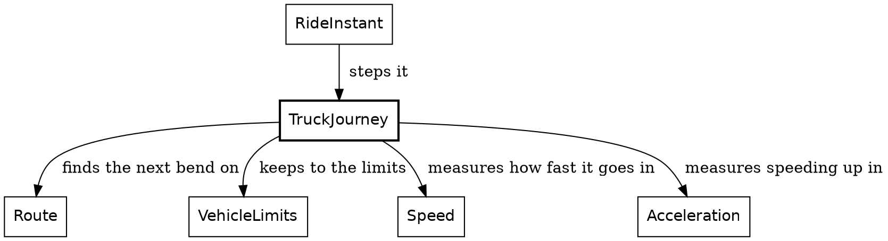

`RideInstant` moves the truck once a step. All it hands over is how far along the route the rider has just got to, and the route itself:

{{code RideInstant.next from "truck = TruckJourney.truck_progress_at_next_step(" to "{ rider_distance: rider_place.distance_along(route), route },"}}

That record holds all the truck reads of the rider. The truck and the rider share `VehicleLimits`, the limits both keep to. The truck's 10% is its own, `chase_margin` in `TruckJourney`.

The step works out the tease, then looks for the next bend:

{{code TruckJourney.truck_progress_at_next_step}}

Here's the tease itself. The lead shrinks in step with the rider's progress along the route:

{{code TruckJourney.tease_position}}

Finding the next bend walks the route's segments with their ends, and takes the first one that ends past the truck:

{{code TruckJourney.next_bend}}

Then come the two ways to take a step. Both sit below the module's block, so they're private, and both are arithmetic on `Speed`. Within 60 metres of a bend, the truck brakes so it reaches the bend at its cautious speed. `VehicleLimits.turn_speed` is the speed a turn allows, and the rider's throttle asks it too. The truck's own rule is that limit times its caution, 80%, to leave a margin:

{{code TruckJourney.turn_caution}}

{{code TruckJourney.progress_braking_for}}

`VehicleLimits.braking_to` works out one steady brake that reaches the target speed at the bend. The brake is steady over the whole distance left, so one of the last steps before the bend can land a little under the target, and `target_speed.max(...)` holds the truck there. `braking_to` crashes on a brake that would take the speed below zero, the invariant it holds for the rider too. Farther from a bend, the truck chases the tease:

{{code TruckJourney.progress_toward_tease}}

The truck reads only how far along the route the rider has come. The cat and the bird ahead react to where the rider is, starting with the cat.

## The cat

A cat waits behind a tree by the road. As the rider comes near, it walks out into the lane, freezes, and leaps clear just before the rider arrives. The cat is the most elaborate animation in Safari Ride, and it's where the rider and the world start to change each other.

```widget cat
Press play and watch the crossing.
```

The picture brings a rider in at a metre a step, from 50 metres off. The cat waits until the gap is 41 metres, walks out, and freezes in the lane at 31. It coils at 7, springs just under 6, and lies collapsed on the far verge by 3.

### One step carried

A crossing is a list of frames, and it plays one frame a step on the ride's clock. So the ride has to carry only one fact about it, the step it starts on. That's an `EncounterPlan`:

{{code EncounterPlan.EncounterPlan from "When the encounter" to "].{"}}

The ride derives everything else about the cat in a frame from the plan and the clock:

How a cat reaches the frame
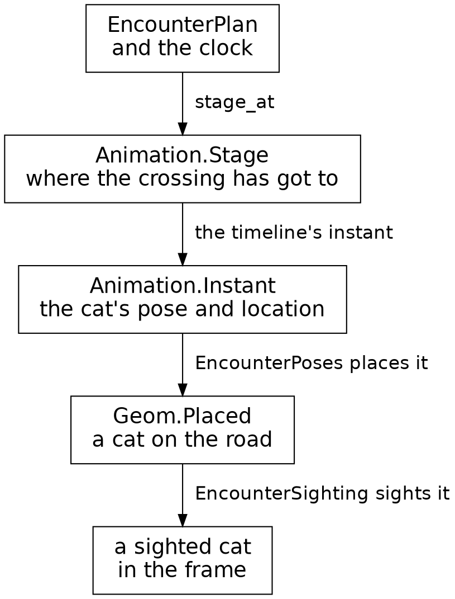

### When it starts

The ride plans the crossing once, from how fast the rider is coming. The cat should be across just as the rider comes within 3 metres of it. What the ride plans by is a span: how many steps the animation takes, and the gap it ends at.

{{code EncounterPlan.StepSpan}}

The cat's span is its frames, ending 3 metres short:

{{code CatCrossing.crossing_span}}

The crossing has 38 frames. So the ride makes the plan on the first step where a rider keeping their speed would cover the rest of the gap, down to 3 metres, within 38 steps. A faster rider covers more road in that time, so the cat sets off farther away:

| Rider's speed | The crossing starts at a gap of |
|---|---|
| 1 metre a step | 41 metres |
| 1.5 metres a step | 60 metres |
| 2 metres a step | 79 metres |

{{code EncounterPlan.plan_for}}

The plan reads the rider's speed on that one step. After that, the cat plays on the clock alone. A rider who brakes arrives a little late, and the cat has crossed on time.

### Where it has got to

The plan and the clock say where the crossing has got to, as a `Stage`:

{{code Animation.Stage}}

`Waiting` comes before the crossing starts. `Playing` counts the steps in, and `Past` counts the steps since it ended. One function works the stage out:

{{code EncounterPlan.stage_at}}

### What it looks like

The crossing's frames come in three runs, one frame a step:

| Frames | What the cat does |
|---|---|
| 1 to 10 | walks out, striding and resting, from behind its tree toward the middle of the road |
| 11 to 34 | stands frozen in the lane |
| 35 to 38 | coils, flies for two frames, and lands on the far verge |

The table counts frames from 1, as the picture does. A `Playing` stage counts its steps from 0. A cat holds itself in one of seven poses:

{{code CatCrossing.CatPose}}

Each frame is a pose, and where the cat is on its way across:

{{code CatCrossing.CrossingFrame}}

{{code CatCrossing.CrossingWay}}

A frame holds how far along its way the cat is, as a share of the way. The road comes in later, by the cat's own tree, so one list of frames serves every crossing. The leap is four of them, set by eye:

{{code CatCrossing.leap_frames}}

One list joins the three runs:

{{code CatCrossing.crossing_frames}}

`map_with_index` hands each walking pose its place in the list, which gives its share of the way out. `List.repeat` makes the 24 frozen frames.

### A timeline

A list of frames and a way to show each one make a timeline. `Animation` defines it once, for any animal:

{{code Animation.Timeline from "Timeline(frame, pose) ::" to "}.{"}}

For the cat, a frame is a `CrossingFrame` and a pose is a `CatPose`. `before` and `after` are the animal at rest, outside the frames. An `Instant(pose)` is a record of the pose and the animal's location.

`crossing_timeline` puts a crossing's frames on the road, by its own tree:

{{code CatCrossing.crossing_timeline}}

`location_of` is a function defined inside another, so it can use the crossing's `start`, `middle` and `end`. `Animation.location_between` returns the location a fraction of the way from one location to another. Asking a timeline for the animal at a stage is one `match`:

{{code Animation.Timeline from "instant : Animation.Timeline" to "Past(_) => timeline.after"}}

`frame_instant` is a function stored in a record's field, so calling it takes parentheses: `(timeline.frame_instant)(frame)`. Written `timeline.frame_instant(frame)`, it would read as a method call. The invariant is that the span and the frames agree, so `instant` crashes on a `Playing` stage past the last frame. Both come from the one list, `crossing_frames`, so every `Playing` stage finds its frame.

### Into the frame

The ride plays only the crossing on the rider's own segment. A cat on a segment ahead waits behind its tree:

{{code EncounterPoses.cat_poses}}

A `Cat` is the cat's kind in the frame: a record of its pose, with the methods every kind has. A `PlacedAnimal(Cat)` is a `Geom.Placed` cat, with the segment it stands on. `EncounterSighting` then sights each cat through `Pipeline.scenery_sighting_of`, as the pipeline sights a tree. From there, a cat joins the frame's depth sort like any other thing.

The ride carries one step for the cat, and derives the rest, frame by frame, from that step and the clock. While it crosses, the cat also asks two things of the rider: hold the throttle, and look. After the bird's chapter, the {{chapter What a cat does to the rider}} chapter takes the rider's side.

## The bird

A bird sits on a treetop by the road. As the rider comes near, it takes off, flies across the road and ahead, and lands on a tree on the far side. The bird is Roc's logo, and it moves the way the cat does: one plan, a stage from the clock, and a timeline of frames.

```widget bird
Press play and watch the bird fly.
```

The picture's camera stays put, 18 metres short of the first tree, and the gap counts down as if a rider were coming at 1.25 metres a step. The bird leaves its perch, a treetop 6.4 metres up, at a gap of 60 metres. It rises to 10.7 metres up in the middle of its flight, and lands on a treetop 4.9 metres up at 15.

### The same plan

The ride plans a flight as it plans a crossing: once, when the rider first comes within reach. A flight is 36 frames, and `flight_span` sets it to end when a rider keeping their speed would be 15 metres short of the tree the bird left. So the rider sees the bird land before passing that tree:

{{code BirdFlight.flight_span}}

A faster rider sets the bird off farther away:

| Rider's speed | The flight starts at a gap of |
|---|---|
| 1 metre a step | 51 metres |
| 1.25 metres a step | 60 metres |
| 2 metres a step | 87 metres |

Each segment holds one encounter at most: a cat crossing, a bird's flight, or a quiet road. One function finds the stage of whichever it is, with that animal's own length:

{{code Encounter.encounter_stage}}

`encounter_span` returns the cat's span or the bird's, and `{ span, .. }` takes its `span` field. A quiet road stays `Waiting` for good.

### Its poses

A bird's pose can carry a tag of its own. Side on or seen from behind, its wings are up or down, so those two tags carry a `WingBeat`:

{{code BirdFlight.WingBeat}}

{{code BirdFlight.BirdPose}}

A flight's 36 frames come in three runs:

| Frames | What the bird does |
|---|---|
| 1 to 4 | one flap, side on |
| 5 to 32 | seven flaps, seen from behind |
| 33 to 36 | dives |

Before the first frame the bird sits on the tree it leaves, and after the last it sits on the tree it lands on. The poses are one list, built from the three runs:

{{code BirdFlight.flight_poses}}

Each frame is a pose, and how far through the flight it is:

{{code BirdFlight.FlightFrame}}

{{code BirdFlight.flight_frames}}

The first frame is 0 of the way through, and the last is all of it. `map_with_index` passes each pose along with its place in the list, and that place over the last frame's place is the frame's share of the way.

### Its path

A `BirdFlight` is a record of two trees, `from` and `to`. Its timeline is the same `Animation.Timeline` as the cat's, with a `FlightFrame` for each frame and a `BirdPose` for each pose:

{{code BirdFlight.flight_timeline}}

The path runs between the two treetops, eased at each end, and rises in an arc 5 metres high at the middle:

{{code BirdFlight.flight_location}}

`Easing.smoothstep` turns a share of the way into one that moves slowly at each end and faster in the middle, so the bird eases away from one tree and into the next. For `t`, the share of the way through, `4t(1 − t)` is 0 at both ends and 1 halfway, so the arc starts and ends at the treetops. The last line is a record update: the point on the line, with its lift raised.

### Finding its trees

A segment gets its bird once, when the world is built. The bird perches on the fifth tree on the left, and flies to the first tree on the far side at least 25 metres farther along:

{{code BirdFlight.flight_from}}

`find_first` returns a `Try`. The `?` takes the tree it found, or returns the failure from `flight_from`, renamed to the bird's own, `NoTreeToFlyTo`, as in the {{chapter Errors as tag unions}} chapter. The bird always starts on the left because its perched and side-on stills face right, so on a left tree it faces the road.

The segment puts the perch and the flight together:

{{code Segment.from_choices from "BirdHere => {" to "BirdHere(flight)"}}

The route's plan for the segment says `BirdHere`, a bare tag, and the segment's own encounter holds `BirdHere(flight)`, the flight itself. The route plans a bird only on a segment with both trees, so every bird's segment holds both: an invariant. `??` opens a `Try` another way: it takes the value from an `Ok`, and for an `Err` it runs the expression on its right instead. Here that's a `crash`, which enforces the invariant with its own message for each tree.

### Into the frame

The bird reaches the frame as the cat does, with a `Bird` as its kind. The rider's own segment plays its flight, and a bird on a segment ahead sits on its perch. A perched bird stands exactly at its tree's top, at the same depth as the tree. The scene paints trees before birds when depths tie, so the bird shows on top of its tree.

The bird is there to be seen. Its whole cost to the ride is a list of poses, a path, and a still for each pose. A cat costs more, because the rider reacts to it.

## What a cat does to the rider

A crossing cat plays on the clock alone, and the rider reacts to it on every step, in two ways: the rider holds the throttle, and looks. Both reactions are the rider's own, so they live on the rider's side, in the `EncounterReaction` module. Its two functions match on the encounter ahead, and the cat is the one case that changes the rider.

The modules around `EncounterReaction`
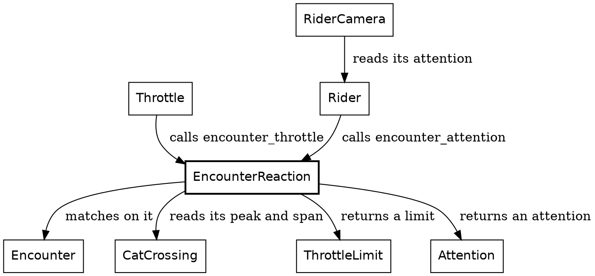

### Hold the throttle

A limit on the throttle is a `ThrottleLimit`, from the {{chapter The throttle}} chapter: either `NoLimit`, or `AtMost` some acceleration.

While a cat crosses, the rider's speed can only hold or fall. That's `AtMost(Acceleration.steady)`, which caps the acceleration at zero:

{{code EncounterReaction.encounter_throttle}}

The outer `match` asks what's on the segment, and the inner one asks where the crossing has got to. A bird and a quiet road both get `NoLimit`.

The cat's limit is one of the four in the throttle's chain of limits, beside the bend, the gawking and the road's shoulder. The chain starts from the cruise acceleration and keeps the lowest. Holding at steady also holds the rider at or below the speed the plan was made for, so the cat is across before the rider arrives.

### Look

How hard something holds the rider's eye is an `Attention`. A full look to the side is 1, and a crossing cat holds the eye harder than that, so underneath it's an `F64`, which can go past 1:

{{code Attention.Attention from "Attention :: F64.{" to "Attention :: F64.{"}}

`encounter_attention` returns the pull of the encounter on the rider's segment:

{{code EncounterReaction.encounter_attention}}

The cat's pull rises as it crosses, up to its peak of 1.8, then fades over 83 steps once it's across, about 80 metres past the cat at a metre a step:

{{code EncounterReaction.cat_attention}}

`Playing` and `Past` both carry a step count, and `cat_attention` uses both: one says how far into the crossing, the other how long since it ended.

`Rider.attention` takes the stronger of two pulls: the cat's, and the depth of the rider's last look, which lingers after the eyes come home. The camera widens its view for that attention, as a startled rider takes in more of the road.

Of the three encounters, the cat alone changes the rider, through both reactions. The rider's reactions to the bends and the pigs came in the rider's own chapters. The cat's are the last of the ride's moving parts. What's left is the machinery under them: the math, the proofs and the platform.

## The math layer

Every sighting so far has turned a place on the road into a place on the screen, on trust. This chapter explains that step, with the trigonometry of perspective: one point travels from a segment of the road ahead, round the bends to the rider, and through the camera's lens onto the screen.

The trip of one point to the screen
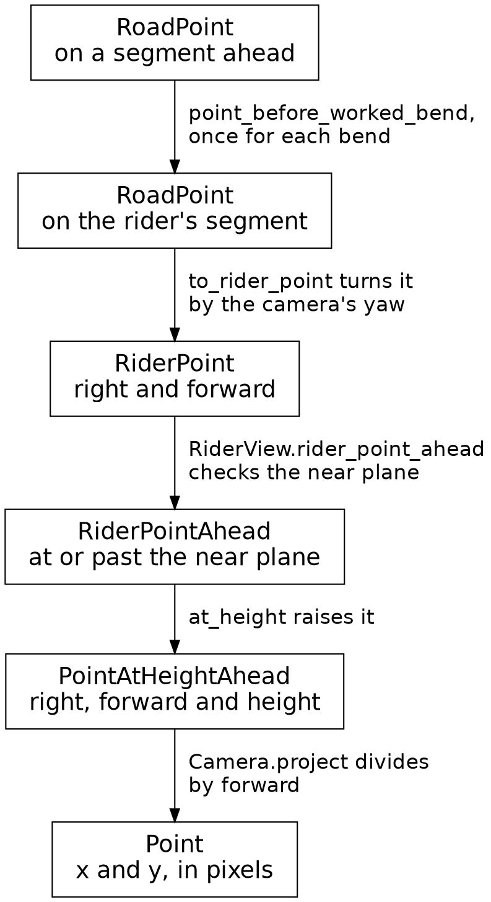

Each box is a coordinate system, and its type says which. `along` and `across` are on the road, `right` and `forward` are from the camera, and `x` and `y` are on the screen. So a function's annotation says which space it works in, and the compiler rejects a call that passes a point from another space.

### Round the bends

A point on the road is measured within its own segment, and each segment holds only its length and the turn at its end. So a point three segments ahead comes back round three bends, one at a time, before the camera can see it:

{{code RoadAhead.rider_point_round_bends}}

`position` is a `SegmentFromRider.Position`, the count of bends between the rider's segment and the point's. Each pass of the loop sets `$point` to the same point, measured on the segment before. For an `Err`, `??` runs a `crash`, as it does for the bird's trees.

Each pass is one rotation and one shift:

{{code Geom.point_before_worked_bend}}

`start_after: start` names the record's `start_after` field `start`. Turning a point by an angle mixes its two parts: the cosine says how much of each part stays where it was, and the sine how much moves over into the other. Then the shift moves the point to where the next segment starts. A `WorkedBend` holds that start and the turn's cosine and sine, worked out once for each bend when the road ahead is built.

### To the rider

On the rider's own segment, one more turn brings the point into the camera's view:

{{code RoadAhead.to_rider_point}}

The camera stands at `vantage`, and its yaw is the way it points, as a turn from straight down the segment. Turning the camera one way turns the world the other way in its view, so the point turns by minus the yaw into `forward` and `right`.

### Through the pinhole

Next, `RiderView.rider_point_ahead`, from the {{chapter Errors as tag unions}} chapter, checks the point against the near plane, 0.4 metres ahead of the camera. It refuses a point short of that as `BehindCamera`, and returns one at or past it as a `RiderPointAhead`. `at_height` raises it to a `PointAtHeightAhead`. Both types are opaque, and every way to build one starts from a point at or past the near plane.

`Camera.project` projects the point onto the screen. The camera is a pinhole, and a pinhole is similar triangles:

{{code Camera.project}}

A point 2 metres to the right and 10 metres ahead has a slope of a fifth: its line of sight runs a fifth of a metre right for every metre forward. `Lens.x_for_slope` multiplies the slope by the focal length, in pixels, and measures from the middle of the screen. The height works the same way, from the eye, 1.2 metres up, and from the horizon on the screen.

Dividing by `forward` is all of perspective: a thing twice as far off lands twice as close to the middle. The near plane keeps `forward` at 0.4 metres or more, so the division always has an answer.

Two more things act on the way. The ground's curve lowers a thing standing far off, as the {{chapter Radio towers}} chapter showed. And far scenery, the sun and the mountains, works from heights above the horizon, with `Lens.far_point` for the sun.

### Cutting at the near plane

A single point is in view or refused, but a solid's face can be both at once. A patch of road can run from ahead of the camera to beside it, so a solid's corners stay plain `PointAtHeight`s until `RiderView.clipped_points` cuts the face at the near plane. Here's a rectangle 2 metres wide, from 2 metres ahead of the camera to a metre behind:

| | Corners, as metres right and metres forward |
|---|---|
| Before | (-1, 2), (1, 2), (1, -1), (-1, -1) |
| After | (-1, 2), (1, 2), (1, 0.4), (-1, 0.4) |

The two corners behind the camera have gone, and two new ones stand where the rectangle's sides cross the near plane.

The near plane is one region a face can be cut to. The ground's horizon is another: past it, 490 metres out, the ground curves out of sight. So one cut serves any region:

{{code RiderView.Region}}

A region is two functions in a record: whether a corner lies inside, and where an edge crosses the boundary. The near plane's region returns `PointAtHeightAhead`s, ready for the camera, and the horizon's returns plain `PointAtHeight`s. Here's the cut:

{{code RiderView.points_in_region}}

`next_corners` turns the corners round by one, with `drop_first` and `take_first`, so `map2` can pair each corner with the next. Each pair is an edge. `fold` builds the cut face from the edges, starting from `List.with_capacity`, an empty list with room set aside. `edge_points_onto` keeps an edge's first corner when it lies in the region, then adds each point where the edge crosses the boundary. The near plane's cut is one line:

{{code RiderView.clipped_points}}

So a point on the road reaches the screen by four moves: a rotation for each bend, one turn to the camera, a check at the near plane, and a projection, which divides by `forward`.

## Proving it

The same step always gives the same frame, because the ride derives each frame from the four things it carries. In this chapter, we turn that sameness into a test strict enough to guard every change, down to the last pixel.

| Step | What the frame shows | Hash of its pixels | Shapes |
|---|---|---|---|
{{proof row 0 The start of the ride}}
{{proof row 100 A bird in flight}}
{{proof row 1529 A cat frozen in the road}}
{{proof row 1542 The same cat in mid-leap}}
{{proof row 3000 The ride under way}}
{{proof row 3698 A distant truck, its glow barely a pixel}}
{{proof row 5700 The truck at dusk, lights on}}
{{proof row 6250 The truck braking in plain view}}
{{proof row 9000 Past the end, on the second lap}}

Each row is one frame of the ride. Ride to that step today, and you get that hash and that many shapes. The gate is the set of checks every change must pass before it lands, and one of them holds every row as it is.

### A fixture is a value

A test rides to any step with one call:

{{code Tour.at_step}}

`Tour.at_step` plays every step from the start up to the one asked for. `Tour.step_forward` rides on past the finish into a second lap, which is how the proof tools reach step 9,000. `Tour.initial` is a value, and each step returns a new tour, so the tour at step 1,529 is the same value in every test, on every run.

### The frame hash

The gate's proof tools are small Roc programs in `gates/proof/`. `RasterFrame` is one. It rides to a step and paints the frame into 576,000 pixels, 960 across and 600 down, in pure Roc, with `SafariFrame` and `ShapesPixels`, the Roc twin of the page's canvas. Then it prints a hash of them. The gate holds each hash to its line of `gates/proof.expected`, exactly. One different pixel in one frame fails it.

A frame proves only what's in it, so each step in the table is there for a scene. We add a row whenever a change could go wrong with every listed frame staying the same. The row at 3,698 is one: the truck brakes about 600 metres off, and its glow is about a pixel across.

### Sums in order

Exact hashes make the order of arithmetic matter: adding floating-point numbers in another order can change the last bit of the answer. `Route.segments_with_ends` adds up the route's lengths, and its doc comment says why its direction matters:

{{code Route.segments_with_ends}}

A product's grouping counts as well. A beacon's angle is `2.0 * F64.pi * phase.to_f64() / Beacon.beacon_period.to_f64()`. Divide the phase by the period first, and the product means the same on paper, but some beacons change in their last bits, and the gate's hash of the built page fails.

A value in an opaque type runs as the number inside it, so a change that retypes a module, to use `Speed` where it used plain `F64`s, leaves every hash where it was. That's why we rename, retype and reorganize the code freely: the compiler checks the types, and the hashes check every pixel.

### Three more proofs

`ShapesFrame` paints each frame twice, once with its polygons whole and once cut into triangles. The gate holds the count of pixels that differ at 0 of 576,000, at every step in the table.

`StepBack` steps back at points along the route, from step 10 to the finish. One step back from step 3,000 has to land on step 2,999, and as many steps back as the ride took have to land on step 0.

`OnRoad` rides the whole route and checks that the rider stays on the road from start to finish.

### Tests beside the code

The rest of the testing is plain `expect`s. An `expect` sits at the top level of a module, under the code it checks, and `roc test` runs it. Safari Ride has over a thousand.

An `expect` can use only what its module imports, so a check that needs several modules goes in `gates/expects/`, a folder of modules made only for checks.

The gate makes every `expect` count. Each line in the source that starts with `expect` has to print `PASS` exactly once when `roc test` runs, so an `expect` has to sit in a module that a test run reaches.

### Crashes that check

Some beliefs about the program are cheaper to check as it runs. Every `Fraction.of` in the ride, from the {{chapter Errors as tag unions}} chapter, enforces an invariant: a ratio outside 0 to 1 means a sum behind it is wrong, so the program stops, with a sentence that says so. The proof tools ride thousands of steps on every run of the gate, so each check on that path runs thousands of times.

### The page itself

This book is built from the code. Every snippet came through Roc's own parser, by name, and each program shown failing went through the compiler, with its message quoted as printed. The gate builds the book, so renaming a function quoted here fails the gate until the prose catches up.

The gate also runs lints, small programs that read the Roc source for patterns we've ruled out, each held at zero, so a vague name fails the gate before a single hash is worked out.

## The platform

Every chapter so far has ended in a list of shapes. In this chapter, we follow the list onto the screen, and the viewer's keys back into the ride, the last of the five pieces. On the way, we see where the ride's effects live: in a small platform under the Roc code, which every app in this book shares.

One tick, in order
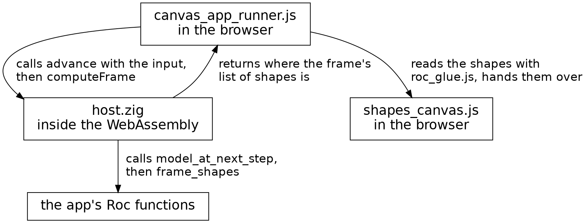

### An app is a value

The {{chapter Platforms, packages and modules}} chapter showed the app's last line: `WasmApp.program` takes `SafariApp.canvas_app`, the whole ride as one value. Here's that value:

{{code SafariApp.canvas_app}}

An app is a record. Most of its fields are plain values: the screen's size, thirty frames a second, the first model, and a title. The ride is silent, so `sounds` returns 0 and `tones` is empty. `model_at_next_step` moves the model on a step, and `frame_shapes` returns the shapes of the model's frame.

Every app's step also takes the seconds the step covers, which `WasmApp` works out from the frame rate. The ride counts steps, so one function fits its step to that shape:

{{code CanvasApp.untimed_model_at_next_step}}

In the annotation, each part in parentheses is the type of a function. `untimed_model_at_next_step` takes a function of a model and an input snapshot, and returns a function that takes the seconds too and passes the first two to `step`. The seconds stop there, so the ride runs on steps alone.

### What the platform calls

`WasmApp.program` turns the app into the functions the page's platform calls, the same for every app:

{{signatures WasmApp.program}}

Every one of the eleven functions has the thin arrow, so all of them are pure. A function such as `width : {} -> U32` takes the empty record, `{}`, and returns a value from the app alone.

The model travels as a `Box(model)`: the model behind a pointer, which the platform holds and only Roc reads. The input travels as seven numbers: the keys held and struck, the mouse buttons held and struck, the pointer's place across and down, and the wheel. `WasmApp.program` builds them back into a snapshot, with `Input.of` for the whole and `Mouse.of` for the mouse.

### The person watching

Mostly, Safari Ride is a screensaver: you sit back and watch it. You can also take the controls. Click the ride to give it the keyboard. Space pauses it. Held down, Right and Left move it forward and back, one step at a time while it's paused, and four at a time while it plays. J jumps to the next segment of the road, and R starts the ride over, running.

The snapshot goes to the app's step, `SafariApp.model_at_next_step`. The step takes the model, which is the tour and whether it's paused, and the snapshot, and returns the next model. Here's the part that pauses and steps:

{{code SafariApp.model_at_next_step from "motion = if input.key_pressed(KeySpace)" to "m.tour.step_forward()"}}

`key_pressed` returns whether a key went down since the last step, so one tap of Space pauses the ride once. `key_down` returns whether a key is held, so holding Right keeps the ride moving. The step reads the snapshot every time it runs, so each control answers on the next step.

### The host

The platform's own code is a host and a little JavaScript. `host.zig`, in Zig, runs inside the WebAssembly beside the app, holds the model, and calls the app's Roc functions. `canvas_app_runner.js`, in the browser, keeps time and gathers the input. For each tick it calls the host's `advance`, which steps the model, and when the browser is ready to draw, `computeFrame`, which returns where the frame's list of shapes sits in memory. When the browser falls behind, the runner steps up to four times before it draws once.

The runner reads the shapes out of memory with `roc_glue.js`, a reader generated from the platform's types, and `shapes_canvas.js` paints them on the page's canvas. On the next call to `computeFrame`, the host hands the last frame's list to Roc's `release` before it asks for a new one. `release` is pure too: it takes the list and returns `{}`. Roc frees a value when its last reference goes, so passing the list to `release` frees it, in the app's own compiled code, which holds the layout of a `Shapes.Shape`.

The runner and the painter come to under 700 lines of JavaScript, shared by every app on the platform, and the ride reaches them as a list of shapes.

### A frame is a list

A frame is one flat list of shapes, painted in order, so a later shape covers an earlier one. Two tags in that list are marks. `Blend` changes how the shapes after it mix with what's painted already. The ride uses it to add a light's glow to the colors under it. `View` sets the space the shapes after it are drawn in: a turn, a shift and a zoom, applied to their points. Here's how the whole frame leans with the rider:

{{code FrameView.leaned_shapes}}

{{code Screen.leaned_by}}

`leaned_by` returns a space that turns the screen about its middle, by the roll in the opposite direction. `leaned_shapes` puts the whole frame inside that space, backdrop first, so the sky and the grass lean with the road.

So the ride is a value, a step and a frame. The platform calls them, and everything with an effect, from the timing to the canvas, happens on the platform's side of the line.

## Zooming back out

Safari Ride is a loop. It carries four things from step to step, derives a frame from them, and steps again. Every part of that loop now has a chapter, so this one puts the parts back together.

The loop
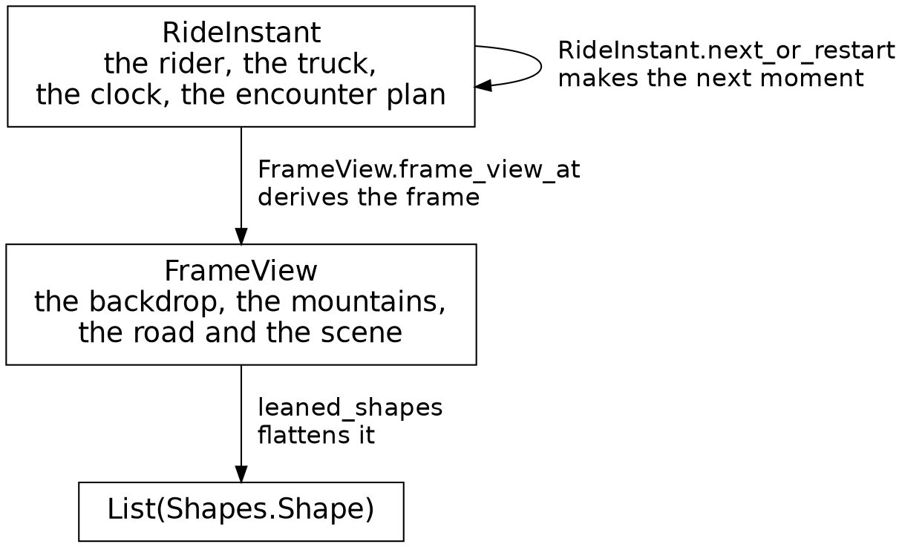

### Four things carried

Here's the whole of what the ride carries:

{{code RideInstant.RideInstant from "RideInstant := {" to "}.{"}}

We derive everything else on the screen from those four fields and the road, afresh in every frame: the sky's colors, the sun, the beacons, the headlights, the cat's pose and the bird's, every sighting and every shape. `Tour` keeps the moments before this one, for stepping back, and each of those is the same record of four fields.

### One step, in order

The four read each other, so the order inside a step matters. As the {{chapter The ride instant}} chapter showed, `RideInstant.next` takes them in this order:

1. The rider moves, reading where the encounter on its segment has got to at the old clock. A cat in the road holds the throttle.
2. The clock ticks.
3. The truck aims at how far along the route the rider now is.
4. The step keeps the encounter plan, drops it at a new segment, or makes one from the rider who has just moved.

The rider reacts to the cat on every step. The cat reacts to the rider once, when its plan is made, and after that it plays on the clock alone. Swap the truck's line with the rider's, and the truck aims at where the rider was a step ago. Stepping back reuses a moment instead: `Tour.step_back` takes an earlier moment off its list.

### Where each thing comes from

Ask of each thing on the screen where it comes from:

| What you see | Where it comes from |
|---|---|
| The rider's view | Derived from the rider, the route, the encounter plan and the clock |
| The sky | Derived from the clock |
| The sun and the mountains | Derived from the clock and the camera |
| The beacons | Derived from the clock and the tower each one tops |
| The trees and the herds | Derived from the world, built once, the camera, and the clock, whose darkness dims them |
| The cat and the bird | Derived from the encounter plan, the clock and the camera |
| The truck | Derived from its progress, one of the four, and the camera |
| Its headlights | Derived from the clock, through the sky's darkness |
| Its brake lights | Derived from the truck, which says whether its last step slowed it |

Every row comes from the four and the road. Even the truck, whose progress the ride carries, reaches the frame through the camera like everything else. The book has shown one design: a small state carried from step to step, everything else derived from it, and types that allow only right states. Get the types right, and everything else follows.

## Appendix: the patterns

Nine patterns kept turning up along the way. They're patterns in a loose sense: shapes of code that Roc makes easy to write and hard to break.

| Name | What it is | Where to see it |
|---|---|---|
| Carried and derived | Carry the few things that must persist from step to step, and derive the rest each frame | `RideInstant`, `Sky`, `Beacon` |
| A sighting decides, a sprite paints | A pure function answers with plain data, or a refusal, and something else turns the data into shapes | `Pipeline.sighting_of`, `TowerSighting` |
| Places and distances | One opaque type for where, a second for how far apart, and only the sums that make sense | `Clock` and `Steps`, `Bearing` and `Turn`, `Along` and `Distance` |
| Rule and timeline | One function says how far along an animation is, and a timeline, plain data, says what the animal shows at each stage | `EncounterPlan.stage_at` and `CatCrossing.crossing_timeline` |
| The step function | A value goes in, and the next value comes out | `Rider.rider_at_next_step`, `TruckJourney.truck_progress_at_next_step`, `Tour.step_forward` |
| The chain of limits | One value passes through independent rules, each of which can only lower it | `Throttle.next_acceleration` |
| One record per space | Field names say which coordinate system a point is in | `RoadPoint`, `RiderPoint`, `PointAtHeight`, `Point` |
| Rehearsal | Run the real rules on a pretend copy, read the result, and throw it away | `Coast`, `LeanSearch`, `Motorcycle.cross_bend_if_on_road` |
| Invariants by `crash` | A fact that holds whenever the program is right is enforced with a `crash`, which stops the program at the first value that breaks it | `Fraction.of`, `Clock.minus`, `VehicleLimits.braking_to` |

## Appendix: list functions

The ride builds most of its answers out of lists. These are the main `List` functions the chapters use, in the order they first come up.

| Function | What it does | Chapter |
|---|---|---|
| `map` | Calls a function on each item, and returns a list of the answers | Lists and map: a far tree |
| `map_with_index` | `map`, with each item's place in the list, counting from 0 | Lists and map: a far tree |
| `concat` | Puts a second list after the first | Lists and map: a far tree |
| `join` | Makes one list of a list of lists | The pipeline |
| `keep_oks` | Calls a function that returns a `Try` on each item, keeps the `Ok` values, and drops the `Err`s | Errors as tag unions |
| `List.from_iter` | Collects a count, such as `U32.until(0, n)`, into a list | The road |
| `join_map` | Maps each item to a list, and joins the lists into one | Rails |
| `drop_first` | Drops the first items, as many as it's given | Rails |
| `fold` | Hands each item in turn to a function, along with the answer so far, starting from a first answer | The throttle |
| `find_first` | Returns the first item that passes a test, as a `Try` | The truck's motion |
| `List.repeat` | Makes a list of one value, as many times as it's given | The cat |
| `take_first` | Keeps the first items, as many as it's given | The math layer |
| `map2` | Walks two lists side by side, and calls a function on each pair | The math layer |

## Appendix: what catches you out

These are the Roc surprises the chapters meet, sorted by where they first show up. The last column names the chapter.

| What you see | What's going on | Chapter |
|---|---|---|
| A method call with no import | A method sits inside its type's braces, and the call finds it from the type of the value before the dot | Functions |
| A helper with no keyword to say it's private | Anything outside a type's braces is private to its module | Where clauses: asking a kind |
| A `where` clause matching the wrong method | A clause matches a method by its name and type alone, so the pipeline's methods all start with "scenery" | Where clauses: asking a kind |
| A crash with a sentence about a sum | `Fraction.of` crashes on a ratio outside 0 to 1, because such a ratio means the sum behind it is wrong | Errors as tag unions |
| `var` and `while` inside a pure function | A variable lives and dies inside its function, so the function is still pure | Variables and loops: rehearsal |
| `?? crash` on a lookup | It enforces an invariant: the lookup always finds its value, and a miss is a bug | The bird |
| A frame hash that moves after a sum was regrouped | Floating-point sums and products depend on their order, so the order is part of what they mean | Proving it |
| An `expect` that can't see a type | An `expect` can name only what its module imports, so a check that needs several modules lives in `gates/expects/` | Proving it |

## Appendix: glossary

This book uses these words in one sense only.

| Word | What it means |
|---|---|
| Across | A place across the road, measured from its middle. Left is negative. |
| Along | A place along a segment, measured from its start. |
| Backdrop | The sky and the grass, the first thing in every frame. |
| Billboard | An animal drawn from an emoji's still, standing still and seen from the side, like the cows. |
| Carried | Kept from one step to the next. The ride carries four things: the rider, the truck, the clock and the encounter plan. |
| Corner | One of the points of a shape. |
| Critter | Any animal in the ride, from the cat to the elephant. A tree or a tower is never a critter. |
| Depth | How far ahead of the camera something is. Far things are painted first. |
| Derived | Worked out afresh in every frame, from what the ride carries and the road. |
| Encounter | What a segment holds for the rider to meet: a cat crossing, a bird's flight, or a quiet road. |
| Encounter plan | One of the four carried things: whether the encounter on the rider's segment is planned yet, and the step it starts at. |
| Far scenery | The sun and the mountains: a direction and a height above the horizon, and never any nearer. |
| Frame | One picture of the ride, for one step. |
| Invariant | A fact that holds whenever the program is right, such as a share lying between 0 and 1. The ride enforces each one with a `crash`. |
| Kind | Which sort of thing something is, like `Conifer`, and the type a `Geom.Placed` carries. |
| Near plane | The closest the camera can see, 0.4 metres ahead. A sighting refuses a thing whose foot is short of it, and a line or face that crosses it is cut there. |
| Picture | Everything on the screen in one frame. |
| Placed | Put on the road, measured `along` and `across` a segment, and `lift` off the ground. |
| Polygon | A shape of any number of corners but three or four, which are triangles and quads. |
| Rendering | A sprite with its depth, a `Rendered`. |
| Route | The list of segments that makes up the whole ride. |
| Segment | One stretch of road, from one bend to the next. |
| Shape | One item in a frame's list, such as a triangle, a disc or a polygon. |
| Sighting | A thing's spot and its kind, for one frame: a `Pipeline.Sighted`. |
| Solid | A thing whose every corner has its own place along, across and above the road, like the truck. |
| Spot | Where a thing stands in one frame, seen from the camera: a `Spot`. |
| Sprite | How one thing looks in one frame: its shapes, a `Sprite`. |
| Step | One tick of the ride. Each step has one frame. |
| Still | An animal's drawing, as polygons in units of its own height. |
| Tier | One layer of a conifer's crown. |

## Appendix: index

Each term points to the chapter that mentions it most, then by number to every other chapter it appears in. A term in fifteen chapters or more says "throughout".

{{index}}

## Credits

Safari Ride was designed by Steve Howell. Claude wrote most of the code and this book under his direction.

The animals by the road are drawn from Microsoft's [Fluent Emoji](https://github.com/microsoft/fluentui-emoji), in its Flat style, under the MIT license.

The way these chapters open and close, and the appendix "what catches you out", are ideas from Braeden Foster's [Rocco tutorial](https://github.com/Pixelsprout/rocco-engine).
