# Safari Ride: a tour of a real Roc program

*[The live ride goes here, running as you read.]*

This is Safari Ride. A rider cycles down a long road through open country, past trees, cows and pigs, with a truck somewhere ahead. Radio masts blink in the distance. A bird takes off as the rider comes near. A cat walks into the lane, freezes, and leaps for the far verge. The sun goes down behind the mountains, and the truck turns on its headlights.

Safari Ride has the important parts of a game's world: terrain, physics, a camera, things that react to the player, and a day that ends. It doesn't have game mechanics yet. Nothing keeps score.

A safari is a guided tour, so this is a tour of a tour. It starts with the big picture, zooms in on a few parts of the program, and zooms back out at the end. Safari Ride is about seventy modules of Roc, which is enough to show how Roc holds up in a program with a lot going on. The tour assumes you can already read Roc. Each chapter points out a few Roc ideas as they come up, and the useful ones come up more than once.

## The problem

The problem is simple to state. Design a world once. Then, each time the clock ticks, move what moves, find everything near enough to see, and draw it against the backdrop.

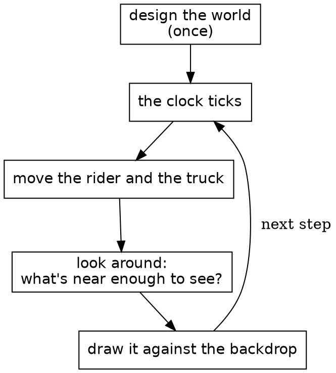

It works like a flipbook, the little stack of drawings that seems to move when you riffle the pages with your thumb. Each page is drawn whole. Safari Ride draws a page about thirty times a second.

The middle box is the heart of it. On a real safari, a guide scans the land and calls out what's there: a cat by the third tree, a bird on the far side. Each of those is a sighting, true for that instant and gone the next. Safari Ride takes its sightings the same way, fresh on every page.

## One whole module

Before the map, here's a whole module, so you know what the boxes on it look like up close. This is the clock from the second box above, all thirty lines of it.

{{module Clock}}

Most of Safari Ride's small modules have this shape: a comment saying what the thing is, its imports, and one type named after the module. `Clock :: U32.{ ... }` is an opaque type: a `U32` underneath, with its methods in the block after it. `Clock.(n)` wraps a number, and in a parameter list it unwraps one, and only this module can do either. Nothing else can add 7 to a clock or pass a tree count as one. `is_eq : _` asks Roc to derive equality.

It's called like this, once a step:

{{code RideMoment.step from "clock: moment.clock.next()," to "clock: moment.clock.next(),"}}

`moment.clock.next()` is static dispatch: `next` comes from the type of `moment.clock`, so the call needs no import.

## The modules

Here's the whole system, simplified. An arrow points from a module to one it imports, so a module is composed of what it points at. Dashed boxes each stand for a family of modules. Roc doesn't allow import cycles, so nothing here can point back up.

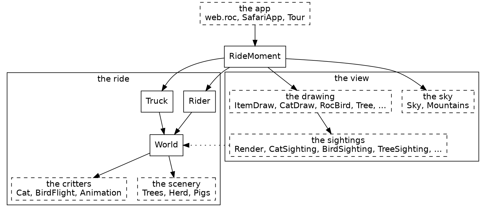

There are two halves. The ride is `Rider`, `Truck` and `World`, with `World` composing the route from its scenery and critters. It knows nothing of drawing. The view is everything that turns the ride into a picture: the sightings find what's in sight, and the drawing paints it. The dotted arrow is the view reading the ride, and no arrow goes the other way. `RideMoment` sits over both, holding one instant of the ride and stepping to the next, and the browser only sees `SafariApp`, which hands it a list of shapes each frame.

### The part that isn't Roc

Safari Ride runs in a browser, and that takes a thin layer of JavaScript. The Roc compiles to wasm. Each tick, the JS keeps the clock, gathers the keys, and calls into Roc. Roc answers with a list of shapes, and the JS paints them on a canvas. The JS knows nothing of cats, and the Roc knows nothing of canvases. The whole game is on the Roc side of that line, and the same app also runs natively. `canvas_apps/ARCHITECTURE.md` has the details, and the platform chapter comes back to it.

### What's a sighting?

Most things in the view come in pairs, and the names say which half is which: `CatSighting` and `CatDraw`, `TreeSighting` and `Tree`, `TowerSighting` and `Tower`, `TruckSighting` and `TruckDraw`.

A sighting answers one question each frame: which of these can the rider see right now, and how should each one look? `CatSighting` goes through the segments ahead, asks `Cat` where it is, works out where that lands in the rider's view, and drops any cat behind the camera or too small to matter. What it hands back is a plain record with no drawing in it:

{{code CatSighting.CatItem}}

`Render` gathers every sighting's items, a depth sort puts them in order, and `ItemDraw` hands each one to the module that paints it. Because a sighting's answer is plain data, it can be checked with numbers, without drawing anything. The rule is simple: a sighting decides, and drawing paints.

## All that's stored

A record is the plainest shape in Roc, and it's nearly all this needs. `RideMoment := { ... }.{ ... }` makes the module's own type out of one. That's a nominal type, which can carry a block of definitions, and unlike an opaque type it leaves its fields readable.

{{code RideMoment.RideMoment from "One moment of the ride" to "}.{"}}

Those three fields are the whole of what Safari Ride keeps from one step to the next. The cat has no state, and neither does the bird, the sun or the beacons. Each frame works them all out again from the rider, the truck and the clock.

That gives three kinds of moving thing, and the tour is organized around them:

| Kind | Things | How it works |
|---|---|---|
| Stepped | The rider, the truck | Stored in `RideMoment`, and moved once a step from where it was |
| Rider-driven | The cat, the bird | Worked out from how the rider is approaching, with nothing stored |
| Clock-driven | The sun, the sky, the beacons, the headlights | Worked out from the clock, with nothing stored |

Trees and cows are a fourth kind, the easiest of all: they never change.

Purity makes some things free. `Tour`, the whole journey, is little more than a list of past instants, so stepping back only needs an older one. The cat follows along, since it was never anywhere but where the rider's position puts it, and the sun rises again.

The game itself has no effectful functions at all. It has no `!` names, no `=>` arrows, no `?` and no `where`. Effects live in the platform.

## What never changes

Trees, cows, the pond and the road are built once and only read after that.

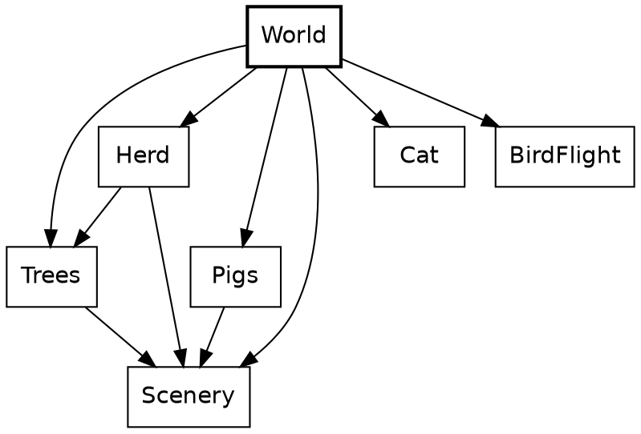

A piece of the world can be just a value. Here's the second whole module, and it's charming in a way code rarely is. `Pond` is a void module, a type with no values whose block holds definitions, and it has two record aliases and six ducks.

{{module Pond}}

There are no functions here at all. The ducks are read where the critters are sighted:

{{code CritterSighting.pond_sightings from "if Scenery.is_pond" to "Pond.ducks.map("}}

`World` turns a route, a plain list of records, into segments of road. A plan for a segment shows how much tag unions can do with no declaration. `[WithBull, NoBull]` is written right in the field's type, and it says more than a boolean would at every place a segment is written down.

{{code World.SegmentPlan}}

A `match` on a closed union has to cover it: leaving out a tag is a compile-time error.

{{code Trees.accent}}

Here's where it's called, picking the colour for a pair of small trees:

{{code Trees.plant_onto from "conifer =" to "Small => Trees.accent(scheme)"}}

`SegmentIndex` is another small opaque type, a `U32` for a segment's place in the route. A place in the route can't be confused with a count of trees, because nothing outside can do arithmetic on it. `crash` appears here too. It isn't for error handling: an index that isn't in the world is a bug in Safari Ride, not a case to handle.

{{code World.SegmentIndex from "## The segment of `world`" to "?? crash"}}

## The sky

The sky is the simplest thing that moves, because it depends on one number.

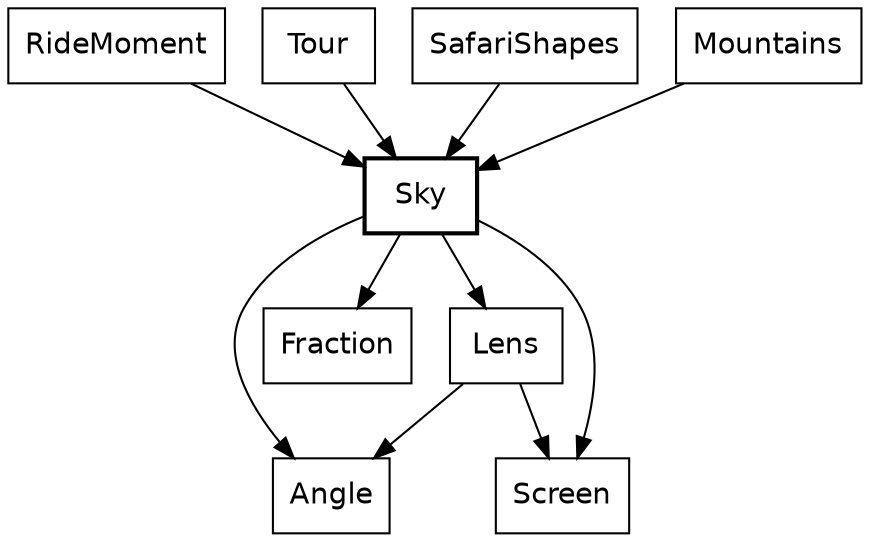

`Sky` sits near the bottom of the system. Leaving out small math helpers, it imports only the angle and fraction types and the lens and screen geometry, and it knows nothing of the rider, the road or the drawing. Those above it each ask for a colour or a sun at a given clock.

*[The sky widget goes here: drag the clock and watch the sun set.]*

### A function of the clock

Every function in this chapter has a `->` arrow, not `=>`. In Roc that's a promise the compiler holds: no effects, so the same clock always gives the same sky. If a function has no `=>` and no `$` in sight, there's nothing behind it to think about.

{{code Sky.sun_height_px}}

The sun's height is a straight line. It starts at 244 pixels, reaches the horizon around step 3,980, and has fully set around step 4,730. `to_f64` is the clock's one door to a float, and this is the only place that uses it.

Dusk calls it. Dusk is a curve and then a line, which means two cases. `Sky` keeps the two halves below its block. Anything outside `Sky :: [].{ ... }` is private to the module, so a helper stays a helper without any keyword.

{{code Sky.dusk_at}}

{{code Sky.dusk_while_up}}

{{code Sky.dusk_after_set}}

And here's the walk up the stack: each frame, `RideMoment` hands the answer to the mountains, whose rock and snow go dark with it.

{{code RideMoment.frame from "Mountains.draw({" to "}),"}}

`Fraction` is a third small opaque type, a ratio from 0 to 1, and only its own block can build one, so a `Fraction` is always in range. It has two ways in. `Fraction.of` takes a ratio that can only be in range and crashes on anything else, because that would be a bug in the sum. `Fraction.clamp` takes a ratio that can rightly fall outside, as a sun sunk far below the horizon does, and holds it at the nearest end.

The horizon's warmth is a third shape, a tent centred on the instant the sun touches the horizon. Three curves come off one number, and they're plain functions rather than anything more general. Nothing else in the game needs them.

{{code Sky.sunset_warmth}}

### Angles that can't be mixed up

The sun is the one thing here that also depends on where the rider is looking. Two tags say the two answers, so there's no `null` and no off-screen sentinel value. A caller has to handle `OutOfView`, because `match` must cover every tag.

{{code Sky.SunPos}}

Opaque types do the most work in this next function. `Angle.Bearing` is a direction in the world and `Angle.Turn` is a change of direction. Both are floats underneath, but only the `Angle` module can build or open one. The function also takes one record argument, destructured in its parameter list, so callers name every field.

{{code Sky.sun_pos}}

Its caller is short enough to read whole:

{{code RideMoment.sun}}

`turn_from_view.abs() >= visible_turn_limit` compares two `Turn`s. The code never touches radians until `sun_place` has to do trigonometry. Passing a `Turn` where a `Bearing` is wanted is a compile-time error:

{{fails turn_as_bearing}}

## The cat

The cat is the best scene in Safari Ride. It walks out, freezes in the lane as the rider bears down on it, and leaps clear at the last possible instant.

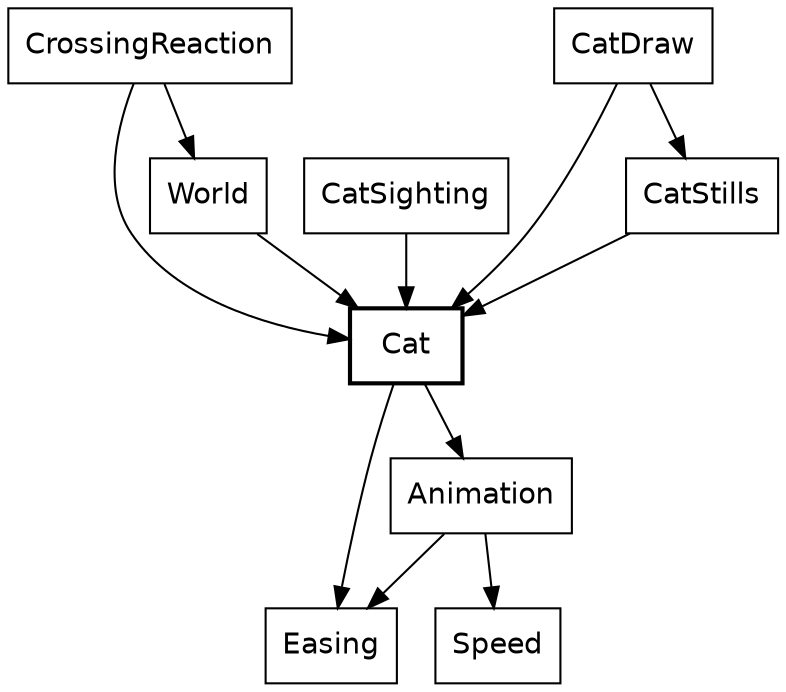

`Cat` says what a cat does, and `Animation` holds what a cat shares with a bird. Everything that uses a cat imports it, and `Cat` imports none of them: it doesn't know it's drawn, sighted or reacted to.

*[The cat widget goes here: drag the rider's gap and watch the crossing play.]*

The slider isn't scrubbing a video. Every position of it is a call to this function. The arrow is `->` again, so the type already says there's no hidden cat being updated somewhere. Method syntax chains the two halves of the job: `.moment(...)` is defined on the `Timeline` that `crossing_timeline` returns.

{{code Cat.moment_at}}

A crossing and an approach go in, and the cat at that instant comes out. The same crossing at the same approach gives the same cat, a thousand frames apart. `crossing_stage` decides how far along things are, and `crossing_timeline` decides what that looks like. They know nothing of each other.

`CatSighting` calls it, adding the distance to the segment to get the gap:

{{code CatSighting.cat_in_view from "gap =" to "moment ="}}

### When it plays

`Approach` is a plain record alias. Its `speed` field isn't a plain number, though. Like `Clock` and `Angle`, `Speed` is an opaque type.

{{code Animation.Approach}}

`Speed.(s)` in a parameter list is how its module opens one. Outside this module, nothing can, so a distance can't be passed as a speed. An animation's beats are an opaque type too, `Beats`: fractional, and tied to no clock, so a place in an animation can't be passed as a step of the ride.

{{code Speed.distance_in}}

`Speed` also defines `is_lte`, which is what lets `speed <= standstill` work in the next snippet with an ordinary operator.

The rule lives in `Animation`. Its first argument is destructured in place, and so is the `Approach` after it, so the body reads in plain names. Here's where `distance_in` gets called, on the second line:

{{code Animation.over_beats}}

And the cat calls the rule with its own numbers:

{{code Cat.crossing_stage}}

The cat plays over beats rather than over a stretch of road because it has to finish before the rider reaches it, however fast the rider comes. A faster rider makes it start earlier. The bird uses `over_gap`, because a bird simply reacts to how close the rider is. Each critter picks the rule that suits it.

The answer is a tag union where two of the tags carry a payload. `Waiting` and `Past` aren't progress of 0 and 1, because a critter can rest somewhere no part of its animation reaches. If `Waiting` were just 0, a perched bird would show the first frame of its flight.

{{code Animation.Stage}}

### What it looks like

A timeline is data, so the cat's whole performance reads in one place, like a score. Tags with payloads do almost everything here: `Through` and `Before` say where a stretch ends, and `Holds` and `Alternates` say how the cat looks.

{{code Cat.crossing_timeline from "looks:" to "finally: Holds(Collapse),"}}

There are two tracks because a cat's looks and its movement change at different instants. Its body moves just ahead of its path, so the `looks` track above cuts at 0.8, 2.8 and 3.8 beats into the escape, while the `path` track below cuts at 1 and 3. One list of phases tying them together wouldn't fit the cat or the bird.

{{code Cat.crossing_timeline from "path:" to "finally: StaysAt(end),"}}

`Timeline` is nominal, the middle ground: unlike an alias it can carry methods, and unlike an opaque type anyone can build one, which is right for data that needs no guarding. `Timeline(pose)` takes a type parameter, which is how a cat and a bird share it. A cat's pose is a closed tag union, and nothing outside `Cat` needs to know its tags. Because it's closed, a `match` on it that misses a pose is a compile-time error.

{{code Cat.Pose}}

A cut has to say which side of it its own beat falls on, and two tags say that better than a boolean would. `crossing_timeline`'s comment says why it matters: those leap beats sum to a float just under the beat they stand for.

{{code Animation.Cut}}

Finding the stretch that's playing shows one more Roc idea. `var $from` is a local variable that a `for` loop reassigns, inside a pure function. Roc allows that because nothing outside can see it: `playing_at` still has a `->` arrow, and the `$` marks what changes. An early `return` ends the loop.

{{code Animation.playing_at}}

### What it does to the rider

So far the cat hasn't touched the rider. That's a separate question, answered in one place.

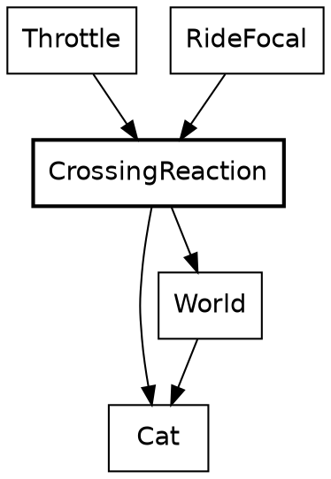

`Throttle` and `RideFocal` know nothing of cats. They ask `CrossingReaction`, which is the only part of the rider's code that does.

`..others` in the argument's type makes it an open record: this function needs `along` and `speed`, and accepts any record that has them, so it doesn't depend on `Pose.RiderState`. `speed` here is the opaque `Speed` again, and `match` on `segment.crossing` has to name every tag.

{{code CrossingReaction.reaction_to}}

A cat in the lane stops the rider opening the throttle, without braking, and widens the view as it pulls the rider's eye. Two tags, `MayAccelerate` and `NoAcceleration`, stand where a boolean might have gone. Its caller is one line, and that line's caller is the lens:

{{code RideFocal.crossing_attention}}

{{code RideFocal.ride_focal}}

This is the only loop in the design. The rider's speed decides where the cat has got to, and the cat holds the rider's speed down. It settles, and it's also why `over_beats` has to stay the cat's rule. A bird asks nothing of the rider, so it falls through to the same answer as an empty road.

Each stretch of road has exactly one `crossing`: `CatCrosses`, `BirdFlies` or `QuietRoad`. A cat and a bird in the same place can't be written down.

### Getting it on screen

The last step is finding the cat in the rider's view.

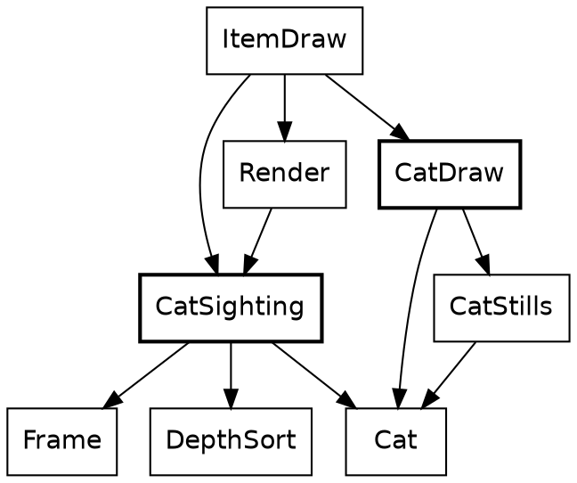

`CatSighting` and `CatDraw` never import each other. `ItemDraw` is what carries a sighting's answer to the drawing.

`CatSighting` places the cat and decides whether it's big enough to draw. An empty list or a list of one is how it says "maybe", because the caller flattens them with `join_map`.

{{code CatSighting.cat_in_view}}

Notice what isn't in this chapter: a cat in `RideMoment`, an update loop, or a flag saying the cat has already crossed. Roc doesn't force that, but pure functions make the stateless version the easy one to write, and every `->` shows it stayed that way.

## The beacons and the headlights

The cat walked out of its place in the order. Two clock-driven things were left behind when it did, and both are brief.

### A blink

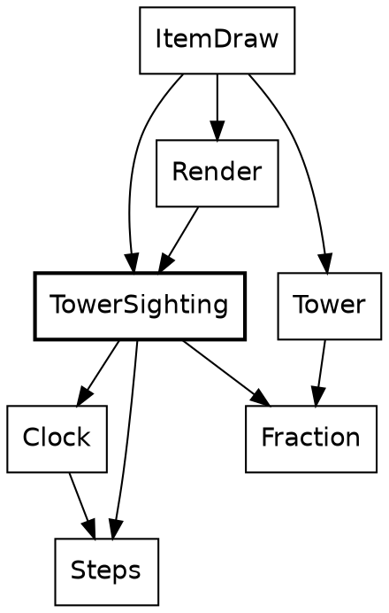

A beacon is the only thing in Safari Ride that repeats on the clock, so it's the first thing that needs to ask how far into a cycle it is. That question isn't about an instant of the ride. It's about a length of time, and Safari Ride keeps those two apart.

*[The beacon widget goes here: drag the clock and watch the masts blink out of step.]*

`Clock` says which step it is. `Steps` says how long something lasts. Both are opaque `U32`s, and `Clock.minus` turns two clocks into `Steps`, the same way two `Angle.Bearing`s make an `Angle.Turn`. Adding two clocks means nothing, so `Clock` has no `plus`, and no code can. Call this *places and distances*: one opaque type for where something is, a second for how far apart two of them are, and only the sums that make sense.

Here, `wrapped_to` is `Steps`'s one way to reach `%`. The result is a `Fraction` built with `of`, because `(1 - cos) / 2` can only be in range:

{{code TowerSighting.beacon_brightness}}

Each mast starts somewhere else in the cycle, so the masts along a road don't blink together. This function is one line of method calls, and every call in it is on a `Steps`:

{{code TowerSighting.beacon_offset_for}}

The sighting calls both, adding the two `Steps`. `view.clock.minus(Clock.start)` is how a place becomes a distance, and it says which distance: the one from the start of the ride.

{{code TowerSighting.tower_if_ahead from "if center.forward <= Geom.near_plane" to "view.clock.minus(Clock.start)"}}

Its caller gives each mast its key, the segment's index. Records with named fields stand in for what would otherwise be five arguments in a row, and `InChain(position)` is a tag carrying a payload, saying where the segment lies from the rider:

{{code TowerSighting.segment_towers from "end_tower = tower_if_ahead(" to "end_tower.concat(mid_tower(view, position))"}}

A mast halfway along a segment takes the key plus 60. That's a small piece of number theory hiding in a constant: 60 staggers of 37 steps come to 2,220, which is 18 periods of 120 and 60 left over, so the mid-mast blinks exactly opposite the end mast.

Notice where the clock stops. `TowerItem.beacon_brightness` is a `Fraction`, and neither `Tower` nor `ItemDraw` imports `Clock`. A sighting decides, and drawing paints. A beacon's blink is decided in the same place as whether the mast is in view at all.

There's no blink abstraction. `Animation.Alternates` also follows a wave, and the resemblance ends there: it picks a pose, and this picks a brightness. Nothing else in the game blinks.

The clock counts steps, not seconds, so pausing the ride freezes the beacons, and stepping back runs them backwards.

### One switch

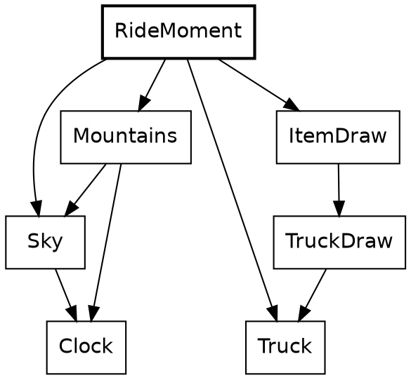

The truck's headlights come on once the sun has gone behind the mountains, at step 4,039 of a ride that lasts 7,040. `Mountains` knows the skyline and already imports `Sky`, so the question is asked there. The argument is an opaque `Clock`, and the answer is a plain `Bool`, which is about to be turned into something better:

{{code Mountains.is_sun_behind_mountains}}

`Truck.Lights` is a record of two tag unions, written in place. `[On, Off]` needs no declaration, and two independent lamps aren't one state with four values, so they're two fields:

{{code Truck.Lights}}

`RideMoment` puts it together. It has to be up here. `Truck` is in the ride half of the system and `Mountains` is in the view, and no arrow goes from the first to the second. `RideMoment` imports both.

{{code RideMoment.truck_lights}}

Lamps are to the truck what a pose is to a cat. The sighting carries them, and the drawing does what they say, with each `match` covering both tags:

{{code TruckDraw.draw from "beams =" to "].join()"}}

That's the clock-driven things. Each is a function with a `Clock` in its arguments, and nothing about them outlives the frame.

## The bird

The bird is Roc's logo, sitting on a treetop. As the rider comes near it takes off, flies across the road and ahead, and drops onto a tree on the far side. It's a rider-driven thing like the cat, and it cost much less, which is the point of this chapter.

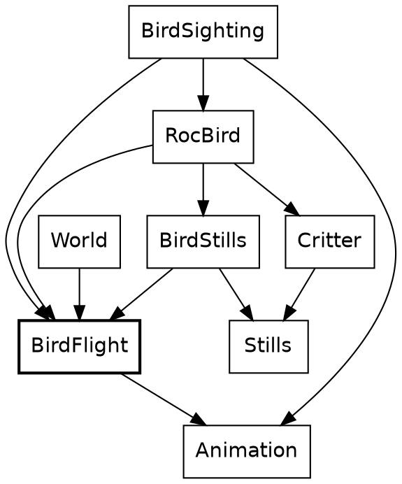

The family has the cat's shape. `BirdFlight` says what a bird does and imports nothing that draws it. `BirdSighting` finds it, `RocBird` draws it, and `BirdStills` holds its pictures. `Animation` is underneath, and most of what the bird does is ask `Animation` for something.

The only `+` in `BirdFlight` is a tree's distance plus the shortest hop. The rest is constants, tags and one timeline.

*[The bird widget goes here: drag the rider's gap and watch the bird fly.]*

### Two rules

A rule turns where the rider is into a `Stage`. The cat's rule was `over_beats`, and the bird's is `over_gap`. The first argument of each is destructured in place, and both answer the same tag union. `over_gap` has a shorter job, so here it is first. `Fraction.clamp` is the right door because a rider far off gives a ratio well outside 0 to 1, and `<=` works on a `Fraction` because `Fraction` defines `is_lte`:

{{code Animation.over_gap}}

The bird calls it with two constants, and passes no speed, since this rule doesn't take one:

{{code BirdFlight.flight_stage}}

Beside it, again, is the cat's rule. Its second argument is the whole `Approach`:

{{code Animation.over_beats}}

The two say different things about the same road:

| | `over_gap` | `over_beats` |
|---|---|---|
| It reads | The gap | The gap and the speed |
| It starts | 60 metres off, always | Earlier for a faster rider |
| It ends | 15 metres off, always | `buffer` metres short, always |
| It's for | Something that reacts to how close the rider is | Something that has to finish in time |
| A stopped rider | Leaves the bird hanging where the gap puts it | Holds the cat at the start of its crossing |

The extra case in `over_beats` is there because its ratio divides by a stretch that a stopped rider makes zero. `over_gap` divides only by constants, so it has no such case. That hanging bird is real: nothing in `over_gap` knows a bird can't hover. The rider doesn't stop near one on this route, so it doesn't come up. [check: confirm the rider never stops inside a bird's 45 metres, including the pigs on the third segment.]

Now the one-liners, side by side. A bird's and a cat's `moment_at` have the same shape:

{{code BirdFlight.moment_at}}

{{code Cat.moment_at}}

Each is a rule's `Stage` handed to a timeline's `moment`. Neither half knows which other half it's been paired with. Call this *rule and score*: one function says how far along things are, and one piece of data says what that looks like. It's composable in the plain sense, because a third critter can take either rule with a timeline of its own, and a new rule would work with both timelines already written.

### A score one beat long

`BirdFlight` sets the length of a flight to one beat, so that a cut on the timeline is simply a share of the flight:

{{code BirdFlight.flight_beats}}

The bird needs one small helper. It sits below the block, so it's private, and it builds an `Alternates` from two poses. `Animation.Looks(BirdFlight.Pose)` is `Looks(pose)` with the type parameter filled in, which is how the cat's timeline type came to fit a bird:

{{code BirdFlight.wings_beating}}

Then the score. `Animation.Timeline.( ... )` wraps a record in the nominal type, and `Side(WingsUp)` is a tag whose payload is another tag. `flight_beats.portion(takeoff_share)` is a method on the opaque `Beats`, and `landing_share.complement()` is one on the opaque `Fraction`. It reads almost like configuration, and most of it is:

{{code BirdFlight.flight_timeline from "length: flight_beats," to "finally: Holds(Diving),"}}

Wings beat all the way through the first two stretches. `count` runs from the start of the timeline, so the wing beat carries on across the cut from side-on to from-behind without restarting.

The path track shows why a `Track` has `finally`. A flight is one unbroken curve, so it has no cuts at all:

{{code BirdFlight.flight_timeline from "path: {" to "rise: flight_arc,"}}

That `Arc` is a tag, and has nothing to do with the `Arc` module that comes later. `path_spot` is where it's played. `{ ..on_line, lift: ... }` is record update: the spot on the straight line, with one field replaced. The curve is `4t(1 - t)`, a parabola that's 0 at both ends and 1 at the middle, so `rise` means what its comment says. This is the polite end of the math chapter.

{{code Animation.path_spot}}

The stills are data too. Nested tags get checked all the way down, so a `match` that forgets `Away(WingsDown)` is a compile-time error. The function reads as a table, and there's nothing else in it:

{{code BirdStills.pose_polys}}

`RocBird.draw` hands that to `Critter.draw_still`, which is what a cow uses, and a bird's feet go through the same `Camera.project` as a tree's top. That's the drawing.

### Finding a tree

Where a bird flies is decided once, when the world is built. `route_from` shows the plain end of Roc's list functions. `keep_if` takes a closure, and `is_far_enough` is one, closing over `from`. `first()` answers a `Try`, which is one of the few that Safari Ride opens by hand. A route is a tag union with two tags: a bird with no tree to fly to `Sits`, which beats a flight of length zero.

{{code BirdFlight.route_from}}

The caller's return type is written in place, a tag union that exists for this one function and fits straight into the `crossing` field of a segment:

{{code BirdFlight.crossing_among}}

And that's called from a `match` in the middle of a record, which is a reminder that `match` is an expression. The plan's plain `BirdCrosses` tag comes in, and `BirdFlies(route)` goes out:

{{code World.built_segment from "crossing: match plan.crossing {" to "QuietRoad => QuietRoad"}}

Each frame, a sighting reads the route back. `|` in a pattern covers two tags with one branch. The crossing is matched in full, so a third kind of crossing would stop here until someone says what a bird sighting should do about it:

{{code BirdSighting.segment_bird}}

Nothing in this chapter is new machinery, and that's what it shows. The four bird modules come to 421 lines, a quarter of them coordinates for the stills, and `Animation` didn't change to admit a bird. [check: the line count once the expect work lands, and the share that's stills.]

## The stepped things

Everything so far can be asked about any instant, cold. Hand `Cat.moment_at` a gap and it answers. The rider and the truck can't do that. Where each of them is depends on where it was, so their state has to be kept, and it's the only state there is. This chapter is about the two fields of `RideMoment` that aren't a clock.

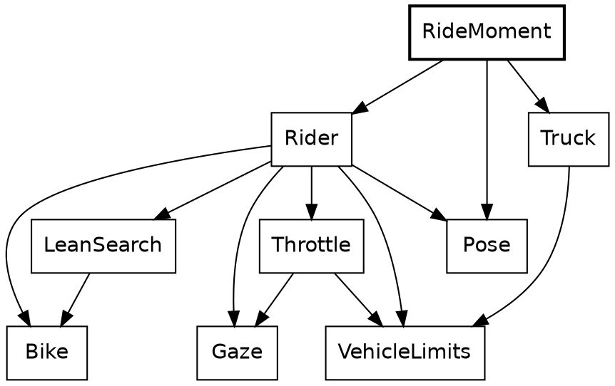

Here's the step again, this time whole. Its body is a block: names, then a record, which is the value of the block. The rider moves first, and the truck reads where the rider has just got to, so the order of those lines is a rule of the game, and `dist` is what carries it.

{{code RideMoment.step}}

`Clock.next`, `Rider.advance` and `Truck.advance` all have the same shape: a value goes in, and the next value comes out. Call that *the step function*. There's no mutable rider being nudged. There's a rider, and another rider one step on, and the old one is still a perfectly good value, which `Tour` keeps in a list.

Stepping has a price, and it's worth stating against the cat:

- A cat can be asked about any gap. A truck at step 4,000 has to be played there, or written down by hand.
- A wrong critter rule is wrong in the frames it touches. A wrong step moves the rider for the rest of the ride.
- `RideMoment.step` has an order, and frames don't.

*[The step widget goes here: pause the ride, step back and forward, and watch the three stored fields change.]*

### The rider

A plain record alias holds the rider, and `RideMoment` stores one. Count the opaque types: `SegmentIndex`, `Turn`, `Speed`, `Lean`, `Bearing` and `Fraction`. Four fields of this one record are angles, of three different types, and passing one type where another is wanted is a compile-time error.

{{code Pose.RiderState}}

The step is four things in order, which is close to how it reads. Static dispatch finds `segment_in` on the `SegmentIndex`. The `match` on `seg.ending` has two tags, and `Continues(_)` ignores its payload:

{{code Rider.advance}}

A decision is a record of two opaque values. There's something to notice in the last line of this next function. `Throttle` is asked about a bike that doesn't exist yet: the rider as it would be with the new lean, which `Bike.with_tilt` makes by building a new record. The real rider isn't touched, because nothing can touch it.

{{code Rider.decide}}

That idea gets larger soon. A small version of it decides what happens at the end of a segment. `resolve_cross` works out the rider on the next segment and keeps that only if it lands inside the lane. The rejected rider simply stops being referred to, and nothing has to be undone:

{{code Rider.resolve_cross}}

Record update does most of the writing in this module. Its plainest use is stopping dead, where `..s` keeps everything but the two fields named:

{{code Rider.stopped_at}}

### The bike

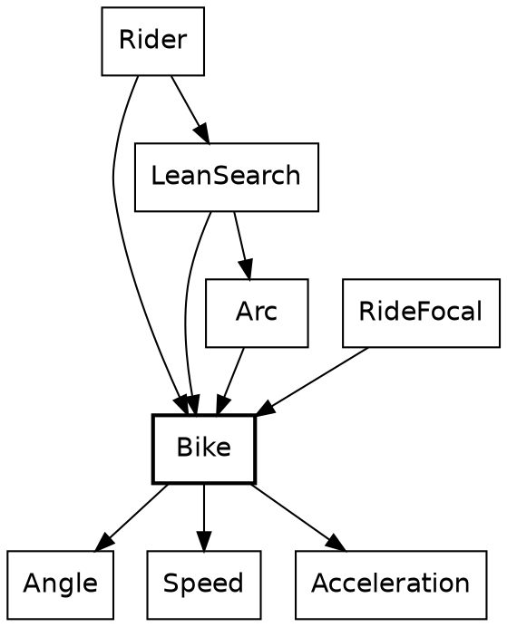

`Bike` is 56 lines, and it's the physics. Its type is the first one in the tour that names the rest of a record. `..others` makes `Motion` open: it's any record with these six fields and whatever else, with `others` standing for the whatever else.

{{code Bike.Motion}}

A structural type like this has to be named when it appears twice. Here it appears in the argument and in the result, and that's the promise: what goes in comes out with the same other fields. A `Pose.RiderState` goes in, with its `segment`, `gaze_yaw` and `focus`, and a `Pose.RiderState` comes out, though `Bike` has never heard of a gaze. Compare `CrossingReaction.reaction_to`, whose open record is only read, and which hands nothing back.

Call this *a narrow view of a wide record*. A module says exactly which fields it cares about, and the compiler takes care of the rest, with no base class and no copying fields across by hand. The smallest example in the program is a function with one job:

{{code Bike.with_tilt}}

`{ ..s, tilt }` is record update with a shorthand: the field and the local have the same name. `Rider.decide` called it above. Here's the step, which `Rider.advance` called:

{{code Bike.simulate_rider_step}}

Reading down, the types do their share of explaining. A `Lean` can't be added to anything but a `Lean`, and it only reaches direction through `tilt.steer(yaw_per_tilt)`, which is the single door from roll to yaw. The bike then moves along the middle of the step's turn, which is what `s.yaw.plus(turn.times(0.5))` means. `to_radians()` appears at the last line that can do without it: `r_cos` wants a float.

### The throttle

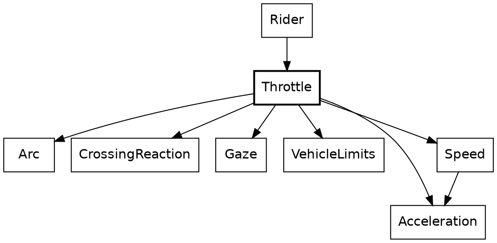

The rider has several reasons to slow down, and they don't know about each other. A turn is coming. A cat is in the lane. There's a pig to look at. The road is about to run out. `Throttle` writes them as a line of gates. An `Acceleration` goes in, a gate lets it through or lowers it, and the next gate gets what's left:

{{code Throttle.get_forward_accel_decel from "a2 = crossing_gate(" to "a4 = shoulder_brake(state, a3)"}}

Call this *the gate chain*. Each gate has the same shape and can be read alone, and adding a reason is one more line. It reads like a list of rules because that's what it is.

Each gate compares two opaque `Acceleration`s with an ordinary `<`, which works because `Acceleration` defines `is_lt`. `crossing_gate` shows two more things about patterns. A guard, `if a > Acceleration.steady`, adds a condition to a branch, and `|` joins two tags in one. When the guard fails, `NoAcceleration` falls through to the last branch. This is where `CrossingReaction`'s tag from the cat chapter lands: the cat stops the rider opening the throttle, and a rider already braking stays braking.

{{code Throttle.crossing_gate}}

`Speed` and `Acceleration` are places and distances again: two speeds make an acceleration, and an acceleration moves a speed. The sum behind braking for a turn is the first line of a physics textbook, `v² = u² + 2as`, solved for `a`. This function is a good example of how far opaque types reach into a parameter list. `target: Speed.(t)` opens the field's `Speed` where it's destructured:

{{code Speed.acceleration_to}}

The first gate calls it, for the distance left to the point where the rider commits to the turn. Three modules use that one line of physics: this one, `Gaze` to slow for a pig, and `Truck`.

{{code Throttle.corner_brake from "corner_a = (" to "state.speed.acceleration_to({ target: v_end, within: d })"}}

After the gates, `clamp_v` holds the speed between rest and the limit, and the function's last move is a small piece of bookkeeping. The chain works in accelerations and the limits are speeds, so the answer is taken back with `.change_from(state.speed)`, the other half of the same pair of types.

The rest of `Throttle` is plainer than this section makes it sound. A good deal of it is still in the shape its emitter left, with brackets round whole bodies. [check: which of these `if (x) a else b` and `( ... )` forms survive the emitter cleanup, then trim the snippets or this sentence.]

### The truck

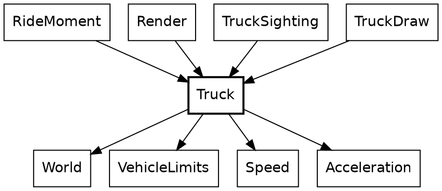

The truck is what the rider chases. It starts 500 metres ahead and keeps to a schedule that brings it to within 100 at the route's end. Its state is three fields:

{{code Truck.TruckState}}

The schedule is a straight line, and a pure function of the rider's progress, destructured from a record so the call site has to name both numbers:

{{code Truck.scheduled_position}}

Its one caller is the truck's step function, the same shape as the rider's. `NextTurn` is a tag union with a payload on one side, so the only way to read a `distance` is to be inside the branch where there is one:

{{code Truck.advance}}

And that's called from `RideMoment.step`, above, with the rider's distance as the only thing the truck knows of the rider. Nothing in `Rider` imports `Truck`, and nothing in `Truck` imports `Rider`. The chase is one record literal in `RideMoment`.

Finding the next turn shows a list pattern. `[]` is the end of the route, and `[segment, .. as later_segments]` takes the first segment and names the rest. Recursion walks the list, carrying where the current segment starts. Only `Truck` and `Paint` use a list pattern. Elsewhere the same walk is a `fold`.

{{code Truck.next_turn_on}}

It's called through a smaller function, which supplies the 0 so nobody else has to:

{{code Truck.next_turn}}

Then the two ways to take a step. Both sit below the block, private, and both are arithmetic on `Speed` by name. `target_speed.max(...)` keeps braking from undershooting, and `speed < truck.speed` is the whole of what turns on the brake lights. They're on while the truck is slowing down, and they go off when it's settled at the speed for the turn, even with the turn still ahead.

{{code Truck.advance_braking}}

{{code Truck.advance_on_schedule}}

`brake_lights` is state because it's a fact about the last step. Headlights aren't, and they stay out of `TruckState`. That's the three kinds of moving thing in one vehicle: the place and speed are stepped, the headlights are clock-driven, and the tyres don't change.

The truck has no `Animation`, and it's worth saying why. A timeline has a known length and can answer for any point along it. The truck has neither. Its next step depends on its last, and its route depends on the rider. `TruckSighting`'s `lead` is the same quantity as an `Approach`'s `gap`, and it has a different name because it's being chased.

The rider's lean has been passed over twice now, with `LeanSearch` doing something the last few sections kept pointing at. That needs the math.

## Zooming back out

*[This chapter ties the tour together once the stepped things, the proof and the platform are written. It returns to the flipbook and the first diagram: the clock ticks, and everything composes from three stored fields.]*

## Credits

Safari Ride was designed by Steve Howell. Claude wrote most of the code and this tutorial under his direction.
