# Safari Ride: a tour of a real Roc program

A long walk through one program of about eighty Roc modules: the big picture, the details, and the big picture again.

## Introduction

Safari Ride is a program written in Roc, and it runs in the page below. It takes a moment to load. When it's ready, a ride starts by itself.

```widget ride
The ride, running as you read. Click it to give it the keyboard: Space pauses, and the arrows step.
```

This is Safari Ride. A rider cycles down a long road through open country, past trees, cows and pigs, with a truck somewhere ahead. Radio towers blink in the distance. A bird takes off as the rider comes near. A cat walks into the lane, freezes, and leaps for the far verge. The sun goes down behind the mountains, and the truck turns on its headlights.

Safari Ride has the important parts of a game's world: terrain, physics, a camera, things that react to the player, and a day that ends. It doesn't have game mechanics yet. Nothing keeps score.

A safari is a guided tour, so this is a tour of a tour. We'll start with the big picture, zoom in on a few parts, and zoom back out at the end. Safari Ride has about eighty modules of Roc, so you'll get to see how Roc holds up in a program with a lot going on.

We assume you can already read Roc. If you can't yet, the official tutorial is the place to start. We'll point out a few Roc ideas in each chapter as they come up.

Each block of code and each diagram has a title line above it. A title line can carry one of these markers:

| Marker | What it says |
|---|---|
| 🔭 | Looking out over the whole |
| 🐾 | Following the trail down to the details |
| 🌳 | A branch, which calls others of Safari Ride's own |
| 🍃 | A leaf, which calls none of them |

## The problem

Here's the problem Safari Ride has to solve. We design a world once. Then, each time the clock steps, we move what moves, find everything near enough to see, and draw it against the backdrop.

The problem, as a loop
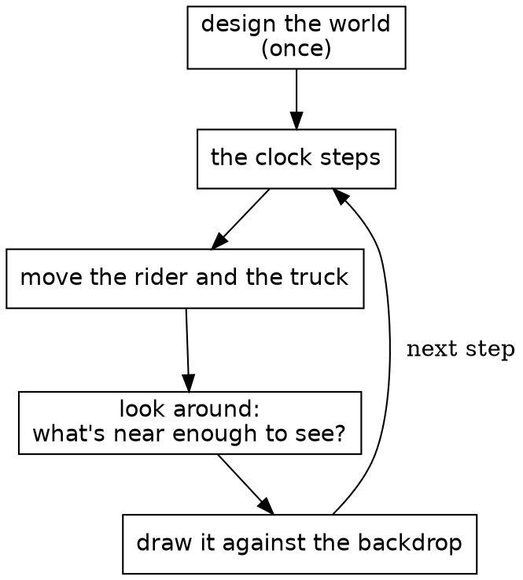

It works like a flipbook, the little stack of drawings that seems to move when you riffle the pages with your thumb. Each page is drawn whole. Safari Ride draws a page about thirty times a second. The code calls a page a frame, and a turn of the loop a step.

The most interesting box is the middle one: looking around. On a real safari, a guide scans the land and calls out what's there: a cat by the third tree, a bird on the far side. We'll call each of those a sighting. A sighting is only true for the moment it's made, so Safari Ride throws them all away and makes new ones for every page.

Next, let's look at what one of those boxes looks like in Roc.

## One whole module

A module of Safari Ride is one file of Roc. This chapter shows one from top to bottom, and it starts with a line that doesn't compile. Here we try to add 7 to the ride's clock:

{{fails clock_plus_seven}}

New in this chapter:

- Roc: opaque types, `is_eq : _`, `expect`, static dispatch
- Modules: `Clock`

This is the module that stops that line, all of it.

{{module Clock}}

Most of Safari Ride's small modules look like this: a comment saying what the thing is, some imports, and one type named after the module.

`Clock :: U32.{ ... }` defines an opaque type. Underneath, a `Clock` is a `U32`, and the block after it holds its methods.

`Clock.(n)` wraps a number into a `Clock`. In a parameter list, it does the opposite and unwraps one. Only this module can do either, which means no other module can add 7 to a clock, or pass a count of trees where a clock is expected.

`is_eq : _` asks Roc to derive equality for us. Below the type, each `expect` is a test, and `roc test` runs them all.

Safari Ride calls it once a step, like this:

{{code RideInstant.next from "clock: instant.clock.next()," to "clock: instant.clock.next(),"}}

`instant.clock.next()` is static dispatch: `next` comes from the type of `instant.clock`, so the call needs no import.

Because a clock is an ordinary value, a test about one fits on a single line. The `expect` above that starts at step 5,699 uses `Clock.at_step` to get there directly, so the test doesn't have to run the ride for 5,699 steps first.

That's one module out of about eighty. In the next chapter, we'll see how the rest fit together.

## The modules

Safari Ride is about eighty modules of Roc. This chapter shows how they fit together, starting with the whole system, simplified.

Each arrow points from a module to a module it imports. A dashed box stands for a family of modules. Roc doesn't allow import cycles, so no arrow can point back up the diagram.

The whole system, simplified
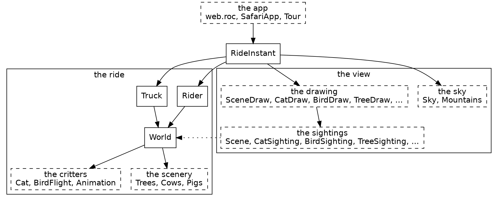

New in this chapter:

- Roc: imports that can't form a cycle
- Modules: `SafariApp`, `Scene`, `SceneDraw`, `CatSighting`

There are two halves. The ride is `Rider`, `Truck` and `World`. `World` puts the route together from its scenery and critters. Nothing in the ride knows anything about drawing.

The view is everything that turns the ride into a picture. The sightings work out what's visible, and the drawing code paints it. The dotted arrow shows the view reading the ride. No arrow goes the other way.

`RideInstant` sits above both halves. It holds one instant of the ride and steps to the next. The browser only ever sees `SafariApp`, which gives it a list of shapes each frame.

### The part that isn't Roc

One tick across the line between JavaScript and Roc
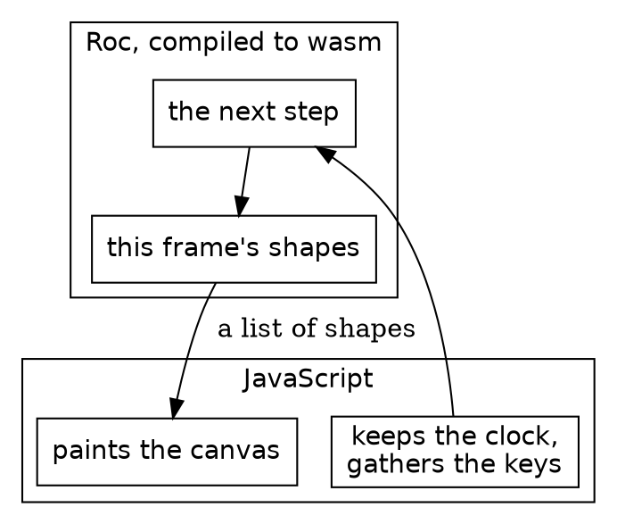

Safari Ride runs in a browser, and that takes a thin layer of JavaScript. The Roc compiles to wasm. Each step, the JS keeps the clock, gathers the keys, and calls into Roc. Roc answers with a list of shapes, and the JS paints them on a canvas. The JS knows nothing of cats, and the Roc knows nothing of canvases. The whole game is on the Roc side of that line, and the same app also runs natively. `canvas_apps/ARCHITECTURE.md` has the details, and the platform chapter comes back to it.

### What's a sighting?

At step 1,570 of the ride, a cat is frozen in the lane. This is what `CatSighting` answers about it on that frame:

| Field | Value |
|---|---|
| `right` | 0.75 metres |
| `forward` | 25.39 metres |
| `height` | 1.7 metres |
| `pose` | `Frozen` |
| `lift` | 0 |

That's a sighting: where the rider sees something, and how it should look.

Most things in the view come in pairs, and the names say which half is which: `CatSighting` and `CatDraw`, `TreeSighting` and `TreeDraw`, `TowerSighting` and `Tower`, `TruckSighting` and `TruckDraw`.

A sighting answers one question each frame: which of these can the rider see right now, and how should each one look? `CatSighting` goes through the stretches of road ahead, which Safari Ride calls segments, asks `Cat` where it is, works out where that lands in the rider's view, and drops any cat behind the camera or too small to matter. What it hands back is a plain record with no drawing in it:

{{code CatSighting.CatSighting}}

`Scene` gathers every sighting's answer, a depth sort puts them in order, and `SceneDraw` hands each one to the module that paints it. Because a sighting's answer is plain data, it can be checked with numbers, without drawing anything. So a sighting decides what's visible, and the drawing code only paints what it's told.

Cows, pigs and the other animals by the road are all sighted the same way, by `CutoutSighting`, and `Cutouts` decides which of them get drawn. `Detail` holds the thresholds behind that kind of decision: how near a tree shows its full detail, and how few pixels tall something may be and still be drawn.

Everything in this chapter happens within a single frame, and none of it survives to the next one. So what does carry over from step to step? That's the next chapter.

## The ride instant

Each time the clock ticks, Safari Ride moves the rider and the truck and draws everything again. `RideInstant` is the one record it keeps from one tick to the next, and it holds the rider, the truck and the clock. One tick is a step.

```widget step
Click the ruler to play the ride to that step, or to go back to it.
```

The first three lines under the ruler are that record's three fields, read from a real ride. Click to the right of the dot, and the ride plays up to that step, eight steps a frame, with what's left to play marked on the ruler. Click to the left, and it's there almost at once, because the steps it has been through are kept in a list.

New in this chapter:

- Roc: nominal types, code with no effects in it
- Modules: `RideInstant`, `Tour`

A record is the plainest shape in Roc, and it's nearly all this needs. `RideInstant := { ... }.{ ... }` makes the module's own type out of one. That's a nominal type, which can carry a block of definitions, and unlike an opaque type it leaves its fields readable.

{{code RideInstant.RideInstant from "One instant of the ride" to "}.{"}}

Those three fields are the whole of what Safari Ride keeps from one step to the next. The cat has no state, and neither does the bird, the sun or the beacons, the blinking lights on the radio towers. Each frame works them all out again from the rider, the truck and the clock.

That gives three kinds of moving thing, and the tour is organized around them:

| Kind | Things | How it works |
|---|---|---|
| Stepped | The rider, the truck | Stored in `RideInstant`, and moved once a step from where it was |
| Rider-driven | The cat, the bird | Worked out from how the rider is approaching, with nothing stored |
| Clock-driven | The sun, the sky, the beacons, the headlights | Worked out from the clock, with nothing stored |

Trees and cows are a fourth kind, the easiest of all: they never change.

The game itself has no effectful functions at all. It has no `!` names, no `=>` arrows and no `?`. Effects live in the platform.

### Pausing and stepping

Mostly, Safari Ride is a screensaver: you sit back and watch it. You can also take the controls. Click the ride to give it the keyboard, and Space pauses it. While it's paused, Right moves one step forward and Left moves one step back. While it's running, each moves four steps at a time. J jumps to the next segment of the road, and R starts over.

`SafariApp.step` handles all of that. It takes the model and a snapshot of the input, and it returns the next model:

{{code SafariApp.step from "paused = if input.key_pressed(KeySpace)" to "Tour.step_forward(m.tour)"}}

There's no event handler here. Each frame, the runner hands `step` a snapshot, and `step` reads it. `key_pressed` says a key went down since the last frame, so one tap of Space pauses the ride once. `key_down` says a key is being held, so holding Right keeps the ride moving.

Stepping forward is the ordinary step. Stepping back is more interesting, because it's where keeping so little pays off. `Tour` holds the current instant and a list of the instants before it, so going back just means taking the last one off the list:

{{code Tour.step_back}}

Nothing has to be undone. An old `RideInstant` is still a perfectly good value. The cat ends up in the right place because its position was only ever worked out from the rider's, and the sun ends up in the right place because it was only ever worked out from the clock. Neither one needs any code for going backwards.

Four kinds of thing have been named, and so far none has been shown.

## The world

Some of Safari Ride never changes. Trees, cows, the pond and the road are built once and only read after that, which makes them the easiest part of the program to read, so the tour starts there.

```widget route
Drag along the route and read each segment's record.
```

Each stretch of this map is one record of a list called `World.plans`, and the lines under the ruler read it out. The marks on the ruler are the six segments with a cat or a bird. We drew the map for this page: the ride itself never has one.

New in this chapter:

- Roc: void modules, tag unions written in a field's type, `match` that has to cover every tag, `crash`
- Modules: `World`, `Pond`, `Trees`

The modules around `World`


A piece of the world can be just a value. Here's the second whole module. `Pond` is a void module: a type with no values, whose block holds definitions. This one has two record aliases and six ducks.

{{module Pond}}

Above its `expect`s, there are no functions here at all. The ducks are read where the critters are sighted:

{{code CutoutSighting.pond_sightings from "if Scenery.is_pond" to "Pond.ducks.map("}}

`World` turns a route, a plain list of records, into segments of road. A plan for a segment shows how much tag unions can do with no declaration. `[WithBull, NoBull]` is written right in the field's type, and it says more than a boolean would at every place a segment is written down.

{{code World.SegmentPlan}}

A `match` on a closed union has to cover it: leaving out a tag is a compile-time error.

{{code Trees.accent}}

Here's where it's called, picking the color for a pair of small trees:

{{code Trees.plant_onto from "conifer =" to "Small => Trees.accent(scheme)"}}

`SegmentIndex` is another small opaque type, a `U32` for a segment's place in the route. A place in the route can't be confused with a count of trees, because nothing outside can do arithmetic on it. `crash` appears here too. It isn't for error handling: an index that isn't in the world is a bug in Safari Ride, not a case to handle.

{{code World.SegmentIndex from "## The segment of `route`" to "?? crash"}}

A value that never changes can be checked once, whole. `Pond`'s one function is below its block, and it's there for a test:

{{code Pond.is_on_water}}

The `expect` under it, in the module above, runs that over all six ducks. One line covers the whole pond.

Nothing in this chapter moves, but the ride does. Next, we'll look at the simplest thing that moves: the sky.

## The road

A road of straight segments still has to get round its bends. Where two segments meet, something has to pave the corner and put up a rail.

```widget bends
Drag to turn the bend, and watch the rail change sides.
```

The road here is two segments, seen from above, and the white dot is where the view is from. The rail runs along the outer edge of the bend, and the yellow dot is the apex, where the outer edges of the two segments meet. The marks on the ruler are the route's own bends. Dragging past the middle swaps the outer edge from one side to the other. A road with no turn has no apex, so the ruler skips the last five degrees either side of straight.

New in this chapter:

- Roc: a closure that gives a repeated call a short name
- Modules: `BendView`, `GroundSighting`, `RailSighting`

`BendView` knows where two segments meet. `GroundSighting` and `RailSighting` each ask it about a bend, and each answers with plain data for another module to draw.

🔭 The modules around `BendView`
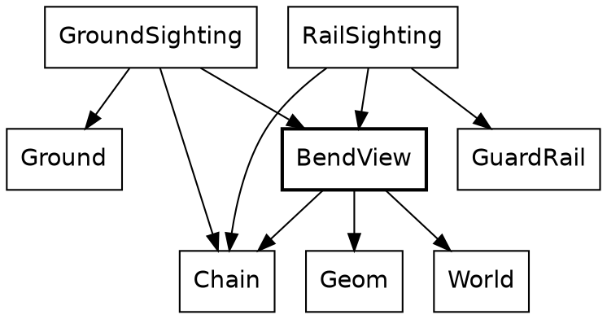

Everything in this chapter is measured from the rider, as a `Geom.RiderPoint`: so many metres to the right, and so many ahead. `Chain` finds where a point on the road lies from the rider, and the math layer chapter shows how. On the road itself, `Along` is a place along a segment and `Across` is a place across the road, and both are opaque types.

### Where two segments meet

A bend is a small record.

🐾 {{code BendView.BendView from "A bend as the rider sees it" to "}.{"}}

`before` and `after` say where the two segments lie from the rider. The turn is positive to the right.

🌳 {{code BendView.outer_edge}}

A bend to the right has its outer edge on the left. That's the swap at the middle of the ruler.

🌳 {{code BendView.apex}}

`point_before` and `point_after` are closures. Each gives a call with four arguments a short name, so the two lines below them read alike. Each line runs along the outer edge of one segment, and `Geom.line_crossing` finds where the two cross. That's the yellow dot.

The road is 4 metres wide, so at a turn of 45 degrees the apex lies 4 × tan(22.5°) past the end of the first segment, which is the 1.7 metres the widget shows. Two parallel lines never cross, so a road with no turn has no apex, and nothing asks for one.

### Paving a corner

A piece of ground is a list of corners and a color.

🐾 🍃 {{code GroundSighting.road_patch}}

That's what `Ground` paints. It's plain data, so it can be checked with numbers.

🌳 {{code GroundSighting.bend_corner}}

Four points cut the corner: the two ends of the first segment, the apex, and the place where the second segment's outer edge starts.

🌳 {{code GroundSighting.lead_in}}

The last 40 metres before a bend get a patch of their own, laid after the road's chunks and before the corner.

🌳 {{code GroundSighting.bend_ground}}

The road along a segment is laid in chunks of up to 25 metres. The widget's two segments are 60 metres each, which makes three chunks each, and `bend_ground` adds two patches. That's the widget's count of 8.

🌳 {{code GroundSighting.pond_ground}}

A pond is ground too. A segment that ends at a pond gets two more patches, the water and its bank, and their outlines come from `Pond`. `on_map` is another closure, and it moves an outline from the pond's own record onto the road.

### The rail at a bend

The rail is a path along the outer edge, out to the apex, and back.

The path of a guard rail
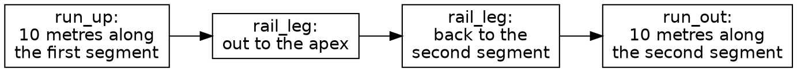

🌳 {{code RailSighting.rail_path}}

The four parts of the list are the four boxes.

🌳 {{code RailSighting.rail_leg}}

A leg gets a point about every metre. It leaves out its first point, which is the last point of the leg before it.

🌳 {{code RailSighting.rails_at}}

`GuardRail.quads_along` turns the path into rails and posts for the depth sort. At a turn of 45 degrees, that's the widget's 49 pieces.

All of this is worked out again on every frame, from the route and the rider. A bend is kept nowhere.

## The sky

The sky is the simplest thing that moves, because it depends only on the clock.

```widget sky
Drag the clock and watch the sun set.
```

Drag across it from left to right, and the clock runs from step 0 to step 6,000. The sun sinks steadily, and near step 3,980 its center meets the horizon: the sun line reads 0.0 px, and the warmth line tops out at 99%, since it rounds down. The marked stretch of the ruler is where the horizon has any warmth at all. The disc is gone near step 4,730, and the dusk line reaches 100% near step 5,490, before the marked stretch ends. Dragging back raises the sun along the same path.

New in this chapter:

- Roc: `->` as a promise, privacy without a keyword, records destructured in a parameter list, tags in place of `null`, code that doesn't compile
- Modules: `Sky`, `Fraction`, `Angle`

`Sky` is a set of functions that each take a clock and answer with a color or the sun's place.

🔭 The modules around `Sky`
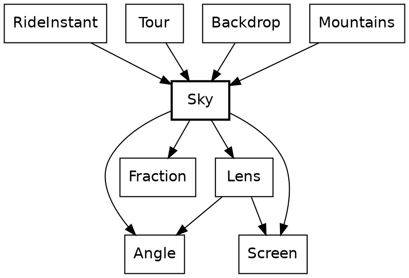

`Sky` sits near the bottom of the system. Leaving out small math helpers, it imports only the angle and fraction types and the lens and screen geometry, and it knows nothing of the rider, the road or the drawing. Those above it each ask for a color or a sun at a given clock.

Every function in this chapter has a `->` arrow, not `=>`. That tells you the function has no effects, and the compiler holds it to that. So the same clock always gives the same sky. If you don't see a `=>`, you only have to think about what the function is given.

Here's one of the questions being asked. `Tour.sky_top_color` takes the clock from the current instant and hands it to `Sky`.

🌳 {{code Tour.sky_top_color}}

Here's what happens behind that call. In this diagram a box is a function, not a module, and an arrow is a call. Only `Sky`'s own functions are shown, and two small helpers are left out.

The calls inside `Sky`
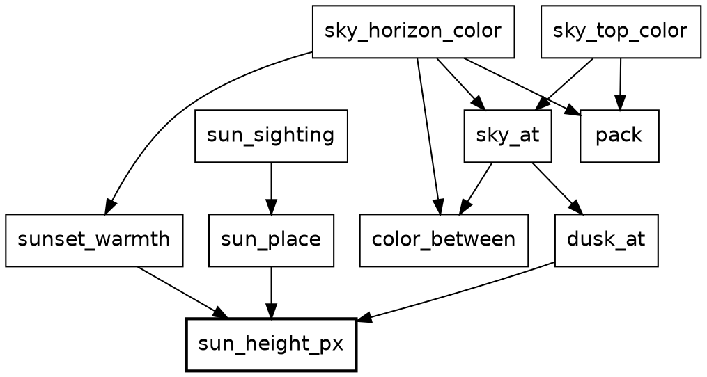

Everything on this diagram that changes with the clock comes down to the box in bold, which is the only one that turns the clock into a number. The rest is color on one side and the sun's place on the other.

The rest of this chapter reads those calls from the bottom up, from where the clock becomes a number to the colors at the top. Together the calls form a tree. A function that calls none of Safari Ride's own is a leaf, and a walk through the tree is a trail.

### A function of the clock

These are the three numbers that come off the clock, at seven steps:

| Step | Sun's height | Dusk | Warmth |
|---|---|---|---|
| 0 | 244.0 px | 0% | 0% |
| 2,000 | 121.5 px | 10% | 0% |
| 3,000 | 60.2 px | 23% | 45% |
| 3,980 | 0.2 px | 42% | 99% |
| 4,730 | -45.8 px | 59% | 58% |
| 5,490 | -92.3 px | 100% | 16% |
| 6,000 | -123.6 px | 100% | 0% |

The sun's column falls in a straight line, the dusk column is a curve and then a line, and the warmth column is a tent.

We start at the bottom of the tree, which isn't on the diagram, because the diagram shows only `Sky`. It's back in `Clock`. `Clock.to_f64` opens the opaque type and calls `U32`'s own `to_f64`, which comes with Roc. It calls nothing else in Safari Ride, so it's a leaf.

🐾 🍃 {{code Clock.to_f64}}

`sun_height_px` calls it. The sun's height is a straight line. It starts at 244 pixels, reaches the horizon around step 3,980, and has fully set around step 4,730. `to_f64` is the clock's one door to a float, and this is the only place that uses it.

🌳 {{code Sky.sun_height_px}}

The next answers are `Fraction`s. `Fraction` is a third small opaque type, a ratio from 0 to 1, and only its own block can build one, so a `Fraction` is always in range. It has two ways in. `Fraction.of` takes a ratio that can only be in range and crashes on anything else, because that would be a bug in the sum. `Fraction.clamp` takes a ratio that can rightly fall outside, as a sun sunk far below the horizon does, and holds it at the nearest end.

Dusk is a curve and then a line, which means two cases, `dusk_while_up` and `dusk_after_set`. `Sky` keeps them below its block. Anything outside `Sky :: [].{ ... }` is private to the module, so a helper stays a helper without any keyword.

🌳 {{code Sky.dusk_while_up}}

🌳 {{code Sky.dusk_after_set}}

`dusk_at` calls `sun_height_px`, then one of those two:

🌳 {{code Sky.dusk_at}}

And here's the walk up the stack: each frame, `RideInstant.shapes` hands the answer to the mountains, whose rock and snow go dark with it.

🌳 {{code RideInstant.shapes from "Mountains.draw({" to "}),"}}

The horizon's warmth is a third shape, a tent centerd on the instant the sun touches the horizon. That makes three curves from one number. They're plain functions, because nothing else in the game needs them. Here's `sunset_warmth`:

🌳 {{code Sky.sunset_warmth}}

### From curves to colors

The numbers above become two colors, the top of the sky and the horizon:

| Step | Top of the sky | Horizon |
|---|---|---|
| 0 | `0x8ecae6` | `0x8ecae6` |
| 3,000 | `0x75a8c6` | `0x9d898e` |
| 3,980 | `0x618ead` | `0xcb6046` |
| 4,730 | `0x4f7595` | `0x966765` |
| 6,000 | `0x243a5e` | `0x243a5e` |

A color ends up as one integer. `pack` gets there with method calls on plain numbers. Static dispatch finds `to_i64_wrap`, `shl_wrap` and `bitwise_or` on Roc's own types. That makes `pack` a leaf, the only one on the diagram.

🍃 {{code Sky.pack}}

`color_between` takes one record argument, destructured in its parameter list, so callers name every field. Each channel moves the same share of the way. `Sky.Rgb` is a plain record alias: three floats with nothing to guard.

🌳 {{code Sky.color_between}}

`sky_at` calls it with the dusk from above. It's private, like the two dusk helpers:

🌳 {{code Sky.sky_at}}

The top of the tree is two calls. `sky_top_color` is the one `Tour.sky_top_color` asked at the start of this chapter, and `sky_horizon_color` is the same sky, warmed toward red by `sunset_warmth`.

🌳 {{code Sky.sky_top_color}}

🌳 {{code Sky.sky_horizon_color}}

### Angles that can't be mixed up

One trail on the diagram is left: the sun's place. It needs angles. `Angle.Bearing` is a direction in the world and `Angle.Turn` is a change of direction. Here we pass a `Turn` where a `Bearing` is wanted:

{{fails turn_as_bearing}}

The sun is the one thing here that also depends on where the rider is looking. Two tags say the two answers, so there's no `null` and no off-screen sentinel value. A caller has to handle `OutOfView`, because `match` must cover every tag.

🐾 {{code Sky.SunSighting}}

Opaque types do the most work from here on. A `Bearing` and a `Turn` are both floats underneath, but only the `Angle` module can build or open one. `sun_place` also calls `sun_height_px`. It's the first code to want a plain number, because `r_tan` takes a float.

🌳 {{code Sky.sun_place from "scale =" to "y: Screen.horizon_y"}}

`sun_sighting` calls it once the sun is known to be in view. It also takes one record argument, destructured in its parameter list.

🌳 {{code Sky.sun_sighting}}

Its caller, `RideInstant.sun`, is short enough to read whole:

🌳 {{code RideInstant.sun}}

`turn_from_view.abs() >= visible_turn_limit` compares two `Turn`s. The code never touches radians until `sun_place` has to do trigonometry.

That's every box on the diagram: one number goes in, and colors and a place for the sun come out, with nothing kept from one frame to the next.

With the sunset, we compute a value based on the clock alone. The cat has a more nuanced rule: the timing of its crossing depends on the rider's position. Before we get to that, we need to be able to draw a cat.

## Birds and cats: drawing the stills

Before a cat can cross the road, we have to be able to draw a cat. Every critter in Safari Ride is a *still*: a small picture made of filled polygons, stored as data. A cat has seven stills, one for each pose, and a bird has six. Animating a critter comes down to choosing which still to show, and where.

```widget stills
Every pose of the cat and the bird. Click one to see it large, and click it again for its polygons.
```

New in this chapter:

- Roc: a large table of plain data
- Modules: `Stills`, `StillDraw`, `CatStills`, `BirdStills`, `EmojiStills`

The stills are the least readable code in Safari Ride, and nobody is meant to read them. They're generated data, encoded as Roc, and this chapter ends with how they got made. Here's how much data each set holds:

| Stills | Kind | Pictures | Polygons | Points |
|---|---|---|---|---|
| `BirdStills` | Hand-drawn | 6 poses | 32 | 119 |
| `CatStills` | Hand-drawn | 7 poses | 275 | 13,453 |
| `EmojiStills` | Emoji-based | one for each animal by the road | 129 | 5,267 |

The distinction matters. The cat and the bird were drawn for this game, and they have poses. The animals by the road started as emoji, and each has one picture.

A polygon is one record. It has a color, an optional gradient and a list of points:

{{code Stills.StillPolygon}}

The bird is the smallest set, because the perched bird is Roc's logo, and the logo is made of a few straight-edged shapes. The cat has far more points, because its curves are made of many short straight lines. Its seven stills fit in a 73-line file, and those lines are very long.

Every point is measured in units of the still's height. Its feet are at `y` 0, and a standing critter is about 1 tall. That's why no pixels or metres appear here. The same numbers draw a cat in the distance and a cat in the lane.

`StillDraw` does the rest. An `Anchor` says where a still stands on screen, which way it faces and how tall it is:

{{code StillDraw.Anchor}}

Drawing a still is then one sum for each point. The height in pixels scales the point, and the feet place it:

{{code StillDraw.screen_point}}

That's all there is to drawing a critter. Each set of stills has a `pose_polygons` function that turns a pose into its polygons, and `StillDraw.draw_still` puts them on screen.

### How the stills got made

That's all the Roc in this chapter. If you came for the Roc, you can skip ahead to [The cat](the-cat.html). The rest of this chapter is the story of where the pictures came from.

At a larger company, a picture like these would pass through three people. An artist would draw it. A software developer would build the tools that get it into the game. A project manager would look at the result and decide whether it's good enough. On Safari Ride, Claude played the first two roles, and Steve played the third.

The artist's cat was a program. An early version of Safari Ride drew the cat in TypeScript, with splines for its body, tapered capsules for its limbs, chains of joints for its legs, and strokes for its whiskers. That's a lot of code to carry from language to language, and a game only ever shows seven poses.

So the developer wrote a baker, a small program that ran the real drawing code once for each pose. A recorder stood in for the canvas. It kept every filled shape as a polygon and turned every stroke into a thin filled quad, and the result was a flat table of polygons. The drawing code stayed behind, and the table moved on.

The emoji-based animals took a different route. They come from Microsoft's Fluent Emoji, in its Flat style. That set draws every animal whole and from the side, where another set draws a rhino as a face, which looks like a bug beside a road. A second baker read each SVG file, walked its shapes in painting order, and cut each curve into short straight lines.

The bull is a hybrid. It comes from the same emoji set, but in its Color style, which is shaded. It's the only still with gradients, on 40 of its 43 polygons, which is why a `StillPolygon` has a place for one. Its 2,309 points are nearly half of `EmojiStills`.

The Roc bird came last. Its perched pose is the logo, and Claude drew the five flight poses to match, directly as polygons, in the logo's two purples.

The project manager's tool was a contact sheet: every still, side by side, in one image. Each bake wrote one, and Steve looked at it. No test can say whether a cat looks like a cat. The comment in the emoji baker puts the standard well: "an elephant is an elephant".

The bakers belong to the older versions of Safari Ride, in TypeScript and Zig. The polygons they made have been carried along ever since, which is why these files look like generated data. They are.

Now that we can draw a cat in any pose, we can work out which pose to show.

## The cat

A cat walks out into the lane, freezes as the rider bears down on it, and leaps clear at the last possible instant. It's one of the most elaborate effects in Safari Ride, so this chapter takes some concentration. Unlike the sun, which follows the clock alone, the cat reacts to the rider.

```widget cat
Drag the rider's gap and watch the crossing play.
```

Drag across it from left to right, and the gap falls from 50 metres to 0, with the rider held at a metre a step. The cat rests on the right verge until 41 metres, where the marked stretch of the ruler starts and the last line changes to "The rider may not accelerate". It walks out, and at 31 metres it freezes in the lane. It stays frozen down to 7 metres, coils, and is in the air from 6 metres to 4. At 3 metres, where the marked stretch ends, it has collapsed on the far verge and the rider may accelerate again. Below that, nothing changes.

New in this chapter:

- Roc: type parameters, operators on opaque types, `var`, `for` and `return` in a pure function
- Modules: `Cat`, `Animation`, `Beat`, `Beats`, `CatHeights`, `Distance`, `Speed`

The cat is one function, `Cat.instant_at`, with two jobs: work out how far along the crossing is, and look up what the cat does at that point. The module `Animation` sits under both.

🔭 The modules around `Cat`
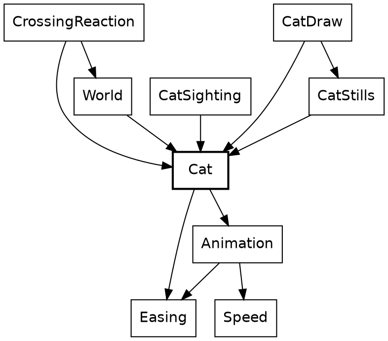

`Cat` says what a cat does, and `Animation` holds what a cat shares with a bird. Everything that uses a cat imports it, and `Cat` imports none of them: it doesn't know it's drawn, sighted or reacted to.

The slider isn't scrubbing a video. Every position of it is a call to `Cat.instant_at`. The arrow is `->` again, so the type already says there's no hidden cat being updated somewhere. Method syntax chains the two jobs: `.instant(...)` is defined on the `Timeline` that `crossing_timeline` returns.

🌳 {{code Cat.instant_at}}

A crossing and an approach go in, and the cat at that instant comes out. The same crossing at the same approach gives the same cat, a thousand frames apart.

`CatSighting.cat_in_view` calls it, adding the distance to the segment to get the gap:

🌳 {{code CatSighting.cat_in_view from "gap =" to "instant ="}}

What `Cat` gets from `Animation` comes down to one type, `Stage`:

{{code Animation.Stage}}

`Stage` is the type where the function's two jobs meet. It's a tag union, and two of its tags carry a payload. You might expect `Waiting` and `Past` to be the same as progress of 0 and 1, but a critter can rest somewhere its animation never goes. If `Waiting` were just 0, a perched bird would show the first frame of its flight.

A rule turns an `Approach` into a `Stage`, and a timeline turns a `Stage` into an `Instant`. `crossing_stage` decides how far along things are, and `crossing_timeline` decides what that looks like. They know nothing of each other.

Here are the calls. In this diagram a box is a function, not a module, and an arrow is a call.

The calls from `Cat` into `Animation`
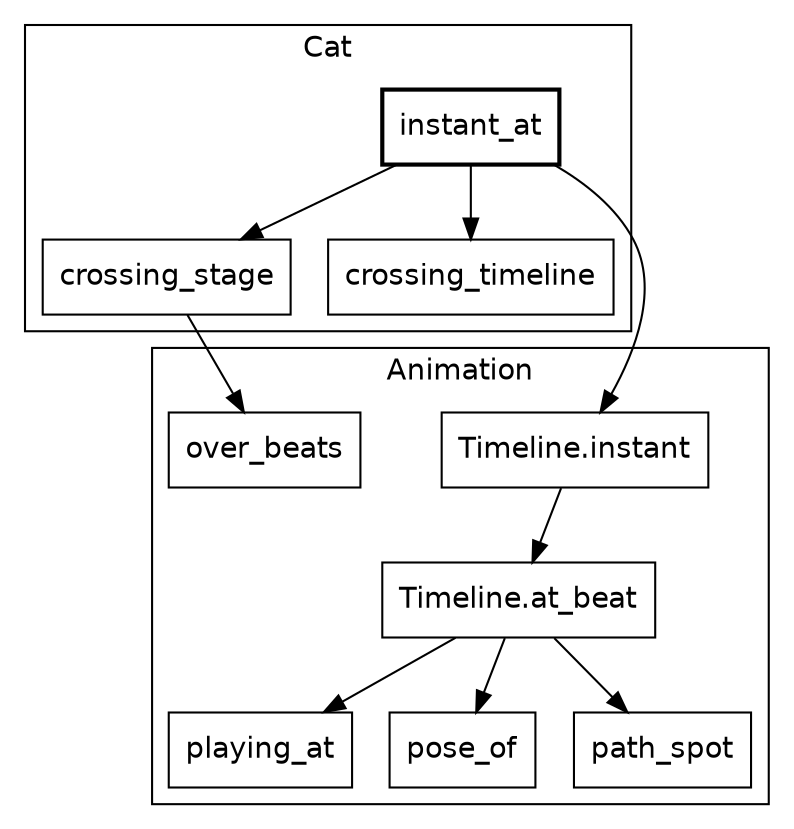

`Cat` reaches into `Animation` twice, once for each job. `crossing_timeline` calls nothing there, because all it does is build a record of what the cat does at each point in the crossing.

The rest of this chapter has three parts. First, we'll see when a crossing plays. Then we'll read the timeline, which says what the cat does at each point. Last, we'll see how it gets on screen.

### When it plays

How far off the crossing starts depends on the rider's speed:

| Rider's speed | The crossing starts at a gap of |
|---|---|
| 1 metre a step | 41 metres |
| 1.5 metres a step | 60 metres |
| 2 metres a step | 79 metres |

A faster rider sets the cat off sooner, so it's clear of the lane in time.

`Cat.crossing_stage` calls the rule with the cat's own numbers. A crossing takes 38 beats: 10 to walk out, 24 frozen, and 4 for the escape. A beat is the animation's own unit of progress, and it's tied to no clock.

🐾 🌳 {{code Cat.crossing_stage}}

The rule lives in `Animation`. It takes the cat's numbers and an `Approach`, which says how the rider is coming:

{{code Animation.Approach}}

`over_beats` destructures its first argument in place, and the `Approach` after it, so the body reads in plain names:

🌳 {{code Animation.over_beats}}

Neither field of an `Approach` is a plain number. `Distance`, `Speed` and `Beats` are opaque types, like `Clock` and `Angle`. A distance can't be passed as a speed, and a place in an animation can't be passed as a step of the ride. `distance_in`, on the second line, multiplies a speed by some beats and gives a `Distance`. `Speed` also defines `is_lte`, which is what lets `speed <= standstill` work with an ordinary operator.


The cat plays over beats rather than over a stretch of road because it has to finish before the rider reaches it, however fast the rider comes. A faster rider makes it start earlier. The bird uses `over_gap`, because a bird simply reacts to how close the rider is. Each critter picks the rule that suits it.

### What it looks like

The two tracks of a crossing, in beats
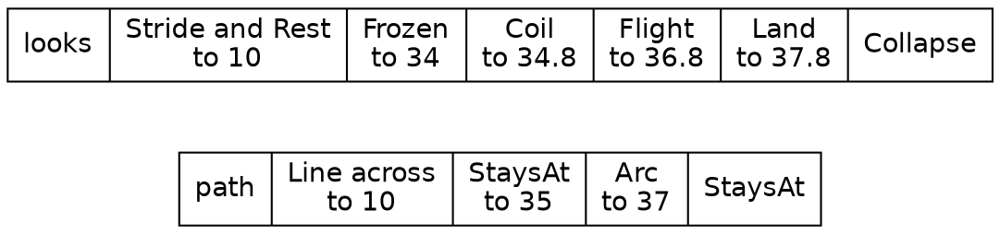

A timeline is data, so the cat's whole performance reads in one place. This is the part of `crossing_timeline` that says how the cat looks:

🌳 {{code Cat.crossing_timeline from "looks:" to "finally: Holds(Collapse),"}}

The words are tags. `Through` and `Before` say where a stretch ends, and `Holds` and `Alternates` say how the cat looks. The poses are a closed tag union, so a `match` that misses one is a compile-time error.

{{code Cat.Pose}}

A timeline is divided into stretches, and a cut is where one stretch ends and the next begins. A cut has to say which stretch its own beat belongs to, and two tags say that better than a boolean would. `crossing_timeline`'s comment says why it matters: the beats of the leap add up to a float just under the beat they stand for.

{{code Animation.Cut}}

There are two tracks because a cat's looks and its movement change at different instants. Its body moves just ahead of its path, so the `looks` track above cuts at 0.8, 2.8 and 3.8 beats into the escape, while the `path` track cuts at 1 and 3. One list of phases tying them together wouldn't fit the cat or the bird.

The `path` track needs three places on the road. `spot_across` makes one, as a single record. It sits below `Cat`'s block, so it's private. `Along.start`, the first place on a segment, is a value and not a call, so this function calls nothing of Safari Ride's.

🍃 {{code Cat.spot_across}}

`crossing_timeline` calls it three times before the timeline starts:

🌳 {{code Cat.crossing_timeline from "## The whole of a crossing" to "end = spot_across"}}

Here's the `path` track:

🌳 {{code Cat.crossing_timeline from "path:" to "finally: StaysAt(end),"}}

`Timeline` is nominal, the middle ground: unlike an alias it can carry methods, and unlike an opaque type anyone can build one, which is right for data that needs no guarding. `Timeline(pose, lift)` takes two type parameters, which is how a cat and a bird share it. A cat fills the first with its own poses and the second with `CatHeights`, because a cat's lift off the ground is measured in its own height.

{{code Animation.Timeline from "## A whole animation" to "}.{"}}

### How a timeline plays

A timeline is data, so something has to play it. This section shows how, and it's where Roc's `var` and `for` appear inside a pure function. If you'd rather get back to the cat, you can skip to "Getting it on screen".

The code that plays a timeline is in `Animation`, and its trail starts at an operator. `Beat.is_lte` opens two `Beat`s and compares the floats inside.


🍃 {{code Beat.is_lte}}

`is_short_of` is one `match`, and it looks like a leaf. It's a branch, because `<=` on two `Beat`s is a call to `is_lte`, and `<` is a call to `is_lt`. An operator on an opaque type runs code of Safari Ride's own.

🌳 {{code Animation.is_short_of}}

Finding the stretch that's playing shows one more Roc idea. In `playing_at`, `var $from` is a local variable that a `for` loop reassigns, inside a pure function. Roc allows that because nothing outside can see it: `playing_at` still has a `->` arrow, and the `$` marks what changes. An early `return` ends the loop.

🌳 {{code Animation.playing_at}}

`Timeline.at_beat` calls it once for each track, which is what lets the two tracks cut wherever they like. `Animation.Timeline.(score)` in a parameter list opens the nominal type, the way `Clock.(n)` opens an opaque one. `pose_of` and `path_spot` turn what's playing into a pose and a spot, and the bird chapter reads `path_spot`.

🌳 {{code Animation.Timeline from "## The critter at `beat`" to "path_spot(path.plays, fraction)"}}

`Timeline.instant` is the one place that knows about stages. Its `match` covers all three tags, and `portion` turns a `Fraction` of the way through into a beat. It answers with an `Instant`, the cat at that point:

{{code Animation.Instant}}

🌳 {{code Animation.Timeline from "## The critter at `stage`." to "Past(_) => score.after"}}

Back at the top, nothing in `instant_at` is unknown any more.

🔭 🌳 {{code Cat.instant_at}}

`crossing_stage(approach)` is the rule with the cat's numbers, `crossing_timeline(cat)` is the timeline, and `.instant` plays the one at the other. A `Stage` is all that passes between them.

### Getting it on screen

The last step is finding the cat in the rider's view.

The modules that put a cat on screen
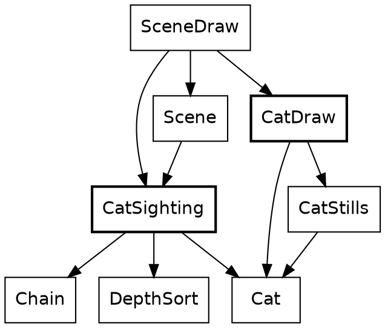

`CatSighting` and `CatDraw` never import each other. `SceneDraw` is what carries a sighting's answer to the drawing.

`cat_in_view` places the cat and decides whether it's big enough to draw. An empty list or a list of one is how it says "maybe".

🌳 {{code CatSighting.cat_in_view}}

`segment_cat` calls it for a segment with a cat, and `in_view` flattens the answers with `join_map`, so a "no" simply disappears:

🌳 {{code CatSighting.in_view}}

Looking back over the chapter, notice what isn't in it: a cat in `RideInstant`, an update loop, or a flag saying the cat has already crossed.

Roc doesn't force that, but pure functions make the stateless version the easy one to write, and every `->` shows it stayed that way.

The cat also has an effect on the rider. A cat in the lane stops the rider speeding up, and that holds the rider back while the crossing plays. It makes more sense once we've seen how the rider is always deciding whether to accelerate, brake or hold steady, so it waits for that chapter.

## The bird

The cat is built on a shared module, `Animation`, and one critter can't show whether that module was written for critters in general or just for cats. The bird is the second critter. It's Roc's logo, sitting on a treetop. As the rider comes near it takes off, flies across the road and ahead, and drops onto a tree on the far side. It's a rider-driven thing like the cat, and it cost much less.

```widget bird
Drag the rider's gap and watch the bird fly.
```

Drag across it from left to right, and the gap falls from 75 metres to 0. The bird sits on the left tree, 5.9 metres up, until 60 metres, where the marked stretch of the ruler starts. It takes off side on, turns away at about 55 metres, and reaches 10.2 metres near the middle of the stretch, shrinking as it goes. It dives from 20 metres, and at 15, where the marked stretch ends, it's perched on the far tree, 4.5 metres up. Below that, the picture stays as it is.

New in this chapter:

- Roc: record update, tags inside tags, closures, opening a `Try` by hand, `match` as an expression
- Modules: `BirdFlight`, `BirdSighting`, `BirdDraw`

The modules around `BirdFlight`


The family has the cat's shape. `BirdFlight` says what a bird does and imports nothing that draws it. `BirdSighting` finds it, `BirdDraw` draws it, and `BirdStills` holds its pictures. `Animation` is underneath, and most of what the bird does is ask `Animation` for something.

`BirdFlight` does one addition, a tree's place plus `shortest_hop`, the shortest flight a bird will make. The rest is constants, tags and one timeline.

### Two rules

A rule turns where the rider is into a `Stage`. The cat's rule was `over_beats`, and the bird's is `over_gap`. They say different things about the same road:

| | `over_gap` | `over_beats` |
|---|---|---|
| It reads | The gap | The gap and the speed |
| It starts | 60 metres off, always | Earlier for a faster rider |
| It ends | 15 metres off, always | `buffer` metres short, always |
| It's for | Something that reacts to how close the rider is | Something that has to finish in time |
| A stopped rider | Leaves the bird hanging where the gap puts it | Holds the cat at the start of its crossing |

The first argument of each is destructured in place, and both answer the same tag union. `over_gap` has a shorter job, so here it is first. `Fraction.clamp` fits here because a rider far off gives a ratio well outside 0 to 1, and `<=` works on a `Fraction` because `Fraction` defines `is_lte`:

{{code Animation.over_gap}}

The bird calls it with two constants, and passes no speed, since this rule doesn't take one:

{{code BirdFlight.flight_stage}}

Beside it, again, is the cat's rule. Its second argument is the whole `Approach`:

{{code Animation.over_beats}}

The extra case in `over_beats` is there because its ratio divides by a stretch that a stopped rider makes zero. `over_gap` divides only by constants, so it has no such case. That hanging bird is real: nothing in `over_gap` knows a bird can't hover. The rider never drops below 1.1 metres a step inside a bird's 45 metres on this route, so it doesn't come up.

Now the one-liners, side by side. A bird's and a cat's `instant_at` have the same shape:

{{code BirdFlight.instant_at}}

{{code Cat.instant_at}}

Each is a rule's `Stage` handed to a timeline's `instant`. Neither half knows which other half it's been paired with. Call this *rule and timeline*: one function says how far along things are, and one piece of data says what that looks like. A third critter can take either rule with a timeline of its own, and a new rule would work with both timelines already written.

### A timeline one beat long

The two tracks of a flight, in shares of one beat
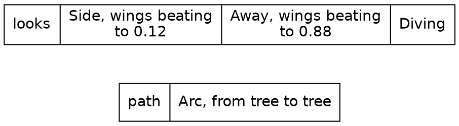

`BirdFlight` sets the length of a flight to one beat, so that a cut on the timeline is simply a share of the flight:

{{code BirdFlight.flight_beats}}

The bird needs one small helper. It sits below the block, so it's private, and it builds an `Alternates` from two poses. `Animation.Looks(BirdFlight.Pose)` is `Looks(pose)` with the type parameter filled in, which is how the cat's timeline type came to fit a bird:

{{code BirdFlight.wings_beating}}

Then the timeline. `Animation.Timeline.( ... )` wraps a record in the nominal type, and `Side(WingsUp)` is a tag whose payload is another tag. `flight_beats.portion(takeoff_share)` is a method on the opaque `Beats`, and `Beat.at` makes a place of the length it gives. It reads almost like configuration, and most of it is:

{{code BirdFlight.flight_timeline from "length: flight_beats," to "finally: Holds(Diving),"}}

Wings beat all the way through the first two stretches. `count` runs from the start of the timeline, so the wing beat carries on across the cut from side-on to from-behind without restarting.

The path track shows why a `Track` has `finally`. A flight is one unbroken curve, so it has no cuts at all:

{{code BirdFlight.flight_timeline from "path: {" to "rise: flight_arc,"}}

That `Arc` is a tag. `path_spot` is where it's played. `{ ..on_line, lift: ... }` is record update: the spot on the straight line, with one field replaced. The curve is `4t(1 - t)`, a parabola that's 0 at both ends and 1 at the middle, so `rise` means what its comment says.

{{code Animation.path_spot}}

The stills are data too. Nested tags get checked all the way down, so a `match` that forgets `Away(WingsDown)` is a compile-time error. The function reads as a table, and there's nothing else in it:

{{code BirdStills.pose_polygons}}

`BirdDraw.draw` hands that to `StillDraw.draw_still`, the function that also draws a cow. A bird's feet reach the screen through `Camera.project`, as a tree's top does, and the math layer chapter shows how. That's the drawing.

### Finding a tree

Where a bird flies is decided once, when the world is built. `habit_from` shows the plain end of Roc's list functions. `keep_if` takes a closure, and `is_far_enough` is one, closing over `from`. `first()` answers a `Try`, which is one of the few that Safari Ride opens by hand. A route is a tag union with two tags: a bird with no tree to fly to `Sits`, which beats a flight of length zero.

{{code BirdFlight.habit_from}}

The caller's return type is written in place, a tag union that exists for this one function and fits straight into the `crossing` field of a segment:

{{code BirdFlight.crossing_among}}

And that's called from a `match` in the middle of a record, which is a reminder that `match` is an expression. The plan's plain `BirdHere` tag comes in, and `BirdHere(route)` goes out:

{{code World.built_segment from "crossing: match plan.crossing {" to "QuietRoad => QuietRoad"}}

Each frame, a sighting reads the route back. `|` in a pattern covers two tags with one branch. The crossing is matched in full, so a third kind of crossing would stop here until someone says what a bird sighting should do about it:

{{code BirdSighting.segment_bird}}

We didn't need any new machinery for the bird. Above their `expect`s, the four bird modules come to about 450 lines, a quarter of them coordinates for the stills. `Animation` has nothing in it about birds.

## The elephant

The cat and the bird both move. The elephant doesn't. It stands at 14 of the route's 19 bends, so it's the animal you'll see most, and what's new about it is where it stands. A grown elephant waits beyond the guard rail on the outside of the bend, and its baby stands in the middle of the road a little further on.

New in this chapter:

- Roc: a `match` that answers with a list
- Modules: `Wildlife`

A segment's `bend_life` field says what's at its bend. `Wildlife.bend_critters` turns that into critters:

{{code Wildlife.bend_critters}}

`Quiet` and `DuckPond` have no animals, so they answer with an empty list. An `Animal` answers with a list of two. `inward` is 1 or -1, so one line of arithmetic places the grown animal on either side of the road.

An elephant has no timeline and no state. It's a plain record, with a place, an emoji, a height and a way to face. `StillDraw` looks up the emoji's still and draws it at that height. The baby is the same still at half the height.

Nothing in that function says "elephant". That's what makes the next chapter short.

## Rhinos, giraffes and the other corner critters

An elephant stands at 14 of the route's 19 bends. A giraffe, a rhino and a zebra have one bend each. They all use the same code as the elephant, and they differ by one row:

{{code Wildlife.species_of}}

Each animal is a tag, and each answers with its emoji and how tall it stands. The `match` has to cover all four.

To add a lion, we'd add a tag, a row here and a still in `EmojiStills`. The compiler would point at every `match` that needs the new tag.

These animals each stand alone at a bend. Most of the others come in crowds, and a crowd starts with a single pig.

## A pig

A pig is the simplest critter in Safari Ride. It has no timeline, and it isn't tied to a bend. Here's how we build one:

{{code Pigs.pig}}

New in this chapter:

- Roc: a `match` on numbers, with a default branch
- Modules: `Pigs`, `Scenery`

That's the record that the elephant and its baby came out as: two places, an emoji, a height and a way to face. A critter's `codepoint` is what finds its still, and that's one `match`, from a number to some polygons:

{{code EmojiStills.emoji_polys_for}}

That's a pig. One pig doesn't look like much of a farm, though.

## Herds: cows and pigs

Safari Ride's farms are crowds of animals, and a crowd is just a list of critters. Both herds are worked out once, when the world is built.

New in this chapter:

- Roc: `List.from_iter` over a range, `match` on a pair
- Modules: `Cows`

### Cows

A herd of 14 cows grazes on the left of the road, in columns of three. Every fourth cow is a calf, at half the height.

{{code Cows.cows}}

A herd in a perfect grid would look like a parking lot, so each cow strays a little from its place:

{{code Cows.cow_at}}

The stray comes from `r_sin` and `r_cos` of the cow's number. It looks random, but it's the same on every run, so the frames stay exact.

A bull may stand in front of the herd, by the trees. It's the same record again, a bit taller than a cow:

{{code Cows.bull_of}}

### Pigs

Pigs graze on the right of the road, near the end of a segment. The first two segments with pigs get a big herd, 7 rows of 7. After that, it's two short rows.

{{code Pigs.pigs_along}}

The `match` is on a pair, so it has to cover all four combinations. The last line joins the two with no pigs.

`Distracting` is the one thing here that a cow doesn't have. One pig in a big herd catches the rider's eye, and the rider slows down to look. That's about the rider more than the pig, so it waits for the rider's chapters.

The critters so far either react to the rider or stand still. The sun only goes one way, and nothing so far repeats on the clock. The beacons do.

## The beacons and the headlights

Some things in Safari Ride are worked out from the clock alone, with nothing stored. The sky is the largest of them. This chapter covers the other two: the beacons on the radio towers, which blink over and over, and the truck's headlights, which switch on once.

```widget beacon
Drag the clock and watch the towers blink out of step.
```

Drag across it from left to right, and the clock runs through two whole blinks, from step 5,400 to step 5,640. The left tower starts dark and the right one at full brightness. At step 5,430, where the first marked stretch starts, both read 49%, and by step 5,460 they've changed places. Each marked stretch is where the left tower is more than half bright. At the far end of the ruler the towers are back where they began.

New in this chapter:

- Roc: a pair of opaque types with only the sums that make sense, records of tag unions written in place
- Modules: `Steps`, `TowerSighting`, `Tower`, `Mountains`, `TruckDraw`

### A blink

The modules behind a beacon
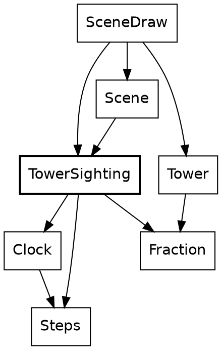

A beacon is the only thing in Safari Ride that repeats on the clock, so it's the first thing that needs to ask how far into a cycle it is. That question isn't about an instant of the ride. It's about a length of time, and Safari Ride keeps those two apart.

`Clock` says which step it is. `Steps` says how long something lasts. Both are opaque `U32`s, and `Clock.minus` turns two clocks into `Steps`, the same way two `Angle.Bearing`s make an `Angle.Turn`. Adding two clocks means nothing, so `Clock` has no `plus`, and no other code can add one. Call this *places and distances*: one opaque type for where something is, a second for how far apart two of them are, and only the sums that make sense.

Here, `wrapped_to` is `Steps`'s one way to reach `%`. The result is a `Fraction` built with `of`, because `(1 - cos) / 2` can only be in range:

{{code TowerSighting.beacon_brightness}}

Each tower starts somewhere else in the cycle, so the towers along a road don't blink together. This function is one line of method calls, and every call in it is on a `Steps`:

{{code TowerSighting.beacon_offset_for}}

The sighting calls both, adding the two `Steps`. `view.clock.minus(Clock.start)` is how a place becomes a distance, and it says which distance: the one from the start of the ride.

{{code TowerSighting.tower_if_ahead from "if center.forward <= Geom.near_plane" to "view.clock.minus(Clock.start)"}}

Its caller gives each tower its key, the segment's index. Records with named fields stand in for what would otherwise be five arguments in a row, and `InChain(position)` is a tag carrying a payload, saying where the segment lies from the rider:

{{code TowerSighting.segment_towers from "end_tower = tower_if_ahead(" to "end_tower.concat(mid_tower(view, position))"}}

A tower halfway along a segment takes the key plus 60. That's a small piece of number theory hiding in a constant: 60 staggers of 37 steps come to 2,220, which is 18 periods of 120 and 60 left over, so the mid-tower blinks exactly opposite the end tower.

Notice where the clock stops. `beacon_brightness` on a `TowerSighting` is a `Fraction`, and neither `Tower` nor `SceneDraw` imports `Clock`. A beacon's blink is decided in the same place as whether the tower is in view at all.

There's no blink abstraction. `Animation.Alternates` also follows a wave, and the resemblance ends there: it picks a pose, and this picks a brightness. Nothing else in the game blinks.

The clock counts steps, not seconds, so pausing the ride freezes the beacons, and stepping back runs them backwards.

### One switch

Here are the truck's lights at three frames of the ride:

| Step | Headlights | Brake lights |
|---|---|---|
| 3,742 | `Off` | `On` |
| 5,700 | `On` | `Off` |
| 6,520 | `On` | `On` |

The modules behind the headlights
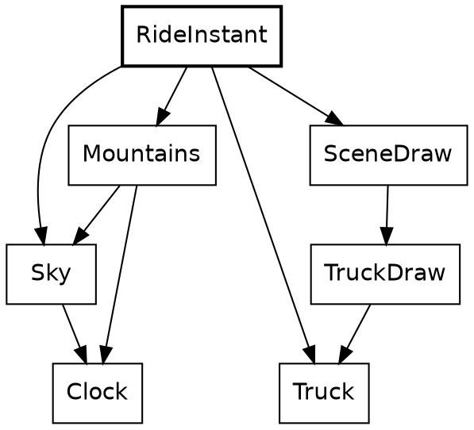

The truck's headlights come on once the sun has gone behind the mountains, at step 4,039 of a ride that lasts 7,040. `Mountains` knows the skyline and already imports `Sky`, so the question is asked there. The argument is an opaque `Clock`, and the answer is a plain `Bool`, which is about to be turned into something better:

{{code Mountains.is_sun_behind_mountains}}

`Truck.Lights` is a record of two tag unions, written in place. `[On, Off]` needs no declaration, and two independent lamps aren't one state with four values, so they're two fields:

{{code Truck.Lights}}

`RideInstant` puts it together. It's the only place that can. `Truck` is in the ride half of the system and `Mountains` is in the view, and no arrow goes from the first to the second. `RideInstant` imports both.

{{code RideInstant.truck_lights}}

Lamps are to the truck what a pose is to a cat. The sighting carries them, and the drawing does what they say, with each `match` covering both tags:

{{code TruckDraw.draw from "beams =" to "].join()"}}

`TruckDraw` leaves the painting to two modules. `TruckBody` paints the trailer, the cab and the tires, far to near, and `TruckLights` paints the beams and the brake lights, each with its glow.

That covers the clock-driven things. Each is a function with a `Clock` in its arguments, and nothing about them outlives the frame.

Everything so far can be asked about any instant, cold. Hand `Cat.instant_at` a gap and it answers. The rider and the truck can't do that.

## The stepped things

Where the rider and the truck are depends on where they were, so their state has to be kept, and it's the only state there is. This chapter and the next few are about the two fields of `RideInstant` that aren't a clock.

```widget step
Click far to the right of the dot, then far to the left.
```

Going forward, the ride has to be played, because each step starts from the one before. Going back, it only reads a list. The rider and the truck are the reason for that difference.

New in this chapter:

- Roc: a block that ends in a record
- Modules: none yet. This chapter shows what calls the modules below, and the next few open them.

The modules that do the stepping
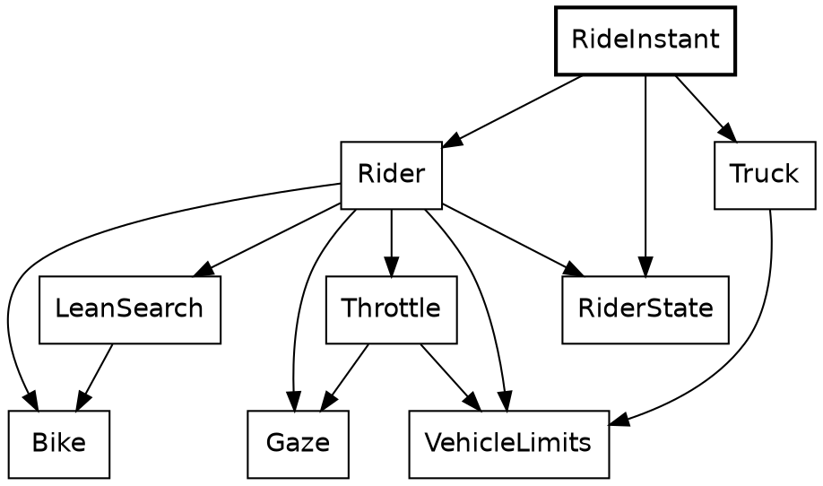

Here's the step again, this time whole. Its body is a block: names, then a record, which is the value of the block. The rider moves first, and the truck reads where the rider has just got to, so the order of those lines is a rule of the game, and `dist` is what carries it.

{{code RideInstant.next}}

`Clock.next`, `Rider.advance` and `Truck.advance` all have the same shape: a value goes in, and the next value comes out. Call that *the step function*. There's no mutable rider being nudged. There's a rider, and another rider one step on, and the old one is still a perfectly good value, which `Tour` keeps in a list.

Stepping has a cost, which shows up when we compare it with the cat:

- We can ask about a cat at any gap. To find a truck at step 4,000, we have to play the ride that far, or write the answer down by hand.
- A wrong critter rule only affects the frames it touches. A wrong step moves the rider for the rest of the ride.
- The lines of `RideInstant.next` have to run in order. Frames can be worked out in any order.

The rider's step is the bigger of the two, and it takes up the next five chapters. The truck gets the chapter after those.

## The rider

This is the rider at step 1,570, with the cat ahead:

| Field | Type | Value |
|---|---|---|
| `segment_index` | `World.SegmentIndex` | 3 |
| `along` | `Along` | 102.62 metres |
| `across` | `Across` | -0.08 metres |
| `yaw` | `Angle.Turn` | 0.0064 radians |
| `speed` | `Speed` | 1.22 metres a step |
| `lean` | `Angle.Lean` | -0.0041 radians |
| `heading` | `Angle.Bearing` | 0.0064 radians |
| `gaze_yaw` | `Angle.Turn` | 0 radians |
| `attention` | `Fraction` | 0.68 |

New in this chapter:

- Roc: a nominal record with no bare floats, a value for a bike that doesn't exist
- Modules: `RiderState`, `Rider`, `CanvasRoll`

A nominal record holds the rider, and `RideInstant` stores one. Count the opaque types: `SegmentIndex`, `Along`, `Across`, `Turn`, `Speed`, `Lean`, `Bearing` and `Fraction`. Nothing in it is a bare float. Four fields of this one record are angles, of three different types, and passing one type where another is wanted is a compile-time error. The last two fields say where the rider is looking, and they get a chapter of their own.

{{code RiderState.RiderState}}

The step does four things in order, and the code reads that way. Static dispatch finds `segment_in` on the `SegmentIndex`. The `match` on `seg.ending` has two tags, and `Continues(_)` ignores its payload:

{{code Rider.advance}}

The rider steers by leaning, so a decision is a record of two opaque values: a change of lean and an acceleration. There's something to notice in the last line of this next function. `Throttle`, which picks the acceleration, is asked about a bike that doesn't exist yet: the rider as it would be with the new lean, which `Bike.with_lean` makes by building a new record. The real rider isn't touched, because nothing can touch it.

{{code Rider.decide}}

The math layer chapter takes that idea much further. A small version of it decides what happens at the end of a segment. `cross_if_on_road` works out the rider on the next segment and keeps that only if it lands inside the lane. The rejected rider simply stops being referred to, and nothing has to be undone:

{{code Rider.cross_if_on_road}}

Record update does most of the writing in this module. Its plainest use is stopping dead, where `..s` keeps everything but the two fields named:

{{code Rider.stopped_at}}

### The picture leans too

When the rider leans, the whole picture leans with it. This is all of that:

{{module CanvasRoll}}

A lean inside the deadband leaves the canvas level, and any other lean passes straight through. The last `expect` is a table of pairs, on both sides of the deadband and at its edge. It's called once a frame:

🌳 {{code Tour.roll}}

The camera turns as well. `ViewYaw` follows the rider's gaze, and turns a little with the lean, as a rider's head turns into a bend.

So a decision is a lean and an acceleration. `Bike` is what turns them into movement.

## The bike

A lean of 1 degree turns the bike by a tenth of a degree each step, so at a metre a step it goes round a circle 573 metres in radius. That's nearly all the physics.

New in this chapter:

- Roc: a named open record
- Modules: `Bike`

The modules around `Bike`
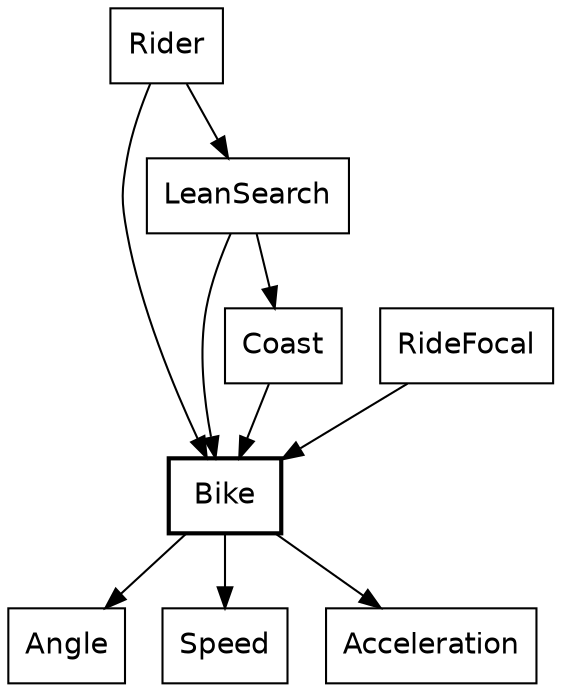

`Bike` holds the physics. It's under 60 lines, not counting its `expect`s. Its type is the first one in the tour that names the rest of a record. `..others` makes `Motion` open: it's any record with these six fields and whatever else, with `others` standing for the whatever else.

{{code Bike.Motion}}

A structural type like this has to be named when it appears twice. Here it appears in the argument and in the result, and that's the promise: what goes in comes out with the same other fields. A `RiderState` goes in, with its `segment`, `gaze_yaw` and `attention`, and a `RiderState` comes out, though `Bike` has never heard of a gaze.

Call this *a narrow view of a wide record*. A module says exactly which fields it cares about, and the compiler takes care of the rest, with no base class and no copying fields across by hand. The smallest example in the program is a function with one job:

{{code Bike.with_lean}}

`{ ..s, lean }` is record update with a shorthand: the field and the local have the same name. `Rider.decide` called it in the last chapter. Here's the step, which `Rider.advance` called:

{{code Bike.advance}}

Reading down, the types do their share of explaining. A `Lean` can't be added to anything but a `Lean`, and it only reaches direction through `lean.steer(turn_per_lean)`, which is the single door from roll to yaw. The bike then moves along the middle of the step's turn, which is what `s.yaw.plus(turn.times(0.5))` means. `speed.step_length()` is a `Distance`, and `Along.plus` takes one, so the move itself is places and distances. `to_radians()` appears at the last line that can do without it: `r_cos` wants a float.

A bike does what it's told. Choosing the lean has to wait for the math layer chapter. Choosing the acceleration is the throttle's job.

## The throttle

The rider is always deciding whether to accelerate, brake or hold steady. `Throttle` makes that decision, once a step.

New in this chapter:

- Roc: guards
- Modules: `Throttle`, `Acceleration`

The modules around `Throttle`


The chain of limits
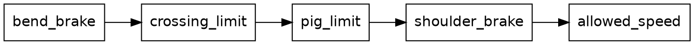

The rider has several reasons to slow down, and they don't know about each other. A turn is coming. A cat is in the lane. There's a pig to look at. The road is about to run out. `Throttle` writes them as a line of limits. An `Acceleration` goes in, a limit lets it through or lowers it, and the next limit gets what's left:

{{code Throttle.acceleration from "a2 = crossing_limit(" to "a4 = shoulder_brake(state, a3)"}}

Call this *the chain of limits*. Each limit has the same shape and can be read alone, and adding a reason is one more line. It reads like a list of rules because that's what it is.

Each limit compares two opaque `Acceleration`s with an ordinary `<`, which works because `Acceleration` defines `is_lt`. `crossing_limit` shows two more things about patterns. A guard, `if a > Acceleration.steady`, adds a condition to a branch, and `|` joins two tags in one. When the guard fails, `NoAcceleration` falls through to the last branch. `NoAcceleration` comes from the cat: it stops the rider opening the throttle, and a rider already braking stays braking. We'll see how next.

{{code Throttle.crossing_limit}}

`Speed` and `Acceleration` are places and distances again: two speeds make an acceleration, and an acceleration moves a speed. The sum behind braking for a turn is the first line of a physics textbook, `v² = u² + 2as`, solved for `a`. This function is a good example of how far opaque types reach into a parameter list. `target: Speed.(t)` opens the field's `Speed` where it's destructured:

{{code Speed.acceleration_to}}

The first limit, `bend_brake`, makes the `a1` that the chain above starts from. It calls this for the distance left to the point where the rider commits to the turn. Three modules use that one line of physics: this one, `Gaze` to slow for a pig, and `Truck`.

{{code Throttle.bend_brake from "bend_a =" to "state.speed.acceleration_to({ target: v_end, within: d })"}}

After the limits, `Throttle.acceleration` hands its result to `allowed_speed`, not quoted here, which holds the speed between rest and the top speed. The chain works in accelerations and that step works in speeds, so the answer is taken back with `.change_from(state.speed)`, the other half of the same pair of types.

The last limit, `shoulder_brake`, has to wait for the math layer chapter, because it simulates the bike ahead of itself.

The two limits in the middle come from what the rider sees. `crossing_limit` is the cat's, and `pig_limit` is the pig's. We'll take the cat first.

## What a cat does to the rider

The loop between the cat and the rider
```dot
digraph reaction_loop {
  rankdir=LR;
  node [shape=box, fontname="Helvetica"];
  speed [label="the rider's speed"];
  cat [label="where the cat\nhas got to"];
  speed -> cat [label="  Cat.crossing_stage  "];
  cat -> speed [label="  CrossingReaction  "];
}
```

The cat chapter promised this. A cat in the lane has a say in what the throttle does, and `CrossingReaction` is where it speaks.

New in this chapter:

- Roc: an open record that's only read
- Modules: `CrossingReaction`, `RideFocal`

The modules around `CrossingReaction`
```dot
digraph reaction {
  node [shape=box, fontname="Helvetica"];
  CrossingReaction [style=bold];
  Throttle -> CrossingReaction;
  RideFocal -> CrossingReaction;
  CrossingReaction -> Cat;
  CrossingReaction -> World;
  World -> Cat;
}
```

`Throttle` sets the rider's acceleration, and `RideFocal` sets how wide the rider's view is. Neither knows anything of cats. They ask `CrossingReaction`, which is the only part of the rider's code that does.

This trail starts back in `Cat`, at two small questions about the same `Stage`.

`is_in_danger` asks whether the crossing is playing. `_` ignores a payload.

🐾 🌳 {{code Cat.is_in_danger}}

`attention` is where `Past`'s payload is used. A cat in the lane also draws the rider's attention, which widens the view. `beyond` is how far past the end of the crossing the rider has come, and that attention fades over that distance, counted in beats. `beats_to_cover` divides by the speed, so a rider at a standstill gets an answer first. `Attention` is another opaque type.

🌳 {{code Cat.attention}}

`CrossingReaction.reaction_to` calls both. `..` in the argument's type makes it an open record, like `Bike.Motion`, though this one is only read and nothing comes back. This function needs `along` and `speed`, and accepts any record that has them, so it doesn't depend on `RiderState`, the rider's record. `speed` here is the opaque `Speed` again, and `match` on `segment.crossing` has to name every tag.

🌳 {{code CrossingReaction.reaction_to}}

A cat in the lane stops the rider opening the throttle, without braking, and widens the view as it pulls the rider's eye. Two tags, `MayAccelerate` and `NoAcceleration`, stand where a boolean might have gone. The next call up, `crossing_attention`, is one line, and its caller, `ride_focal`, works out the view's focal length:

🌳 {{code RideFocal.crossing_attention}}

🌳 {{code RideFocal.ride_focal}}

This is the only feedback loop in the design. The rider's speed decides where the cat has got to, and the cat holds the rider's speed down. The loop settles, and it's why `over_beats` has to stay the cat's rule. A bird asks nothing of the rider, so it falls through to the same answer as an empty road.

Each stretch of road has exactly one `crossing`: `CatCrosses`, `BirdHere` or `QuietRoad`. A cat and a bird in the same place can't be written down.

A cat catches the rider's eye from the lane. A pig does it from the side of the road, and the rider turns to look.

## The rider's gaze

The herds chapter left one pig waiting. On the first two segments with pigs, a pig in the big herd catches the rider's eye. The rider turns to look and slows down, and the picture turns too.

New in this chapter:

- Roc: comparing a tag with `==`
- Modules: `Gaze`, `ViewYaw`

### Where the rider looks

The rider's record has two fields we skipped. `gaze_yaw` is the angle between where the bike points and where the rider looks. `attention` says how much a look still holds the rider, from 0 to 1. They're stepped like everything else in that record, and the last line of `Rider.advance` does it, after the bike has moved:

{{code Gaze.next_rider_gaze}}

The rider looks either at a pig or at the road. An angle only means something for a pig, so only `OnPig` carries one:

{{code Gaze.GazeTarget}}

{{code Gaze.desired_gaze}}

`pig_ahead` answers with `Looking` or `NotLooking`. There's only one thing to ask of that, so `==` does the job of a `match`.

{{code Gaze.pig_ahead}}

`Distracting` is the tag from the herds chapter. `yaw` is the bike's angle to the road, so a rider who's steering hard keeps its eyes where it's going. Then there are two more conditions. The pig has to be within 150 metres:

{{code Gaze.pig_ahead_near}}

And it has to be less than 35 degrees from the way the bike points. The pig stands beside the road, so the angle to it grows as the rider comes closer. At 35 degrees the rider lets it go.

{{code Gaze.pig_in_sight}}

`Pigs.gaze_pig` is the third pig of the front row, at the place it would stand if it didn't stray.

### Turning the head

{{code Gaze.next_gaze_yaw}}

Toward a pig, the gaze turns by at most 4 degrees a step, and `within` holds the change to that limit on either side. On the way back it moves a twentieth of the way each step, and never more than 0.2 degrees. Once it's within 0.02 degrees it snaps to straight ahead, so a look comes to a real end. If the segment ends first, `Rider.on_next_segment` puts the gaze straight ahead.

Nothing here turns the bike. The gaze goes to the camera, and to nothing else that moves:

{{code ViewYaw.view_yaw_for}}

So when the rider looks right, the road slides left on the page, and the bike keeps going where it was going.

### Attention

{{code Gaze.next_attention}}

While the gaze is off the road, attention rises with how far it has turned, and it doesn't drop. Once the gaze is straight ahead, attention fades by 0.0012 a step, so it takes hundreds of steps to go. That's why the table in the rider chapter has an `attention` of 0.68 at step 1,570, with no pig in sight.

`RideFocal.ride_focal` takes the stronger of the cat's attention and this one. So a pig widens the view the way a cat does, and it stays wide for a while after.

### Slowing down

`pig_limit` is the third link in the throttle's chain. It asks `Gaze` for a brake, and takes it if that's harder than what it was offered:

{{code Throttle.pig_limit}}

{{code Gaze.pig_gaze_brake}}

{{code Gaze.pig_gaze_brake_easing}}

The sum is the one the throttle uses for a bend, with a pig for a bend. The rider aims to be down to 0.2 metres a step by 25 metres before the pig. `d.max(...)` keeps the distance positive once the rider gets there.

Whether the rider is gawking is a plainer question than whether it's looking:

{{code Gaze.is_gawking}}

It starts 150 metres before the pig, and only asks where the rider is. So it outlasts the look. The rider crawls past the pig and on to the end of the segment, long after its eyes have moved on.

That's the rider's step, apart from the lean. The other stepped thing is up ahead.

## The truck

The truck stays ahead of the rider all the way:

| Step | Rider, along the route | Truck, along the route | Lead |
|---|---|---|---|
| 0 | 0 metres | 500 metres | 500 metres |
| 2,000 | 1,819 metres | 2,186 metres | 366 metres |
| 4,000 | 4,607 metres | 4,968 metres | 362 metres |
| 6,000 | 6,481 metres | 6,632 metres | 151 metres |

New in this chapter:

- Roc: list patterns, recursion
- Modules: `Truck`

The modules around `Truck`
```dot
digraph truck {
  node [shape=box, fontname="Helvetica"];
  Truck [style=bold];
  RideInstant -> Truck;
  Scene -> Truck;
  TruckSighting -> Truck;
  TruckDraw -> Truck;
  Truck -> World;
  Truck -> VehicleLimits;
  Truck -> Speed;
  Truck -> Acceleration;
}
```

The truck is what the rider chases. It starts 500 metres ahead and keeps to a schedule that brings it to within 100 at the route's end. Its state is three fields:

{{code Truck.TruckState}}

The schedule is a straight line, and a pure function of the rider's progress, destructured from a record so the call site has to name both `Distance`s:

{{code Truck.scheduled_position}}

Its one caller is the truck's step function, the same shape as the rider's. `NextBend` is a tag union with a payload on one side, so the only way to read a `distance` is to be inside the branch where there is one:

{{code Truck.advance from "schedule = scheduled_position(" to "NoBendAhead => advance_on_schedule(truck, schedule)"}}

And that's called from `RideInstant.next`, in the stepped things chapter, with the rider's distance as the only thing the truck knows of the rider. Nothing in `Rider` imports `Truck`, and nothing in `Truck` imports `Rider`. The chase is one record literal in `RideInstant`.

Finding the next turn shows a list pattern. `[]` is the end of the route, and `[segment, .. as later_segments]` takes the first segment and names the rest. Recursion walks the list, carrying where the current segment starts. Only `Truck` and `Paint` use a list pattern. Elsewhere the same walk is a `fold`.

{{code Truck.next_bend_on from "match segments {" to "next_bend_on(later_segments, { route_position, segment_start: segment_end })"}}

It's called through a smaller function, which supplies the 0 so nobody else has to:

{{code Truck.next_bend}}

Then the two ways to take a step. Both sit below the block, private, and both are arithmetic on `Speed` by name. `target_speed.max(...)` keeps braking from undershooting, and `speed < truck.speed` is the whole of what turns on the brake lights. They're on while the truck is slowing down, and they go off when it's settled at the speed for the turn, even with the turn still ahead.

{{code Truck.advance_braking}}

{{code Truck.advance_on_schedule}}

`brake_lights` is state because it's a fact about the last step. Headlights aren't, and they stay out of `TruckState`. That's three of the four kinds in one vehicle: the place and speed are stepped, the headlights are clock-driven, and the tires don't change.

The truck has no `Animation`. A timeline has a known length and can answer for any point along it. The truck has neither. Its next step depends on its last, and its route depends on the rider. `TruckSighting` calls the distance to the truck `lead`, the same quantity as an `Approach`'s `gap`, because the truck is being chased.

One question about the rider is still open: how `Rider.decide` picks a lean. The module that answers it is `LeanSearch`, and it rests on the geometry and physics in the next chapter.

## The math layer

Safari Ride's rider steers by rehearsing. Each step it tries twelve leans, and keeps one. That rests on a layer of math, and this chapter works up to it from the floor.

```widget rehearsal
Click a mark to see that try at a lean.
```

Each try lets a rider who doesn't exist coast down the road with one lean, and the white arc is where that rider goes. The yellow line is where the real rider wants to end up. A try that ends on the wrong side of it sends the next try the other way, and by the twelfth they've closed in. This is step 370 of the ride, just after the first bend.

New in this chapter:

- Roc: records as coordinate systems, `fold`, `fold_rev` and `map2`, two functions that call each other
- Modules: `Geom`, `Chain`, `Camera`, `Lens`, `Coast`, `LeanSearch`, `Float`

A lot of Safari Ride is math and physics, and most of it is geometry a reader could do on paper. It's here because this kind of code suits a compiled functional language unusually well, for a short list of reasons that each get a section:

- A formula is an expression, and a function with no effects is the same thing with a name.
- Units can be types, for no runtime cost. [check: confirm a `::` wrapper around `F64` costs nothing at runtime, in the dev and wasm builds.]
- A coordinate system can be a record, so the fields say which one a point is in.
- Physics that's a pure function can be run for pretend, which is the best thing in this chapter.
- It's compiled, so running it for pretend hundreds of times per frame is affordable.

### The most imported modules

Safari Ride has 79 modules, not counting `web.roc`, `main.roc` and `game.roc`. The import graph is lopsided in a good way. Counting who imports what, leaving out the test programs, a handful stand out, and the lines here are the ones above each module's `expect`s:

| Module | Imported by | Lines | What it is |
|---|---|---|---|
| `Distance` | 44 | 62 | A length in metres |
| `Along` | 29 | 57 | A place along a segment |
| `Across` | 27 | 73 | A place across the road |
| `Angle` | 21 | 172 | Three opaque types for rotation |
| `Pixels` | 21 | 86 | A length on screen |
| `Geom` | 20 | 213 | Road points, rider points, and how to turn one into the other |
| `Fraction` | 19 | 92 | A ratio from 0 to 1 |
| `World` | 17 | 415 | The route |
| `Chain` | 16 | 172 | Where the road lies from where the rider is |
| `Scenery` | 15 | 48 | The words the world is built from, and the road's width |

After those ten the count drops to 12, for `Screen`, 11 for `Speed` and 10 for `DepthSort`. Most modules are imported by one, two or three others. `Shapes`, `Trig` and `DeviceMath` are imported about as widely. They're in `lib/`, a folder of modules shared with the repository's other canvas apps.

These are the core utility modules. There are only ten, and nearly everything else is a small module that takes one of these and adds a single idea. Six of the ten are nothing but numbers with rules, and the top three are under 80 lines each. A cat, a tower and a truck are all found on the road through `Chain`, and all reach the screen through `Camera`.

The modules of the math layer
```dot
digraph math {
  node [shape=box, fontname="Helvetica"];
  LeanSearch -> Coast;
  LeanSearch -> Bike;
  Coast -> Bike;
  Coast -> Angle;
  Bike -> Angle;
  Chain -> Geom;
  Camera -> Geom;
  Camera -> Screen;
  Lens -> Angle;
  Lens -> Screen;
  Geom -> Angle;
}
```

Two families share `Angle` and don't otherwise meet: `Geom`, `Chain`, `Camera` and `Lens` say how the world looks from the bike, and `Bike`, `Coast` and `LeanSearch` say where it's going.

### Numbers with units

Here we add a speed to a length:

{{fails speed_as_distance}}

Eighteen small opaque types run through Safari Ride, and the tour has met most of them one at a time. Set side by side, they're a system:

| Type | Under it | What it measures |
|---|---|---|
| `Clock` | `U32` | A place in the ride |
| `Steps` | `U32` | A length of time |
| `Beat` | `F64` | A place in an animation |
| `Beats` | `F64` | A length of an animation |
| `Angle.Bearing` | `F64` | A place on the compass |
| `Angle.Turn` | `F64` | The angle between two bearings |
| `Angle.Lean` | `F64` | Roll, which only reaches direction through a rate |
| `Distance` | `F64` | A length in metres |
| `Along` | `F64` | A place along a segment |
| `Across` | `F64` | A place across the road |
| `Pixels` | `F64` | A length on screen |
| `CatHeights` | `F64` | A length measured in the cat's own height |
| `Speed` | `F64` | Metres a step |
| `Acceleration` | `F64` | Metres a step, each step |
| `Fraction` | `F64` | A ratio from 0 to 1 |
| `Attention` | `F64` | How strongly something holds the eye, from 0 up |
| `World.SegmentIndex` | `U32` | A place in the route |
| `Chain.Position` | `U32` | A place in the view ahead |

This is the opaque type doing the job of a unit. The block after each type is a small statement of dimensional analysis. `Speed.distance_in` takes `Beats` and gives a `Distance`. `Along.plus` takes a `Distance`, and two `Along`s give one back. `Lean.steer` takes a rate and gives a `Turn`. There's no `Bearing.plus(Bearing)`, because that sum has no meaning. If you try to write one, the compiler stops you.

The bug these prevent is the most common one in this kind of code: a correct formula with the wrong number in it. Most physics bugs type-check in a language where everything's a float.

The price is a long list of short methods, and a certain amount of `.to_radians()`. The headers of the float ones all say the same thing: "Each operation does the plain float arithmetic its name says." We'll see why that sentence matters in the proving chapter.

The units run from the road to the screen. Once a point is measured from the rider, its `right` and `forward` are `Distance`s, and a length on screen is `Pixels`. `Pixels` is signed, because a place on screen is measured from the corner, so a point off the left of the screen is negative, and so is the height of a sun below the horizon. It stops at the edge of `lib.Shapes`, which takes plain numbers. A formula wants floats, so `.to_metres()` unwraps one at the top of a function that's about to do trigonometry, and the answer is wrapped again at the end. `Along` can't be passed as `Across`, which rules out the classic swap in a function with both.

### One record per space

A point in Safari Ride is in one of four spaces, and the record's fields say which. Here we hand a point measured from the rider to a function that wants a point on the road:

{{fails rider_point_as_road_point}}

The points are plain records. They don't need to be opaque, since a record's type is its fields, and a `RoadPoint`'s fields are opaque already.

{{code Geom.RoadPoint}}

{{code Geom.RiderPoint}}

{{code Geom.RaisedPoint}}

{{code Screen.Point}}

Structural records give us *one record per space* at no cost: `along` and `across` are on the road, `right` and `forward` are from the rider, and `x` and `y` are pixels. Reading any function, the field names say where it is.

Going from the road to the rider is a translation and a rotation, and this is the function where the opaque places give way to floats. `distance_from` makes the translation, and the rotation is written the way it would be on paper:

{{code Geom.to_rider_point}}

From there to the screen is a pinhole camera, which is similar triangles. Dividing by `forward` is all of perspective. Nearly everything on screen passes through this function, and it's short:

{{code Camera.project}}

`BirdDraw.draw` calls it with a record built on the spot for the bird's feet:

{{code BirdDraw.draw from "feet = Camera.project(" to "cam_focal,"}}

The focal length comes from a lens. `focal` is a value computed from other values, with no function in sight, and `field_of_view` is a `Turn`, so taking half of it needs no comment about radians. [check: whether a value like this inside a `.{ }` block is evaluated at compile time, as top-level values are.]

{{code Lens.focal}}

The view widens as the rider leans. One `Fraction` goes in, and a focal length comes out. `RideFocal.ride_focal`, from the chapter on what a cat does to the rider, calls this through `cam_focal`, taking the wider of what the lean and the rider's attention ask for:

{{code Lens.focal_for_lean}}

{{code Lens.cam_focal}}

### Round the bends

```widget route
The route again. This map comes from adding up the turns, which the ride itself never does.
```

The road has no global coordinates. A point on it is measured within one segment, `along` and `across`, and nothing in the game holds a world coordinate for it. Each segment knows only its length and the turn at its end. `World.plans` is nineteen records like this one, and it reads like configuration: a list of plain values, with the tags declared by `SegmentPlan` and an opaque `Distance` and `Turn` built from their units. It's checked like any other Roc, so a misspelled tag is a compile-time error.

{{code World.plans from "length: Distance.metres(1200.0)," to "bend_life: Animal(Rhino),"}}

So to see something three segments ahead, a point has to be carried back round each bend between it and the rider, one at a time. That's one rotation per bend, and `fold_rev` is the shape of it. The accumulator is a `RoadPoint`, it starts on the far segment, and each step moves it onto the segment before. `before_in` gives the segments between, and the closure is the only thing the loop does. The last line does the one translation and rotation from above:

{{code Chain.rider_point_ahead from "on_rider_segment =" to "Geom.to_rider_point(on_rider_segment, road.vantage)"}}

The rotation itself is plain, with two cases, because a right-hand bend pivots on the far side of the lane:

{{code Geom.in_segment_before}}

This is what lets `CatSighting`, `BirdSighting`, `TowerSighting`, `TreeSighting` and the rest not care where a segment is. They name a position in the chain and a point on that segment, and they get back a `RiderPoint`. That's why `Chain` has sixteen importers.

The ground also curves away. That's one formula, the small-angle drop of a sphere, with a record destructured in the parameter list and `right` and `forward` taken out to metres before they're squared. There are two radii in the program, and neither is the earth's. `Geom.ground_curve_radius`, 100 km, is the surface the road and the truck stand on, and it puts the horizon 490 metres out. `Tower.sink_radius`, 20 km, only sets how soon a far tower goes: a tower is gone at 1.8 km, where the ground's curve would leave it in view to 4 km.

{{code Geom.ground_drop}}

### Cutting a polygon

Here's a triangle with one corner behind the rider, before and after cutting:

| | Corners, as metres right and metres ahead |
|---|---|
| Before | (0, -1), (2, 5), (-2, 5) |
| After | (0.47, 0.4), (2, 5), (-2, 5), (-0.47, 0.4) |

The corner behind the camera has gone, and two new ones stand on the camera's plane, 0.4 metres ahead.

Anything that crosses the camera's plane has to be cut, or dividing by `forward` flips it across the screen. The textbook algorithm walks a polygon's edges, keeping corners in view and adding a new corner wherever an edge crosses the plane. In Roc, that's a pairing and a `fold`. `map2` zips each corner with the next one, which is the list rotated by one, and `fold` builds the new polygon. `List.with_capacity` is the one line about performance, and `clip_edge_onto` is passed by name:

{{code Geom.clip_near}}

A fold's step is a plain function of the list so far and one edge:

{{code Geom.clip_edge_onto}}

`Ground`, `GuardRail` and `TruckShape` call it the same way. `patch.corners.map(...)` makes the `RaisedPoint`s, and what comes back is a shorter or longer list of the same type:

{{code Ground.draw from "in_front = Geom.clip_near(" to "Paint.polygon(patch.color, Camera.project_all(in_front, cam_focal))"}}

### Rehearsal

The rider has no steering wheel. Nothing tells it where to go. Each step, it has to choose a lean, and it does that by working out what would happen.

The calls of one rehearsal
```dot
digraph rehearsal {
  rankdir=LR;
  node [shape=box, fontname="Helvetica"];
  decide [label="Rider.decide"];
  best [label="LeanSearch.best_lean"];
  project [label="Coast.project"];
  advance [label="Bike.advance"];
  decide -> best;
  best -> project [label="  12 tries  "];
  project -> advance [label="  a step at a time  "];
}
```

The widget at the top of this chapter is this section at work.

`Coast` answers one question. If the rider stopped changing anything now, and coasted, what would happen? It takes the rider, and it runs the physics. The call is the same `Bike.advance` that moves the real rider, with no lean change and steady speed. That's why `Bike` has to be a function. A method that changed a bike in place couldn't be tried out like this.

{{code Coast.coast_from from "judge_place(" to "{ lean_step: Angle.upright, acceleration: Acceleration.steady },"}}

`Coast.Progress(others)` carries a `Bike.Motion(others)`: a narrow view of a wide record again, so `Coast` can take the whole rider without knowing what's in it. `coast_from` moves the bike and its partner `judge_place` says where it got to, and the two call each other until the coast reaches the shoulder, makes 25 metres of progress, or runs for 2,000 steps. The answer is a record saying which of those happened:

{{code Coast.Outcome}}

`Coast.project` sets it going, with the road's edges as bounds:

{{code Coast.project}}

`LeanSearch` asks `Coast` that question at a dozen different leans. The rider wants the coast to end somewhere near the middle of the lane, and more lean to the right moves the end of a coast to the right, so this is a bisection. It's a recursive function with its whole state in one record argument, `low` and `high` closing in on each other. `Bike.with_lean(state, mid)` is a rider who doesn't exist, handed to `Coast`, who gets a future that didn't happen:

{{code LeanSearch.search_lean_from from "mid = low.halfway_to(high)" to "low: mid,"}}

The decision about which way to go is a `match` on what the rehearsal found. Running off the left means more right, running off the right means less, and staying on the road compares the end of the coast with the target:

{{code LeanSearch.want_more_right}}

Its caller gives the search its bounds, at most a degree either side of the current lean. That's what stops the bike flicking from one lean to another:

{{code LeanSearch.best_lean}}

And `Rider.decide` calls that, on its first line. The walk up the stack ends there.

Call this *rehearsal*: run the real rules on a pretend copy, read the result, and throw it away. The numbers are worth stating. Twelve coasts for the lean and one more in `Throttle`, which uses `Coast` to ask whether the road is about to run out. Over the whole ride, a coast averages about 44 simulated steps. So each real step of the ride runs about 570 steps of bike physics that never happen, and the 7,040 steps of the ride come to about four million. With no drawing, on the dev backend, the whole ride takes about three seconds: under half a millisecond a step, against a budget of 33. [check: the 44 is `forward / speed` from one coast per step, measured at 9aa3814, not a counter inside `coast_from`; the three seconds is one native run, and the page runs wasm.]

In a language with mutable objects, a rehearsal has a problem to solve before it starts. It needs to copy the rider, or save it and restore it, and it needs to be sure the copy really is one, all the way down. It needs to know that the physics doesn't quietly update something global, like a scoreboard or a random number generator. In Roc, none of that comes up. `Bike.advance` has a `->`, so it can't reach anything but its arguments. The old rider stays intact because every rider does. A rehearsal that goes wrong costs nothing, and all of `LeanSearch` is 105 lines.

The last limit of the throttle is the same idea with one rehearsal in it. It runs the coast, and brakes only if the coast leaves the road:

{{code Throttle.shoulder_brake}}

### Arithmetic all the way down

| `x` | `Float.exp(x)` | `exp(x)` from a C math library |
|---|---|---|
| 0.5 | 1.648721270700128 | 1.6487212707001282 |
| 1 | 2.7182818284590446 | 2.718281828459045 |
| 2 | 7.389056098930651 | 7.38905609893065 |

Safari Ride computes even its basic math functions itself. `lib/DeviceMath.roc` computes `sin`, `cos`, `sqrt` and `atan` in Roc, with no call to a math library. `Float` does the same for `exp`, which is a Taylor series after a range reduction. It's nothing but names and multiplications, and it's the kind of code that looks exactly as it does in a textbook:

{{code Float.exp_series}}

{{code Float.exp}}

`Throttle.shoulder_brake_at` is the caller, so a rehearsed coast's length decays into a braking force through this. [check: why these are hand-written rather than builtins. They came with the Codex port, and the reason is probably that the same bits come out on every target. Ask Steve before saying so.]

So from top to bottom, a rider chooses a lean by simulating physics, and the physics is plain arithmetic on opaque numbers. None of it has any effects. In the next chapter, we'll see what that's worth when the program has to change.

## Proving it

There are no animals in this chapter. It's about what happens to a program of this size when something has to change, which is the question a reader who cares whether Roc scales should ask.

The answer rests on one fact from the ride instant chapter. Three fields decide a frame, and a frame is a value. So a frame can be compared, exactly, with the same frame from an hour ago.

| Step | What the frame shows | Hash of its pixels | Shapes |
|---|---|---|---|
{{proof row 0 The start of the ride}}
{{proof row 100 A bird in flight}}
{{proof row 1570 A cat frozen in the lane}}
{{proof row 1586 The same cat in mid-leap}}
{{proof row 3000 The ride under way}}
{{proof row 3742 A distant truck, its glow too small to draw}}
{{proof row 5700 The truck at dusk, lights on}}
{{proof row 6520 The truck braking in plain view}}
{{proof row 9000 Past the end, on the second lap}}

Each row is one frame of the ride. Run the ride to that step today and you get that hash and that many shapes, and a change to the program has to leave every row as it is. This page's numbers come from the same file the check reads, `gates/proof.expected`.

New in this chapter:

- Roc: `expect` with its data beside it, `crash` as an assertion, a fold whose direction matters
- Modules: `RasterFrame`, `ShapesFrame`, `StepBack`, `SafariFrame`, `ShapesPixels`

The proof tools and what they read
```dot
digraph proving {
  node [shape=box, fontname="Helvetica"];
  gates [label="the proof tools\nRasterFrame, ShapesFrame, StepBack", style=dashed];
  Tour [style=bold];
  gates -> Tour;
  gates -> SafariFrame;
  gates -> ShapesPixels;
  SafariFrame -> ShapesPixels;
  SafariFrame -> backdrop;
  ShapesPixels -> ScanlineFill;
  backdrop [label="the backdrop\nBackdropPixels, SunPixels", style=dashed];
}
```

Everything here lives in `gates/`, and the game never runs any of it. The merge gate is the check a change has to pass before it lands. It runs the lints, every `expect`, the tutorial's build and the proof tools. Its programs reach the game through `game.roc`, a package whose only job is to list the modules they read. [check: the builder's includes can't reach `gates/`, `lib/` or `web.roc`, which is why these chapters describe those and don't quote them. Decide whether the builder should.]

### A fixture is a value

Getting a test to step 1,570 of a game normally takes some doing. Here it takes a loop. `Tour.initial` is a value, and `Tour.step_forward` is the outermost step function. It wraps `RideInstant.next_or_restart`, quoted below, and it also trims the list of past instants. An `if` chain does the trimming, and its comment says why half of the list goes at once:

{{code Tour.step_forward}}

Testing here is just calling a function. There are no mocks, no fakes, no browser and no waiting. The tests are completely deterministic.

`RideInstant.next_or_restart` is one `if`, and it's worth seeing because it puts the end of the ride in one place. A ride that's finished starts again, so `Tour` needs no notion of game over:

{{code RideInstant.next_or_restart}}

### The frame hash

`RasterFrame` rides to a step, paints the frame into 576,000 exact pixels, and prints an FNV-1a hash of them. The painter is `SafariFrame`, in pure Roc. Its `ShapesPixels` does what `shapes_canvas.js`, the JavaScript that paints the page, does on a canvas. The gate holds each hash to a line of `gates/proof.expected`, exactly. There's no tolerance: one different pixel in one frame fails it.

A frame is only evidence for what's in it, so the steps in the table at the top of this chapter aren't arbitrary. The ride lasts 7,040 steps, so the clock at step 9,000 reads 1,959. [check: what 3,000 and 9,000 are there for; the gate's header doesn't say.]

We add a frame whenever something could go wrong without any listed frame changing. A brake light wired to `Off`, for example, would have passed every hash until we added step 6,520.

Exact hashes have a consequence that reaches into the code. Float addition isn't associative, so a sum's order is part of its meaning here. `World.route_length` says so in its doc comment, and it's one of the few places in Safari Ride where the direction of a fold is a decision:

{{code World.route_length}}

That's also what the sentence in the headers of `Speed`, `Beats`, `Fraction`, `Angle` and the rest is for. "Each operation does the plain float arithmetic its name says, so code moved onto this type computes exactly what it did before." An opaque type adds names and takes nothing away. A retyping that adds `Speed` to a module changes the types throughout, and if it leaves the arithmetic alone, every hash stays where it is. If a hash moves, the retyping changed the program, and the gate says so.

This is how the code in this tour got its shape. About fifty modules were renamed, retyped and reorganized, many of them in parallel, and each merge had to leave the frames alone. Roc's types caught what they catch, the hashes caught the rest, and the picture didn't change. [check: the number, and whether "many" should say how many at once.] A language with no hidden state doesn't make a refactor safe by itself. It makes it possible to write a test strict enough to be trusted.

There's one limit to all this. The hash proves `ShapesPixels`'s pixels, and the page's pixels come from the browser's canvas, with anti-aliasing. What the two share is the list of shapes. `web/page_check.mjs` runs each built page against a stand-in canvas, and past that the JS has only its own checks.

### Two more proofs

The second of these two proofs is here because of a real bug:

| | One step back from step 3,000 lands on |
|---|---|
| When the history kept its first 2,048 instants | 2,047 |
| Now | 2,999 |

`ShapesFrame` paints each frame twice: once with its polygons whole, as the browser gets them, and once cut into triangles, as the native program gets them. It counts the pixels that differ, and the gate requires zero of 576,000, at every step in the table.

`StepBack` checks that one step back goes back exactly one step, at depths either side of the history's cap. It's in the gate because the answer was once no, and its header says how: the list stopped recording when full, so a step back from frame 3,000 landed on 2,047. Holding the first 2,048 instants was a perfectly consistent thing for a list to do. The test works by asking `Tour.step_back` and comparing clocks, and since `Tour.step_back` is this small, there isn't much else to ask:

{{code Tour.step_back}}

### `expect`

The rest of the testing is ordinary `expect`s. An `expect` sits at the top level of a module, under the code it checks, and `roc test` runs it. There are over a thousand, and they're Safari Ride's only other tests. The tour has already shown twenty-six of them, in the whole of `Clock` and `Pond`. A pure function needs nothing else: literal arguments, literal answer. Each `expect` asserts one thing, and they cover both sides. `Clock`'s check that a clock equals itself one step on is false, so it's written with `!`. `Float.round` has a run of its boundaries, from `-0.5000000000000001` up through `0.49999999999999994`, on both sides of each. [check: those two numbers are quoted by hand, since an `expect` has no name for an include to find. It wants an include form of its own.]

A test's data can sit beside it as a plain definition. `Bike` doesn't import `RiderState`, and `Motion` is open, so its fixture is a record that has the six fields and makes up the rest. `segment` and `attention` are bare numbers here, because `Bike` carries them through and never looks. A narrow view of a wide record pays off twice: the test needs nothing the module doesn't.

{{code Bike.riding}}

It's called like any other value, and the steps that follow are named, so three `expect`s can read them:

{{code Bike.first_step}}

The gate makes `expect` honest in one further way. The gate takes its count from the source: every line that starts `expect`, in a module that one of its `roc test` runs compiles, has to print `PASS` exactly once. An `expect` that nothing compiles fails, and so does one that's indented out of reach. One more consequence: an `expect` can only name what its module imports, so a check sits where its test data can be seen, and a module doesn't take on an import for a test's sake. `Coast`'s projections are checked in `Throttle`, which can see a `Speed`, and `LeanSearch`'s search in `Rider`, which can see a `RiderState`.

Even a truck can be checked this way, though it can't be asked about step 4,000 cold. A `TruckState` is a record, so a test writes one down and calls `Truck.advance` once.

### Crashes that help

{{code Fraction.of}}

Every `Fraction.of` in the game is an assertion, and the gate runs a lot of them. A ratio outside 0 to 1 stops the program, with a sentence saying the sum behind it is wrong. `Try` is the right answer when a value can honestly be absent. This isn't that case. A wrong ratio is a bug, and the sooner it's a crash the better.

Here's one of the many places it's used, with `smoothstep` trusting its own algebra. A proof run rides through it thousands of times, so if the algebra were wrong, the gate would be first to know.

{{code Easing.smoothstep}}

The same holds for the code's other `crash`es, including two dozen `?? crash`es on lookups that can't miss. Each one states a belief about the program, and every gate run tests it.

### The page itself

This tutorial is built from the code. Every fenced snippet here came through Roc's own parser, by name, and each failing program is run through the compiler, which is quoted. The gate builds the page. So renaming a function quoted here fails the gate until the prose catches up, and the compiler message under `turn_as_bearing` is the compiler's.

Lints round it out: a set of lints for Roc source runs first, with each count held exactly, and every count is at zero. A name that's vague or a boolean parameter that should be a tag fails before a single hash is computed.

All of that runs without a screen. The tour still hasn't said how a list of shapes reaches one, or where the effects went.

## The platform

The platform is what puts the list of shapes on a screen: the host, the JavaScript, and the modules every canvas app shares. Safari Ride has very little to say about it, on purpose. "The part that isn't Roc", in the modules chapter, gave the outline, and this chapter adds the code.

The modules around `SafariApp`
```dot
digraph platform {
  node [shape=box, fontname="Helvetica"];
  web [label="web.roc"];
  SafariApp [style=bold];
  web -> WasmApp;
  web -> SafariApp;
  WasmApp -> CanvasApp;
  SafariApp -> CanvasApp;
  SafariApp -> Input;
  SafariApp -> Tour;
  SafariApp -> Backdrop;
  SafariApp -> Screen;
  SafariApp -> Shapes;
  CanvasApp -> Input;
  CanvasApp -> Shapes;
  Tour -> Shapes;
  Backdrop -> Shapes;
}
```

New in this chapter:

- Roc: an app as a record, functions in record fields, `var` and `while`, `roc glue`
- Modules: `WasmApp`, `CanvasApp`, `Input`, `Shapes`

`WasmApp`, `CanvasApp`, `Input` and `Shapes` are in `lib/`, and they're the same for every canvas app.

| The same modules, built as | By | For |
|---|---|---|
| Wasm | `web.roc` | The page |
| A native program | The merge gate | The proof tools |
| A native program on roc-ray | `main.roc` | A desktop window |

### An app is a value

{{code SafariApp.canvas_app}}

An app here is a record, handed to a runner. `CanvasApp(model)` has a type parameter for whatever the app keeps. Safari Ride's model is its `Tour` and a pause flag, and the app reads like configuration, because almost all of it is.

`CanvasApp.untimed_advance(step)` takes a function and answers a function, the same one with a seconds argument to ignore. Safari Ride counts steps, and this is the place that says so: a runner offers the seconds, and they go nowhere.

`web.roc` is thirteen lines, most of them its header. Its body is `program = WasmApp.program(SafariApp.canvas_app)`, and that's the whole connection between the game and the web.

### Keys

| Key | What it does |
|---|---|
| Space | Pauses or resumes the ride |
| Right | `Tour.step_forward`, four times, or once while paused |
| Left | `Tour.step_back`, four times, or once while paused |
| J | Jumps to the next segment |
| R | Starts again from `Tour.initial` |

Input comes as a value too. `Input.Snapshot` says which keys are down and which were just struck, so a test could write one down, and `key_pressed(KeyR)` takes a tag. Everything the keys do is a function from `Tour` to `Tour`, so moving four steps or one, forward or back, is one helper with a function in a record field. `var` is back, this time with `while`, in a function that's still pure. `$tour` and `$i` can't be seen from outside.

{{code SafariApp.repeat}}

`Tour.step_forward` and `Tour.step_back` are plain values to pass here:

{{code SafariApp.step from "if input.key_down(KeyRight) {" to "step_once: Tour.step_forward,"}}

Stepping back through the ride is a keypress because `Tour.step_back` is a list lookup, and nothing else in the game knows it happens.

### A frame is a list

| What's in the shapes of step 1,570 | How many |
|---|---|
| `Poly` | 2,705 |
| `Disc` | 7 |

What the game hands back each frame is a `List(Shapes.Shape)`. A shape is a tag: `Poly`, `Disc`, `Rect` and a few more, each with its fill. Two of them aren't shapes. `Blend` and `View` are marks in the list that change how what comes after them is painted, because a frame is a list, and a mark is the cheapest way to say that.

The rider's lean is one of those marks. The whole picture banks into a turn, backdrop included, so `SafariApp.frame` builds a camera out of nested tags and puts it at the front. The rest is `Tour` answering questions, each a one-liner:

{{code SafariApp.frame from "centre = {" to ").prepend(lean)"}}

### Where the effects went

One tick, in order
```dot
digraph one_tick {
  rankdir=LR;
  node [shape=box, fontname="Helvetica"];
  pace [label="canvas_app_runner.js\npaces the clock"];
  advance [label="advance\n(Roc)", style=bold];
  frame [label="frame\n(Roc)", style=bold];
  read [label="roc_glue.js\nreads the shapes"];
  paint [label="shapes_canvas.js\npaints them"];
  release [label="release\n(Roc)", style=bold];
  pace -> advance -> frame -> read -> paint -> release;
}
```

The game has no effectful functions, so where did the effects go? They never got as far as Roc. The wasm platform asks for a record of functions over a boxed model:

`init`, `advance`, `frame`, `release`, `sounds`, `width`, `height` and `fps`, and for sound, which Safari Ride leaves empty, `tone_count`, `tone_freq` and `tone_ms`. Every one has a thin arrow, `->`. The host in `web/platform/host.zig` keeps the box, and all that crosses is numbers and a list of shapes. Wasm's edge has no records, so the input is flattened into seven numbers, and `Input.of` rebuilds it. `roc glue` generates `roc_glue.js`, which knows the layout of a frame in wasm memory, from `web/platform/Frame.roc`, so `roc_glue.js` is never edited.

Each step goes like this. `canvas_app_runner.js` paces the clock and gathers the keys. It calls `advance`, then `frame`, in Roc. It reads the shapes back through the generated glue, and `shapes_canvas.js` paints them on a canvas. The host keeps the list until the next frame, then hands it back so that Roc can drop it. That's `release`, a function whose body is `{}`: Roc knows the layout of what it's dropping, and the host shouldn't have to.

The JS is about 490 lines for every canvas app there is. It knows nothing of cats. The only `!` names near Safari Ride are the `main!` and `echo!` of the gate programs, which are ordinary command-line apps, and the proof tools need them to print a hash.

The same modules are compiled three ways, which shows how cleanly the game is separated from the platform. The page builds them to wasm. The gates build them natively. And `main.roc` hands the same `SafariApp.canvas_app` to `native/CanvasAppRunner.roc` on roc-ray, a Roc platform for native graphics. That third one is the spike that proved the idea and it isn't kept current, as Safari Ride's README says, so the page is the maintained side. The first two run on every gate.

That's the last of the parts. Next, we'll put them back together by returning to the loop from the start of the tour.

## Zooming back out

Safari Ride is a loop. It designs a world once, and each time the clock ticks, it moves what moves, finds what's near enough to see, and draws it. Every box on that loop has now been opened.

```widget ride
The ride again, with nothing in it left unexplained.
```

The loop, and the chapters that opened it
```dot
digraph opened {
  node [shape=box, fontname="Helvetica"];
  world [label="design the world (once)\nThe world, The road"];
  tick [label="the clock ticks\nOne whole module"];
  move [label="move the rider and the truck\nThe stepped things to The truck, The math layer"];
  look [label="look around\nThe modules, The cat, The bird"];
  draw [label="draw it against the backdrop\nThe sky, The platform"];
  world -> tick;
  tick -> move;
  move -> look;
  look -> draw;
  draw -> tick [label="  next step"];
}
```

*[This chapter ties the tour together once the stepped things, the proof and the platform are written. It returns to the flipbook and the first diagram: the clock steps, and everything composes from three stored fields.]*

## Appendix: the patterns

The tour named nine patterns in passing. They're patterns in the loose sense: shapes that kept turning up, and that Roc makes easy to write and hard to break.

| Name | What it is | Where to see it |
|---|---|---|
| Worked out, not stored | Keep the few things that must persist, and derive the rest each frame | `RideInstant`, `Cat`, `Sky` |
| A sighting decides, drawing paints | A pure function answers with plain data, and something else draws it | `CatSighting`, `TowerSighting` |
| Places and distances | One opaque type for where, a second for how far apart, and only the sums that make sense | `Clock` and `Steps`, `Bearing` and `Turn`, `Along` and `Distance`, `Speed` and `Acceleration` |
| Rule and timeline | One function says how far along, and one piece of data says what that looks like | `over_gap` and `flight_timeline` |
| The step function | A value goes in, and the next value comes out | `Rider.advance`, `Truck.advance`, `Tour.step_forward` |
| A narrow view of a wide record | An open record names the fields it uses and carries the rest through | `Bike.Motion(others)` |
| The chain of limits | One value passes through independent rules, each of which can only lower it | `Throttle.acceleration` |
| One record per space | Field names say which coordinate system a point is in | `RoadPoint`, `RiderPoint`, `RaisedPoint`, `Screen.Point` |
| Rehearsal | Run the real rules on a pretend copy, read the result, and throw it away | `Coast`, `LeanSearch`, `Rider.cross_if_on_road` |

Code that reads like configuration deserves a line of its own, because the tour kept stopping to admire it: `Pond`, `World.plans`, the timelines, and `SafariApp.canvas_app`. None of them is a config format. They're ordinary Roc values, so the compiler checks them, and a tag that's misspelled is a compile-time error.

## Appendix: what catches you out

This page lists what catches a reader of Roc out in Safari Ride, sorted by what shows up first. Everything on it comes from a chapter, and the last column says which.

### Reading the code

| What you see | What's going on | Chapter |
|---|---|---|
| A method call with no import | Static dispatch finds `next` from the type of the value | One whole module |
| A helper with no keyword to say it's private | Anything outside the module's block is private | The sky |
| A `match` that looks like a leaf and isn't | `<=` on an opaque type is a call to its `is_lte`, so an operator can run code of the program's own | The cat |
| `var` and `for` under a `->` | A local that nothing outside can see, with `$` marking what changes. The function is still pure | The cat |
| `?? crash` on a lookup | It isn't error handling. It states a belief about the program, and every gate run tests it | The world, Proving it |

### Getting it to compile

| What you see | What's going on | Chapter |
|---|---|---|
| An open record that has to be named | `..others` needs a name when it appears twice, because the name promises that the same fields come out as went in | The bike |
| An `expect` that can't see a type | It can only name what its module imports, so `Coast`'s projections are checked in `Throttle` | Proving it |

### Running it

| What you see | What's going on | Chapter |
|---|---|---|
| A crash with a sentence about a sum | `Fraction.of` takes a ratio that can only be in range. A ratio that can rightly fall outside wants `Fraction.clamp` | The sky, Proving it |
| A pose cut on the wrong side of its beat | The leap's beats sum to a float just under the beat they stand for, so a cut says `Through` or `Before` | The cat |
| The first frame of an animation shown too soon | `Waiting` and `Past` aren't progress of 0 and 1, because a critter can rest where no part of its animation reaches | The cat |
| A bird hanging in the air | `over_gap` doesn't know a bird can't hover. A stopped rider would leave one there, and on this route the rider doesn't stop inside a bird's 45 metres | The bird |
| Beacons that stop, or run backwards | The clock counts steps, not seconds, so pausing freezes them and stepping back reverses them | The beacons and the headlights |
| A frame hash that moves after a sum was reordered | Float addition isn't associative, so a sum's order is part of its meaning | Proving it |
| A green gate over a wrong brake light | The gate is blind to whatever no listed frame shows | Proving it |
| A page that differs from the hashed frame | The hash proves `ShapesPixels`'s pixels. The page's come from the browser's canvas, with anti-aliasing | Proving it |

## Credits

Safari Ride was designed by Steve Howell. Claude wrote most of the code and this tutorial under his direction.

The animals by the road are drawn from Microsoft's [Fluent Emoji](https://github.com/microsoft/fluentui-emoji), in its Flat style, under the MIT license.

The way these chapters open and close, the predictions under the widgets and the page of surprises are ideas from Braeden Foster's [Rocco tutorial](https://github.com/Pixelsprout/rocco-engine).
