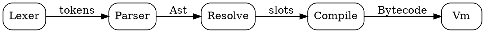
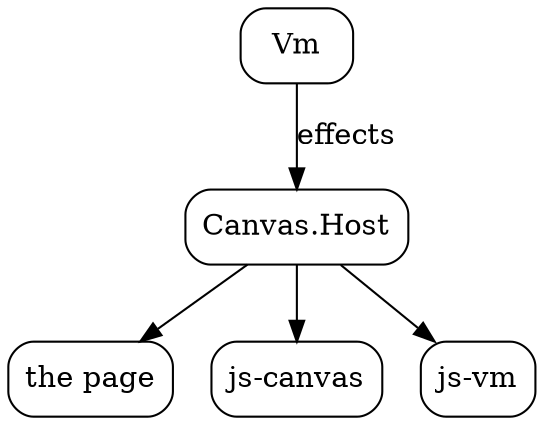

# A JavaScript Interpreter in Roc

A small book about roc-apps' `js/` project: a bytecode VM for a subset of JavaScript, written in Roc, and what building it taught about Roc's values, its two backends and its build times.

## Introduction

The `js/` project in [roc-apps](https://github.com/showell/roc-apps) is an interpreter for a subset of JavaScript, written in [Roc](https://www.roc-lang.org/). It runs as a command-line program, `js-vm`, and in a browser playground at [roc.lynrummy.com/js/](https://roc.lynrummy.com/js/), where a program draws on a canvas as it runs and a memory view shows its heap over time.

This book is for a reader who knows programming and is new to this codebase, and above all for one curious about writing a language's runtime in a language that has only values. AI coding agents (Claude) wrote the code, with human supervision, over two days, 2026-11-23 and 2026-11-24.

### What it runs

The subset is real JavaScript: numbers, strings, arrays, objects, closures, `let` and `const`, `try` and `finally`, `switch`, destructuring, optional chains, spread, Maps and Sets, and the timers. `this`, `new` on a program's own function, prototypes and classes stay outside it, and `js/README.md` says why: each would make every call carry a receiver or every property read walk a prototype chain, and each is a large step.

Here is one of the playground's samples, a turtle drawing a spiral:

{{file js/canvas/2-turtle-spiral.js}}

### Who judges it

Every program in the subset is real JavaScript, so node is a free oracle. `js/oracle.shale` runs each program in `js/tests/` through node 22 and through `js-vm`, and the two transcripts, exit codes included, must match byte for byte. A program outside the subset gets an error that names what it used: each program in `js/tests/refused/` names, on its first line, the message `js-vm` must end with. The corpus grew from 32 programs and 25 refusals on the first day (`cfe7c5fc`) to 55 and 44 (`js/README.md`, its status of 2026-11-24). Program 54, `54-big-daddy.js`, is a day in a small city that uses every feature of the subset, and it is also the playground's "all features" sample (`06ab1f8b`, `17977264`).

### Where the numbers come from

Each number in this book comes from a commit message in roc-apps, cited by its short hash, from `js/README.md`, or from another file of the repository, named where it is used. Code is quoted from the repository as it stands when the book is built.

{{chapter How it got here}} is the project's short history. The design starts at {{chapter The pipeline and the machine}}.

## How it got here

This chapter is the history, kept brief. A reader who wants the design can skip ahead to {{chapter The pipeline and the machine}}.

### A tree-walker first

The first interpreter walked the tree (`1ad0c76a`). Its whole state was one value threaded through the walk: the heap, the scopes, the output and the step count. The same day it gained the node oracle, a wasm page with an editor and a Run button (`e809c922`), copy probes and exact allocation counts (`7e32c784`, `64a42c08`), variables resolved to slots before the run (`76adf75b`), a canvas library behind a host of effects (`95112668`, `a2ac2fdb`), and timers and clicks on one queue with a virtual clock (`ba5e1bdd`). By the end of the day the walker passed 50 of 50 corpus programs and 44 of 44 refusals.

### The VM, in three rounds

The bytecode VM was built beside the walker in three rounds on 2026-11-24. The first round (`ba3ed12c`) brought the compiler and the stack machine, and refused what it had yet to cover as `js: unsupported (vm): ...`: 37 of 50 programs matched node, the VM refused the other 13, and every answer it gave was right. The second round (`ff1474f1`, `a43c8f46`) added exceptions, `switch`, labels, destructuring, optional chains, Maps and Sets, and the timers, and brought the VM to 50 of 50 and 44 of 44. The third round (`ab1798ec`, `6665e55a`) added a mark-sweep collector. Before it, the programs in `js/heaps/` peaked at 164, 164, 40 and 64 MB; after it, each holds about 1,024 cells and peaks at 3.8 to 4.1 MB on the dev build (`70271947`).

### The page, and the walker's end

The playground moved onto the VM next: the canvas samples (`0b1efafa`), then the page (`a9a06e74`). Then the walker was deleted (`1c1c9e7e`): `Interp.roc`, `js-run` and `js-count` went, and the VM's expected-count files took the walker's names, so the check tier stayed the same.

The page gained a memory view (`4d891f1f`, `4e5dd15b`): a popup with the last run's heap over time. Then came a speed fix (`c1050677`), the subject of {{chapter What copies}}.

### Garbage you can watch

Two samples followed for the memory view. `js/tests/55-garbage.js` makes 1,800 short-lived pieces, an object, an array and a closure each, in 12 rounds, so the memory view's sawtooth shows its teeth; node holds it like every corpus program, and the page lists it third (`3ce0f676`). `onCollect(fn)` is a playground extra, like `onClick` and outside JavaScript: its handler hears each collection after the sweep, as an event that runs between instructions, as a timer does. Node keeps its own collector hidden from a program, so the canvas log `9-garbage-heard` holds that sample, in `js-canvas` and on the page (`ad87080c`). The handler sits in the boxed event queue, so a program that ignores `onCollect` pays one match inside each collection and runs every instruction as before.

## The pipeline and the machine

A program's text becomes a run in five stages, each a module in `js/roc/`. This chapter follows a program through them, then looks at the one value the run works on: the machine.

### The pipeline

From the text to the run

- **`Lexer.roc`** makes tokens, each with its line and column.
- **`Parser.roc`** reads them into `Ast.roc`'s tree by recursive descent, and lays out each scope's names as it goes.
- **`Resolve.roc`** places every name before the run: each read, write and declaration learns how many scopes out its variable lives and where it sits there. The interpreter then reads a variable by its place, and compares names only here.
- **`Compile.roc`** lays out each function's frame and makes each function, and the program itself, a flat list of `Bytecode.roc`'s instructions. Every jump is relative to the instruction after it, so a piece of compiled code means the same wherever it lands.
- **`Vm.roc`** runs them on a stack machine.

Beside them, `Inspect.roc` formats `console.log`'s output as node's `util.inspect` does, function for function, and `NumberText.roc` writes a number as `String(n)` does.

### The loop only dispatches

The VM's loop fetches the next instruction and hands the machine to `dispatch!`, whose match calls one top-level handler an arm. Each handler is a small function of its own, so the language grows by adding handlers and every function stays small. Here is the heart of the loop, a collection first when one is due:

{{lines js/roc/Vm.roc from "while is_running($machine)" to "$machine = dispatch!("}}

### The heap is one Roc value

JavaScript shares arrays, objects and closures by reference: two variables that hold one array see each other's writes. Roc has only values. So the interpreter keeps everything JavaScript shares in one list of cells, the heap, and a JavaScript reference is an index into it. A cell is one of these:

{{lines js/roc/Heap.roc from "Cell : [" to "Freed(Heap.Free),"}}

Roc writes a list in place only while it is the list's sole owner, so a single stray reference to the heap makes every write copy the whole heap. `js/README.md`, "Why the heap is one value", lists the shapes that keep the heap unique, each with a comment where it is used:

- a cell is written by `List.update`, which hands its function the cell as the sole owner;
- a writer gets the list straight from the record it updates, `{ ..machine, cells: Heap.with_property(machine.cells, ...) }`;
- a result is taken apart where it is answered, so its machine lives on alone;
- a writer asks what a cell is (`ValueRules.kind_of`), and leaves the cell in the heap;
- a stack place given up is cleared to `Null`;
- a loop over the machine is a `var $st` loop, so the machine stays out of every closure;
- the host travels as an argument of its own, beside the machine.

### The machine

Everything a run holds is one record, `Vm.Machine`, handed to each instruction's handler and handed back:

{{lines js/roc/Vm.roc from "Machine : {" to "turtle : Box(Canvas.Turtle),"}}

The boxes are the subject of {{chapter What copies}}: each boxed part is one that most instructions leave alone.

### Slots and boxes

A call's frame is a run of slots on the operand stack, starting at its base: its parameters, then the variables its blocks and loops declare, then the hidden slots its `for ... of` loops keep their place in, then the boxes of the variables it captures. An instruction names a slot by its place from the base, so reading a local is one index into the stack. The values a function is working on sit above its slots, and the callers' frames wait in `frames`.

A variable that a closure may capture lives in a box: a heap cell, `Variable`, that the frame and its closures share. The parser marks each scope that holds a function literal (`Ast.Capture`), and only those scopes box their variables; the rest stay plain slots. A closure's `Fun` cell names an `Environment` cell, which holds its code's number and the boxes it captures. A `for` loop whose body makes closures gives each pass a fresh box, as JavaScript's `let` requires.

So everything a program holds is data: the stack, the frames and the cells. That is what lets a collector find it all.

## The collector, the rules and the host

This chapter covers the parts around the loop: the collector that frees the heap's cells, the two modules every run shares, the host that carries the effects, and the page.

### The collector and its roots

`Collector.roc` is a precise mark and sweep that keeps every live cell where it is. The VM names its roots, `marked` follows every reference from them through the cells, and `swept` turns each unmarked cell into a `Freed` cell linked into the free list, which `Heap.allocated` takes from before it grows the heap. A live cell keeps its place, so a reference stays the index it was.

The roots are the machine's data:

{{function js/roc/Vm.roc roots}}

A collection is due when the free list is empty and the heap has reached its threshold. After each one, the threshold is twice what the collection kept, and at least 1,024 cells:

{{function js/roc/Vm.roc is_collection_due}}

Between two instructions every value the program holds is in the machine. The one exception is a builtin that runs a callback, such as `filter` or `sort`: what it keeps across the callback waits on the stack, where the collections inside the callback see it. A live value that names a freed cell stops the run, since it means a root was missed.

### ValueRules and Events

Two modules serve everything that runs a program.

**`ValueRules`** holds JavaScript's rules for values: property reads and writes, operators on mixed values, the methods of strings, arrays, Maps and Sets, and the errors they throw, each message in one place. The VM's fast paths settle the common cases (numbers, an object's own property, an array's item) and hand the rest to a rule. A rule takes a small machine of the cells and the run's status, `ValueRules.Machine`: the VM lends it the cells and takes back what the rule gives, so the cells have one owner while the rule writes them. The module was split out of the walker when the VM borrowed it (`f9dd79d0`), and for a while both engines used it.

**`Events`** holds the queue of callbacks and its virtual clock (`a43c8f46`). A timer's callback, a click, the canvas's next `frame(t)` and a collection `onCollect` hears are each an event, due at a time in milliseconds, run earliest first, and two at one time in the order they were queued. The clock reads 0 while the program runs and moves to each callback's time as it runs, so a program's output is the same on every run and the same as node's.

### The host and its effects

The interpreter reaches the world through a host, `Canvas.Host`, a record of four effectful functions:

{{lines js/roc/Canvas.roc from "Host : {" to "collected! : {"}}

An effect happens when the program calls for it: the VM hands each one to `emit!` in program order, `console.log` included, so a program that stops halfway has drawn what it drew before the stop. A read, `pointer!` or `key!`, is asked of the host when the program asks. `collected!` hears of each collection once it has swept. Every effect has one written form, `Canvas.line_of`, so a sample's golden log is the very text the page paints from.

Three hosts, one interpreter

- **The page's** host (`JsApp.roc`, on the platform in `js/wasm/`) calls into the page's JavaScript while the Roc call runs.
- **The recording host,** `js-canvas` (`JsCanvas.roc`), writes every effect and every read as a line, for the golden logs.
- **`js-vm`'s** host prints each log as it is made.

### The page

The page is `js/web/`. `js_page.js` makes everything the page shows, its styles included, so the HTML is only a door: an editor, the canvas and the console. `js_runner.js` is the door onto `js.wasm`: it starts a program, then calls it a frame at a time, about 30 times a second, each frame a tick of the program's clock (`Vm.tick!`) that runs the clicks queued since the last tick, the timers due and `frame(t)`. `js_painter.js` paints each effect's line on a 2D canvas as it arrives, and the browser shows the canvas when the frame's call returns.

The memory view, `js_memory.js`, is a popup with two small charts of the last run. The top one is the heap's cells in use, which climb as the program allocates and drop at each collection, a sawtooth; the bottom one is the wasm memory's size. The VM reports each collection through `collected!`, so the count lives in the host, outside the machine.

`js/build.shale` names every file but `index.html` by its bytes, so a browser always loads the scripts that match its page, and it replaces the page only after `js/page_check.mjs` passes.

## What copies

The project's performance work came down to three rules about Roc values.

### A value is copied when it is handed on

Every VM instruction takes the machine and hands it back, and a handler copies the machine record on the way in. A record update copies the record around the field it writes, inline sub-records included (`docs/roc-notes.md`, "Speed and copying").

### Box what is rarely written

A part of the machine that most instructions leave alone costs a copy on every instruction if it sits inline. The event queue was the first example: only timers and clicks touch it, yet inline it made the release build's fib(22) take 123 ms; boxed, 82 ms (`3ad69676`). The inline queue cost about 50% more time. `docs/roc-notes.md` adds the qualification: a `Box` carried untouched is free, but every write re-boxes, one allocation per write, so a box suits a part that is rarely written after it is made.

### Stay under 256 bytes

LLVM copies a record of up to 256 bytes with eight vector moves, and calls `memcpy` for a bigger one. The collector's fields, the budget and the boxed turtle took the machine from 232 to 312 bytes, so every instruction paid a `memcpy` call. Boxing the collector's schedule alone left it at 288 bytes, still past the line, which is why that change left the times as they were. Boxing the builtins, the collector's schedule and count, and the step and effect budgets brought it to 248 bytes (`c1050677`):

| release build, best of five, CPU | 312 bytes | 248 bytes |
|---|---|---|
| fib(22) | 110 ms | 99 ms |
| nested loops | 495 ms | 439 ms |
| `memcpy` in fib's profile | 16% | absent |

The lesson in `js/README.md` is that a field added inline counts against the 256, and boxing one part pays off only once the whole machine is back under the line. The line is a cliff: a machine past it pays the whole `memcpy`.

## Dev and release builds disagree

Roc has two backends. The dev backend (`--opt=dev`) compiles in about a second and emits code that is mostly stack moves. The release build (`--opt=speed`) goes through LLVM, runs much faster, and compiles slowly. The two builds disagree about allocations, about time and about copies, and this project met each disagreement.

### Allocation counts

`js/controls/` holds nine small programs, each a loop that does one kind of write. `js/controls.shale` runs each at 1,000 and 10,000 passes, counts `roc_alloc`'s calls exactly, and holds what one pass allocates to `expected.txt` (release) and `expected-dev.txt` (dev). A control left out of a file is held to 0.

| control | dev | release |
|---|---|---|
| 00-loop | 0 | 0 |
| 01-array-store | 1 | 0 |
| 02-closure-call | 1 | 0 |
| 03-string-building | 0 | 0 |
| 04-property-write | 1 | 0 |
| 05-array-push | 2 | 1 |
| 06-push-pop | 2 | 1 |
| 07-map-set | 4.08 | 2.08 |
| 08-garbage-in-a-call | 3.04 | 1 |

Most of the difference is one cause. The dev build lowers closures to boxes, so a `List.update` whose lambda captures a value that holds a reference count (a key, a value, a list) allocates once per write to box the capture. That allocation is a box and the list stays in place, and the release build makes it zero times (the files' own comments say so line by line). One dev allocation remains unexplained: 02-closure-call's 112-byte list per call, which roc-alloc-trace puts down to `Vm.pushed` and which three rewrites left in place (`js/README.md`).

This difference forced a decision. The walker's heap writers were first rewritten as `List.update` calls (`bece7bda`); the release build held every control, and four dev controls rose by one. The change was reverted (`63f8149b`), then brought back (`324756a6`) under the rule that Roc code should read well and play well with tooling, even at the cost of a little noise in dev builds. The dev expected file was rewritten, and every new line in it explains its allocation.

### Copies that happen only in dev

Some copies are made only by the dev build, at a helper's boundary: there a helper stays a call that owns its arguments, where the release build specializes it first. `docs/roc-notes.md` lists three such shapes. This project met two kinds:

- **A rule generic over the whole machine.** When `ValueRules` was split out, a version that took the engine's whole machine as an open record came first. The dev build copied the cells a rule wrote through it (a probe measured 3 allocations a write against 1), and the walker's dev controls went red, 05-array-push rising from 3 to 12.73 a pass (`f9dd79d0`). The rules now take a small machine of the cells, which the VM lends and takes back.
- **A planted copy the release build optimized away.** Twice, a `List.drop_last` was planted back into the walker's scope handling. Each time the dev ladder went red on 02-closure-call alone (15 to 16 in `76adf75b`, 3 to 4 in `b7d66601`) and the release ladder stayed green, because the release build makes zero copies there.

The second case is why the dev ladder is useful: it sees copies the release build optimizes away, and those copies are often a sign of a shape that will copy in release once the code around it changes.

### Timings

Dev timings fail to predict release timings, even in direction.

| change | dev fib(22) | release fib(22) | source |
|---|---|---|---|
| walker: variables read by slot | 674 to 435 ms | 83 to 67 ms | `76adf75b` |
| walker: loops, same change | 4,387 to 2,105 ms | 486 to 475 ms | `76adf75b` |
| walker: the Map control's branch against master | 676 to 642 ms | 121 to 169 ms | `54be42fb` |
| VM today | about 860 ms | 99 ms | `js/README.md` |

The first two rows show a change that halved the dev time of the loops while moving the release time by 11 ms. The third shows a branch that was faster than master on dev and 40% slower in release. Today the release build runs fib(22) about nine times faster than the dev build (860 against 99 ms).

### Rails

The page runs a program on the browser's main thread, so it holds the program to step budgets: 3,000,000 steps before the first frame and 300,000 a frame. The walker counted statements; the VM counts calls and loop passes, so the same budget covers about twice the work. On the dev backend the walker took 1.1 s of CPU to run out a frame's budget and 5.2 s for a program's; the VM takes 2.0 s and 8.8 s (`a9a06e74`, `js/README.md`, "Pitfalls").

### What each build is for

roc-apps' `CLAUDE.md` (section 9) and `js/README.md` give each build its job. Screen on the dev build: allocation counts are deterministic, so a change that moves one shows on the dev ladder in seconds, and most trials end there. Measure on the release build, once per round, from one shared build (`tools/roc_build.shale` keys each build by its inputs, so a ladder, a timing and a heap probe of the same tree share it). A dev-build timing says little about the program.

## Build times

RC1's release builds were the project's slowest loop. The walker's release build grew with the language: 65 s when the controls first landed (`64a42c08`), 686 s after the language gaps (`a3af13f4`), and 1,052 s for `js-run` at the commit tagged `rc1-slow-release-build`, for about 10,000 lines of Roc, against under a second on dev (the tag's message). Commit `762c7d3a` gives the JavaScript tier's release build as 11 to 17 minutes and puts most of the time in RC1's SpecConstr pass.

The VM's release build was 670 s in its first round (`f4237b8a`), when it still imported the walker's module for the value rules. After the value rules moved into a module of their own and the VM dropped its import of the walker (`f9dd79d0`), it was 84 s (`3ad69676`, `2edd155a`), while `js-run` still took 481 s. The record shows the drop following the split; reading the split as its cause is an inference from that order. Later figures are 110 s after the collector (`de56943f`) and 91 s in `js/README.md`'s status line.

## How it is tested

A check is trusted once it has been seen to fail. Each check below holds the code to a fixed answer, and each count is exact.

### The oracle against node

`js/oracle.shale`, a tier of the default `check.shale`, holds every corpus program's transcript and exit code to node's, 55 of them, and every refusal to its message. Every program runs, and the run fails if any one fails. It also runs with `collect=every`, which collects after every instruction that allocates, and programs 51 to 53 hold values through each kind of root while collections run.

### Controls held exactly

`check.shale js=1` runs the nine allocation controls of {{chapter Dev and release builds disagree}}, in both builds. A missing expected file fails the run (`6b13e927`).

### Golden logs for the canvas

`js/canvas.shale` holds each of the 9 canvas samples to its log of effects for scripted frames, keys and clicks, and a log moves only by an explicit freeze.

### page_check

`js/page_check.mjs` drives the page's own JavaScript under node. It holds the wasm to node on every corpus program and refusal, holds the samples to their golden logs, and checks the memory view. The page is replaced only after it passes.

### Planted faults

The record has many plants, each reverted:

- a line width of 72 instead of 80 turned one program red (`cfe7c5fc`);
- the event queue left out of the roots turned 52 red, and `filter`'s item left off the stack turned 53 red (`2094d365`);
- a wrong expected count turned 00-loop red by name (`6b13e927`);
- a memory view with its collection marks taken out turned page_check red (`4d891f1f`).

## What is left

These come from `js/README.md` and the record:

- 02-closure-call's 112-byte dev allocation per call is still unexplained.
- The VM throws a RangeError at 400 nested calls, where node goes much deeper.
- A Map or a Set keeps a place for every key it ever held, so a table that many keys pass through grows with them.
- `js-vm` takes the program as one command-line argument, limited to 128 KiB.
- `onCollect` and the other canvas builtins are this project's own, so logs of effects judge them in place of node.
- `this`, `new` on a program's function and classes remain outside the subset, for the reasons in {{chapter Introduction}}.

## Appendix A: The playground's samples

Each of these runs in [the playground](https://roc.lynrummy.com/js/), where it can be changed and run again.

{{listing samples}}

### The page's own console samples

These are written in `js/web/js_page.js` itself, and the page offers them last.

{{lines js/web/js_page.js from "const CONSOLE_SAMPLES = [" to "const asConsole = "}}

## Appendix B: The tested programs

### The corpus

Each program prints what node prints, and `js/oracle.shale` holds the VM to it.

{{listing corpus}}

### The refused programs

The VM refuses each program with the message its first line gives.

{{listing refused}}
